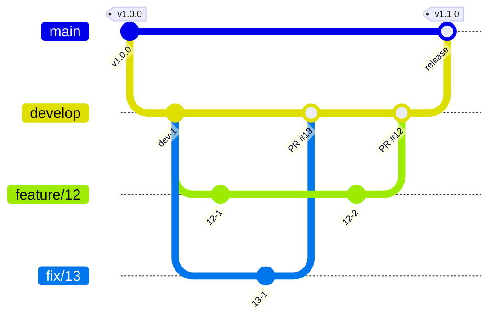

# 開発の準備

必要なものは mise である。Node.js と apm のバージョンは `mise.toml` に、pnpm のバージョンは `package.json` の `packageManager` にある。

```sh
mise install
pnpm install
```

`pnpm install` は、`prepare` で lefthook の Git のフックを入れる。

スキルとフックは apm で配置し、Git で追跡しない。  
clone した後の最初のセッションで、セッションの開始のフックが配置する。手で配置するときは次を実行する。

```sh
apm install --frozen
```

`apm install` の後に配置先を `.gitignore` に足す post-install は、マシンごとに 1 度信頼させる。

```sh
apm lifecycle trust
```

## 文書を直すとき

文章の規則は textlint で、経緯の混入とリンクは docs のスクリプトで確認する。指摘された語は言い換え、`--fix` は使わない。

```sh
pnpm exec textlint <直した Markdown>
node .claude/hooks/docs/hooks/check-history.mjs
node .claude/hooks/docs/hooks/check-links.mjs
```

既存の文書には textlint の指摘が残っている。直した文書だけに掛け、CI も pull request で変えた Markdown だけを見る。

`verified_commit` の後に実装が変わった文書は、`node .claude/hooks/docs/hooks/list-drift.mjs` で一覧する。実装と読み比べてから `verified_commit` を進める。

## E2E のテストを直すとき

E2E は、workspace の `@kufu/e2e`（`e2e/`）にある。テストのコードは `e2e/tests/` の層に置き、書き方の規則は `pnpm check` が流す。

```sh
pnpm e2e
pnpm check
pnpm typecheck
```

層、testid の名前、書き方の規則の更新の手順は、[context/testing/e2e.md](context/testing/e2e.md) にある。

## デザインシステムを直すとき

トークン、コンポーネント、デザインシステムの文書、カタログのページは、同じ変更で直す。書き方の規則は、スキル write-design-system と [DESIGN.md](packages/ui/DESIGN.md) にある。

文書は `packages/ui/DESIGN.md` と `packages/ui/design/` にある。トークンの 3 つの層は `packages/ui/src/tokens/` にある。

トークンの 3 つの層と、暗い面（`.surface-inverse`）のファイル `surface-inverse.css` は、`packages/ui/src/tokens/` にある。

コントラストと色の値のチェックは、次のコマンドで流す。`pnpm check` と CI も、このコマンドを流す。

```sh
pnpm check:design
```

`check:design` は、次の 3 つを順に流す。

- `node scripts/check-contrast.mjs`: 通常の面のセマンティックトークンの組のコントラスト
- `node scripts/check-contrast.mjs --root .surface-inverse <3 つのファイル>`: 暗い面の組のコントラスト
- `node scripts/check-raw-values.mjs`: corporate-site と `packages/ui` のコードの、色の値とプリミティブトークンの名前

チェックから外している組と理由は、[packages/ui/design/tokens.md](packages/ui/design/tokens.md) にある。

## spec を書くとき

spec の節の構成と書き方は、スキル write-design-docs が持つ。このリポジトリだけの取り決めを次に書く。

### 名前

- ディレクトリ名は `docs/specs/<issue 番号>-<slug>/` にする。slug は英小文字、数字、ハイフンで書く。
- 最初に読む文書は `index.md` にする。開発プロセスの宣言を置くときは、同じディレクトリの `process.yml` に書く。
- issue の番号がない一時の下書きだけ、`docs/specs/draft-<yyyymmdd>-<slug>/` に置く。番号がついたら、正式な名前に改める。

### 必須の確認

新しい spec を作るときは、次を確認する。

- Design Doc の更新が要るか。
- ADR の起票が要るか。
- コーポレートサイトの performance に影響するか。
- UI を共通化するか。app と feature の中で閉じる UI は、`packages/ui` へ寄せない。複数の feature か app にまたがる再利用が明確なものだけを共通化する。
- React Compiler と互換か。
- E2E、Storybook、unit test が要るか。

### spec を閉じるとき

spec は issue の作業文書なので、issue を閉じるときに削除する。判断の根拠は [ADR-0011](docs/adr/0011-specs-closeout-enforcement.md) にある。次の順に進める。

1. 残す設計（IA、データモデル、フロー、アーキテクチャの判断）が、Design Doc、context、ADR に反映済みかを確認する。
2. 反映していない分を反映する。選択肢を比べて決めた判断は ADR にする。
3. 削除する spec を指すリンクを、issue のリンクなどに置き換える。削除した spec を基準の文書として扱わない。
4. spec のディレクトリを削除し、`pnpm check:specs` で残りがないことを確認する。

手順 1 から 3 を終えるまで削除しない。issue を閉じると、手順 4 の削除の pull request を [`.github/workflows/spec-closeout.yml`](.github/workflows/spec-closeout.yml) が起票する。その pull request をマージするかどうかが削除の判断であり、手順 1 から 3 の確認は本文のチェックリストで行う。閉じる pull request に spec の削除を含めた場合は起票されない。

## コミットするとき

コミットと push の前に、lefthook が次を確認する。設定は `lefthook.yml` にある。

- 保護するブランチへの直接のコミットと push を止める。
- ステージしたファイルを `vp fmt` で整形し、`pnpm check` を実行し、Markdown に textlint を掛ける。
- commit-msg のフックで、commitlint がメッセージの形式を確認する。規則は `commitlint.config.mjs` にある。

- 変更の分け方とメッセージの書き方は、スキル write-commit に従う。

## ブランチとリリース

<!-- 次はデフォルトの運用。運用が違えば本文と図を書き換える -->

ブランチは、`main`、`develop`、issue ごとの作業用のブランチにする。

- `main` はリリース済みの状態を指す。`develop` は次のリリースに向けて変更を集める。
- 作業用のブランチは `develop` から切る。名前は `feature/<issue 番号>` にし、不具合は `fix/<issue 番号>` にする。`develop` へは、pull request を通してマージする。
- リリースは、`develop` を `main` へ pull request でマージし、`main` のコミットにタグを付ける。バージョンはセマンティック バージョニングに従う。
- リリース後の緊急の修正は、`main` から `hotfix/<issue 番号>` を切り、`main` と `develop` の両方へマージする。
- 保護するブランチは `main`、`develop` である。直接はコミットせず、pull request を通してマージする。直接コミットを許す場面があれば、この行の下に場面と理由を書く。

<!-- 次のバージョンを何から決めるか。コミットメッセージからなら release-please、変更ごとの記述からなら changesets -->



## issue と pull request

<!-- issue の種類とラベル、pull request との対応 -->

- 作業は issue から始める。pull request は 1 つの issue に対応させる。
- 題と本文の書き方は、スキル write-issue-pr に従う。
