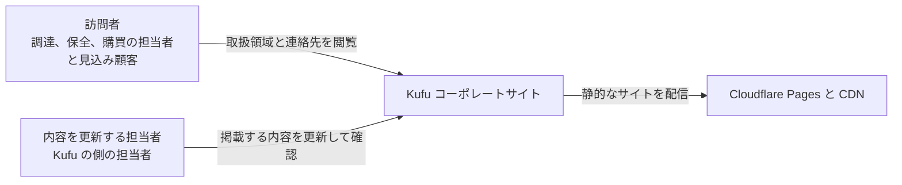

# Kufu Monorepo PRD

## Overview / Problem Statement

Kufu Monorepo は、Kufu のコーポレートサイトと、共通の UI、設定、テストの基盤を 1 つのリポジトリで管理する。  
主な目的は、コーポレートサイトを高い表示の速さと保守のしやすさを保って公開することである。

調達、保全、購買の担当者と見込み顧客は、Kufu の取扱製品のカテゴリ、メーカー、加工と販売の対応範囲、問い合わせ先を短時間で確かめる場所を持たない。  
そのため、Kufu に相談できる対象かを判断できず、問い合わせの機会を逃しやすい。  
見込み顧客が会社の情報と連絡先を確かめ、電話、FAX、メール、フォームのどれかで Kufu に連絡できる状態が要る。

内容を更新する担当者は、会社概要、取扱製品、メーカーの情報を安全に更新して確かめるための基準の文書と手順を持たない。

## Background

### コーポレートサイトは表示の速さと運用のしやすさで価値が決まる

コーポレートサイトは、表示の速さ、情報の分かりやすさ、公開の前の検証が重要である。  
不要な React 化とクライアントの JavaScript の増加は、表示の速さを損なう。

### サイト、共通の UI、設定を別々に育てると、構成と品質の基準が散らばる

コーポレートサイト、共通の UI、設定が別々に成長すると、構成と品質の基準が分散しやすい。  
AI エージェントに実装を頼むとき、責務の境界と技術の選定が曖昧だと、不要な React 化と UI の重複した実装が起きやすい。  
app と package の責務と、AI エージェント向けの規則を文書にしておけば、拡張するときもコーポレートサイトの性能と monorepo の一貫性を守れる。

## Goals

対象の利用者は次の 4 者。

- 工業製品と機械工具の調達、保全、購買の担当者: Kufu が扱う製品のカテゴリ、メーカー、加工と販売の対応範囲、問い合わせ先を短時間で把握したい。
- 既存の取引先と、紹介で来た見込み顧客: 会社の情報、連絡先、取扱領域を確かめ、電話、FAX、メール、フォームのどれかで連絡したい。
- Kufu の側で内容を更新し公開する担当者: 会社概要、取扱製品、メーカーの情報、問い合わせへの導線を安全に更新して確かめたい。
- 実装と保守をする開発者と AI エージェント: app と package の責務の境界を参照し、不要な React 化と UI の重複を避けたい。
  - 開発者と AI エージェントは、訪問者に向けた価値を安全に実装し運用するための関係者として扱う。主な対象は訪問者である。

提供する結果は次の 4 つ。

1. 訪問者が、Kufu の取扱領域と問い合わせの方法を短時間で判断できるコーポレートサイトを公開する。
2. 内容を更新する担当者が、会社の情報、取扱製品、メーカーの情報を安全に更新できる基準の文書と、確かめる手順を用意する。
3. app を足しても崩れない monorepo の境界を保つ。
4. AI エージェント向けの設定と spec の流れで、実装を頼むときの判断のぶれを減らす。

## Lower-Priority Goals

- コーポレートサイトに掲載する投稿を管理する app（`apps/cms`）
  - 掲載する投稿を管理画面で作って更新し、コーポレートサイトへ公開する。
  - 立ち上げるかの判断は [Open Questions](#open-questions) にある。
  - ADR-0003: [Phase 1 は corporate-site だけを実装する](adr/0003-phase1-corporate-site-only-and-cms-deferred.md)

## Non-Goals

- CMS と API、認証、管理画面、業務のツールを作ること。
- Astro で完結できるコーポレートサイトの機能を React へ移すこと。
- 用途が決まらないまま `packages/ui` を抽象化しすぎること。
- 汎用の UI のライブラリを整えすぎること。

## User Stories

### 調達と保全の担当者が、Kufu に相談できる対象かを判断できない

調達と保全の担当者は、取扱製品のカテゴリとメーカーを確かめて、Kufu に相談できる対象かを判断したい。  
How Might We: 担当者が、取扱製品のカテゴリとメーカーを短時間で確かめられるようにするには。

### 見込み顧客が、会社概要と問い合わせ先をすぐに確かめられない

見込み顧客は、会社概要と問い合わせ先をすばやく確かめて、電話、FAX、メール、フォームのどれかで連絡したい。  
How Might We: 見込み顧客が、どのページからも問い合わせ先へ着けるようにするには。

### 内容を更新する担当者が、会社の情報の基準と掲載箇所を把握できない

内容を更新する担当者は、会社の情報と取扱の情報の基準と掲載箇所を把握して、公開するサイトを安全に更新したい。  
How Might We: 担当者が、掲載する情報の基準の文書と、それが載るページを辿れるようにするには。

### 開発者と AI エージェントが、対象の app と禁止事項を把握できない

開発者と AI エージェントは、対象の app と package と禁止事項をはっきり把握して、プロジェクトの方針に沿って実装したい。  
How Might We: 実装の前に、設計、ADR、context の基準の文書を確かめられるようにするには。

## Proposed Solution / Feature Description

### Landscape

訪問者は取扱領域と連絡先を閲覧し、内容を更新する担当者は掲載する内容を更新して確かめる。  
コーポレートサイトは Cloudflare から配信する。

### コーポレートサイト

コーポレートサイトは、トップ、取扱製品、お問い合わせの 3 つのページと、全ページに共通のヘッダーとフッターで構成する。  
ADR-0006: [corporate-site の IA を 3 route にする](adr/0006-corporate-site-three-route-ia.md)

- トップ（`/`）: 経営理念と事業の要約、販売と加工の事業の紹介、取扱製品の 18 のカテゴリの索引、会社の情報を載せる。
- 取扱製品（`/products`）: 18 のカテゴリごとに、取り扱うメーカーをすべて並べる。カテゴリとメーカーを検索できる。
- お問い合わせ（`/contact`）: 電話、FAX、メールの連絡先と、問い合わせのフォームを載せる。
- 全ページに共通: ヘッダーのナビゲーションと問い合わせへの導線を持ち、どのページからも問い合わせ先へ着ける。

ページの構成と、情報をどこに置くかは [コーポレートサイトの Design Doc](apps/corporate-site/DesignDoc.md#ページの構成) にある。

### 問い合わせフォーム

訪問者は、お問い合わせのページのフォームから問い合わせを送れる。  
フォームは電話、FAX、メールと並ぶ補助の導線で、送信に失敗しても電話、FAX、メールで連絡できるようにする。  
入力した内容は問い合わせへの対応にだけ使い、Kufu へメールで知らせる。

送信の仕組みは決めてあるが、まだ作っていない。  
ADR-0009: [corporate-site の問い合わせフォームの backend](adr/0009-corporate-site-contact-form-backend.md)

### 掲載する内容の基準

会社概要、業務の内容、取扱製品のカテゴリ、取扱メーカーの基準の文書を、リポジトリに置く。  
内容を更新する担当者は、基準の文書を直し、pull request のレビューと表示の確認を経て公開する。

### Milestones

#### Phase 1: コーポレートサイトの公開

コーポレートサイトの 3 つのページと、掲載する内容の基準を提供する。  
問い合わせフォームの送信を提供する時期は未定。  
app を実装する対象は `apps/corporate-site` だけにする。  
ADR-0003: [Phase 1 は corporate-site だけを実装する](adr/0003-phase1-corporate-site-only-and-cms-deferred.md)

確かめる問いは未定。

#### Phase 2: 投稿の管理

`apps/cms` を立ち上げると判断したときに始める。  
提供する機能と確かめる問いは未定。

### Success Metrics

- コーポレートサイトを、公開できる状態でビルドできる。
  - `pnpm build` が毎回成功する。
- 訪問者が、取扱領域と問い合わせ先へ着ける。
  - `/`、`/products`、`/contact` の主な route と問い合わせへの導線を、Playwright の E2E で通す。
- Astro の静的な生成と、island を最小にする方針を守る。
  - 表示だけの UI に、不要な island を 1 件も足さない。client directive と React の island をレビューで確かめ、要るときは bundle と Lighthouse で確かめる。
- 掲載する内容の基準と掲載箇所を追える。
  - 会社概要、取扱製品、メーカーの情報について、基準の文書へのリンクを保つ。`design/features/corporate-site/reference/` とコーポレートサイトの Design Doc の対応で確かめる。
- AI エージェントと開発者が、責務の境界を参照できる。
  - 実装の前に、Design Doc、ADR、context の基準の文書へのリンクを確かめられる。

次の 4 つを、悪化させない指標として数える。

- 不要なクライアントの JavaScript の数: Astro のコーポレートサイトに、不要な client directive か React の island が増えた件数。コーポレートサイトの性能の劣化を防ぐ。
- UI の重複の数: app の配下で、共通にすべき UI を重ねて実装した件数。一貫性を守る。
- package の境界の違反の数: app から非公開の実装か、別の app の内部へ依存した件数。monorepo の境界を守る。
- React Compiler に合わない実装の数: React Compiler に対応しないライブラリか実装が、確かめずに入った件数。React の側の技術的負債を抑える。

package の境界の違反は、リポジトリのチェック（`pnpm depcruise` と `pnpm knip`）が検出した件数で数える。  
ほかの 3 つは、pull request のレビューで見つけた件数で数える。

数値の目標（Lighthouse のスコア、問い合わせへの転換率、訪問の数）は決まっていない。  
決めるまでは、ビルド、E2E、island の方針、基準の文書へのリンクを、確かめられる条件にする。

## Open Questions / Risks

### Open Questions

- コーポレートサイトを公開した後の事業の KPI（訪問の数、問い合わせへの転換率など）を、どの指標で見るか。
  - Kufu の owner が、公開の後に決める。
- Lighthouse と bundle の大きさの性能予算を、具体的にいくつにするか。
  - 開発者と Kufu の owner が、公開の前の検証で決める。それまでは Astro の静的な生成と、不要な island を 0 件にすることを守る。
- `packages/ui` を本格的な共有の package へ移す判断の条件は何か。
  - 開発者と Kufu の owner が、2 つ目の UI の利用者が出る前に決める。それまでは corporate-site の中に置くことを優先する。
- `apps/cms` を立ち上げるか。
  - Kufu の owner が、着手の前に決める。投稿の数、更新の頻度、運用者の人数、外部の編集者の有無で判断する。
  - 実装の issue を起こす前に、次の 4 つを満たす。
    - CMS が要る業務の理由が具体的になっている。
    - 管理する内容、更新の頻度、運用者、承認の流れが決まっている。
    - 認証、権限、監査、プレビューでの公開の要件が決まっている。
    - React の app の標準の候補について、最新版の API と React Compiler への対応を確かめている。候補は [CMS の Design Doc](design/features/cms/DesignDoc.md) にある。
- コーポレートサイトの内容を更新する責務を誰が持ち、どう承認するか。
  - Kufu の owner が、最初の運用を始める前に決める。CMS を入れるまでは、リポジトリの基準の文書と pull request のレビューで運用する。
- 基盤のリポジトリと app のリポジトリの変更を、互いに参照してレビューする流れをどうするか。
  - 開発者と基盤の owner が、本番の公開の前に決める。Cloudflare Pages と Terraform の変更を、どう相互に参照するかを決める。
- Cloudflare Pages の preview と production に結びつく domain、branch、secret の運用の規則をどうするか。
  - 開発者と基盤の owner が、本番の公開の前に決める。いまの取り決めは [context/operations.md](context/operations.md) にある。

### Risks

未定。
