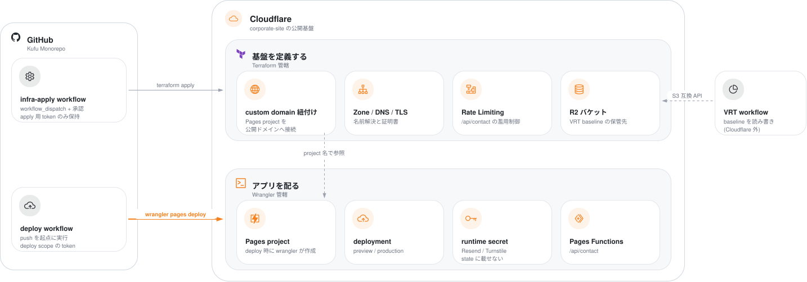
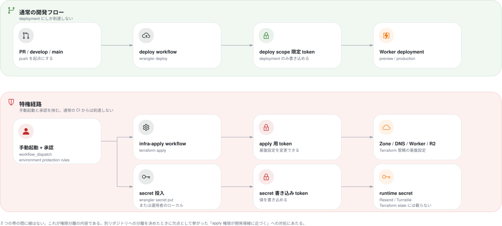

# ADR-0020: Cloudflare リソースの管理は Terraform と Wrangler で分担する

## 状態

承認 (2026-08-23)。ADR-0019 と同時に承認した。ただし Pages を前提にした部分は ADR-0022 が置換した (2026-08-25)。管轄の原則 (データを保持するリソースは Terraform、実行するリソースは Wrangler) は有効である

## 決定日

2026-08-16

> **本文のうち Cloudflare Pages を前提にした箇所は、決定当時の記録である。** 現行の配信基盤は Workers static assets である。管轄の原則、credential の 2 系統分離、runtime secret を state に載せない決定は、いずれも有効なまま Workers へ引き継いでいる。置き換わったのは「Pages project を Wrangler の管轄とする」「bootstrap 順序の制約」「Cloudflare Pages を継続する」の 3 節と、管轄表の Pages 行である。現行の構成は [ADR-0022](0022-workers-static-assets-over-pages.md) を参照する。

## 背景

- Cloudflare の infra code を Kufu Monorepo へ集約すると決めた。本 ADR はその上に立つ。集約後、どのリソースをどのツールで管理するかは未定である。
  - [ADR-0019](0019-terraform-monorepo-consolidation.md) — infra code を monorepo へ集約する決定。ディレクトリ構成と bootstrap の分離も定める
- Cloudflare はリソースごとのツール使い分けを許容する一方、**同じリソースを複数ツールから管理しないこと**を要件としている。ツールを 1 つに寄せる必要はないが、管轄の重複は排除する必要がある。
  - [Cloudflare Terraform Best Practices](https://developers.cloudflare.com/terraform/advanced-topics/best-practices/) の「Manage some resources outside of Terraform」— Terraform 外で管理してよい条件と、同一リソースを二重管理しない要件を定める
- 現状の Cloudflare 設定はすべて Dashboard 上にあり、コード管理されていない。`wrangler` の設定ファイルもリポジトリに存在しない (2026-08-16 時点)。
- corporate-site は Astro の静的生成で、問い合わせフォームの送信のみ Pages Functions (Workers) を使う**設計である**。2026-08-16 時点で未実装のため (`apps/corporate-site/functions/` が存在しない)、本 ADR は実装されたときの管轄を先に定める。
  - [ADR-0009](0009-corporate-site-contact-form-backend.md) — 問い合わせフォームのバックエンド構成を定めた決定
- Pages Functions は runtime secret として Resend API key、メール宛先、Turnstile secret key を必要とする。
  - [context/infrastructure.md](../context/infrastructure.md) の Infrastructure Contract (app → infra) — app が要求する secret 名を列挙する。実値は repo に保存しないと定める
- VRT baseline は R2 へ置く。読み書きするのは GitHub Actions であり、S3 互換 API を使う。**アプリ (Worker) からの R2 binding は不要である。** Pages project が必要とする binding は決定時点で存在しない。
  - [ADR-0021](0021-vrt-baseline-on-r2.md) — VRT baseline を R2 へ移す決定
- 別リポジトリへの分離を決めたとき、monorepo 同居の欠点として「Terraform apply 権限や Cloudflare credential を app 開発導線に近づけやすくなる」が挙げられた。集約後も残る懸念のため、管轄の分割はこの対処と整合させる必要がある。

### Pages project が管轄を決めにくい理由

Cloudflare Pages project は 2 つの性質が 1 リソースに同居している。

- 基盤としての性質: サイトがどのドメインで公開されるか。変更頻度が低く、本番影響が大きい。
- アプリとしての性質: どの成果物を配るか、どの環境変数と secret を持つか。deploy のたびに変わる。

Terraform の `cloudflare_pages_project` は後者に相当する設定 (環境変数 / secret / binding) を内包する。Terraform がこの resource を管理すると、Wrangler が secret を投入した時点で Terraform が差分を検出し、次の apply でその secret を削除しようとする。

一方、custom domain の紐付けは `cloudflare_pages_domain` という独立した resource であり、project を Terraform が管理しなくても紐付けだけを管理できる。

## 決定

> **承認順序**: 本 ADR と ADR-0019 は**同時に承認する**。monorepo 同居の欠点として挙がった 5 点のうち、credential の分離と、本番影響の大きい変更を PR に埋もれさせない対処は、本 ADR の管轄分担に依存する。本 ADR は infra code の集約を前提とする。

### 分担の原則

**基盤設定を Terraform、アプリの deploy と runtime 設定を Wrangler が管理する。1 つのリソースを両方から管理しない。**

いずれのツールに属するか判断できない新規リソースが現れた場合は、次の順で判定する。

1. **データを保持するか。保持するなら Terraform。** 消えると復旧できないリソースを、deploy のたびに動く経路から切り離すためである。
2. deploy のたびに変わるか。変わるなら Wrangler。
3. 変わらない場合、そのリソースの変更が本番の可用性またはドメイン到達性に影響するか。影響するなら Terraform。
4. どちらでもない場合、Terraform を既定とする (変更履歴と review を残せるため)。

### データを保持するリソースは Terraform、実行するリソースは Wrangler

判定 1 を具体的なリソース種別へ当てはめると次になる。管轄を誤るとデータの消失に直結するため、この 3 行が最も重要である。

| 種別                                                                 | 管轄      | 理由                                                  |
| -------------------------------------------------------------------- | --------- | ----------------------------------------------------- |
| データを保持するリソース (R2 バケット、D1 データベース、KV 名前空間) | Terraform | 消えると復旧できない。deploy では変わらない           |
| データを保持しない実行リソース (Worker script、deployment)           | Wrangler  | deploy のたびに入れ替わる。作り直しても失うものがない |
| binding (どの実行リソースがどのデータを参照するか)                   | Wrangler  | アプリの依存宣言であり、`wrangler.jsonc` を正本とする |

決定時点では D1 も KV も使っていない。将来 cms や別アプリがこれらを必要としたとき、この規則で管轄が定まる。

**この規則は値の受け渡しを増やす。** Terraform が作ったリソースの識別子 (R2 のバケット名、D1 の database id) を Wrangler 側へ渡す必要があり、データを保持するリソースが増えるほど受け渡しの本数が増える。**受け渡しの方法は Infrastructure Contract を正本として定める。** 対象が 2 つ目になる前に整備する。

### 決定時点の管轄

| リソース                              | 管轄      | 判断根拠                                                           |
| ------------------------------------- | --------- | ------------------------------------------------------------------ |
| Zone / DNS record / TLS               | Terraform | deploy と独立し、ドメイン到達性に直結する                          |
| Pages custom domain 紐付け            | Terraform | 同上。project とは独立した resource として管理できる               |
| R2 バケット (VRT baseline 用)         | Terraform | deploy と独立し、CI が消費するだけ                                 |
| R2 バケット (Terraform state 用)      | Terraform | `infra/bootstrap/` が作る。下記「state 用バケットの例外」を参照    |
| Rate Limiting ルール (`/api/contact`) | Terraform | deploy と独立した濫用制御の設定                                    |
| Pages project 本体                    | Wrangler  | 下記「Pages project を Wrangler の管轄とする」を参照               |
| deployment (preview / production)     | Wrangler  | deploy そのもの。Terraform の管理対象ではない                      |
| runtime secret (Resend / Turnstile)   | Wrangler  | 下記「runtime secret を Terraform state に載せない」を参照         |
| binding (R2 / KV など)                | Wrangler  | 決定時点で該当なし。将来必要になった場合は `wrangler.jsonc` に置く |

この表の運用上の正本は Infrastructure Contract に置く。リソースが増減したときは同ファイルを更新する。本 ADR の表は決定時点の割り当てであり、後から書き換えない。

**state 用バケットの例外**: R2 バケットは 2 つ存在する。VRT baseline 用は `infra/cloudflare/` が管理し、その state は R2 backend に置く。Terraform state 用は `infra/bootstrap/` が管理し、その state はローカルに置く。どちらも Terraform 管轄で二重管理は生じないが、**state の置き場が異なる**点で扱いが分かれる。



図の要点:

- Cloudflare の内側は管轄で 2 つに分かれ、それぞれへ入る実線 (管理経路) は 1 本ずつである。同じリソースへ両方のツールから線が入っていないことが、二重管理が生じていないことを表す。
- 破線は参照であり、管理ではない。`cloudflare_pages_domain` は Wrangler が作った project を名前で参照する。この向きが bootstrap の順序制約を生む。
- **runtime secret だけは、枠へ入る実線の対象外である。** 図では橙の注記で示した。deploy workflow の token は secret 投入権限を持たず、投入は特権経路のみで行う。経路は次の図が描く。
- 描いた R2 バケットは Terraform state 用の 1 つだけである。VRT baseline 用は保管方式が未確定のため描いていない。R2 を採る場合、Terraform 管轄のバケットが 1 つ増え、GitHub Actions が S3 互換 API で読み書きする。アプリ (Worker) からの binding はどちらの方式でも発生しない。
- **図が描くのは、本決定を実装した後の定常状態である。** 初回のみ実行する `infra/bootstrap/` と、運用者が手で行う project の初回作成は載せていない (初回の順序は下記「bootstrap 順序の制約」を参照)。Pages Functions は未実装であり、実装されたときの管轄として描いている。

### 権限と実行経路

credential を 2 系統に分け、通常の CI に apply 権限と secret 投入権限を持たせない。



図の要点:

- 通常の開発フローから到達できるのは deployment だけである。DNS、R2、secret へは到達しない。
- 特権経路は手動起動に限り、GitHub の environment protection rules で承認を要求する。
- apply 用と secret 書き込み用は必要な scope が異なるため別の token として描いた。1 つの token に束ねるか分けるかは、実装時に Infrastructure Contract へ確定した形を記載する。

### Pages project を Wrangler の管轄とする

Terraform が `cloudflare_pages_project` を管理する場合、Wrangler による secret 投入との衝突を避けるために `lifecycle { ignore_changes = [deployment_configs] }` が必要になる。「Terraform が管理しているように見えて実際には管理していない範囲」が生まれ、上記の原則を形骸化させる。

provider 5.24.0 の schema を確認したところ、`cloudflare_pages_project` の `deployment_configs` は `env_vars` (`secret_text` を含み `sensitive` が付く) / `r2_buckets` / `d1_databases` / `kv_namespaces` / `compatibility_date` を内包していた。**本 ADR が前提にした構造は実在する。**

一方 `cloudflare_pages_domain` の必須項目は `account_id` / `name` / `project_name` の 3 つだけである。project を文字列で参照するため、**project を Terraform が管理しなくても紐付けだけを管理できる。**

Terraform は `cloudflare_pages_domain` と DNS record を管理する。これにより、本番影響の大きい「どのドメインでどの project が公開されるか」は Terraform 側に残る。別リポジトリへの分離が守ろうとした影響範囲の分離は、この範囲で満たせる。

**project の初回作成は運用者の手動操作とする。** `wrangler pages deploy` は project を自動作成しない。非対話 (CI) で project が存在しないと `UserError` を投げて終わる。対話実行のときだけ作成の可否を尋ねる。

```
if (projectName && !isExistingProject && !isInteractive) {
  let message = `The Pages project "${projectName}" does not exist.`;
  ...
  throw new UserError(message, ...)
}
```

初回は `wrangler pages project create <name> --production-branch <branch>` を運用者が実行する。**Terraform 管轄には移さない。** 移すと `deployment_configs` ごと抱えることになり、上記の理由で原則が壊れる。

**bootstrap 順序の制約**: `cloudflare_pages_domain` は project の存在を前提とする。初回は次の順で実行する。この順序は Infrastructure Contract に手順として記載する。

1. 運用者が `wrangler pages project create` で project を作る
2. deploy workflow が `wrangler pages deploy` で成果物を配る
3. `terraform apply` が `cloudflare_pages_domain` と DNS record を作る

### runtime secret を Terraform state に載せない

Terraform が secret の値を管理すると、state ファイルに平文で保存される。state を R2 に置く前提では state 自体が機密となり、閲覧権限の管理対象が増える。回避できるコストである。

- secret の値は `wrangler pages secret put` で投入する。
- 投入は日常の deploy workflow から行わない。手動起動の特権 workflow (`workflow_dispatch` + GitHub environment protection rules) または運用者のローカル実行に限る。
- 通常の CI が持つ Cloudflare credential は deploy に必要な scope へ限定し、secret 投入権限を含めない。
- Terraform は secret の**名前**のみを変数として扱い、値を扱わない。名前の一覧は Infrastructure Contract を正本とする。

同じ規則を認証情報一般へ適用する。R2 バケットは Terraform が作成するが、GitHub Actions が S3 互換 API で使う access key は Terraform 外で発行し、GitHub Actions の secret に登録する。

Cloudflare も credential を平文で保持せず `cf-vault` や Vault のような手段で保管するよう定めており、state に値を載せない本決定と整合する。

### Cloudflare Pages を継続する

配信基盤は Cloudflare Pages を継続する。Workers Static Assets への移行は本決定の対象外とし、別 issue で検討する。

deploy 経路を作り直す本作業は移行の契機になりうるが、決定済みの構成 (Pages Functions を含む) の再設計を伴い、作業範囲が本 issue を大きく超える。移行の是非は、Pages と Workers のどちらを長期的に維持するかという Cloudflare 側の方針に依存するため、本 ADR では判断しない。

**ただし Cloudflare 側の方針は既に表に出ている。** `wrangler pages deploy` が非対話で失敗するときのメッセージは、Workers を繰り返し勧める。

> Workers are the recommended way to deploy all new projects.
> Otherwise, if you are trying to create a new Pages project, start by running: `wrangler pages project create` (though we strongly recommend using Workers instead).

Pages が廃止されるという告知ではないが、新規は Workers へ寄せる姿勢が CLI の文言に入っている。**移行を検討する別 issue では、この事実を起点にする。**

## 代替案

### 1. すべてを Terraform で管理する

#### Pros

- 管理ツールが 1 つに揃い、「どこを見ればよいか」が単純になる。
- deploy を含むすべての変更が `terraform plan` の差分として現れる。

#### Cons

- Terraform に deploy を担わせる標準的な手段がなく、成果物のアップロードは結局 Wrangler か API 呼び出しになる。
- `cloudflare_pages_project` の `deployment_configs` を Terraform が持つため、secret を Terraform 管理下に置かざるを得ず、state が機密になる。
- deploy のたびに Terraform を実行することになり、apply 権限が日常の CI に降りてくる。集約時に挙げた credential の懸念を悪化させる。

### 2. すべてを Wrangler と Dashboard で管理する

#### Pros

- 初期セットアップが最も速い。Terraform の学習と state 運用が不要になる。

#### Cons

- DNS、custom domain、Rate Limiting が Dashboard 上の属人設定として残る。変更履歴、review、再現性、環境差分管理が弱いという Dashboard 運用の欠点がそのまま該当する。
- 本 issue が集約する目的の 1 つ (コード管理されていない Cloudflare リソースをコード管理下に置く) を満たさない。

### 3. Terraform が Pages project を持ち、`ignore_changes` で衝突を避ける

#### Pros

- Pages project の存在と production / preview branch 設定が Terraform の差分に現れる。
- project 作成が apply で完結し、bootstrap の順序依存が発生しない。

#### Cons

- `ignore_changes` の対象範囲が「Terraform が管理していない範囲」として暗黙に存在し、レビュー時に読み取りにくい。
- 環境変数を Terraform 側に足したくなったとき、`ignore_changes` の内側にあるため反映されず、原因の特定が難しい。
- 「1 つのリソースを両方から管理しない」という原則の例外を、最初の 1 件目から作ることになる。

## 影響

### 良い影響

- Cloudflare credential が 2 系統に分かれる。Terraform apply 用の強い token は apply workflow のみが持ち、通常の CI は deploy scope に限定した token しか持たない。集約時に挙げた credential の懸念への直接の対処になる。
- Terraform state に機密が入らないため、state backend の保護要件が「漏洩しても直ちに侵害にならない」水準まで下がる。
- 日常の deploy が Terraform を経由しないため、UI 変更の PR に infra の差分が混ざらない。「レビュー観点が混ざる」という懸念を、repo を分けずに緩和できる。

### 悪い影響 / トレードオフ

- 管理ツールが 2 つになり、「どちらが管轄か」を都度判断する必要が生じる。判定手順と表を正本として維持する運用コストがかかる。
- Pages project の設定 (compatibility date、binding など) が Terraform の差分に現れない。`wrangler.jsonc` が実質の正本となるため、同ファイルをレビュー対象として扱う必要がある。production branch は設定ファイルではなく `wrangler pages project create --production-branch` と deploy 時の `--branch` で決まるため、手順として残す。
- 初回構築時に Wrangler deploy → Terraform apply の順序制約がある。手順を誤ると `cloudflare_pages_domain` の apply が失敗する。
- secret の投入が自動化されないため、値の更新時に手動操作が必要になる。ローテーション手順を運用として残す必要がある。

### 確認済み (2026-08-25)

- **provider は 5.24.0 である。** 認証は `CLOUDFLARE_API_TOKEN` を読む。API key は legacy 扱いであり使わない。
- **`cloudflare_pages_project` の `deployment_configs` は secret を内包する。** 本 ADR が代替案 3 を退けた根拠は成立している。
- **`wrangler pages deploy` は project を自動作成しない。** 非対話では失敗する。初回作成を運用者の手動操作とする形へ決定を改めた。
- **設定ファイルは `wrangler.jsonc` を使う。** Wrangler は `wrangler.json` / `wrangler.jsonc` / `wrangler.toml` を受け付けるが、Cloudflare は新規プロジェクトへ `wrangler.jsonc` を推奨しており、一部の新機能は JSON 形式でのみ使えると明記している。本文の表記もこれに揃えた。
- **Cloudflare Secrets Store は Pages Functions から使えない。** Pages の wrangler 設定が受け付ける binding は `vars` / `d1_databases` / `durable_objects` / `hyperdrive` / `kv_namespaces` / `queues.producers` / `r2_buckets` / `vectorize` / `services` / `analytics_engine_datasets` / `ai` の 11 種で、`secrets_store_secrets` は含まれない。Secrets Store 側のドキュメントも Workers 連携しか扱っていない。**runtime secret の管轄を再評価する余地は、現時点では無い。**

### 未確認事項

本 ADR の判断を支える未確認事項は残っていない。

## 実装・運用への反映

- 対象 app / package: `apps/corporate-site`、`e2e` (VRT の baseline 保管方式を決めた場合)、GitHub Actions workflow
- spec 更新要否: 要。#47 の spec に、ツール別の作業分割と bootstrap 順序を反映する
- 本節は**本 ADR に由来する更新**を扱う。集約そのものに由来する更新 (`repos.infra` / `repos.layout` / `commands` / `domains` / DesignDoc) は ADR-0019 の同名節を正本とする。更新時期も同 ADR に従い、実装完了後である
- AI 向け設定更新要否: 要。context/infrastructure.md にツール境界表と bootstrap 手順を追加し、[context/architecture.md](../context/architecture.md) に Terraform と `wrangler.jsonc` の配置と依存規約を定める

## 関連ドキュメント

- [ADR-0019](0019-terraform-monorepo-consolidation.md): monorepo への集約 (本 ADR の前提)
- [ADR-0001](0001-terraform-infra-repository-boundary.md): infra repo 分離 (ADR-0019 が supersede)
- [ADR-0009](0009-corporate-site-contact-form-backend.md): 問い合わせフォームの Workers 依存と secret 要件
- [context/infrastructure.md](../context/infrastructure.md): ツール境界表 / bootstrap 手順 / 値の受け渡し / Infrastructure Contract の正本
- [design/DesignDoc.md](../design/DesignDoc.md): Cloudflare を公開基盤とする前提 (本 ADR は基盤の選択を変えない)
- [Cloudflare Terraform Best Practices](https://developers.cloudflare.com/terraform/advanced-topics/best-practices/)
- [context/architecture.md](../context/architecture.md): Terraform と Wrangler 設定ファイルの配置と依存規約 (実装完了後に追記する)
- [infra-tool-boundary.drawio.svg](../design/diagrams/infra-tool-boundary.drawio.svg): 管轄境界の図
- [infra-permission-flow.drawio.svg](../design/diagrams/infra-permission-flow.drawio.svg): credential と実行経路の図
- [ADR-0021](0021-vrt-baseline-on-r2.md): VRT baseline を R2 へ置く決定 (管轄表の R2 が有効になる)
- [ADR-0022](0022-workers-static-assets-over-pages.md): 配信基盤を Workers へ移す決定 (Pages 前提の部分を置換)
- issue: #47 (決定経緯)
