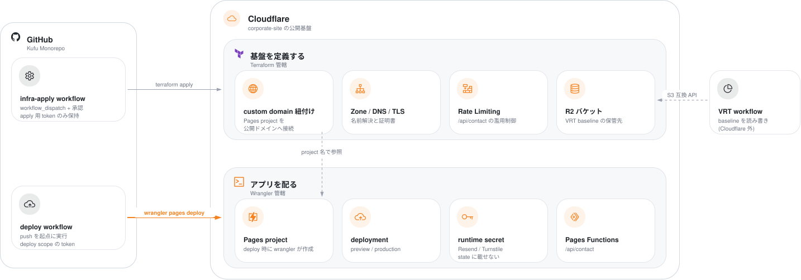
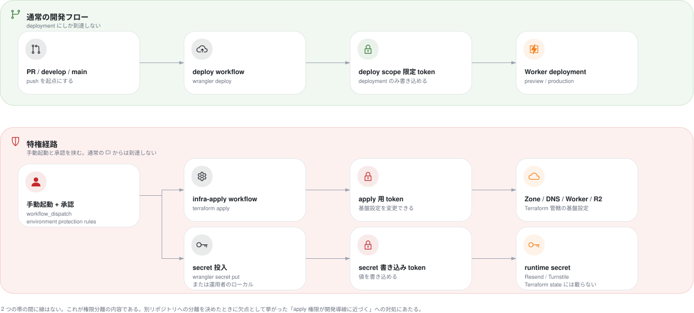

# ADR-0021: Cloudflare リソースの管理は Terraform と Wrangler で分担する

## Status

承認

## Context

- ADR-0020 は、Cloudflare の infra code を Kufu Monorepo へ集約すると決めた。
  集約した後に、どのリソースをどのツールで管理するかは決めていなかった。
  - ADR-0020: [Terraform の infra code を Kufu Monorepo へ集約する](0020-terraform-monorepo-consolidation.md)
- Cloudflare は、リソースごとにツールを使い分けることを認めている。
  一方で、同じリソースを複数のツールから管理しないことを要件にしている。
  - 出典: [Cloudflare Terraform Best Practices](https://developers.cloudflare.com/terraform/advanced-topics/best-practices/) の「Manage some resources outside of Terraform」
- 決定のとき、Cloudflare の設定はすべて Dashboard 上にあり、コードで管理していなかった。
  `wrangler` の設定ファイルも、リポジトリになかった。
- Cloudflare を公開の基盤にする前提は Design Doc にある。
  この ADR は基盤の選択を変えない。
  - 出典: [design/DesignDoc.md](../design/DesignDoc.md)
- corporate-site は Astro で静的に生成し、問い合わせフォームの送信だけを Pages Functions（Workers）で処理する設計である。
  決定のときは未実装（`apps/corporate-site/functions/` がない）だったので、この ADR は実装したときの管轄を先に定める。
  - ADR-0009: [corporate-site の問い合わせの送信は Cloudflare Pages Functions（Workers）で中継する](0009-corporate-site-contact-form-backend.md)
- Pages Functions は、runtime secret として Resend API key、メールの宛先、Turnstile secret key を要する。
  app が要する secret の名前と、実値をリポジトリに置かないことは、基盤への取り決めに定めている。
  - 出典: [context/operations.md の「kufu-infra へ渡す取り決め」](../context/operations.md#kufu-infra-へ渡す取り決め)
- VRT baseline は R2 に置き、GitHub Actions が S3 互換 API で読み書きする。
  Worker から R2 への binding は要らない。
  決定のとき、Pages project が要する binding はなかった。
  - ADR-0022: [VRT baseline を Cloudflare R2 へ移す](0022-vrt-baseline-on-r2.md)
- ADR-0001 は、monorepo に同居させる案の弱みに「Terraform の apply の権限や Cloudflare の credential が app の開発の導線に近づく」を挙げた。
  この懸念は集約した後も残るので、管轄の分け方をこの懸念への対処と合わせる必要がある。
  - ADR-0001: [Terraform の infra code は kufu-apps と別のリポジトリで管理する](0001-terraform-infra-repository-boundary.md)
- Cloudflare Pages の project は、2 つの性質を 1 つのリソースに持つ。
  - 基盤の性質: サイトをどのドメインで公開するか。変更が少なく、本番への影響が大きい。
  - アプリの性質: どの成果物を配るか、どの環境変数と secret を持つか。deploy のたびに変わる。
- Terraform の `cloudflare_pages_project` は、アプリの性質の設定（環境変数、secret、binding）を含む。
  Terraform がこの resource を管理すると、Wrangler が secret を入れた時点で差分が出て、次の apply が secret を消そうとする。
  custom domain の紐付けは別の resource（`cloudflare_pages_domain`）なので、紐付けだけを Terraform で管理できる。

## Decision

この ADR は ADR-0020 と同時に承認する。  
ADR-0020 が挙げた monorepo に同居させる欠点のうち、credential の分離と、本番への影響が大きい変更を PR に埋もれさせない対処は、この ADR の分担に依存するためである。

### 基盤の設定は Terraform、アプリの deploy と runtime の設定は Wrangler が管理する

**1 つのリソースを、両方のツールから管理しない。**  
どちらのツールに属するか分からない新しいリソースは、次の順で判定する。

1. **データを保持するなら Terraform。** 消えると戻せないリソースを、deploy のたびに動く処理から切り離すためである。
2. deploy のたびに変わるなら Wrangler。
3. 変わらない場合、変更が本番の可用性かドメインへの到達に影響するなら Terraform。
4. どれでもなければ Terraform を既定にする。変更の履歴と review を残せるためである。

判定 1 をリソースの種別に当てはめると、次の表になる。  
管轄を誤るとデータを失うので、この表が最も重要である。

| 種別                                                                  | 管轄      | 理由                                                    |
| --------------------------------------------------------------------- | --------- | ------------------------------------------------------- |
| データを保持するリソース（R2 バケット、D1 データベース、KV 名前空間） | Terraform | 消えると戻せない。deploy では変わらない                 |
| データを保持しない実行のリソース（Worker script、deployment）         | Wrangler  | deploy のたびに入れ替わる。作り直しても失うものがない   |
| binding（どの実行のリソースがどのデータを参照するか）                 | Wrangler  | アプリの依存の宣言であり、`wrangler.jsonc` を基準にする |

決定のときは D1 も KV も使っていない。  
cms や別のアプリがこれらを要したときに、この規則で管轄が決まる。

この規則は、値の受け渡しを増やす。  
Terraform が作ったリソースの識別子（R2 のバケット名、D1 の database id）を Wrangler へ渡す必要があり、データを保持するリソースが増えるほど本数が増える。  
受け渡しの方法は基盤への取り決めとして定め、対象が 2 つ目になる前に整える。

### 決定のときの管轄

| リソース                               | 管轄      | 判断の根拠                                                 |
| -------------------------------------- | --------- | ---------------------------------------------------------- |
| Zone / DNS record / TLS                | Terraform | deploy と独立し、ドメインへの到達に直結する                |
| Pages の custom domain の紐付け        | Terraform | 同上。project と独立した resource として管理できる         |
| R2 バケット（VRT baseline 用）         | Terraform | deploy と独立し、CI が使うだけ                             |
| R2 バケット（Terraform state 用）      | Terraform | `infra/bootstrap/` が作る。state の置き場が異なる          |
| Rate Limiting ルール（`/api/contact`） | Terraform | deploy と独立した、濫用を抑える設定                        |
| Pages project の本体                   | Wrangler  | Terraform が持つと secret まで抱える                       |
| deployment（preview / production）     | Wrangler  | deploy そのもの                                            |
| runtime secret（Resend / Turnstile）   | Wrangler  | Terraform state に載せない                                 |
| binding（R2 / KV など）                | Wrangler  | 決定のときは該当がない。要るときは `wrangler.jsonc` に置く |

表のうち Pages の 2 行は、Pages を前提にした割り当てである。  
この判断は ADR-0023 で置き換えた。  
ADR-0023: [配信基盤を Cloudflare Pages から Workers static assets へ移す](0023-workers-static-assets-over-pages.md)

運用で使う管轄の表は context/operations.md に置き、リソースが増減したらそちらを更新する。  
この ADR の表は決定のときの割り当てで、後から書き換えない。

R2 バケットは 2 つあり、state の置き場が異なる。  
VRT baseline 用は `infra/cloudflare/` が管理し、その state を R2 backend に置く。  
Terraform state 用は `infra/bootstrap/` が管理し、その state をローカルに置く。  
どちらも Terraform の管轄なので、二重の管理は生じない。

管轄の境界を次の図に描く。

- Cloudflare の内側は管轄で 2 つに分かれ、それぞれへ入る実線（管理の線）は 1 本ずつである。
  同じリソースへ両方のツールから線が入っていないので、二重の管理は生じていない。
- 破線は参照で、管理ではない。
  `cloudflare_pages_domain` は、Wrangler が作った project を名前で参照する。
  この向きが bootstrap の順序を決める。
- **runtime secret だけは、枠へ入る実線の対象から外れる。**
  図では橙の注記で示した。
  deploy の workflow の token は secret を入れる権限を持たず、特権の workflow と運用者だけが secret を入れる。
- 図は R2 バケットを Terraform state 用の 1 つだけ描き、VRT baseline 用は描いていない。
  VRT baseline 用も Terraform の管轄で、Worker からの binding は生じない。
- 図は、この決定を実装した後の定常の状態を描く。
  初回だけ実行する `infra/bootstrap/` と、運用者が手で行う project の初回の作成は描いていない。

### credential を 2 系統に分け、通常の CI に apply と secret の投入の権限を持たせない

credential と、どこから何を実行するかを次の図に描く。

- 通常の開発のフローから届くのは deployment だけである。
  DNS、R2、secret へは届かない。
- 特権の workflow は手動の起動に限り、GitHub の environment protection rules で承認を求める。
- apply 用と secret の書き込み用は要る scope が異なるので、別の token として描いた。
  1 つの token に束ねるか分けるかは、実装のときに基盤への取り決めへ確定した形を書く。

### Pages project を Wrangler の管轄にする

Terraform が `cloudflare_pages_project` を管理すると、secret の投入とぶつからないよう `lifecycle { ignore_changes = [deployment_configs] }` が要る。  
Terraform が管理しているように見えて管理していない範囲が生まれ、分担の原則が意味を失う。  
`cloudflare_pages_domain` の必須の項目は `account_id` / `name` / `project_name` の 3 つで、project を文字列で参照する。  
そこで、Terraform は `cloudflare_pages_domain` と DNS record だけを管理する。  
本番への影響が大きい「どのドメインでどの project を公開するか」は Terraform の側に残り、ADR-0001 が守ろうとした影響の範囲の分離を満たせる。

**project の初回の作成は、運用者が手で行う。**  
`wrangler pages deploy` は、project を自動で作らない。  
運用者が `wrangler pages project create <name> --production-branch <branch>` を実行する。  
初回の作成を Terraform の管轄には移さない。  
移すと `deployment_configs` ごと抱えることになり、分担の原則が崩れるためである。

この判断は ADR-0023 で置き換えた。  
ADR-0023: [配信基盤を Cloudflare Pages から Workers static assets へ移す](0023-workers-static-assets-over-pages.md)

`cloudflare_pages_domain` は project があることを前提にするので、初回は次の順で実行する。  
この順序は、基盤への取り決めに手順として書く。

1. 運用者が `wrangler pages project create` で project を作る。
2. deploy の workflow が `wrangler pages deploy` で成果物を配る。
3. `terraform apply` が `cloudflare_pages_domain` と DNS record を作る。

この判断は ADR-0023 で置き換えた。  
ADR-0023: [配信基盤を Cloudflare Pages から Workers static assets へ移す](0023-workers-static-assets-over-pages.md)

### runtime secret を Terraform state に載せない

Terraform が secret の値を管理すると、state ファイルに平文で残る。  
state を R2 に置くと state そのものが機密になり、閲覧の権限を管理する対象が増える。  
このコストは避けられる。

- secret の値は `wrangler pages secret put` で入れる。
- 日常の deploy の workflow からは入れない。
  手動で起動する特権の workflow（`workflow_dispatch` と GitHub の environment protection rules）か、運用者のローカルの実行に限る。
- 通常の CI が持つ Cloudflare の credential は deploy に要る scope に限り、secret を入れる権限を含めない。
- Terraform は secret の**名前**だけを変数として扱い、値を扱わない。
  名前の一覧は、基盤への取り決めに置く。

同じ規則を、認証情報の全般に当てはめる。  
R2 バケットは Terraform が作るが、GitHub Actions が S3 互換 API で使う access key は Terraform の外で発行し、GitHub Actions の secret に登録する。  
Cloudflare も、credential を平文で持たず `cf-vault` や Vault のような手段で保管するよう定めており、この決定と合う。

### 配信基盤は Cloudflare Pages を続ける

Workers static assets への移行は、この決定の対象から外し、別の issue で検討する。  
移行は、決めてある構成（Pages Functions を含む）を設計し直す必要があり、#47 の作業の範囲を大きく超える。  
Pages と Workers のどちらを長く保つかは Cloudflare の方針によるので、この ADR では判断しない。  
ただし、`wrangler pages deploy` が非対話で失敗するときのメッセージは、新しい project に Workers を勧めている。  
移行を検討する issue では、この事実から始める。

この判断は ADR-0023 で置き換えた。  
ADR-0023: [配信基盤を Cloudflare Pages から Workers static assets へ移す](0023-workers-static-assets-over-pages.md)

## Verification

- Terraform の Cloudflare provider は 5.24.0 を使う。
  認証は `CLOUDFLARE_API_TOKEN` を読み、legacy 扱いの API key は使わない。
- `cloudflare_pages_project` の `deployment_configs` は、secret を含む。
  含む項目は `env_vars`、`r2_buckets`、`d1_databases`、`kv_namespaces`、`compatibility_date` である。
  `env_vars` は `secret_text` を含み、`sensitive` が付く。
  Terraform に Pages project を持たせる案を退けた根拠は成り立つ。
- `wrangler pages deploy` は、非対話の実行で project がないと `UserError` を投げて終わる。
  対話の実行のときだけ、作るかを尋ねる。
- 設定ファイルは `wrangler.jsonc` を使う。
  Wrangler は `wrangler.json`、`wrangler.jsonc`、`wrangler.toml` を受け付ける。
  Cloudflare は新しいプロジェクトに `wrangler.jsonc` を勧め、一部の新しい機能は JSON の形式でだけ使えると書いている。
- Cloudflare Secrets Store は、Pages Functions から使えない。
  Pages の wrangler の設定が受け付ける binding は 11 種で、`secrets_store_secrets` を含まない。
  - 11 種は `vars`、`d1_databases`、`durable_objects`、`hyperdrive`、`kv_namespaces`、`queues.producers` と、次の 5 つ。
    `r2_buckets`、`vectorize`、`services`、`analytics_engine_datasets`、`ai`
  - Secrets Store の側の文書も、Workers との連携だけを扱う。
    runtime secret の管轄を見直す余地はない。

## Considered Options

| 選択肢                                                                                    | 強み                                                                                                                                                     | 弱み                                                                                                                                                                                                                                                             |
| ----------------------------------------------------------------------------------------- | -------------------------------------------------------------------------------------------------------------------------------------------------------- | ---------------------------------------------------------------------------------------------------------------------------------------------------------------------------------------------------------------------------------------------------------------- |
| **採用:** 基盤の設定を Terraform、アプリの deploy と runtime の設定を Wrangler で管理する | apply と secret の投入の権限を通常の CI から外せる。Terraform state に機密が入らない                                                                     | 管理するツールが 2 つになる。Pages project の設定が Terraform の差分に出ない。初回の構築に順序の制約がある                                                                                                                                                       |
| すべてを Terraform で管理する                                                             | 管理するツールが 1 つに揃う。deploy を含むすべての変更が `terraform plan` の差分に出る                                                                   | Terraform に deploy を担わせる標準の手段がなく、成果物のアップロードは Wrangler か API の呼び出しになる。`deployment_configs` を持つので、secret を Terraform で管理し、state が機密になる。deploy のたびに apply するので、apply の権限が日常の CI に降りる     |
| すべてを Wrangler と Dashboard で管理する                                                 | 初期のセットアップが最も速い。Terraform の学習と state の運用が要らない                                                                                  | DNS、custom domain、Rate Limiting が Dashboard 上の属人的な設定として残る。変更の履歴、review、再現性が弱い。コードで管理していない Cloudflare のリソースをコードで管理する、という集約の目的を満たさない                                                        |
| Terraform が Pages project を持ち、`ignore_changes` でぶつかりを避ける                    | Pages project があることと production / preview の branch の設定が Terraform の差分に出る。project の作成が apply で完結し、bootstrap の順序に依存しない | `ignore_changes` の範囲が、Terraform が管理しない範囲として暗黙に残る。review で読み取りにくい。環境変数を Terraform に足しても `ignore_changes` の内側なので反映されず、原因を特定しにくい。1 つのリソースを両方から管理しない原則の例外を、最初の 1 件から作る |

## Consequences

### Positive

- Cloudflare の credential が 2 系統に分かれる。
  apply 用の強い token は apply の workflow だけが持ち、通常の CI は deploy の scope に限った token だけを持つ。
  ADR-0001 が挙げた credential の懸念に、直接に対処できる。
- Terraform state に機密が入らないので、state backend を守る要件が「漏れても直ちに侵害にならない」水準まで下がる。
- 日常の deploy は Terraform を経由しないので、UI を変える PR に infra の差分が入らない。
  review の観点が 1 つの PR に並ぶ懸念を、リポジトリを分けずに和らげられる。

### Negative

- 管理するツールが 2 つになり、どちらの管轄かを毎回判断する必要がある。
  判定の手順と管轄の表を基準として保つ運用のコストがかかる。
- Pages project の設定（compatibility date、binding など）が Terraform の差分に出ない。
  `wrangler.jsonc` が実質の基準になるので、このファイルを review の対象として扱う。
  production の branch は設定ファイルでなく、`wrangler pages project create --production-branch` と deploy のときの `--branch` で決まるので、手順として残す。
- 初回の構築では、Wrangler の deploy を Terraform の apply より先に行う必要がある。
  順序を誤ると、`cloudflare_pages_domain` の apply が失敗する。
- secret の投入を自動化しないので、値を変えるたびに手で操作する。
  ローテーションの手順を、運用として残す必要がある。
