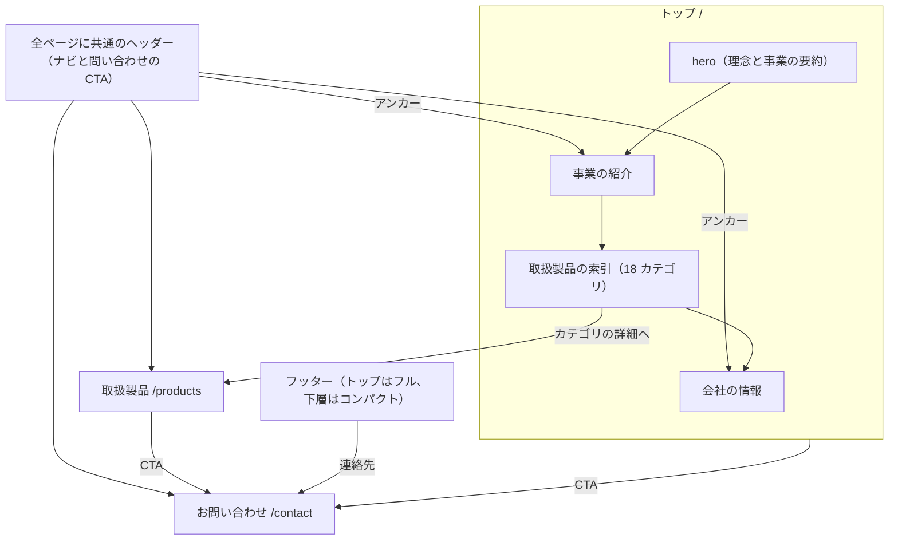
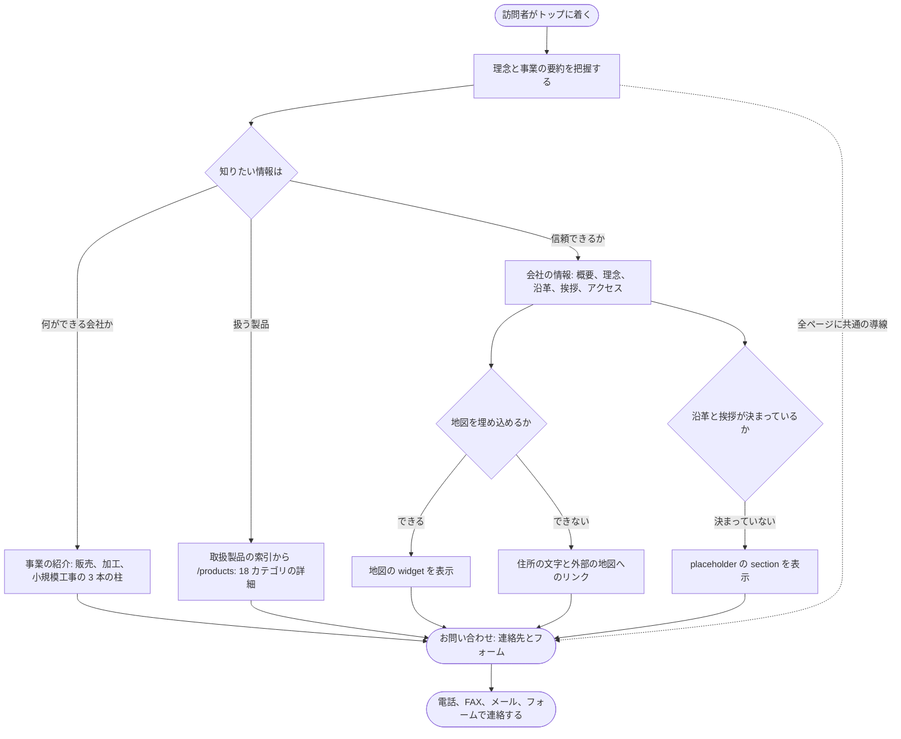
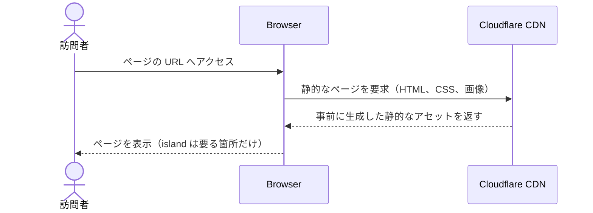

# コーポレートサイト

## Overview

Astro によるコーポレートサイトを、高い表示の速さと保守のしやすさで公開する。  
全体像は [design/DesignDoc.md](../../design/DesignDoc.md) に、横断の取り決めは [context/](../../context/index.md) にある。

## Scope

持つものは次のとおり。

- `apps/corporate-site` の 3 つの route と、全ページに共通の layout
- 掲載する内容のデータ（`src/content/`）と、一次情報の文書との対応
- コーポレートサイトの中で閉じる UI。section の中か `components/common/` に置く。
- ブランドの表現の指針

持たないものは次のとおり。

- Astro で完結できる機能の React 化
- CMS による内容の管理。候補は [CMS の Design Doc](../../design/features/cms/DesignDoc.md) にある。
- 問い合わせフォームの入力の項目、送信、API の設計。[問い合わせフォームの Design Doc](../../design/features/contact-form/DesignDoc.md) にある。
- デザイントークンの値。`packages/ui` の stylesheet にある。

## Design

### 設計の方針

- Astro の `.astro` のコンポーネントを基本にする。
- React の island は、フォーム、動的な UI、外部の widget のように操作が要る箇所に限る。
  - 表示だけの UI は、`@kufu/ui` の shadcn のコンポーネントを `client:*` なしで静的に描画する。
  - ADR-0008: [Astro と React island の方針](../../adr/0008-astro-react-island-policy.md)
- 画像、フォント、スクリプトは、性能予算を意識して管理する。
- コンポーネントは `components/sections/<section>/` の 1 階層に並べ、各 section の公開面は `index.ts` の再輸出だけにする。
  - 層と依存の向き、共有へ移す条件は [context/codebase.md](../../context/codebase.md#app-の中の層) にある。
  - ADR-0014: [corporate-site の sections 構成](../../adr/0014-corporate-site-sections-architecture.md)
- `src/styles/` のファイルの分け方は [context/codebase.md](../../context/codebase.md#スタイルのファイル) にある。
- 画像は `src/assets/` に置き、Astro Image か import で扱う。
  - build の asset graph に載せ、width、height、lazy loading、形式の最適化を適用する。
  - `public` に直接置くと、参照を追えず最適化も弱いため使わない。
- 公開するアセットは Cloudflare の CDN からの配信を前提に、キャッシュと更新の単位を意識して置く。

### ページの構成

3 つの route と、全ページに共通の layout で構成する。  
ADR-0006: [corporate-site の IA を 3 route にする](../../adr/0006-corporate-site-three-route-ia.md)

| ページ         | route       | 主な section                                                                                                                      |
| -------------- | ----------- | --------------------------------------------------------------------------------------------------------------------------------- |
| トップ         | `/`         | hero（理念と事業の要約）、事業の紹介（販売と加工のジグザグの構成と、小規模工事の事例）、取扱製品の索引（18 カテゴリ）、会社の情報 |
| 取扱製品       | `/products` | 18 カテゴリの詳細（INDEX のパネルと、カテゴリごとの全メーカーの一覧）                                                             |
| お問い合わせ   | `/contact`  | 連絡先（TEL、FAX、メール）と問い合わせフォーム                                                                                    |
| 全ページに共通 | なし        | ヘッダー（ナビと CTA）。フッターはトップがフル（サイトマップ付き）、下層がコンパクト（ブランドと連絡先）                          |

- 事業の内容と会社の情報は、トップの section に入れ、単独の route を作らない。直接の導線は、トップの中のアンカーで提供する。
- コンテナの幅と横の余白は、全ページで 1440px と横の padding 56 に揃える。実装は 1 つの max-width と共通の padding にする。
- 3 つの route それぞれに、desktop とモバイルの表示を用意する。
  - hover、focus、フォームのエラーのような状態は `@kufu/ui` の規約に従って実装し、Storybook で確認する。
- `/products` のカテゴリとメーカーの検索は、`q` の query parameter だけを状態の基準にする。
  - 最初の表示、再読込、共有した URL から検索の条件を戻す。入力の途中では履歴を増やさない。空の文字列では `q` を消す。
  - JavaScript を実行する前の HTML に、18 カテゴリと全メーカーを持たせる。
- reveal のアニメーションは progressive enhancement にする。
  - JavaScript が無効か、`IntersectionObserver` が使えない環境では、すべての内容を最初から表示する。
  - アニメーションのために、HTML だけでの読みやすさを損なわない。

情報の項目ごとに、置くページと section は次のとおり。

| 項目                                 | 置く先                                         | 補足                                 |
| ------------------------------------ | ---------------------------------------------- | ------------------------------------ |
| 会社名、創立、資本金、代表、所在地   | トップの会社の情報                             | フッターにも要約を置く               |
| TEL、FAX、E メール                   | トップの会社の情報、`/contact`、全ページに共通 | どのページからも連絡できるようにする |
| 経営理念                             | トップの hero と会社の情報                     | 訴求と信頼の中心                     |
| 業務の内容（見積、販売、加工、工事） | トップの事業の紹介                             | 販売、加工、小規模工事の 3 本の柱    |
| 取扱製品のカテゴリ（18 区分）        | トップの索引と `/products`                     | 1 つのデータを両方のページが参照する |
| 取扱メーカー（延べ約 320 社）        | `/products`                                    | カテゴリごとの全メーカーの一覧       |
| アクセスと地図                       | トップの会社の情報の中                         | 地図を埋め込むかは性能予算で判断する |
| 沿革と代表の挨拶                     | トップの会社の情報（placeholder）              | 本文は後から入れる                   |

- 会社概要の一次の情報（社名、所在地、代表、連絡先）は、トップの会社の情報を基準にする。フッターなどは参照にとどめる。
- アクセスと地図、沿革、代表の挨拶のうち決まっていないものは、placeholder で公開できる状態を保つ。
- グローバルナビ（トップの section へのアンカーと、取扱製品、お問い合わせ）と、全ページに共通の問い合わせの CTA で、どのページからも `/contact` に着けるようにする。
  - ナビの項目の詳細は `components/common/SiteHeader.astro` にある。

ナビゲーションの構造は次のとおり。

訪問者が知りたい情報から問い合わせまで進む流れは次のとおり。

### section の構成

section と、その公開面、使うページの対応は次のとおり。  
section の名前はドメインで付けるので、ページとの対応はディレクトリから読めず、この表で表す。  
ADR-0014: [corporate-site の sections 構成](../../adr/0014-corporate-site-sections-architecture.md)

| section             | 公開面（`index.ts` が再輸出する） | 内部の presentation                                                                     | 使うページ  |
| ------------------- | --------------------------------- | --------------------------------------------------------------------------------------- | ----------- |
| `hero`              | `Hero.astro`                      | なし                                                                                    | `/`         |
| `business`          | `BusinessSection.astro`           | `BusinessFeatureRow.astro`                                                              | `/`         |
| `company`           | `CompanySection.astro`            | なし                                                                                    | `/`         |
| `consultation`      | `ConsultationSection.astro`       | なし                                                                                    | `/`         |
| `products-category` | `ProductsCategorySection.astro`   | `FeaturedCategoryCarousel.astro`、`FeaturedCategoryCard.astro`                          | `/`         |
| `products-detail`   | `ProductsDetailSection.astro`     | `ProductsHero.astro`、`ProductsSidebarNav.astro`、`ProductsCategoryAccordionList.astro` | `/products` |
| `contact`           | `ContactSection.astro`            | なし                                                                                    | `/contact`  |

- 複数の section かページで使う site のコンポーネントは、`components/common/` の直下に平らに置く。
  - 例は `BaseLayout`、`SiteHeader`、`SiteFooter`、`SectionHeading`、`ContactCtaLink`。
- `products-category` は products のドメインのデータ（`productCategories` と `categoryMakers` の collection）を扱うが、載せる先は `/` である。
  - ドメインと載せるページが一致しないので、ディレクトリはドメインで分け、ページとの対応はこの表で表す。

### コンテンツの一次情報

掲載する内容の一次情報は、リポジトリの [design/features/corporate-site/reference/](../../design/features/corporate-site/reference/) に置く。

- [company-profile.md](../../design/features/corporate-site/reference/company-profile.md): 会社概要、業務の内容、取扱製品のカテゴリ 18 区分
- [manufacturers.md](../../design/features/corporate-site/reference/manufacturers.md): 取扱メーカー、延べ約 320 社
- `.ai-out/` は AI エージェントが取り込むための未追跡の作業場所で、一次情報にしない。
- 取扱製品は、カテゴリ（18 区分）から、そのカテゴリの取扱メーカーの一覧へ進むモデルで示す。
  - 同じメーカーが複数のカテゴリに出ることは、取扱の範囲として認める。
- コードが読むデータは Astro の Content Collection と `src/content/` に置き、一次情報から手で写して保つ。
  - 写したデータには、元の一次情報のパスを書く（`src/content/source-references.ts`）。
  - 食い違いは、pull request のレビューと表示の確認で見つける。
- 18 カテゴリとメーカーの一覧は、`/` の索引と `/products` の両方に出るので、1 つのデータを両方のページが参照する。ページに直接書いて二重に管理しない。

### 問い合わせフォーム

`/contact` の問い合わせフォームは、連絡先（TEL、FAX、メール）と並ぶ補助の導線である。  
フォームの送信に失敗しても、電話、FAX、メールで連絡できる構成にする。  
入力の項目、検証、送信の流れ、API の契約、セキュリティの規則は、[問い合わせフォームの Design Doc](../../design/features/contact-form/DesignDoc.md) にある。

### デザイントークン

トークン（CSS の変数と値）の基準は `packages/ui` の stylesheet で、この文書には値を写さない。

- CSS の変数の定義（primitive と semantic）: `packages/ui/src/styles/tokens.css`
- font-face の登録: `packages/ui/src/styles/fonts.css`
- トークンを utility へ写す `@theme inline`: `packages/ui/src/styles/theme.css`（`@kufu/ui/theme.css`）
- React の app 用のすべてを含むエントリ: `packages/ui/src/styles/globals.css`（`@kufu/ui/styles.css`）
- 体系（2 層の構成、shadcn の語彙、inverse のスコープ）
  - ADR-0007: [デザイントークンの構成](../../adr/0007-design-token-architecture.md)

CSS のトークンを持たないガイドは、次の 3 つ。

- spacing: CSS のトークンを持たない。4px のグリッドと、推奨のリズム 12、16、24、32、48、80（Tailwind の `3/4/6/8/12/20`）を使う。
  - `space-*` はこの写像として扱い、トークンの記述のチェックの対象にしない。チェックの除外は [context/conventions.md](../../context/conventions.md#check-exclusions) にある。
- radius: shadcn の `--radius` に揃え、基準の値は `tokens.css` の 4px にする。Button の 8px、Tag の 4px のようなコンポーネント固有の値は、`@kufu/ui` のコンポーネントの variant で管理する。
- type scale: Tailwind の標準を使う。見出しの階層との対応は [トーンとマナー](#トーンとマナー) にある。

### トーンとマナー

ブランドの表現の基準は、この節に置く。  
いまの利用者は corporate-site だけで、cms のような利用者が増えたら、複数の app が参照できる場所へ移す。

- デザインの言語: 工業的な直線の構成を基調にし、基準 4px の控えめな角丸と 1px の細い罫線（`--border`）で面を区切る。寒色のグレーを基調に、teal をアクセントにする。
- 書体の役割
  - `--font-serif`（Noto Serif JP、weight 600）: 見出し、経営理念、ブランド名。信頼感の中心にする。
  - `--font-sans`（Noto Sans JP）: 本文、リード、UI の文字
  - `--font-mono`（Geist Mono）: eyebrow、ラベル、番号、連絡先。letter-spacing を広め（1〜2.2px）にして、工業的なアクセントにする。
  - 読み込みは `@fontsource-variable/*`（可変フォント）を使う。日本語は unicode-range で分けたサブセットにし、すべての glyph を一度に読み込まない。`font-display: swap`（FOUT を許す）にする。
  - `components/common/BaseLayout.astro` が `@kufu/ui/fonts.css?url` を preload と link で読み込み、フォントの配信を document の head の側で制御する。
- 見出しの階層（type scale は Tailwind の標準で、トークンにしない）
  - hero の見出し: serif の 48〜56px、行間 1.2
  - section の見出し: serif の 34〜44px。mono の eyebrow（10〜12px と tracking）と番号を並べる。
  - カードの見出し: serif の 20px。本文: sans の 13.5〜17px、行間 1.7〜1.85
- 装飾の語彙
  - 大きなウォーターマークの数字（`--ghost-foreground`、140px の mono）
  - 写真への色の被せ（`--photo-overlay` の multiply と彩度の調整）
  - 写真の上のキャプションのパネル（`--card-overlay`）
- 面の構成: 明るい面は `--background` と `--muted` を交互に置いて、section のリズムを作る。フッターと強い CTA の帯は暗い面（inverse のスコープ）に切り替え、アクセントの文字は `--primary-soft` を使う。
- 余白: [デザイントークン](#デザイントークン) の spacing のガイドに従う。section の縦の padding は 80、横は 56（コンテナの幅 1440）にする。
- アクセントの使いどころ: CTA のボタン（`--primary` の塗りと白の文字）、eyebrow、理念の強調の語だけに使う。面積を絞り、信頼感を優先する。
- 使わない表現
  - 飾りの em-dash。区切りは `/` を使う。
  - 数字を大きく並べる stat のカード。事実は文章の中で述べる。
  - カテゴリごとに、代表のメーカーを強調したうえで全メーカーを載せる二重の掲載。全メーカーの 1 つのリストに揃える。
  - 暗い面のトーンは 1 つに揃える。

### 静的なページの配信

ページは事前に生成した静的なアセットとして配信する。

## Interface

- route: `src/pages/index.astro`、`src/pages/products.astro`、`src/pages/contact.astro`
- section: `src/components/sections/<section>/index.ts`
- 共有の site のコンポーネント: `src/components/common/`
- 内容のデータ: `src/content/` と `src/content.config.ts`。一次情報への参照は `src/content/source-references.ts`
- スタイルの entry: `src/styles/globals.css`
- app の Storybook: `.storybook/`
- E2E のための script: `build`、`preview`、`e2e:serve`。取り決めは [context/testing.md](../../context/testing.md#runtime-requirements) にある。
- section の境界のチェック: `scripts/check-section-boundary.mjs`。`lint` に含まれる。

## Verification

次の観点で確認する。

- `apps/corporate-site` をビルドできる。
- Cloudflare Pages の preview deployment で、主なページを表示できる。
- 主なページと問い合わせへの導線を、Playwright で確認できる。
- Astro のページに、不要な React の island と client directive が増えていない。

### E2E が担うジャーニー

route をまたいだ到達を、E2E で確認する。  
テストの規約は [context/testing.md](../../context/testing.md#test-types-and-guarantees) にある。  
ADR-0017: [UI のテストの構成](../../adr/0017-ui-test-structure-policy.md)

- 回遊: `/` から `/products` へ進み、カテゴリを検索し（URL に検索の条件が残る）、`/contact` に着く。
- ナビゲーション: ヘッダーとフッターのリンクと、モバイルのナビの開閉から、各 route へ着ける。
- JavaScript が無効のとき: JavaScript を無効にしても、3 つの route の主な内容が表示され、問い合わせ先へ着ける。

問い合わせフォームの送信のジャーニーは、フォームを実装したときに足す。

### VRT の対象

ADR-0015: [VRT の方針](../../adr/0015-visual-regression-testing-policy.md)

- 3 つの route（`/`、`/products`、`/contact`）を、desktop と mobile の 2 つの幅で撮り、baseline との差分を検出する。
- app の Storybook の story も撮る。
- 許す差分は 0（完全一致）から始め、差分が出たら CI を失敗させる。
