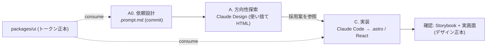

# Design Production Workflow

> 最終更新: 2026-07-26

デザイン制作 (方向性探索 → 実装) の **プラットフォーム共通ワークフロー** を定める横断契約。

- ツール選定の意思決定根拠 → [ADR-0012](../adr/0012-design-source-of-truth-implementation.md) (旧 [ADR-0004](../adr/0004-design-production-workflow.md) を置換)
- デザインシステムの _中身_ (トークン) の正本 → `packages/ui/src/styles/tokens.css` (体系は [ADR-0007](../adr/0007-design-token-architecture.md)、参照ハブは [feature doc](../design/features/corporate-site/DesignDoc_corporate-site.md))
- 本書は _どう作るか_ (プロセス・ディレクトリ・拡張方針) の運用正本。

## 1. 大原則

1. **デザインシステム正本は `packages/ui`** (トークン = [`tokens.css`](../packages/ui/src/styles/tokens.css) の CSS 変数 + コンポーネント。[ADR-0007](../adr/0007-design-token-architecture.md) で 2 層構造 + 3 entry 配信に確定)。各ツールはこれを **消費** するだけで fork しない。新トークンが要る場合は先に `packages/ui` へレビュー経由で昇格する。
2. **デザイン正本は実装 (コード + Storybook)** ([ADR-0012](../adr/0012-design-source-of-truth-implementation.md))。中間デザイン正本 (デザインファイル) を持たない。デザインの「今の姿」は実装と Storybook が示す。
3. **drift 最小**。中間正本を持たないことで二重更新が発生しない。durable な設計判断 (IA / レイアウト方針 / ブランド指針) は [design/features/](../design/features/) と `packages/ui` トークンへ back-propagate する。

## 2. 全体フロー

| Phase       | ツール              | 目的                                   | 成果の扱い                             |
| ----------- | ------------------- | -------------------------------------- | -------------------------------------- |
| A0 依頼設計 | 手動 / Claude Code  | Claude Design 依頼文を組む             | `.prompt.md` を **commit** (再現性)    |
| A 方向性    | Claude Design       | 方向性プロトを 2〜3 案出して比較・決定 | 使い捨て HTML (staging)。commit しない |
| C 実装      | Claude Code / Codex | 採用案を参照して直接実装               | `.astro` / React + Storybook (正本)    |

## 3. フェーズ詳細

### Phase A0: プロンプト設計 (Claude Design 依頼文の作成)

Claude Design の出力品質は依頼文に強く依存する (密な単一段落で具体的だと初稿が約 2/3 で実用、曖昧だとほぼゼロ)。対象画面ごとに依頼文を組み、`design/features/<feature>/<screen>.prompt.md` に **commit** する。

#### 初回セットアップ (design system 連携)

- Claude Design の Import で **codebase をリンク**し、`packages/ui` のトークン/コンポを design system として読ませる。
- **モノレポは全体でなく `packages/ui` (+ 対象 app) に絞ってリンク**する (性能・ブラウザ不安定回避)。`.git` / `node_modules` は含めない。

#### 依頼文テンプレ (goal / layout / content / audience を 1 段落で)

- **goal**: 何の画面/セクションを何のために作るか
- **layout**: 視覚構造 (セクション順・グリッド・nav 形式)。IA の正本は feature doc (例: [corporate-site のページ構成](../design/features/corporate-site/DesignDoc_corporate-site.md#ページ構成-ia))
- **content**: ドメインと **実コンテンツ素材** (company-profile / manufacturers の実テキスト。ダミー回避)
- **audience**: 誰向けか (例: 取引先・採用候補)
- **制約**: `packages/ui` トークン踏襲、Astro 静的・最小 island・性能予算、レスポンシブ (desktop / mobile)
- **出力**: standalone HTML、**2〜3案**、対象画面サイズ
- **状態**: empty / error / loading / データ量違い も出させる

#### 書き方のコツ

- 否定形でなく **具体指定** (×「クリーム色を使わない」→ ○「淡いシルバーグレー〜ブルーグレー、角丸 4px、角張った sans-serif」)。
- 汎用 AI 然とした既定 (Inter/Roboto、紫グラデ等) を避け、ブランド固有の選択を明示。
- **コンポーネント名を一貫させる** (名前が実装まで伝わる)。

### Phase A: 方向性探索 (Claude Design)

- A0 の依頼文で 2〜3 案を出す。非デザイナー (オーナー / PM) が方向性を素早く比較・決定する用途に限定する。
- **Claude が生成前に出す clarifying questions に必ず答える** (ここで品質が大きく上がる)。
- 修正は道具を使い分ける: **chat=構造的な作り替え / inline comment=要素を直接指す局所修正 / adjustment knobs=spacing・color のライブ調整**。
- 大胆な別案は「今のを保存して全く別方向を試して」で分岐させる。
- 採用案を standalone HTML で `design/.staging/` (gitignore 済み) へ出力する。**HTML 自体は正本にしない**。
- 期待値: Claude Design は **80〜90% の完成度の高速プロトタイピング**向き。細部は phase C の実装と Storybook レビューで詰める。

### Phase C: 実装 (Claude Code / Codex)

- 採用案の HTML とデザイン意図を参照し、layout / styling / 構造を実装へ写像する。参照元は使い捨てであり、成果物であるコードが以後の正本になる。
- 出力は **Astro 中心** (`src/pages/*.astro` + `src/components/sections/<section>/`。配置規約は [component-design.md](component-design.md))。`@kufu/ui` のトークン/コンポを参照する。インタラクションが要る所だけ React island (`client:*`) にする (境界は [ADR-0008](../adr/0008-astro-react-island-policy.md))。
- **状態系 (hover / focus / error / empty)、データ量違い・検索/フィルタ結果などの動的データ、レスポンシブは実装時に必ず補完する。** プロト HTML に無くても省略しない。
- 実データ (company-profile / manufacturers) で表示検証する。ダミーテキスト前提のレイアウト破綻を防ぐ。
- プロト HTML の素朴な div 配置をそのまま持ち込まず、`@kufu/ui` コンポ + セマンティック HTML へ **写像**する (a11y 崩れの防止)。
- 性能方針 (静的生成・最小 island) は [architecture.md](architecture.md) / [toolchain.md](toolchain.md) に従い、E2E / テストを整える。
- レビューは **Storybook と実画面** で行う。component は Storybook に story を置き、状態を確認できるようにする ([component-design.md](component-design.md))。

## 4. ディレクトリ / ファイル規約

デザイン成果物 (依頼文 / コンテンツ正本) は `design/features/<feature>/` に集約する。デザインの実体は実装側にある。

| 用途                      | 置き場所                                       | Git           | 備考                                                                                                                                                                                |
| ------------------------- | ---------------------------------------------- | ------------- | ----------------------------------------------------------------------------------------------------------------------------------------------------------------------------------- |
| Claude Design 依頼文      | `design/features/<feature>/<screen>.prompt.md` | commit        | A0 の依頼文。採用した方向のものを再現性のため残す (却下された方向案の依頼文は残さない)                                                                                              |
| Claude Design 仮置き      | `design/.staging/`                             | **gitignore** | phase A の使い捨て HTML。commit しない                                                                                                                                              |
| feature 設計 home         | `design/features/<feature>/DesignDoc_*.md`     | commit        | IA / 設計方針 / ブランド指針の正本                                                                                                                                                  |
| コンテンツ正本            | `design/features/<feature>/reference/`         | commit        | 掲載コンテンツの一次情報                                                                                                                                                            |
| 実装コード (デザイン正本) | `apps/<app>/src/(pages\|components)/`          | commit        | デザインの「今の姿」の正本。Storybook で状態を確認する                                                                                                                              |
| 画像アセット              | `apps/<app>/src/assets/`                       | commit        | Astro Image / import で最適化する ([ADR-0012](../adr/0012-design-source-of-truth-implementation.md))                                                                                |
| デザイントークン (正本)   | `packages/ui/src/styles/tokens.css`            | commit        | runtime CSS 変数の定義はここのみ。Tailwind utility 公開は `theme.css`、font-face は `fonts.css`、全量エントリは `styles.css` ([ADR-0007](../adr/0007-design-token-architecture.md)) |

`packages/ui/src/styles/` の内訳: `tokens.css` (CSS 変数の定義)/ `theme.css` (Tailwind utility への `@theme inline` mapping)/ `fonts.css` (font-face 登録)/ `globals.css` (全量エントリ = `@kufu/ui/styles.css`)。

## 5. shadcn/ui で表現できない場合の拡張ポリシー

shadcn/ui は **コードを自分の repo に copy して所有する** モデルなので行き止まりにならない。次の優先順で対応する (上から試す):

1. **トークンで寄せる**: 配色・radius・spacing・typography は `tokens.css` のセマンティックトークン (`--primary` 等) 上書きで、コンポーネントを書き換えず見た目を変える。
2. **既存コンポを直接編集**: 所有コードなので CVA の variant 追加・マークアップ変更で拡張する。
3. **wrapper パターン**: 既存コンポにロジック/レイアウトを足す場合は base を汚さず wrapper で包む。
4. **独自コンポーネント新設**: shadcn の流儀 (CVA variants・セマンティックトークン・a11y は Radix primitives) に沿って `packages/ui` に新規追加する。

「shadcn/ui の拡張」と「独自デザインシステム」は **対立しない**。別システムを並立させず、`packages/ui` を単一正本として **token → primitive → 独自コンポ** と積み上げる ([architecture.md](architecture.md) の colocation→昇格ルールに従う)。

## 6. トークン正本ガード (バリデーション)

- 実装コードが `@kufu/ui` トークンを参照しているか確認する。独自値 (raw hex / arbitrary value) を検出したら正本へ寄せる。
- **spacing 例外**: `space-*` は CSS トークンを持たず、Tailwind 標準スケールへの写像 (4px グリッド、対応は feature doc のデザイントークン節のガイド) として扱う ([ADR-0007](../adr/0007-design-token-architecture.md))。
- PR では [PULL_REQUEST_TEMPLATE](../.github/PULL_REQUEST_TEMPLATE.md) の Design Guard チェックリストで確認する。

## 7. Figma fallback

- チームが既に Figma 主体、または非エンジニアを含む共同デザインレビューが必要な場合のみ **Figma + Figma MCP Server** を採用してよい。
- その場合も **正本は `packages/ui` と実装**。Figma frame リンクから MCP 経由で実装へハンドオフし、design 判断は feature doc へ反映する。
- Figma 由来のトークンを使う場合も `tokens.css` へ 1:1 でマッピングし、トークンの二重管理を作らない。

## 8. 運用上の注意

- **ライセンス**: Claude Design は **Pro 枠で利用可** (research preview)。使用上限に当たれば Max へアップグレード (別購入不要)。
- **有償化トリガー**: 非エンジニア含む共同レビュー / 本格デザインオペが必要になったら **Figma + MCP** (§7 fallback) を検討する。単なるコストでは乗り換えない。
- フローを変える場合は [ADR-0012](../adr/0012-design-source-of-truth-implementation.md) を更新してから本書を改訂する。
