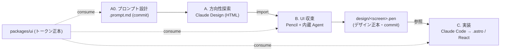

# Design Production Workflow

> 最終更新: 2026-06-06

デザイン制作（方向性 → UI 確定 → 実装）の **プラットフォーム共通ワークフロー** を定める横断契約。

- ツール選定の意思決定根拠 → [ADR-0004](../adr/0004-design-production-workflow.md)
- デザインシステムの _中身_（トークン）の正本 → [design system foundation (#13)](https://github.com/Fukuemon/kufu-apps/issues/13)
- 本書は _どう作るか_（プロセス・ディレクトリ・拡張方針）の運用正本。

## 1. 大原則

1. **デザインシステム正本は `packages/ui`**（トークン = [`globals.css`](../packages/ui/src/styles/globals.css) の CSS 変数 + コンポーネント）。各ツールはこれを **消費** するだけで fork しない。トークンは **一方向 `packages/ui` → Pencil**（consume のみ）。Pencil から `globals.css` を書き戻さない。新トークンが要る場合は先に `packages/ui`（#13）へレビュー経由で昇格してから Pencil に取り込む。`.pen` は「トークンを使ったデザイン」であって「トークンを定義する場所」ではない。
2. **デザイン正本は `.pen`**（repo 内・Git 管理）。**デザイン → コードは一方向**。Pencil へコードを round-trip しない（理由は §3「なぜコードを Pencil へ戻さないか」）。
3. **drift 最小**。`.pen` を「デザイン正本」、コードを「実装正本」とし、レビューで対応づける。durable な設計判断は [design/features/](../design/features/) と `packages/ui` トークンへ back-propagate して design 側を正本にする。

## 2. 全体フロー

確定した単一フロー（**design-first**）。`.pen` をデザイン正本にし、コードは `.pen` から一方向に生成する。

| Phase       | ツール               | 目的                                      | 成果物                                  |
| ----------- | -------------------- | ----------------------------------------- | --------------------------------------- |
| A0 依頼設計 | 手動 / Claude Code   | Claude Design 依頼文を組む                | `.prompt.md` を **commit**（再現性）    |
| A 方向性    | Claude Design        | 方向性プロトを2〜3案出して比較・決定      | 使い捨て HTML（staging）。commit しない |
| import      | Claude Design→Pencil | 採用案の HTML を Pencil canvas へ取り込む | （中間成果。`.pen` の元）               |
| B 収束      | Pencil + 内蔵 Agent  | canvas で pixel/余白/階層を精緻化         | `.pen` + `images/` を **commit**        |
| C 実装      | Claude Code / Codex  | `.pen`(JSON)+デザインを参照して実装       | 本実装（`.astro` / React）              |

## 3. フェーズ詳細

### Phase A0 — プロンプト設計（Claude Design 依頼文の作成）

Claude Design の出力品質は依頼文に強く依存する（ベストプラクティス: 密な単一段落で具体的だと初稿が約 2/3 で実用、曖昧だとほぼゼロ）。対象画面ごとに依頼文を組み、`apps/<app>/design/<screen>.prompt.md` に **commit** する（再現性 = §8 課題5 対策）。

#### 初回セットアップ（design system 連携）

- Claude Design の Import で **codebase をリンク**し、`packages/ui` のトークン/コンポを design system として読ませる。
- **モノレポは全体でなく `packages/ui`（+ 対象 app）に絞ってリンク**する（性能・ブラウザ不安定回避）。`.git` / `node_modules` は含めない。

#### 依頼文テンプレ（goal / layout / content / audience を1段落で）

- **goal**: 何の画面/セクションを何のために作るか
- **layout**: 視覚構造（セクション順・グリッド・nav 形式）。IA は [#11](https://github.com/Fukuemon/kufu-apps/issues/11) / [design/features/](../design/features/)
- **content**: ドメインと **実コンテンツ素材**（company-profile / manufacturers の実テキスト。ダミー回避）
- **audience**: 誰向けか（例: 取引先・採用候補）
- **制約**: `packages/ui` トークン踏襲、Astro 静的・最小 island・性能予算、レスポンシブ（desktop / mobile）
- **出力**: standalone HTML、**2〜3案**、対象画面サイズ
- **状態**: empty / error / loading / データ量違い も出させる（§8 課題3/4 の前倒し緩和）

#### 書き方のコツ

- 否定形でなく **具体指定**（×「クリーム色を使わない」→ ○「淡いシルバーグレー〜ブルーグレー、角丸 4px、角張った sans-serif」）。
- 汎用 AI 然とした既定（Inter/Roboto、紫グラデ等）を避け、ブランド固有の選択を明示。
- **コンポーネント名を一貫させる**（名前が後段の import/実装まで伝わる）。

### Phase A — 方向性探索（Claude Design）

- A0 の依頼文で 2〜3 案を出す。非デザイナー（オーナー / PM）が方向性を素早く比較・決定する用途に限定する。
- **Claude が生成前に出す clarifying questions に必ず答える**（ここで品質が大きく上がる）。
- 修正は道具を使い分ける: **chat=構造的な作り替え / inline comment=要素を直接指す局所修正（chat より正確）/ adjustment knobs=spacing・color のライブ調整**。
- 大胆な別案は「今のを保存して全く別方向を試して」で分岐させる。
- 採用案を standalone HTML で `design/.staging/`（gitignore 済み）へ出力する。**HTML 自体は正本にしない**。
- 期待値: Claude Design は **80〜90% の完成度の高速プロトタイピング**向き。pixel 確定は phase B（Pencil）で行う。

### import — Claude Design → Pencil

- Pencil の AI（`Cmd/Ctrl+K`）で、staging の HTML を canvas へ取り込む（`Recreate this page from design/.staging/<file>.html`）。
- これは方向性の持ち込みであり AI 再生成のため厳密ではない。**精緻化は phase B で行う前提**。

### Phase B — UI 収束（Pencil + 内蔵 Agent）

- Pencil の canvas と内蔵 Agent で pixel/余白/階層を精緻化し、`.pen` を確定する。
- トークンは `Create Pencil variables from globals.css` で [`globals.css`](../packages/ui/src/styles/globals.css) を参照（Pencil 変数 = CSS custom properties にマップ）。`packages/ui` を正本に保ったまま消費する。
- `.pen` と `images/` を commit して Git 管理する。これが以降のデザイン正本（レビューは生 JSON 差分でなくレンダリング/スクショで行う。§8 課題6）。

### Phase C — 実装（Claude Code / Codex）＝ 本実装

- Claude Code が **`.pen`（構造化 JSON）+ デザイン** を参照し、layout / styling / 構造を抽出して実装する。
- 出力は **Astro 中心**（`src/pages/*.astro` + `src/components/<feature>/`）。`@kufu/ui` のトークン/コンポを参照する。インタラクションが要る所だけ React island（`client:*`）にする。
- 性能方針（静的生成・最小 island）は [architecture.md](architecture.md) / [toolchain.md](toolchain.md) に従い、E2E/テストを整える。
- durable な設計判断（IA / レイアウト / フロー）は [design/features/](../design/features/) と `packages/ui` トークンへ back-propagate する。

### なぜコードを Pencil へ戻さないか

- Pencil の対応は **React / Vue / Svelte / HTML/CSS で、`.astro` は非対応**。corporate-site は Astro 中心のため `.astro` を Pencil に忠実インポートできない。
- Pencil の code↔design は **ライブリンクではなく AI 再生成**で、複雑レイアウトで 4〜8px のズレが出る等 **非可逆(lossy)**。
- よって **`.pen` をデザイン正本にし、コードは `.pen` から一方向に生成**する。デザイン変更は **`.pen` を直してから該当箇所のコードを再生成/修正**する（コードを Pencil に取り込み直さない）。

## 4. ディレクトリ / ファイル規約（確定）

| 用途                     | 置き場所                               | Git           | 備考                                       |
| ------------------------ | -------------------------------------- | ------------- | ------------------------------------------ |
| Claude Design 依頼文     | `apps/<app>/design/<screen>.prompt.md` | commit        | A0 の依頼文。再現性のため残す              |
| Claude Design 仮置き     | `design/.staging/`                     | **gitignore** | phase A の使い捨て HTML。commit しない     |
| 確定デザイン（`.pen`）   | `apps/<app>/design/<screen>.pen`       | commit        | デザイン正本。画面/feature 単位で複数可    |
| `.pen` 付随アセット      | `apps/<app>/design/images/`            | commit        | `.pen` から相対参照。Pencil が自動生成     |
| 実装コード               | `apps/<app>/src/(pages\|components)/`  | commit        | `.pen` を参照して実装。実装正本            |
| デザイントークン（正本） | `packages/ui/src/styles/globals.css`   | commit        | 全フェーズが consume。ここでしか定義しない |

- `.pen` は **1プロジェクト＝複数可**。`home.pen` / `components.pen` のように目的別に分割する。
- 配置は本表で確定。パイロットで例外が出たら本表を更新してから運用する。

## 5. shadcn/ui で表現できない場合の拡張ポリシー

shadcn/ui は **コードを自分の repo に copy して所有する** モデルなので行き止まりにならない。次の優先順で対応する（上から試す）:

1. **トークンで寄せる**: 配色・radius・spacing・typography は `globals.css` のセマンティックトークン（`--primary` 等）上書きで、コンポーネントを書き換えず見た目を変える。
2. **既存コンポを直接編集**: 所有コードなので CVA の variant 追加・マークアップ変更で拡張する。
3. **wrapper パターン**: 既存コンポにロジック/レイアウトを足す場合は base を汚さず wrapper で包む。
4. **独自コンポーネント新設**: shadcn の流儀（CVA variants・セマンティックトークン・a11y は Radix primitives）に沿って `packages/ui` に新規追加する。

「shadcn/ui の拡張」と「独自デザインシステム」は **対立しない**。別システムを並立させず、`packages/ui` を単一正本として **token → primitive → 独自コンポ** と積み上げる（[architecture.md](architecture.md) の colocation→昇格ルールに従う）。Figma 由来トークンを使う場合も Tailwind theme / `globals.css` に 1:1 マッピングして drift を防ぐ。

## 6. トークン正本ガード（バリデーション）

- 実装コードが `@kufu/ui` トークンを参照しているか確認する。独自値を検出したら正本へ寄せる。
- `.pen` が `packages/ui` を fork していないか（独自トークンを抱えていないか）確認する。fork を検出したら差し戻す。

## 7. Figma fallback

- チームが既に Figma 主体、または非エンジニアを含む共同デザインレビューが必要な場合のみ **Figma + Figma MCP Server** を採用してよい。
- その場合も **正本は `packages/ui`**。Figma frame リンクから MCP 経由で実装へハンドオフし、design 判断は design feature doc へ反映する。

## 8. 既知の課題と緩和策

`.pen` 起点で DS 作成・実装する際の落とし穴と運用ルール。

| #   | 課題                                                                         | 緩和策                                                                                    |
| --- | ---------------------------------------------------------------------------- | ----------------------------------------------------------------------------------------- |
| 1   | 正本の向きの衝突（`.pen` がトークン源泉になり `packages/ui` と二重正本）     | トークンは一方向 `packages/ui` → Pencil。新トークンは先に #13 へ昇格（§1 大原則）         |
| 2   | `.pen` は幾何ツリーで意味論なし → 素朴実装で div 配置・a11y 崩れ             | 実装時に `.pen` プリミティブ → `@kufu/ui` コンポ + セマンティック HTML へ**写像**を必須化 |
| 3   | レスポンシブ / 状態(hover/focus/error) / 動的データ(リスト・i18n) が入らない | A0/A で Claude Design に状態も出させ、spec / feature doc で規定、phase C で必ず補完       |
| 4   | ダミーテキスト前提でレイアウトが実データで破綻                               | phase C で実コンテンツ（company-profile / manufacturers）での検証を行う                   |
| 5   | `.pen` → コードは AI 再生成で非決定的                                        | `.pen` は「意図の正本」。pixel 契約にせず許容差を決めて目視確認                           |
| 6   | `.pen`(JSON) の座標差分は PR で読めない                                      | レビューはレンダリング / スクショで行い、生 JSON 差分に依存しない                         |
| 7   | コンポーネント正本の二重化（`.pen` vs Storybook）                            | 生きたコンポ正本は `packages/ui` + Storybook(#6)。`.pen` はデザイン意図に限定             |

## 9. 運用上の注意

- **ライセンス（確定）**: Claude Design は **Pro 枠で利用可**（research preview）。使用上限に当たれば Max へアップグレード（別購入不要）。Pencil は **無償枠を既定**とする。
- **有償化トリガー（確定）**: 単なるコストでは乗り換えない。① 非エンジニア含む共同レビュー / 本格デザインオペが必要 → **Figma + MCP**（§7 fallback）。② Pencil の seat / 機能上限のみでワークフローは満足 → **Pencil 有償**。
- 本ワークフローは corporate-site の1ページでパイロット実走して検証してから本採用する。特に **`.pen` 参照での `.astro` 実装精度** を確認する。
- ツール選定・確定フローを変える場合は [ADR-0004](../adr/0004-design-production-workflow.md) を更新してから本書を改訂する。
