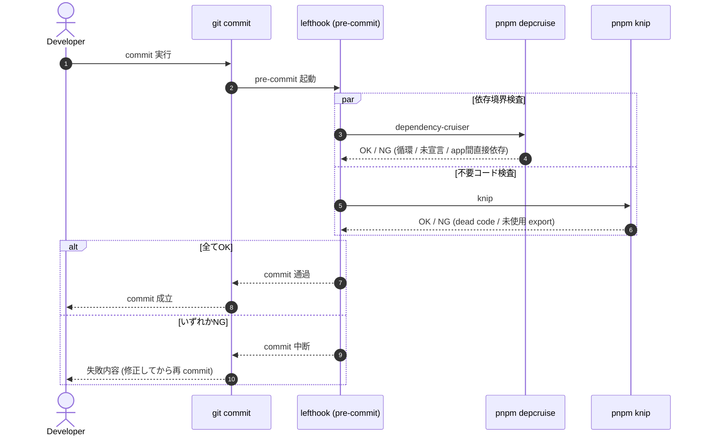

# Engineering Conventions

> 最終更新: 2026-08-16

shared config / root task / repository quality gate の境界規約。toolchain 一覧は [toolchain.md](toolchain.md)。

## Shared Config Boundary

- `packages/config` は少なくとも `tsconfig`、`oxlint`、`vitest` の共有設定を export する。
- export は用途別 subpath を正とし、`tsconfig/base`、`tsconfig/react`、`tsconfig/astro`、`oxlint/base`、`vitest/base` を初期対象にする。
- `oxfmt` は config file をほぼ持たない前提のため、root script と実行ルールを正本にする。
- `knip` と `dependency-cruiser` は workspace 全体を検査するため、root config と root script を正とする。
- `Storybook` は shared UI と app-local Presentation component の review 入口として扱う。詳細な component 配置・命名・Storybook 対象は [component-design.md](component-design.md) を正本とする。
- `packages/ui` Storybook は shared component catalog とし、`apps/*` の app-local Storybook は feature-local Presentation component の review 入口とする。
- shared component を `packages/ui` に追加する場合は Storybook story を必須にする。

## Root Task Boundary

- workspace task は root script から `turbo run` で束ねる。
- `dev`、`dev:corporate`、`build`、`lint`、`typecheck`、`test` は `turbo run` を使う。
- `typecheck` の実体は各 workspace が持ち root は集約のみ (corporate-site は `astro check`、packages は `tsc --noEmit`)。TypeScript project references は workspace が増えるまで導入しない。
- `format`、`e2e`、`knip`、`depcruise` は root 管理ツールとして直実行する。
- `e2e`、`knip`、`dependency-cruiser` は package task ではなく repository task として扱う。
- Storybook 起動導線は root から対象 package / app へ委譲する: `storybook` は shared / app-local を並列起動し、`storybook:ui` は `packages/ui`、`storybook:corporate` は `apps/corporate-site` を対象にする。
- Storybook build は production `build` に混ぜず、dedicated quality gate (`storybook:build`) として扱う。
- `lefthook` の `pre-commit` で `pnpm depcruise` と `pnpm knip` を自動実行し、commit 前に repository quality gate を通す。

## Repository Quality Gate (pre-commit)

Storybook build は CI / PR quality gate の対象とするが、pre-commit の必須 gate には含めない。ローカル commit 前の必須 gate は引き続き `depcruise` / `knip` とし、Storybook は PR で破損を検出する。

### CI とローカル hook の分担

正本は [ADR-0016](../adr/0016-ci-local-hook-responsibility.md)。

- **CI を最後の砦とする。** pre-commit は `--no-verify` で迂回できるため、`typecheck` / `build` / `knip` / `depcruise` / `e2e` / VRT を CI に載せる。ローカル hook との重複は**意図的な二重化**として許容する。
- ローカル hook は速いフィードバックを担い、CI は迂回不可能な gate を担う。同じ検査が両方で走ることを問題としない。
- **CI 実行時間の目標値は置かない。** ジョブ追加後の実測値を記録し、その値を見て Turbo remote cache の要否と required status checks の設定を判断する。
- VRT の撮影と判定は CI 環境に一本化する (ローカルと CI でフォントのレンダリングが異なるため。[ADR-0015](../adr/0015-visual-regression-testing-policy.md))。

## Docs Closeout Gate (手動)

`pnpm check:specs` は close 済み issue の spec ディレクトリが `specs/` に残っていないかを検査する。closeout (issue close 時の spec 削除) の実施を担保する gate であり、判断根拠は [ADR-0011](../adr/0011-specs-closeout-enforcement.md)。

- 実行タイミング: **issue close 直後** と、文書整理の PR。close 前に実行しても対象 issue はまだ OPEN で、その spec の消し忘れは検出できない
- `gh` CLI で issue state を照会するため、オフライン時・commit 速度への影響を避けて **lefthook には組み込まない**
- CI では `.github/workflows/spec-residue.yml` が同じ検査を実行する (default branch への push / 週次 cron / 手動)。**PR ゲートにはしない** — 別 PR で spec を清算する運用では、issue は閉じたが spec は残っている窓の間、無関係な PR が落ちるため
- 残存を検出したら [specs/README.md](../specs/README.md) の清算手順に従う

## Repository Analysis Contract

- `knip` は workspace ごとの `project` / `entry` を持つ monorepo config を root `knip.json` に持つ。
- `dependency-cruiser` は root `.dependency-cruiser.cjs` を正本とし、少なくとも circular dependency、未宣言依存、devDependency 流入、app 間直接依存を検査する。
- app 間直接依存は禁止し、共有コードは `packages/*` の公開入口へ寄せる ([architecture.md](architecture.md))。
- false positive を避けるため、generated file や root 管理の設定ファイルは root config 側で除外する。

## Storybook Review Contract

- `packages/ui` の shared component は `packages/ui` Storybook に掲載する。
- `apps/*` に閉じる Presentation component は app-local Storybook に掲載する。
- `packages/ui` Storybook に app 固有 component / page-level sample を置かない。
- app-local Storybook は production artifact ではなく、runtime bundle / performance budget には含めない。
- story は default を必須とし、主要 variant / error / empty / disabled などの状態がある場合は story に残す。
- story は固定 props / fixture を使い、本番 secret や実送信を伴う Container を載せない。
- Storybook build は CI / PR で確認する。production `build` の一部にはしない。
