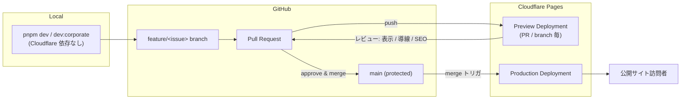

# Infrastructure & Operations

> 最終更新: 2026-05-31

公開基盤・環境戦略・運用・セキュリティの契約。Terraform 実体は別 repo (`kufu-infra`) で管理する ([ADR-0001](../adr/0001-terraform-infra-repository-boundary.md))。本書は **app 側が依存する contract** を定義する。

## Infrastructure / Deployment

- 公開基盤: Cloudflare (Pages を第一候補、Workers は API / BFF 必要時のみ)。
- `apps/corporate-site` は Astro 静的生成 → Cloudflare Pages への build artifact 配信を前提に構成する。
- API / BFF を導入しない限り、Node.js 常駐サーバや専用 VM を前提にしない。
- 静的 asset (画像 / 動画 / フォント) は Cloudflare CDN 配信を前提に最適化する。
- DNS / TLS / キャッシュ / 圧縮は Cloudflare 標準機能に寄せ、app 側で重複実装しない。
- Terraform の実体は `kufu-infra` repo を正本とし、本 monorepo には Terraform 本体を置かない。

## Infrastructure Contract (app → infra)

app 側から infra repo へ受け渡す contract:

- Pages project 名 (preview / production)
- preview / production の domain
- 必要な secret 名 (実値は repo に保存しない)
- Workers 依存の有無
- app 変更で infra 差分が必要な場合の参照リンク (spec / ADR → infra repo PR)

## Environment Strategy

| Environment | Purpose                | Cloudflare Role                                             |
| ----------- | ---------------------- | ----------------------------------------------------------- |
| local       | 開発者のローカル確認   | `pnpm dev` で app を起動し、Cloudflare 依存を持ち込まない。 |
| preview     | PR / branch ごとの確認 | Cloudflare Pages preview deployment で実ページ確認を行う。  |
| production  | 公開サイト             | Cloudflare Pages production deployment を正本とする。       |

- Preview URL を使って、レイアウト崩れ、リンク、フォーム導線、SEO メタデータをレビューする。
- 本番 deploy は `main` へのマージを起点に行う前提で設計する。
- branch 単位で安全に確認できることを、コーポレートサイト改修の標準 workflow に含める。

図の要点:

- preview と production はどちらも Cloudflare Pages 上で同じ build 経路を通る。
- preview レビュー (レイアウト / リンク / フォーム / SEO) を通過しない PR は merge しない。
- production への昇格は **`main` へのマージのみ**が起点で、手動 deploy 経路を標準にしない。
- infra 側 (Pages project / domain / secret) の変更は Infrastructure Contract 経由で `kufu-infra` repo へ依頼する。

## Operations / Observability

- deploy 成功だけでなく、preview での導線確認を公開判定に含める。
- Cloudflare Analytics や Web Analytics を利用できる場合は、コーポレートサイトの performance と導線計測の一次観測点として使う。
- 監視、ログ、分析の詳細は、フォーム導線や API 連携の採用時に spec / ADR で追加定義する。
- Cloudflare 固有設定が app 実装に漏れ出さないよう、framework 設定と deploy 設定の責務を分ける。
- Terraform plan / apply の手順や state backend の詳細は infra repo 側で管理し、この monorepo に複製しない。

## Security / Privacy

- Cloudflare 上で扱う secret、token、API key は client 側へ露出させず、環境ごとの secret 管理に分離する。
- Terraform variable や provider credential など infra 用の秘匿情報は app repo に持ち込まない。
- フォーム保護や bot 対策が必要な場合は、Cloudflare Turnstile など edge 側サービスを候補に含める。
- CMS/API を導入する場合は、認証、権限、公開フロー、プレビュー環境を設計する ([DesignDoc_cms.md](../design/features/cms/DesignDoc_cms.md))。
- コーポレートサイトの assets はライセンスと利用許諾を確認する。
- 問い合わせフォームなどで個人情報を扱う場合の方針は feature / spec で明記する。
