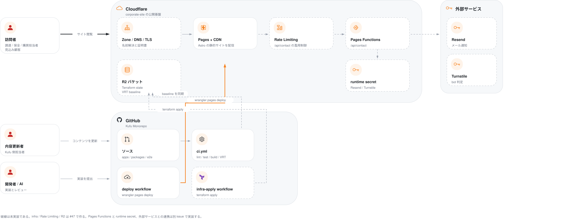

# Kufu Monorepo Design Doc

## Overview

Kufu Monorepo は、Kufu のコーポレートサイトと、共通の UI、設定、テストの基盤を pnpm workspace で管理する。  
コーポレートサイトの訪問者は取扱領域と連絡先を閲覧し、内容を更新する担当者は掲載する内容を更新して確かめる。  
誰のどの課題を解くかは [PRD](../PRD.md) にある。

コーポレートサイトは Astro で静的に生成し、Cloudflare から配信する。  
UI は共有の package に置き、CMS は最初から作らない。  
ADR-0019: [コーポレートサイトを Astro の静的な生成で作る](../adr/0019-astro-static-corporate-site.md)

## Goals and Non-Goals

この設計が提供するものは次のとおり。

- `apps/corporate-site` を、Astro の静的な生成によるコーポレートサイトとして作り、保守する。
- `packages/ui` に、デザイントークンと、共有の UI の primitive を置く。
- `packages/config` に、TypeScript、lint、format などの共有の設定を置く。
- ルートで管理する E2E で、コーポレートサイトの主な導線を公開の前に確かめる。
- AI エージェント向けの設定（`AGENTS.md`、`CLAUDE.md`、`.agents`、`.codex`、`.claude`）を、monorepo の方針に合わせる。

意図して作らないものは次のとおり。

- CMS と API、認証、管理画面、業務のツール
- Astro で完結できるコーポレートサイトの機能の React 化
- 用途が決まらない `packages/ui` の抽象化と、汎用の UI のライブラリ
- 本番の基盤を apply する仕組み。Terraform は別のリポジトリ `kufu-infra` が持つ。
  - ADR-0001: [Terraform を基盤のリポジトリに分ける](../adr/0001-terraform-infra-repository-boundary.md)

## Assumptions and Constraints

- 文書の上の正式な名前は `Kufu Monorepo` にする。
- npm の package の名前の接頭辞は `@kufu/*` にする。
- app を実装する対象は `apps/corporate-site` だけにする。
  - ADR-0003: [Phase 1 は corporate-site だけを実装する](../adr/0003-phase1-corporate-site-only-and-cms-deferred.md)
- UI はコーポレートサイトの中に置くことを第一の原則にし、複数の利用者がはっきりしたものを `packages/ui` へ移す。
  - デザイントークンは、最初から `packages/ui` を基準にする。
  - ADR-0007: [デザイントークンの構成](../adr/0007-design-token-architecture.md)
- TypeScript、lint、format、test の設定は `packages/config` に集める。
- pnpm workspace と Turborepo を使い、app と package の単位でタスクを実行する。
- 基盤は Cloudflare の標準の機能で閉じ、独自のサーバーの運用を前提にしない。

## Architecture

利用者、リポジトリ、公開の基盤、外部のサービスの関係を 1 枚で示す。  
利用者と外部のシステムの関係（C4 の L1）は、[PRD の Landscape](../PRD.md#landscape) にもある。



- **破線は未実装である。**
  `infra/`、Worker、Rate Limiting、R2 は、決まっているがまだ作っていない。
  ADR-0020: [Terraform の infra code を Kufu Monorepo へ集約する](../adr/0020-terraform-monorepo-consolidation.md)  
  ADR-0023: [配信基盤を Cloudflare Pages から Workers static assets へ移す](../adr/0023-workers-static-assets-over-pages.md)
  実装が進んだら実線に変える。
- 訪問者が触れるのは Cloudflare だけである。GitHub は成果物を届ける側にあり、利用者からは見えない。
- 内容を更新する担当者と開発者は、どちらも pull request から変更を出す。内容の更新も実装も、同じ CI（`ci.yml`）のチェックを通る。
- 本番へ変更を出す workflow は 2 本ある。`deploy workflow` がアプリを配り、`infra-apply workflow` が基盤を変える。2 本が持つ credential は分かれている。
- R2 は、Terraform の state と VRT の baseline の 2 つに使う。baseline は、`ci.yml` が比べる前と後で同期する。
- この図だけは、今の事実だけを書く原則の例外として、決まっているが未実装の構成を含む。
  ADR-0013: [Design Doc の各節には今の事実だけを書く](../adr/0013-designdoc-present-facts-only.md)

- `apps/corporate-site` は、`packages/ui` と `packages/config` が公開するエントリポイントだけに依存する。
- `packages/ui` は `packages/config` に依存してよい。
- app の間で直接依存しない。
- 依存の規則とチェックの方法は [context/codebase.md](../context/codebase.md#dependency-rules) にある。

## Components

### apps/corporate-site

Astro によるコーポレートサイト。  
静的な生成、内容の構成、最小限の island を担う。  
app の中の Storybook で、section のコンポーネントをレビューする。

- 持たないもの: デザイントークンとフォントの定義、複数の app で使う UI、本番の基盤の設定
- 設計: [コーポレートサイトの Design Doc](../apps/corporate-site/DesignDoc.md)
- 問い合わせフォームの設計: [問い合わせフォームの Design Doc](features/contact-form/DesignDoc.md)

### packages/ui

デザイントークン、フォント、共有のスタイルシートの基準と、再利用がはっきりした共有の UI の primitive を置く。  
Storybook で共有のカタログを提供する。  
ADR-0007: [デザイントークンの構成](../adr/0007-design-token-architecture.md)

- 持たないもの: ページの section、業務の文言を持つコンポーネント、app のデータの形に依存するコンポーネント
- 置いてよいものの規則は [context/codebase.md](../context/codebase.md#app-の中の層) にある。

### packages/config

TypeScript、oxlint、Vitest のような、共有する価値の高い設定を集める。

- 持たないもの: knip と dependency-cruiser の設定。リポジトリの全体を見るので、ルートに置く。
- subpath の一覧は [context/conventions.md](../context/conventions.md#shared-configuration) にある。

### e2e

ルートで管理する Playwright で、公開の前の検証と、主な導線の回帰のテストを担う。  
route の VRT もここで撮る。

- 持たないもの: 1 つのコンポーネントの中で閉じる操作の検証。Storybook の play が担う。
- テストの種類ごとの責務は [context/testing.md](../context/testing.md#test-types-and-guarantees) にある。

### apps/cms（候補）

コーポレートサイトに掲載する投稿を管理する app の候補。  
実装していない。  
React の app の標準の候補は [CMS の Design Doc](features/cms/DesignDoc.md) にある。

## Interfaces

- `@kufu/ui` は、コンポーネント、hooks、utility と、スタイルシートの 4 つのエントリ（`styles.css`、`tokens.css`、`theme.css`、`fonts.css`）を export する。
  - 一覧は `packages/ui/package.json` の `exports` にある。
  - スタイルシートの使い分けは [context/codebase.md](../context/codebase.md#スタイルのファイル) にある。
- `@kufu/config` は、用途別の subpath で共有の設定を export する。
- ルートのコマンドは [context/tech-stack.md](../context/tech-stack.md#ルートのコマンド) にある。
- E2E の環境変数と、app が持つ script の取り決めは [context/testing.md](../context/testing.md#runtime-requirements) にある。
- Edge API の共通の契約は [context/codebase.md](../context/codebase.md#edge-api) にある。

## Cross-Cutting Concerns

### 判断の優先順位

設計の判断が食い違ったときは、次の順に優先する。

1. 性能。特にコーポレートサイトでは、Astro の静的な生成と、最小の island を優先する。
2. 一貫性。UI、構造、命名を揃え、app の配下で独自に実装しない。
3. 開発体験
4. 将来の拡張のしやすさ

### 設計の方針

- コーポレートサイトの性能と SEO を最も優先する。
- Astro で解決できるものを React の island にしない。
  - ADR-0008: [Astro と React island の方針](../adr/0008-astro-react-island-policy.md)
- 基盤は Cloudflare の標準の機能で閉じ、独自のサーバーの運用を前提にしない。
- Terraform は別のリポジトリで管理し、app のリポジトリに本番の基盤を apply する流れを持ち込まない。
  - ADR-0001: [Terraform を基盤のリポジトリに分ける](../adr/0001-terraform-infra-repository-boundary.md)
- AI エージェントは、Design Doc、ADR、package の境界を参照し、対象の外の実装を避ける。
- デザインの基準は、実装のコードと Storybook にする。
  - ADR-0012: [デザインの基準を実装にする](../adr/0012-design-source-of-truth-implementation.md)

### 取り決めの所在

横断の取り決めは [context/](../context/index.md) にある。  
環境、公開の条件、秘密情報の置き場は [context/operations.md](../context/operations.md) に、チェックの実行点は [context/conventions.md](../context/conventions.md#チェックの実行点) にある。

## Repository Layout

```text
.
├── PRD.md
├── apps/
│   └── corporate-site/   # Astro のコーポレートサイト。DesignDoc.md を持つ
├── packages/
│   ├── ui/               # デザイントークン、共有の UI、Storybook
│   └── config/           # 共有の TypeScript、oxlint、Vitest の設定
├── e2e/                  # Playwright の E2E と route の VRT
├── playwright.config.ts
├── design/
│   ├── DesignDoc.md      # この文書
│   └── features/         # コードがまだない機能の Design Doc と、掲載する内容の一次情報
├── adr/
├── context/
├── specs/                # issue ごとの作業の文書。issue を閉じるときに消す
└── scripts/              # リポジトリのチェックと VRT のスクリプト
```
