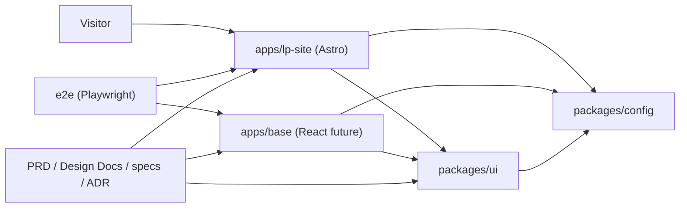

# Kufu Monorepo Design Docs

## Latest Updated At

- 2026-05-07

## Related PRD

- [PRD.md](../PRD.md)

## Goal

Kufu の LP サイトを Astro で高いパフォーマンスと保守性を保って構築し、将来の React 業務アプリ、管理画面、CMS/API 連携を追加できる pnpm monorepo の責務境界を定義する。

## Non Goals

- 初期段階で CMS/API、認証、管理画面、内部業務ツールを実装すること。
- Astro で完結できる LP 機能を React へ寄せること。
- `packages/ui` を将来未確定の用途まで見越して過剰に抽象化すること。

## Background

### 前提用語

- LP: Kufu のマーケティングサイト。
- Island: Astro ページ上で必要箇所だけクライアント実行される UI。
- app: `apps/*` 配下の実行単位。
- package: `packages/*` 配下の共有 UI、設定、ライブラリ。
- spec: issue / 機能単位で、要求、設計、テスト観点を整理する作業文書。
- ADR: 長期参照する意思決定ログ。

### 背景

Kufu Monorepo は、Phase 1 で LP サイトを作ることを主目的とする。LP は表示速度、情報の分かりやすさ、公開前検証が重要であり、不要な React 化やクライアント JavaScript の増加を避ける必要がある。

一方で、将来は React ベースの業務効率化ツールや管理画面、CMS/API 連携が必要になる可能性がある。初期から app / package の責務と AI 向けルールを定義しておくことで、将来拡張時も LP の性能と monorepo の一貫性を守れる。

### 設計上の前提

- Phase 1 の主対象は `apps/lp-site` である。
- `apps/base` は将来の React 業務アプリ枠として定義する。
- UI の共通化は `packages/ui` に集約する。
- TypeScript、lint、format、test 設定は `packages/config` に寄せる。
- pnpm workspace と Turborepo を使い、app / package 単位でタスクを実行する。
- CMS/API は初期スコープ外で、必要時に ADR と spec を作成して採否を決める。

## Overview

Kufu Monorepo は、`apps`、`packages`、`e2e`、`docs workflow` の 4 つの領域で構成する。

## Detailed Design

### モジュール責務

| Module            | Responsibility                                                          |
| ----------------- | ----------------------------------------------------------------------- |
| `apps/lp-site`    | Astro による LP。静的生成、コンテンツ構成、必要最小限の island を担う。 |
| `apps/base`       | 将来の React 業務アプリ。TanStack Router / Query などの標準を採用する。 |
| `packages/ui`     | 複数 app で共有する React UI。shadcn/ui ベースの部品を集約する。        |
| `packages/config` | TypeScript、oxlint、oxfmt、Vitest、Storybook などの共有設定を集約する。 |
| `e2e`             | Playwright による公開前検証と主要導線の回帰テストを担う。               |
| `specs`           | issue / 機能単位の要求、論点、設計、テスト観点を整理する。              |
| `adr`             | 長期参照する技術選定や責務境界の意思決定を残す。                        |

### Phase 1 設計方針

- LP は Astro の `.astro` コンポーネントを基本にする。
- React island はフォーム、動的 UI、外部 widget など必要な箇所に限定する。
- LP の画像、フォント、スクリプトは性能予算を意識して管理する。
- 共通 UI は利用箇所が複数 app にまたがる時点で `packages/ui` へ移す。
- 初期の `packages/ui` は実利用に基づく最小構成にし、将来未確定のコンポーネントは先回りしない。
- E2E は LP の表示、主要導線、問い合わせ導線を優先する。

### React アプリ設計方針

- ルーティングは TanStack Router を標準とする。
- データフェッチは TanStack Query を標準とし、axios などの追加は spec で必要性を確認する。
- 状態管理は Zustand を必要箇所に限定し、URL に表現できる状態は router 側へ寄せる。
- フォームは React Hook Form を標準とする。
- React Compiler を使う前提で実装する。
- React Compiler に対応していないライブラリや実装パターンを使う場合は、事前に公式情報や一次情報を確認し、必要なら `'use no memo'` を追加する。

### Toolchain

- Package manager: pnpm workspace
- Task runner: Turborepo
- LP framework: Astro
- React app build: Vite
- Bundler: Rolldown
- Language: TypeScript
- Linter: oxlint
- Formatter: oxfmt
- Unit test: Vitest
- UI catalog: Storybook
- E2E: Playwright
- Dead code detection: knip
- Dependency analysis: dependency-cruiser
- Library build: tsdown

### 主要ユースケース

#### 1. LP ページを追加する

1. `apps/lp-site` に Astro ページまたは section component を追加する。
2. 静的な表示で足りる場合は `.astro` に閉じる。
3. 動的 UI が必要な場合だけ React island を使う。
4. 共通化すべき UI がある場合は `packages/ui` へ移す。
5. Playwright で主要導線を確認する。

#### 2. 共通 UI を追加する

1. 複数 app または将来の再利用が明確な UI だけを `packages/ui` に追加する。
2. shadcn/ui ベースの実装は app 配下で重複定義しない。
3. Storybook で利用状態を確認できるようにする。
4. LP 側で使う場合は、不要な client directive が増えないか確認する。

#### 3. React 業務アプリを追加する

1. `apps/base` または新規 `apps/*` に app shell を作る。
2. ルーティング、データフェッチ、フォーム、状態管理は標準ライブラリを使う。
3. UI は `@kufu/ui` を経由する。
4. React Compiler 互換性を確認する。
5. E2E と unit test の責務を spec で定義する。

#### 4. CMS/API 連携を検討する

1. CMS が必要な理由、更新頻度、運用者、公開フローを spec に書く。
2. Hono API、Inertia、React の採否を ADR で比較する。
3. API package や app 追加が必要な場合だけ monorepo 構成を拡張する。
4. LP の性能と公開安全性を満たすことを採用条件にする。

### Data / Content 設計

- LP の静的コンテンツは、初期段階では `apps/lp-site` 内に配置する。
- CMS 化するまでは、コンテンツ更新の責務とレビュー観点を spec に残す。
- 画像や動画などの assets は LP の性能予算を考慮して配置、圧縮、読み込み方式を決める。
- URL は状態管理の一部として扱い、React app では TanStack Router の route state に寄せる。

### Package Boundary

- app から別 app の内部実装へ依存しない。
- app から `packages/ui`、`packages/config` など公開 package を経由して共有する。
- app 固有の UI は app 内に置き、複数 app で使う段階で `packages/ui` へ昇格する。
- 共通 utility は必要性が明確な場合だけ package 化する。

### 設計上の重要ポイント

- LP の performance と SEO を最優先する。
- Astro で解決できるものを React island にしない。
- React アプリでは URL、server state、client state を分けて扱う。
- AI workflow は spec / ADR / package boundary を参照して、対象外の実装を避ける。
- CMS/API は「将来の選択肢」であり、初期の前提として実装しない。

## Alternatives Considered

### LP も React SPA で作る

- 利点: React app と技術を統一しやすい。
- 欠点: LP に不要な JavaScript が増えやすく、性能と静的生成の利点を失う。
- 不採用理由: Phase 1 の主価値は LP の高速公開と保守性であり、Astro の方が適しているため。

### app ごとに UI を個別実装する

- 利点: 初期実装は速い。
- 欠点: デザインや挙動が分岐し、将来の修正コストが上がる。
- 不採用理由: monorepo の価値は再利用性と一貫性にあるため。

### 初期から CMS/API を作る

- 利点: コンテンツ更新の自由度が高い。
- 欠点: 初期の LP 公開に対して複雑性が高く、運用や認証の設計も必要になる。
- 不採用理由: 現時点の主目的は Astro LP の構築であり、CMS は必要性が具体化してから判断するため。

## Caveats / Security / Privacy

- 問い合わせフォームや外部サービス連携を追加する場合は、個人情報の扱いを spec で明記する。
- CMS/API を導入する場合は、認証、権限、公開フロー、プレビュー環境を設計する。
- LP の assets はライセンスと利用許諾を確認する。
- React Compiler 対応はライブラリ更新により変化するため、導入時点で確認する。

## Test Plan

- `apps/lp-site` が build できること。
- LP の主要ページと問い合わせ導線が Playwright で確認できること。
- Astro ページに不要な React island や client directive が増えていないこと。
- `packages/ui` の共有 UI が Storybook / unit test で確認できること。
- `packages/config` の共有設定を各 app / package が利用できること。
- React app 追加時に TanStack Router、TanStack Query、React Hook Form、Zustand、React Compiler 前提が守られること。
- CMS/API を導入する場合は、ADR と spec が先に作成されていること。

## Open Questions

- LP の具体的なページ構成とコンテンツ更新フローをどこまで初期 spec に含めるか。
- `packages/ui` の初期コンポーネント範囲をどこまでにするか。
- CMS が必要になる判断基準をどの指標で固定するか。
