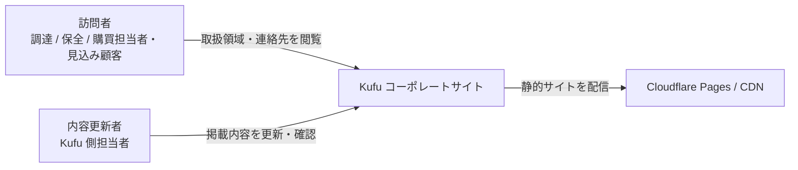
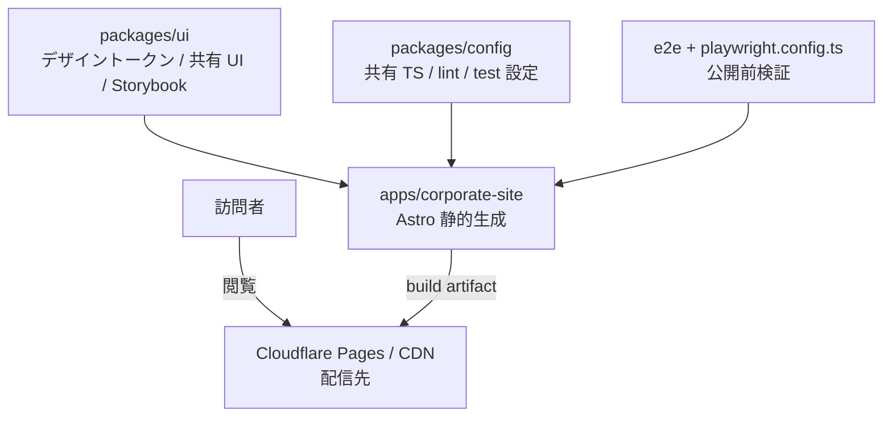

# Kufu Monorepo Design Docs

> 最終更新: 2026-07-26

**Document Status:** Approved
**Development Status:** In Progress

本 Design Doc は Kufu Monorepo の **全体像 (system landscape)** を扱う。Why/What の所在 → Goal → アーキテクチャ概観 → モジュール責務の順に示し、詳細は feature doc と context library へ委譲する。独立 PRD は作らず、本 doc の `## Why / What` 節を PRD 相当の正本とする。要求と landscape 判断を同じ読者・同じ変更単位で管理し、重複と drift を避けるためである。

本 doc は **現状の事実のみ**を記載する。将来計画は [Open Questions / Future Work](#open-questions--future-work) 節に集約し、他の節には書かない ([ADR-0013](../adr/0013-designdoc-present-facts-only.md))。

## 概要 (Summary)

Kufu Monorepo は、Kufu のコーポレートサイトと共通 UI / 設定 / テスト基盤を pnpm workspace で一元管理するリポジトリである。Astro によるコーポレートサイトを高いパフォーマンスと保守性を保って公開することを主目的とする。主な利用者はコーポレートサイト訪問者と内容更新者であり、開発者 / AI エージェントはその価値を安全に実装するためのステークホルダーである。詳細な feature 設計は [design/features/](features/)、技術規約は [context/](../context/)、プロジェクト固有値は [context/project.yml](../context/project.yml) を正本とする。

## Why / What

### 背景・課題 (Why)

事業上の課題:

- 調達 / 保全 / 購買担当者や見込み顧客が、Kufu の取扱製品カテゴリ・メーカー・加工/販売の対応範囲・問い合わせ先を短時間で確認できる場所がなく、問い合わせの機会を逃しやすい。
- 見込み顧客が会社情報・連絡先を確認し、電話 / FAX / メール / フォームのいずれかで Kufu と接点を持てる状態を用意する必要がある。
- 内容更新者が会社概要・取扱製品・メーカー情報を安全に更新・検証できる正本と手順がない。

開発上の制約:

- コーポレートサイト、共通 UI、設定が別々に成長すると、構成や品質基準が分散しやすい。
- コーポレートサイトは表示速度と運用しやすさが重要である。
- AI エージェントに実装を依頼する場合、責務境界や技術選定が曖昧だと、不要な React 化や UI の重複実装が起きやすい。

### 想定ユーザー

主対象はコーポレートサイト訪問者である。開発者 / AI エージェントは、訪問者向け価値を安全に実装・運用するためのステークホルダーとして扱う。

| 区分         | 対象                                         | 関心事                                                                                        |
| ------------ | -------------------------------------------- | --------------------------------------------------------------------------------------------- |
| Primary user | 工業製品・機械工具の調達 / 保全 / 購買担当者 | Kufu が扱う製品カテゴリ、メーカー、加工・販売の対応範囲、問い合わせ先を短時間で把握できること |
| Primary user | 既存取引先・紹介経由の見込み顧客             | 会社情報、連絡先、取扱領域を確認し、電話 / FAX / メール / フォームのいずれかで連絡できること  |
| Operator     | Kufu 側の内容更新者 / 公開作業者             | 会社概要、取扱製品、メーカー情報、問い合わせ導線を安全に更新・検証できること                  |
| Developer    | 実装・保守を行う開発者 / AI エージェント     | app / package の責務境界を参照し、不要な React 化や UI 重複を避けられること                   |

ユーザーストーリー:

- 調達 / 保全担当者として、取扱製品カテゴリとメーカーを確認したい。そうすれば Kufu に相談できる対象か判断できる。
- 見込み顧客として、会社概要と問い合わせ先をすばやく確認したい。そうすれば電話 / FAX / メール / フォームのいずれかで連絡できる。
- 内容更新者として、会社情報や取扱情報の正本と掲載箇所を把握したい。そうすれば公開サイトを安全に更新できる。
- 開発者 / AI エージェントとして、対象 app / package と禁止事項を明確に把握したい。そうすればプロジェクト方針に沿った実装ができる。

Primary Jobs To Be Done:

1. 訪問者が Kufu の取扱領域と問い合わせ方法を短時間で判断できるコーポレートサイトを公開する。
2. 内容更新者が会社情報・取扱製品・メーカー情報を安全に更新できる正本と検証導線を用意する。
3. app 追加に耐える monorepo 境界を維持する。
4. AI 向け設定と spec workflow により、実装依頼時の判断ぶれを減らす。

### 提供価値 / 成功条件 (What)

成功条件:

| #   | 成功条件                                          | 測定方法                                                                     | 満たすべき水準                                     |
| --- | ------------------------------------------------- | ---------------------------------------------------------------------------- | -------------------------------------------------- |
| 1   | コーポレートサイトを公開可能な状態で build できる | `pnpm build`                                                                 | 成功率 100%                                        |
| 2   | 訪問者が取扱領域と問い合わせ先へ到達できる        | `/`, `/products`, `/contact` の Playwright E2E                               | 主要 route と問い合わせ導線を E2E で通す           |
| 3   | Astro の静的生成と最小 island 方針を守る          | client directive / React island の review、必要時の bundle / Lighthouse 確認 | 表示専用 UI の不要な island 追加 0 件              |
| 4   | コンテンツ正本と掲載箇所が追跡できる              | `design/features/corporate-site/reference/` と feature doc の対応確認        | 会社概要・取扱製品・メーカー情報の正本リンクを維持 |
| 5   | AI / 開発者が責務境界を参照できる                 | design / ADR / context / AGENTS の整合確認                                   | 実装前 spec と関連正本リンクを保持                 |

定性アウトカム:

- コーポレートサイトの表示速度と情報設計が損なわれにくい。
- UI と設定の置き場を迷わず判断できる。
- AI がコピー元由来の古い前提を参照せず、Kufu Monorepo の文脈で作業できる。

ガードレール:

| 指標                                 | 定義                                                                          | 意図                             |
| ------------------------------------ | ----------------------------------------------------------------------------- | -------------------------------- |
| Unnecessary Client JS Count          | Astro コーポレートサイトに不要な client directive / React island が増えた件数 | コーポレートサイト性能劣化を防ぐ |
| Direct UI Duplication Count          | app 配下で共通化すべき UI が重複実装された件数                                | 一貫性を守る                     |
| Package Boundary Violation Count     | app から private 実装や別 app の内部へ依存した件数                            | monorepo 境界を守る              |
| React Compiler Incompatibility Count | React Compiler 非対応ライブラリや実装が未確認で入った件数                     | React 側の技術的負債を抑える     |

Package Boundary Violation Count は repository quality gate (`pnpm depcruise` / `pnpm knip`)、それ以外は PR review で検出した件数として数える。

数値目標 (Lighthouse スコア、問い合わせ転換率、訪問数) は未確定であり、[未決事項](#未決事項) #1 / #2 で扱う。現時点では build / E2E / island 方針 / 正本リンクを検証可能な成功条件とする。

### スコープ

対象:

- `apps/corporate-site` を Astro コーポレートサイトとして構築・保守する。
- `packages/ui` にデザイントークンと shared UI primitive を置く。
- `packages/config` に TypeScript、lint、format などの共有設定を置く。
- root 管理の E2E で、コーポレートサイトの主要導線を公開前に検証する。
- AI 向け設定 (`AGENTS.md`、`CLAUDE.md`、`.agents`、`.codex`、`.claude`、`.cursor`) を monorepo 方針に合わせる。
- spec / ADR により、実装前にスコープ、責務、検証方法を整理する。

対象外は [Non Goals](#non-goals) を正本とする。

## Related ADRs

| ADR                                                                    | 決定                                                         | 関連ドキュメント                                                                                                                                                                             |
| ---------------------------------------------------------------------- | ------------------------------------------------------------ | -------------------------------------------------------------------------------------------------------------------------------------------------------------------------------------------- |
| [ADR-0001](../adr/0001-terraform-infra-repository-boundary.md)         | Cloudflare の Terraform は別 repo (`kufu-infra`) で管理する  | [context/infrastructure.md](../context/infrastructure.md)                                                                                                                                    |
| [ADR-0002](../adr/0002-monorepo-scaffold-create-command-policy.md)     | app scaffold は公式 create command を優先する                | [context/toolchain.md](../context/toolchain.md)                                                                                                                                              |
| [ADR-0003](../adr/0003-phase1-corporate-site-only-and-cms-deferred.md) | app 実装対象は `apps/corporate-site` のみ。`apps/cms` は後続 | [features/corporate-site/DesignDoc_corporate-site.md](features/corporate-site/DesignDoc_corporate-site.md), [features/cms/DesignDoc_cms.md](features/cms/DesignDoc_cms.md)                   |
| [ADR-0009](../adr/0009-corporate-site-contact-form-backend.md)         | 問い合わせ送信は Cloudflare Pages Functions を中継する       | [features/corporate-site/DesignDoc_corporate-site.md](features/corporate-site/DesignDoc_corporate-site.md#問い合わせフォーム仕様), [context/infrastructure.md](../context/infrastructure.md) |
| [ADR-0011](../adr/0011-specs-closeout-enforcement.md)                  | specs は存続させ closeout (close 時削除) を徹底する          | `CLAUDE.md` Spec Workflow Contract                                                                                                                                                           |
| [ADR-0012](../adr/0012-design-source-of-truth-implementation.md)       | デザイン正本は実装 (コード + Storybook)。ADR-0004 を置換     | [context/design-workflow.md](../context/design-workflow.md)                                                                                                                                  |
| [ADR-0013](../adr/0013-designdoc-present-facts-only.md)                | 本 doc は現状事実のみ記載、将来計画は Future Work 節へ一元化 | 本 doc                                                                                                                                                                                       |

## Project Profile

- repository path、commands、branch pattern、対象ドメイン、Issue Tracker は [context/project.yml](../context/project.yml) を正本とする。
- infra repo 境界は [ADR-0001](../adr/0001-terraform-infra-repository-boundary.md) を正本とする。

## Goal

Kufu のコーポレートサイトを Astro で高いパフォーマンスと保守性を保って構築する。共通の設定とデザイン基盤を `packages/*` に置き、app 追加に耐える境界を保つ。

## Non Goals

- CMS/API、認証、管理画面、業務ツールを実装すること。
- Astro で完結できるコーポレートサイト機能を React へ寄せること。
- `packages/ui` を用途未確定のまま過剰に抽象化すること。
- 汎用 UI ライブラリの過剰な整備。

## Background

### 前提用語

- コーポレートサイト: Kufu のマーケティングサイト。
- Island: Astro ページ上で必要箇所だけクライアント実行される UI。
- app: `apps/*` 配下の実行単位。
- package: `packages/*` 配下の共有 UI、設定、ライブラリ。
- spec: issue 単位で要求・論点・設計・テスト観点を整理する作業文書。issue close 時に削除する ([ADR-0011](../adr/0011-specs-closeout-enforcement.md))。
- feature doc: feature 単位の設計 (How) を残す永続文書 ([features/](features/))。
- context: 技術スタック規約・codebase architecture・運用契約を集約する永続ナレッジ層 ([context/](../context/))。
- ADR: 長期参照する意思決定ログ。

### 背景

Kufu Monorepo はコーポレートサイトの構築・運用を主目的とする。コーポレートサイトは表示速度、情報の分かりやすさ、公開前検証が重要であり、不要な React 化やクライアント JavaScript の増加を避ける必要がある。app / package の責務と AI 向けルールを明文化しておくことで、拡張時もコーポレートサイトの性能と monorepo の一貫性を守れる。

### 設計上の前提

- 文書上の正式名は `Kufu Monorepo` とする。
- npm package prefix は `@kufu/*` とする。
- app 実装対象は `apps/corporate-site` のみ ([ADR-0003](../adr/0003-phase1-corporate-site-only-and-cms-deferred.md))。
- UI はコーポレートサイト内 colocation を第一原則とし、複数 consumer が明確になったものを `packages/ui` へ移す。デザイントークンは最初から `packages/ui` が正本 ([ADR-0007](../adr/0007-design-token-architecture.md))。
- TypeScript、lint、format、test 設定は `packages/config` に寄せる。
- pnpm workspace と Turborepo を使い、app / package 単位でタスクを実行する。

## アーキテクチャ概観 (Overview)

C4 L1 / L2 の粒度で全体像を示す。feature 内部の component 図や詳細フローは [design/features/](features/) へ委譲する。

### System Context (C4 L1) — 誰が・何のために使うか

利用者視点に絞る。開発プロセス (開発者 / GitHub / docs workflow) は [詳細の所在](#詳細の所在-委譲先) が扱う。

### Container (C4 L2) — 主要な実行単位とデータの流れ

図に載せるのは **repo に実装コードが存在する実行単位と、確定済みの配信先** とする。仕様が決まっていても未実装のものは [Future Work](#未実装の計画) が扱う ([ADR-0013](../adr/0013-designdoc-present-facts-only.md) の更新)。

## モジュール責務

| Module                | Responsibility                                                                                                                                                                                             |
| --------------------- | ---------------------------------------------------------------------------------------------------------------------------------------------------------------------------------------------------------- |
| `apps/corporate-site` | Astro によるコーポレートサイト。静的生成、コンテンツ構成、必要最小限の island を担う。app-local Storybook で feature component をレビューする。                                                            |
| `packages/ui`         | デザイントークン / フォント / shared stylesheet の正本と、再利用が明確になった shared UI primitive を置く ([ADR-0007](../adr/0007-design-token-architecture.md))。Storybook で shared catalog を提供する。 |
| `packages/config`     | TypeScript、oxlint、Vitest など共有価値の高い設定を集約する。                                                                                                                                              |
| `e2e`                 | root 管理の Playwright による公開前検証と主要導線の回帰テストを担う。                                                                                                                                      |
| `specs`               | issue 単位の要求、論点、設計、テスト観点を整理する。issue close 時に削除する。                                                                                                                             |
| `adr`                 | 長期参照する技術選定や責務境界の意思決定を残す。                                                                                                                                                           |

## 詳細の所在 (委譲先)

landscape より下の詳細は以下を正本とする。本 doc には重複させず、抜けと意図的委譲を区別するためリンクのみ置く。

### Feature 設計 (How: feature)

feature 単位の設計 (データ構造・画面・主要シナリオ / フロー) は [design/features/](features/) を正本とする。実装レベルの手順は spec へ委譲する。

| Feature            | 文書                                                                                                       | 状態                                |
| ------------------ | ---------------------------------------------------------------------------------------------------------- | ----------------------------------- |
| コーポレートサイト | [features/corporate-site/DesignDoc_corporate-site.md](features/corporate-site/DesignDoc_corporate-site.md) | 実装中                              |
| CMS / React アプリ | [features/cms/DesignDoc_cms.md](features/cms/DesignDoc_cms.md)                                             | 構想のみ ([未決事項](#未決事項) #4) |

### Engineering Context (How: 横断規約)

技術スタック規約・codebase architecture・運用契約は [context/](../context/) ライブラリを正本とする。プロジェクト固有値は [context/project.yml](../context/project.yml) を正本とする。

| トピック                                    | 文書                                                          |
| ------------------------------------------- | ------------------------------------------------------------- |
| repository 固有値 / commands / tracker      | [context/project.yml](../context/project.yml)                 |
| package / runtime / state boundary          | [context/architecture.md](../context/architecture.md)         |
| component 設計 / Storybook 対象             | [context/component-design.md](../context/component-design.md) |
| toolchain・build・scaffold policy           | [context/toolchain.md](../context/toolchain.md)               |
| root task / shared config / quality gate    | [context/engineering.md](../context/engineering.md)           |
| E2E runtime contract / unit test            | [context/testing.md](../context/testing.md)                   |
| infra / deployment / environment / security | [context/infrastructure.md](../context/infrastructure.md)     |
| デザイン制作ワークフロー                    | [context/design-workflow.md](../context/design-workflow.md)   |

## Alternatives Considered

### コーポレートサイトも React SPA で作る

- 利点: React app と技術を統一しやすい。
- 欠点: コーポレートサイトに不要な JavaScript が増えやすく、性能と静的生成の利点を失う。
- 不採用理由: 主価値はコーポレートサイトの高速公開と保守性であり、Astro の方が適しているため。

### app ごとに UI を個別実装する

- 利点: 初期実装は速い。
- 欠点: デザインや挙動が分岐し、保守コストが上がる。
- 不採用理由: monorepo の価値は再利用性と一貫性にあるため。

### 初期から CMS/API を作る

- 利点: コンテンツ更新の自由度が高い。
- 欠点: コーポレートサイト公開に対して複雑性が高く、運用や認証の設計も必要になる。
- 不採用理由: 主目的は Astro コーポレートサイトの構築であり、CMS は必要性が具体化してから判断するため。

## 設計上の重要ポイント

- コーポレートサイトの performance と SEO を最優先する。
- Astro で解決できるものを React island にしない。
- インフラは Cloudflare の標準機能で閉じ、独自サーバ運用を前提にしない。
- Terraform は別 repo 管理とし、アプリ repo に本番基盤の apply 導線を持ち込まない。
- AI workflow は design / ADR / package boundary を参照して、対象外の実装を避ける。

## Open Questions / Future Work

### 確定済みで正本を委譲した事項

| 項目                  | 正本                                                                                                                                                                               | 備考                                                                                                                 |
| --------------------- | ---------------------------------------------------------------------------------------------------------------------------------------------------------------------------------- | -------------------------------------------------------------------------------------------------------------------- |
| コーポレートサイト IA | [features/corporate-site/DesignDoc_corporate-site.md](features/corporate-site/DesignDoc_corporate-site.md#ページ構成-ia)                                                           | 3 route 統合構成 (`/`, `/products`, `/contact`)。決定根拠は [ADR-0006](../adr/0006-corporate-site-three-route-ia.md) |
| デザイントークン体系  | [features/corporate-site/DesignDoc_corporate-site.md](features/corporate-site/DesignDoc_corporate-site.md#デザイントークン) / [ADR-0007](../adr/0007-design-token-architecture.md) | CSS 変数の値は `packages/ui` stylesheet が正本                                                                       |

### 未実装の計画

| 項目                   | 内容                                                                                                                                                           | 根拠 / 追跡先                                                                                                                 |
| ---------------------- | -------------------------------------------------------------------------------------------------------------------------------------------------------------- | ----------------------------------------------------------------------------------------------------------------------------- |
| 問い合わせ送信 backend | Cloudflare Pages Functions (`/api/contact`) で送信を中継し、Resend でメール通知する。仕様は決定済み・実装は未着手                                              | [ADR-0009](../adr/0009-corporate-site-contact-form-backend.md) / [issue #26](https://github.com/Fukuemon/kufu-apps/issues/26) |
| `apps/cms`             | コーポレートサイト掲載投稿を管理する app 候補。責務・公開フロー・データモデル・app shell は未設計 (立ち上げ判断は[未決事項](#未決事項) #4)                     | [ADR-0003](../adr/0003-phase1-corporate-site-only-and-cms-deferred.md) / [features/cms/](features/cms/DesignDoc_cms.md)       |
| CI パイプライン        | Storybook カタログ公開 (`.github/workflows/storybook-pages.yml`) は稼働中。build / lint / test と docs closeout 検査 (`pnpm check:specs`) の CI 常設化が未対応 | [issue #12](https://github.com/Fukuemon/kufu-apps/issues/12)                                                                  |

### 未決事項

| #   | 論点                                                                                  | 決定者               | 期限                          | 状態 | メモ                                                                               |
| --- | ------------------------------------------------------------------------------------- | -------------------- | ----------------------------- | ---- | ---------------------------------------------------------------------------------- |
| 1   | コーポレートサイト公開後の事業 KPI (訪問数、問い合わせ転換率など) をどの指標で見るか  | Kufu owner           | 公開後                        | 未決 | 現時点は build / E2E / 導線確認を成功条件とする                                    |
| 2   | Lighthouse / bundle size など performance budget の具体値                             | 開発者 + Kufu owner  | 公開前検証                    | 未決 | Astro 静的生成と不要 island 0 件を先に守る                                         |
| 3   | `packages/ui` を本格共有 package へ移行する判断条件                                   | 開発者 + Kufu owner  | 2 つ目の UI consumer が出る前 | 未決 | 現時点は corporate-site 内 colocation を優先                                       |
| 4   | `apps/cms` の立ち上げ判断基準                                                         | Kufu owner           | 着手前                        | 未決 | 投稿数、更新頻度、運用者人数、外部編集者の有無で判断する                           |
| 5   | コーポレートサイトコンテンツ更新の責務分担と承認フロー                                | Kufu owner           | 初回運用開始前                | 未決 | CMS 化前は committed reference と PR review を正本運用にする                       |
| 6   | infra repo と app repo の変更を相互参照する review workflow                           | 開発者 + infra owner | 本番公開前                    | 未決 | Cloudflare Pages / Terraform 変更の cross-reference 方針                           |
| 7   | Cloudflare Pages の preview / production に紐づく domain / branch / secret 運用ルール | 開発者 + infra owner | 本番公開前                    | 未決 | 実装方針は [context/infrastructure.md](../context/infrastructure.md) と ADR へ委譲 |

## 変更履歴

| 日付       | 変更者 | 変更内容                                                                                                     |
| ---------- | ------ | ------------------------------------------------------------------------------------------------------------ |
| 2026-06-14 | Codex  | ターゲット、成功条件、未決事項を styleguide-documents に沿って具体化                                         |
| 2026-07-03 | Claude | 個別ライブラリ名を feature doc への参照に置換、ガードレールの測定方法を明記                                  |
| 2026-07-05 | Claude | Why/What 節 (想定ユーザー・成功条件・スコープ) を追加。重複記述を整理し未決事項を1つの表にまとめた           |
| 2026-07-05 | Claude | 背景・課題 (Why) を事業上の課題 (訪問者・見込み顧客・内容更新者視点) 先出しに再構成し、開発上の制約と分離    |
| 2026-07-25 | Claude | Related ADRs に ADR-0011/0012/0013 を追記 (#31 sync)                                                         |
| 2026-07-26 | Claude | 現状事実化 (#31): Phase 語彙と将来記述を全節から排除し Future Work へ集約。C4 L1/L2 を実在の要素のみに再設計 |
