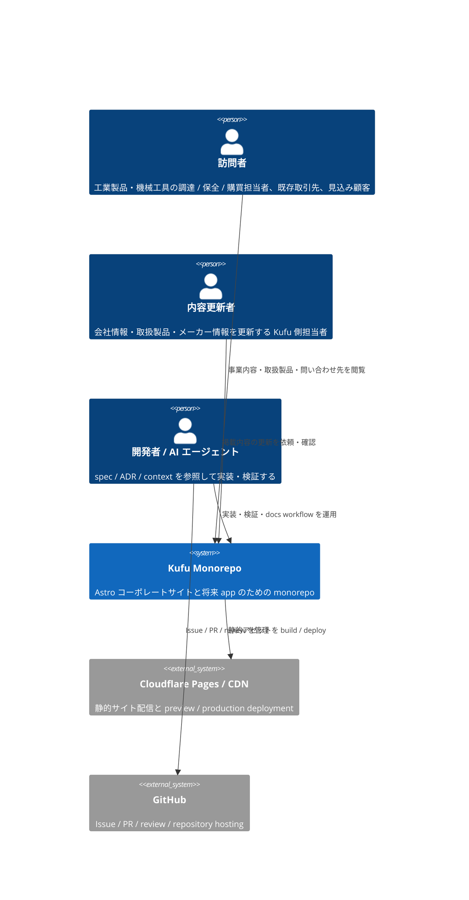
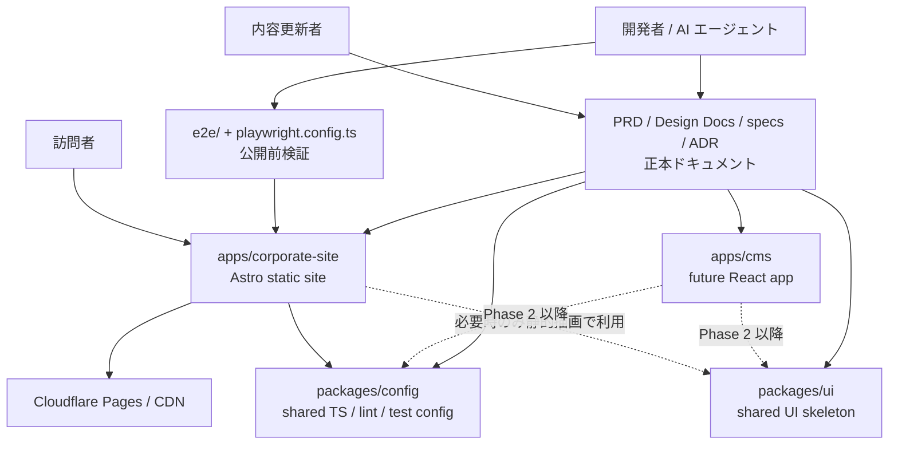

# Kufu Monorepo Design Docs

> 最終更新: 2026-06-14

**Document Status:** Approved
**Development Status:** In Progress

本 Design Doc は Kufu Monorepo の **全体像 (system landscape)** を扱う。Goal / モジュール責務 / 横断方針を示し、詳細は feature doc と context library へ委譲する。

## 概要 (Summary)

Kufu Monorepo は、Phase 1 で Astro コーポレートサイトを公開し、将来の CMS / 管理画面 / 業務アプリ追加に耐える app / package / docs workflow の境界を整える。主な利用者はコーポレートサイト訪問者と内容更新者であり、開発者 / AI エージェントはその価値を安全に実装するためのステークホルダーである。詳細な feature 設計は [design/features/](features/)、技術規約は [context/](../context/)、プロジェクト固有値は [context/project.md](../context/project.md) を正本とする。

## Related PRD

- [PRD.md](../PRD.md)

## Related ADRs

| ADR                                                                    | 決定                                                        | 関連ドキュメント                                                                                                                                                           |
| ---------------------------------------------------------------------- | ----------------------------------------------------------- | -------------------------------------------------------------------------------------------------------------------------------------------------------------------------- |
| [ADR-0001](../adr/0001-terraform-infra-repository-boundary.md)         | Cloudflare の Terraform は別 repo (`kufu-infra`) で管理する | [context/infrastructure.md](../context/infrastructure.md)                                                                                                                  |
| [ADR-0002](../adr/0002-monorepo-scaffold-create-command-policy.md)     | app scaffold は公式 create command を優先する               | [context/toolchain.md](../context/toolchain.md)                                                                                                                            |
| [ADR-0003](../adr/0003-phase1-corporate-site-only-and-cms-deferred.md) | Phase 1 は `apps/corporate-site` のみ。`apps/cms` は後続    | [features/corporate-site/DesignDoc_corporate-site.md](features/corporate-site/DesignDoc_corporate-site.md), [features/cms/DesignDoc_cms.md](features/cms/DesignDoc_cms.md) |

## Project Profile

- repository path、commands、branch pattern、対象ドメイン、Issue Tracker は [context/project.md](../context/project.md) を正本とする。
- infra repo 境界は [ADR-0001](../adr/0001-terraform-infra-repository-boundary.md) を正本とする。

## Goal

Kufu のコーポレートサイトを Astro で高いパフォーマンスと保守性を保って構築する。
将来的に CMS アプリ、管理画面、業務効率化系のツールなどを構築することを視野に入れ、共通の設定やデザインの基盤を整えておく。

## Lower-Priority Goals

- `apps/cms` の app shell、公開フロー、データモデルを Phase 2 以降に設計する。
- コーポレートサイトの内容更新頻度や運用者数が増えた場合に、CMS/API 連携や認証を ADR / spec で判断する。
- `packages/ui` は複数 consumer が出た時点で本格共有 package として育てる。

## Non Goals

- 初期フェーズで CMS/API、認証、管理画面、業務ツールを実装すること。
- Astro で完結できるコーポレートサイト機能を React へ寄せること。
- `packages/ui` を将来未確定の用途まで見越して過剰に抽象化すること。

## Background

### 前提用語

- コーポレートサイト: Kufu のマーケティングサイト。
- Island: Astro ページ上で必要箇所だけクライアント実行される UI。
- app: `apps/*` 配下の実行単位。
- package: `packages/*` 配下の共有 UI、設定、ライブラリ。
- spec: issue / 機能単位で、要求、設計、テスト観点を整理する作業文書。
- feature doc: feature 単位の設計 (How) を残す永続文書 ([features/](features/))。
- context: 技術スタック規約・codebase architecture・運用契約を集約する永続ナレッジ層 ([context/](../context/))。
- ADR: 長期参照する意思決定ログ。

### 背景

Kufu Monorepo は、Phase 1 でコーポレートサイトを作ることを主目的とする。コーポレートサイトは表示速度、情報の分かりやすさ、公開前検証が重要であり、不要な React 化やクライアント JavaScript の増加を避ける必要がある。一方で、将来は React ベースの CMS アプリや管理画面、CMS/API 連携が必要になる可能性がある。初期から app / package の責務と AI 向けルールを定義しておくことで、将来拡張時もコーポレートサイトの性能と monorepo の一貫性を守れる。

### 設計上の前提

- Phase 1 の主対象は `apps/corporate-site` である。
- `apps/cms` はコーポレートサイト掲載投稿を管理する将来 app 候補として定義し、Phase 1 では実装せず設計だけを後続 issue / spec に送る。
- UI の共通化は、Phase 1 で `packages/ui` skeleton を置き、本格運用は複数 consumer が出た時点で進める。
- TypeScript、lint、format、test 設定は `packages/config` に寄せる。
- pnpm workspace と Turborepo を使い、app / package 単位でタスクを実行する。
- CMS/API は初期スコープ外で、必要時に ADR と spec を作成して採否を決める。

## アーキテクチャ概観 (Overview)

本 Design Doc は C4 L1 / L2 の粒度で全体像を示す。feature 内部の component 図や詳細フローは [design/features/](features/) と spec へ委譲する。

### System Context (C4 L1) — 誰が・何のために使うか

### Container (C4 L2) — 主要な実行単位とデータの流れ

Kufu Monorepo は、`apps`、`packages`、root 管理の `e2e`、`docs workflow` の 4 つの領域で構成する。

## モジュール責務

| Module                | Responsibility                                                                                                |
| --------------------- | ------------------------------------------------------------------------------------------------------------- |
| `apps/corporate-site` | Astro によるコーポレートサイト。静的生成、コンテンツ構成、必要最小限の island を担う。                        |
| `apps/cms`            | コーポレートサイト掲載投稿を管理する将来 app。Phase 1 では実装せず、Phase 2 で app shell と責務を設計する。   |
| `packages/ui`         | 複数 app / feature で再利用が明確になった UI 基盤を置く。Phase 1 で skeleton を置き、共有需要に応じて育てる。 |
| `packages/config`     | TypeScript、oxlint、Vitest など共有価値の高い設定を集約する。                                                 |
| `e2e`                 | root 管理の Playwright による公開前検証と主要導線の回帰テストを担う。                                         |
| `specs`               | issue / 機能単位の要求、論点、設計、テスト観点を整理する。                                                    |
| `adr`                 | 長期参照する技術選定や責務境界の意思決定を残す。                                                              |

## 詳細の所在 (委譲先)

landscape より下の詳細は以下を正本とする。本 doc には重複させず、抜けと意図的委譲を区別するためリンクのみ置く。

### Feature 設計 (How: feature)

feature 単位の設計 (データ構造・画面・主要シナリオ / フロー) は [design/features/](features/) を正本とする。実装レベルの手順は spec へ委譲する。

| Feature            | 文書                                                                                                       | Phase   |
| ------------------ | ---------------------------------------------------------------------------------------------------------- | ------- |
| コーポレートサイト | [features/corporate-site/DesignDoc_corporate-site.md](features/corporate-site/DesignDoc_corporate-site.md) | Phase 1 |
| CMS / React アプリ | [features/cms/DesignDoc_cms.md](features/cms/DesignDoc_cms.md)                                             | Phase 2 |

### Engineering Context (How: 横断規約)

技術スタック規約・codebase architecture・運用契約は [context/](../context/) ライブラリを正本とする。プロジェクト固有値は [context/project.md](../context/project.md) を正本とする。

| トピック                                    | 文書                                                      |
| ------------------------------------------- | --------------------------------------------------------- |
| repository 固有値 / commands / tracker      | [context/project.md](../context/project.md)               |
| package / runtime / state boundary          | [context/architecture.md](../context/architecture.md)     |
| toolchain・build・scaffold policy           | [context/toolchain.md](../context/toolchain.md)           |
| root task / shared config / quality gate    | [context/engineering.md](../context/engineering.md)       |
| E2E runtime contract / unit test            | [context/testing.md](../context/testing.md)               |
| infra / deployment / environment / security | [context/infrastructure.md](../context/infrastructure.md) |

### Related ADRs / 代替案 (Why: 判断)

確定した技術判断・却下した代替案は [adr/](../adr/) を正本とする。本 doc では landscape に影響する代表的な判断のみ示す。

## Alternatives Considered

### コーポレートサイトも React SPA で作る

- 利点: React app と技術を統一しやすい。
- 欠点: コーポレートサイトに不要な JavaScript が増えやすく、性能と静的生成の利点を失う。
- 不採用理由: Phase 1 の主価値はコーポレートサイトの高速公開と保守性であり、Astro の方が適しているため。

### app ごとに UI を個別実装する

- 利点: 初期実装は速い。
- 欠点: デザインや挙動が分岐し、将来の修正コストが上がる。
- 不採用理由: monorepo の価値は再利用性と一貫性にあるため。

### 初期から CMS/API を作る

- 利点: コンテンツ更新の自由度が高い。
- 欠点: 初期のコーポレートサイト公開に対して複雑性が高く、運用や認証の設計も必要になる。
- 不採用理由: 現時点の主目的は Astro コーポレートサイトの構築であり、CMS は必要性が具体化してから判断するため。

## 設計上の重要ポイント

- コーポレートサイトの performance と SEO を最優先する。
- Astro で解決できるものを React island にしない。
- 初期インフラは Cloudflare の標準機能で閉じ、独自サーバ運用を前提にしない。
- Terraform は別 repo 管理とし、アプリ repo に本番基盤の apply 導線を持ち込まない。
- React アプリでは URL、server state、client state を分けて扱う。
- AI workflow は spec / ADR / package boundary を参照して、対象外の実装を避ける。
- CMS/API は「将来の選択肢」であり、初期の前提として実装しない。

## Open Questions / Future Work

### 確定済みで正本を委譲した事項

| 項目                  | 正本                                                                                                                                                                               | 備考                                                                                                                 |
| --------------------- | ---------------------------------------------------------------------------------------------------------------------------------------------------------------------------------- | -------------------------------------------------------------------------------------------------------------------- |
| コーポレートサイト IA | [features/corporate-site/DesignDoc_corporate-site.md](features/corporate-site/DesignDoc_corporate-site.md#ページ構成-ia)                                                           | 3 route 統合構成 (`/`, `/products`, `/contact`)。決定根拠は [ADR-0006](../adr/0006-corporate-site-three-route-ia.md) |
| デザイントークン体系  | [features/corporate-site/DesignDoc_corporate-site.md](features/corporate-site/DesignDoc_corporate-site.md#デザイントークン) / [ADR-0007](../adr/0007-design-token-architecture.md) | CSS 変数の値は `packages/ui` stylesheet が正本                                                                       |

### 未決事項

| #   | 論点                                                           | 決定者               | 期限                          | 状態 | メモ                                                                           |
| --- | -------------------------------------------------------------- | -------------------- | ----------------------------- | ---- | ------------------------------------------------------------------------------ |
| 1   | `packages/ui` skeleton から本格共有 package へ移行する判断条件 | 開発者 + Kufu owner  | 2 つ目の UI consumer が出る前 | 未決 | 現時点は corporate-site 内 colocation を優先                                   |
| 2   | CMS が必要になる判断基準                                       | Kufu owner           | Phase 2 着手前                | 未決 | 投稿数、更新頻度、運用者人数、外部編集者有無で判断                             |
| 3   | infra repo と app repo の変更を相互参照する review workflow    | 開発者 + infra owner | 本番公開前                    | 未決 | Cloudflare Pages / Terraform 変更の cross-reference 方針                       |
| 4   | Cloudflare Pages の domain / branch / secret 運用粒度          | 開発者 + infra owner | 本番公開前                    | 未決 | 詳細は [context/infrastructure.md](../context/infrastructure.md) と ADR で確定 |
