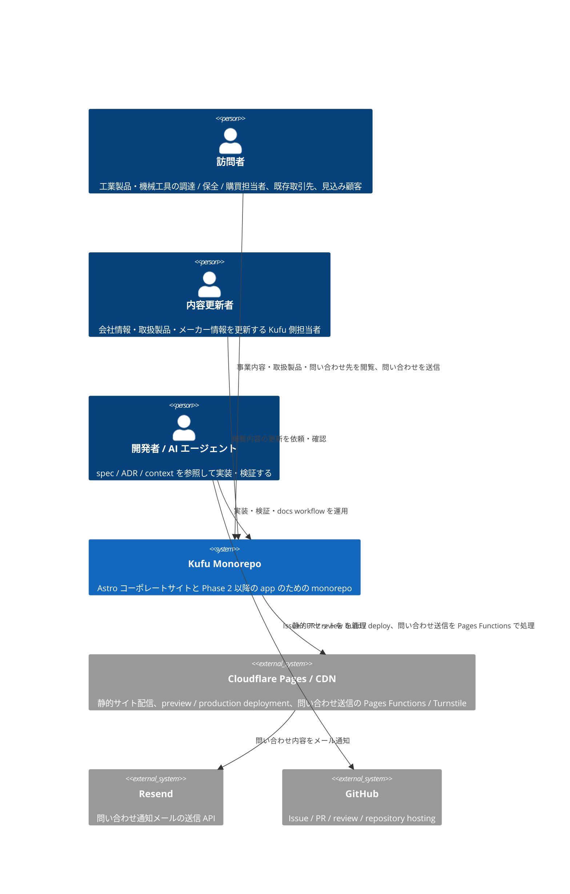
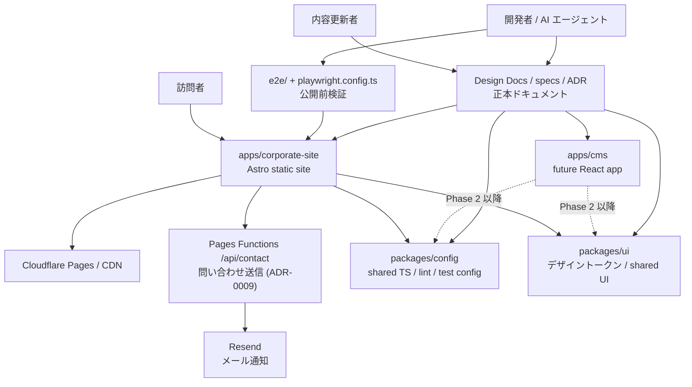

# Kufu Monorepo Design Docs

> 最終更新: 2026-07-25

**Document Status:** Approved
**Development Status:** In Progress

本 Design Doc は Kufu Monorepo の **全体像 (system landscape)** を扱う。Why/What の所在 → Goal → アーキテクチャ概観 → モジュール責務の順に示し、詳細は feature doc と context library へ委譲する。独立 PRD は作らず、本 doc の `## Why / What` 節を PRD 相当の正本とする。理由は、Phase 1 の要求と landscape 判断を同じ読者・同じ変更単位で管理し、重複と drift を避けるためである。

## 概要 (Summary)

Kufu Monorepo は、Kufu のコーポレートサイト、Phase 2 以降の CMS アプリ・管理画面・内部業務ツール、共通 UI / 設定 / テスト基盤を pnpm workspace で一元管理するリポジトリである。Phase 1 は Astro によるコーポレートサイト構築を最優先にし、高いパフォーマンスと保守性を保って公開する。主な利用者はコーポレートサイト訪問者と内容更新者であり、開発者 / AI エージェントはその価値を安全に実装するためのステークホルダーである。詳細な feature 設計は [design/features/](features/)、技術規約は [context/](../context/)、プロジェクト固有値は [context/project.yml](../context/project.yml) を正本とする。

## Why / What

### 背景・課題 (Why)

事業上の課題:

- 調達 / 保全 / 購買担当者や見込み顧客が、Kufu の取扱製品カテゴリ・メーカー・加工/販売の対応範囲・問い合わせ先を短時間で確認できる場所がなく、問い合わせの機会を逃しやすい。
- 見込み顧客が会社情報・連絡先を確認し、電話 / FAX / メール / フォームのいずれかで Kufu と接点を持てる状態を用意する必要がある。
- 内容更新者が会社概要・取扱製品・メーカー情報を安全に更新・検証できる正本と手順がない。

開発上の制約:

- コーポレートサイト、業務ツール、共通 UI、設定が別々に成長すると、構成や品質基準が分散しやすい。
- コーポレートサイトは表示速度と運用しやすさが重要だが、Phase 2 以降の React アプリや CMS 連携も見据える必要がある。
- AI エージェントに実装を依頼する場合、責務境界や技術選定が曖昧だと、不要な React 化や UI の重複実装が起きやすい。
- Astro コーポレートサイトと Phase 2 以降の React ベース CMS アプリでは最適な設計が異なるため、初期から境界を明文化する必要がある。

フェーズ展望:

- Phase 1: Astro コーポレートサイト、共通設定、root 管理の E2E 入口、`packages/ui` skeleton を成立させる。
- Phase 2: コーポレートサイト掲載投稿を管理する `apps/cms` の責務、公開フロー、データモデル、app shell を設計する。
- Phase 3: `apps/cms` や追加 app の実装、必要に応じた CMS/API 連携や認証を拡張する。

### 想定ユーザー

Phase 1 の主対象はコーポレートサイト訪問者である。開発者 / AI エージェントは、訪問者向け価値を安全に実装・運用するためのステークホルダーとして扱う。

| 区分         | 対象                                         | 関心事                                                                                        | Phase 1 優先度 |
| ------------ | -------------------------------------------- | --------------------------------------------------------------------------------------------- | -------------- |
| Primary user | 工業製品・機械工具の調達 / 保全 / 購買担当者 | Kufu が扱う製品カテゴリ、メーカー、加工・販売の対応範囲、問い合わせ先を短時間で把握できること | 高             |
| Primary user | 既存取引先・紹介経由の見込み顧客             | 会社情報、連絡先、取扱領域を確認し、電話 / FAX / メール / フォームのいずれかで連絡できること  | 高             |
| Operator     | Kufu 側の内容更新者 / 公開作業者             | 会社概要、取扱製品、メーカー情報、問い合わせ導線を安全に更新・検証できること                  | 中             |
| Developer    | 実装・保守を行う開発者 / AI エージェント     | app / package / spec / ADR の責務境界を参照し、不要な React 化や UI 重複を避けられること      | 中             |
| Future user  | Phase 2 以降の CMS / 業務アプリ利用者        | コーポレートサイト公開後に、必要性が具体化した段階で管理機能を利用できること                  | 低             |

ユーザーストーリー:

- 調達 / 保全担当者として、取扱製品カテゴリとメーカーを確認したい。そうすれば Kufu に相談できる対象か判断できる。
- 見込み顧客として、会社概要と問い合わせ先をすばやく確認したい。そうすれば電話 / FAX / メール / フォームのいずれかで連絡できる。
- 内容更新者として、会社情報や取扱情報の正本と掲載箇所を把握したい。そうすれば公開サイトを安全に更新できる。
- 開発者 / AI エージェントとして、対象 app / package と禁止事項を明確に把握したい。そうすればプロジェクト方針に沿った実装ができる。

Primary Jobs To Be Done:

1. 訪問者が Kufu の取扱領域と問い合わせ方法を短時間で判断できるコーポレートサイトを公開する。
2. 内容更新者が会社情報・取扱製品・メーカー情報を安全に更新できる正本と検証導線を用意する。
3. Phase 2 以降の CMS アプリや業務アプリ追加に耐える monorepo 境界を用意する。
4. AI 向け設定と spec workflow により、実装依頼時の判断ぶれを減らす。

### 提供価値 / 成功条件 (What)

成功条件:

| #   | 成功条件                                          | 測定方法                                                                     | Phase 1 target                                     |
| --- | ------------------------------------------------- | ---------------------------------------------------------------------------- | -------------------------------------------------- |
| 1   | コーポレートサイトを公開可能な状態で build できる | `pnpm build` / CI build                                                      | 成功率 100%                                        |
| 2   | 訪問者が取扱領域と問い合わせ先へ到達できる        | `/`, `/products`, `/contact` の Playwright E2E                               | 主要 route と問い合わせ導線を E2E で通す           |
| 3   | Astro の静的生成と最小 island 方針を守る          | client directive / React island の review、必要時の bundle / Lighthouse 確認 | 表示専用 UI の不要な island 追加 0 件              |
| 4   | コンテンツ正本と掲載箇所が追跡できる              | `design/features/corporate-site/reference/` と feature doc の対応確認        | 会社概要・取扱製品・メーカー情報の正本リンクを維持 |
| 5   | AI / 開発者が責務境界を参照できる                 | spec / ADR / context / AGENTS の整合確認                                     | 実装前 spec と関連正本リンクを保持                 |

定性アウトカム:

- コーポレートサイトの表示速度と情報設計が損なわれにくい。
- UI と設定の置き場を迷わず判断できる。
- Phase 2 以降の React アプリ追加時も、コーポレートサイトの方針と衝突しない。
- AI がコピー元由来の古い前提を参照せず、Kufu Monorepo の文脈で作業できる。

ガードレール:

| 指標                                 | 定義                                                                          | 意図                             |
| ------------------------------------ | ----------------------------------------------------------------------------- | -------------------------------- |
| Unnecessary Client JS Count          | Astro コーポレートサイトに不要な client directive / React island が増えた件数 | コーポレートサイト性能劣化を防ぐ |
| Direct UI Duplication Count          | app 配下で共通化すべき UI が重複実装された件数                                | 一貫性を守る                     |
| Package Boundary Violation Count     | app から private 実装や別 app の内部へ依存した件数                            | monorepo 境界を守る              |
| React Compiler Incompatibility Count | React Compiler 非対応ライブラリや実装が未確認で入った件数                     | React 側の技術的負債を抑える     |

各ガードレールは、Package Boundary Violation Count を repository quality gate (`pnpm depcruise` / `pnpm knip`) で、それ以外を PR review で検出した件数として数える。

未確定の数値目標 (例: Lighthouse スコア、問い合わせ転換率、訪問数) は Phase 1 公開後の計測基盤と運用体制が決まってから確定する ([未決事項](#未決事項) #1 / #2)。現時点では build / E2E / island 方針 / 正本リンクを Phase 1 の検証可能な成功条件とする。

### スコープ

Phase 1 スコープイン:

- `apps/corporate-site` を Astro コーポレートサイトとして構築する。
- `packages/ui` に shared UI package の skeleton を置く。
- `packages/config` に TypeScript、lint、format などの共有設定を置く。
- root 管理の E2E 入口を整備し、コーポレートサイトの主要導線を公開前に検証できる状態にする。
- AI 向け設定 (`AGENTS.md`、`CLAUDE.md`、`.agents`、`.codex`、`.claude`、`.cursor`) を monorepo 方針に合わせる。
- spec / ADR により、実装前にスコープ、責務、検証方法を整理できる状態にする。

Phase 1 スコープアウトは [Non Goals](#non-goals) を正本とする (重複回避のため本節では列挙しない)。

Phase 1 完成条件 (Definition of Done):

- `apps/corporate-site` の責務、技術選定、禁止事項が Design Docs と AI 設定に明記されている。
- `packages/ui` の skeleton が Phase 2 以降の拡張の入口として配置され、Phase 2 の実装対象と区別されている。
- `packages/config` の役割と export 対象が明確で、root / app / package の責務境界が文書化されている。
- コーポレートサイトの主要ページと問い合わせ導線を検証する E2E 方針がある。
- Phase 2 以降の React 化と build 最適化の適用方針が Design Doc / context / ADR で明文化されている。
- 不要依存と境界違反 (循環、未宣言依存、app 間直接依存など) を root から検査できる。
- commit 前に repository quality gate (依存検査・dead code 検出) が自動実行される。
- コピー元固有のコード検索やインデックス前提がドキュメントや AI workflow から取り除かれている。

## Related ADRs

| ADR                                                                    | 決定                                                                              | 関連ドキュメント                                                                                                                                                                             |
| ---------------------------------------------------------------------- | --------------------------------------------------------------------------------- | -------------------------------------------------------------------------------------------------------------------------------------------------------------------------------------------- |
| [ADR-0001](../adr/0001-terraform-infra-repository-boundary.md)         | Cloudflare の Terraform は別 repo (`kufu-infra`) で管理する                       | [context/infrastructure.md](../context/infrastructure.md)                                                                                                                                    |
| [ADR-0002](../adr/0002-monorepo-scaffold-create-command-policy.md)     | app scaffold は公式 create command を優先する                                     | [context/toolchain.md](../context/toolchain.md)                                                                                                                                              |
| [ADR-0003](../adr/0003-phase1-corporate-site-only-and-cms-deferred.md) | Phase 1 は `apps/corporate-site` のみ。`apps/cms` は後続                          | [features/corporate-site/DesignDoc_corporate-site.md](features/corporate-site/DesignDoc_corporate-site.md), [features/cms/DesignDoc_cms.md](features/cms/DesignDoc_cms.md)                   |
| [ADR-0009](../adr/0009-corporate-site-contact-form-backend.md)         | 問い合わせ送信は Cloudflare Pages Functions を中継する                            | [features/corporate-site/DesignDoc_corporate-site.md](features/corporate-site/DesignDoc_corporate-site.md#問い合わせフォーム仕様), [context/infrastructure.md](../context/infrastructure.md) |
| [ADR-0011](../adr/0011-specs-closeout-enforcement.md)                  | specs は存続させ closeout (close 時削除) を徹底する                               | `CLAUDE.md` Spec Workflow Contract                                                                                                                                                           |
| [ADR-0012](../adr/0012-design-source-of-truth-implementation.md)       | デザイン正本は実装 (コード + Storybook)。ADR-0004 を置換                          | [context/design-workflow.md](../context/design-workflow.md) (改訂は別 issue)                                                                                                                 |
| [ADR-0013](../adr/0013-designdoc-present-facts-only.md)                | 本 doc は現状事実のみ記載、将来計画は Future Work 節へ一元化 (書き換えは別 issue) | 本 doc                                                                                                                                                                                       |

## Project Profile

- repository path、commands、branch pattern、対象ドメイン、Issue Tracker は [context/project.yml](../context/project.yml) を正本とする。
- infra repo 境界は [ADR-0001](../adr/0001-terraform-infra-repository-boundary.md) を正本とする。

## Goal

Kufu のコーポレートサイトを Astro で高いパフォーマンスと保守性を保って構築する。
Phase 2 以降に CMS アプリ、管理画面、業務効率化系のツールなどを構築することを視野に入れ、共通の設定やデザインの基盤を整えておく。

## Lower-Priority Goals

- `apps/cms` の app shell、公開フロー、データモデルを Phase 2 以降に設計する。
- コーポレートサイトの内容更新頻度や運用者数が増えた場合に、CMS/API 連携や認証を ADR / spec で判断する。
- `packages/ui` は複数 consumer が出た時点で本格共有 package として育てる。

## Non Goals

- 初期フェーズで CMS/API、認証、管理画面、業務ツールを実装すること。
- Astro で完結できるコーポレートサイト機能を React へ寄せること。
- `packages/ui` を用途未確定のまま過剰に抽象化すること。
- 汎用 UI ライブラリの過剰な整備。

## Background

### 前提用語

- コーポレートサイト: Kufu のマーケティングサイト。
- Island: Astro ページ上で必要箇所だけクライアント実行される UI。
- app: `apps/*` 配下の実行単位。
- package: `packages/*` 配下の共有 UI、設定、ライブラリ。
- spec: issue / 機能単位で、要求、設計、テスト観点を整理する作業文書。
- feature doc: feature 単位の設計 (How) を残す永続文書 ([features/](features/))。
- context: 技術スタック規約・codebase architecture・運用契約を集約する永続ナレッジ層 ([context/](../context/))。
- ADR: 長期参照する意思決定ログ。

### 背景

Kufu Monorepo は、Phase 1 でコーポレートサイトを作ることを主目的とする。コーポレートサイトは表示速度、情報の分かりやすさ、公開前検証が重要であり、不要な React 化やクライアント JavaScript の増加を避ける必要がある。一方で、Phase 2 以降は React ベースの CMS アプリや管理画面、CMS/API 連携が必要になる可能性がある。初期から app / package の責務と AI 向けルールを定義しておくことで、拡張時もコーポレートサイトの性能と monorepo の一貫性を守れる。

### 設計上の前提

- 文書上の正式名は `Kufu Monorepo` とする。
- npm package prefix は `@kufu/*` とする。
- Phase 1 の主対象は `apps/corporate-site` である。
- `apps/cms` はコーポレートサイト掲載投稿を管理する Phase 2 以降の app 候補として定義し、Phase 1 では実装せず設計だけを後続 issue / spec に送る。
- UI の共通化は、Phase 1 で `packages/ui` skeleton を置き、本格運用は複数 consumer が出た時点で進める。
- TypeScript、lint、format、test 設定は `packages/config` に寄せる。
- pnpm workspace と Turborepo を使い、app / package 単位でタスクを実行する。
- CMS/API は初期スコープ外で、必要時に ADR と spec を作成して採否を決める。
- 実体コードが未作成の場合でも、ドキュメントは構築予定の repo contract として扱う。

## アーキテクチャ概観 (Overview)

本 Design Doc は C4 L1 / L2 の粒度で全体像を示す。feature 内部の component 図や詳細フローは [design/features/](features/) と spec へ委譲する。

### System Context (C4 L1) — 誰が・何のために使うか

### Container (C4 L2) — 主要な実行単位とデータの流れ

Kufu Monorepo は、`apps`、`packages`、root 管理の `e2e`、`docs workflow` の 4 つの領域で構成する。

## モジュール責務

| Module                | Responsibility                                                                                                                                                     |
| --------------------- | ------------------------------------------------------------------------------------------------------------------------------------------------------------------ |
| `apps/corporate-site` | Astro によるコーポレートサイト。静的生成、コンテンツ構成、必要最小限の island を担う。                                                                             |
| `apps/cms`            | コーポレートサイト掲載投稿を管理する Phase 2 以降の app。Phase 1 では実装せず、Phase 2 で app shell と責務を設計する。                                             |
| `packages/ui`         | デザイントークン / フォント / shared stylesheet の正本と、再利用が明確になった shared UI primitive を置く ([ADR-0007](../adr/0007-design-token-architecture.md))。 |
| `packages/config`     | TypeScript、oxlint、Vitest など共有価値の高い設定を集約する。                                                                                                      |
| `e2e`                 | root 管理の Playwright による公開前検証と主要導線の回帰テストを担う。                                                                                              |
| `specs`               | issue / 機能単位の要求、論点、設計、テスト観点を整理する。                                                                                                         |
| `adr`                 | 長期参照する技術選定や責務境界の意思決定を残す。                                                                                                                   |

## 詳細の所在 (委譲先)

landscape より下の詳細は以下を正本とする。本 doc には重複させず、抜けと意図的委譲を区別するためリンクのみ置く。

### Feature 設計 (How: feature)

feature 単位の設計 (データ構造・画面・主要シナリオ / フロー) は [design/features/](features/) を正本とする。実装レベルの手順は spec へ委譲する。

| Feature            | 文書                                                                                                       | Phase   |
| ------------------ | ---------------------------------------------------------------------------------------------------------- | ------- |
| コーポレートサイト | [features/corporate-site/DesignDoc_corporate-site.md](features/corporate-site/DesignDoc_corporate-site.md) | Phase 1 |
| CMS / React アプリ | [features/cms/DesignDoc_cms.md](features/cms/DesignDoc_cms.md)                                             | Phase 2 |

### Engineering Context (How: 横断規約)

技術スタック規約・codebase architecture・運用契約は [context/](../context/) ライブラリを正本とする。プロジェクト固有値は [context/project.yml](../context/project.yml) を正本とする。

| トピック                                    | 文書                                                      |
| ------------------------------------------- | --------------------------------------------------------- |
| repository 固有値 / commands / tracker      | [context/project.yml](../context/project.yml)             |
| package / runtime / state boundary          | [context/architecture.md](../context/architecture.md)     |
| toolchain・build・scaffold policy           | [context/toolchain.md](../context/toolchain.md)           |
| root task / shared config / quality gate    | [context/engineering.md](../context/engineering.md)       |
| E2E runtime contract / unit test            | [context/testing.md](../context/testing.md)               |
| infra / deployment / environment / security | [context/infrastructure.md](../context/infrastructure.md) |

### Related ADRs / 代替案 (Why: 判断)

確定した技術判断・却下した代替案は [adr/](../adr/) を正本とする。本 doc では landscape に影響する代表的な判断のみ示す。

## Alternatives Considered

### コーポレートサイトも React SPA で作る

- 利点: React app と技術を統一しやすい。
- 欠点: コーポレートサイトに不要な JavaScript が増えやすく、性能と静的生成の利点を失う。
- 不採用理由: Phase 1 の主価値はコーポレートサイトの高速公開と保守性であり、Astro の方が適しているため。

### app ごとに UI を個別実装する

- 利点: 初期実装は速い。
- 欠点: デザインや挙動が分岐し、保守コストが上がる。
- 不採用理由: monorepo の価値は再利用性と一貫性にあるため。

### 初期から CMS/API を作る

- 利点: コンテンツ更新の自由度が高い。
- 欠点: 初期のコーポレートサイト公開に対して複雑性が高く、運用や認証の設計も必要になる。
- 不採用理由: 現時点の主目的は Astro コーポレートサイトの構築であり、CMS は必要性が具体化してから判断するため。

## 設計上の重要ポイント

- コーポレートサイトの performance と SEO を最優先する。
- Astro で解決できるものを React island にしない。
- 初期インフラは Cloudflare の標準機能で閉じ、独自サーバ運用を前提にしない。
- Terraform は別 repo 管理とし、アプリ repo に本番基盤の apply 導線を持ち込まない。
- React アプリでは URL、server state、client state を分けて扱う。
- AI workflow は spec / ADR / package boundary を参照して、対象外の実装を避ける。
- CMS/API は Phase 2 以降の選択肢であり、初期の前提として実装しない。

## Open Questions / Future Work

### 確定済みで正本を委譲した事項

| 項目                  | 正本                                                                                                                                                                               | 備考                                                                                                                 |
| --------------------- | ---------------------------------------------------------------------------------------------------------------------------------------------------------------------------------- | -------------------------------------------------------------------------------------------------------------------- |
| コーポレートサイト IA | [features/corporate-site/DesignDoc_corporate-site.md](features/corporate-site/DesignDoc_corporate-site.md#ページ構成-ia)                                                           | 3 route 統合構成 (`/`, `/products`, `/contact`)。決定根拠は [ADR-0006](../adr/0006-corporate-site-three-route-ia.md) |
| デザイントークン体系  | [features/corporate-site/DesignDoc_corporate-site.md](features/corporate-site/DesignDoc_corporate-site.md#デザイントークン) / [ADR-0007](../adr/0007-design-token-architecture.md) | CSS 変数の値は `packages/ui` stylesheet が正本                                                                       |

### 未決事項

| #   | 論点                                                                                  | 決定者               | 期限                          | 状態 | メモ                                                                               |
| --- | ------------------------------------------------------------------------------------- | -------------------- | ----------------------------- | ---- | ---------------------------------------------------------------------------------- |
| 1   | コーポレートサイト公開後の事業 KPI (訪問数、問い合わせ転換率など) をどの指標で見るか  | Kufu owner           | Phase 1 公開後                | 未決 | Phase 1 中は build / E2E / 導線確認を成功条件とする                                |
| 2   | Lighthouse / bundle size など performance budget の具体値                             | 開発者 + Kufu owner  | 公開前検証 phase              | 未決 | Astro 静的生成と不要 island 0 件を先に守る                                         |
| 3   | `packages/ui` skeleton から本格共有 package へ移行する判断条件                        | 開発者 + Kufu owner  | 2 つ目の UI consumer が出る前 | 未決 | 現時点は corporate-site 内 colocation を優先                                       |
| 4   | `apps/cms` の立ち上げ判断基準                                                         | Kufu owner           | Phase 2 着手前                | 未決 | 投稿数、更新頻度、運用者人数、外部編集者の有無で判断する                           |
| 5   | コーポレートサイトコンテンツ更新の責務分担と承認フロー                                | Kufu owner           | 初回運用開始前                | 未決 | CMS 化前は committed reference と PR review を正本運用にする                       |
| 6   | infra repo と app repo の変更を相互参照する review workflow                           | 開発者 + infra owner | 本番公開前                    | 未決 | Cloudflare Pages / Terraform 変更の cross-reference 方針                           |
| 7   | Cloudflare Pages の preview / production に紐づく domain / branch / secret 運用ルール | 開発者 + infra owner | 本番公開前                    | 未決 | 実装方針は [context/infrastructure.md](../context/infrastructure.md) と ADR へ委譲 |

## 変更履歴

| 日付       | 変更者 | 変更内容                                                                                                  |
| ---------- | ------ | --------------------------------------------------------------------------------------------------------- |
| 2026-06-14 | Codex  | ターゲット、成功条件、未決事項を styleguide-documents に沿って具体化                                      |
| 2026-07-03 | Claude | 個別ライブラリ名を feature doc への参照に置換、ガードレールの測定方法を明記                               |
| 2026-07-05 | Claude | Why/What 節 (想定ユーザー・成功条件・スコープ) を追加。重複記述を整理し未決事項を1つの表にまとめた        |
| 2026-07-05 | Claude | 背景・課題 (Why) を事業上の課題 (訪問者・見込み顧客・内容更新者視点) 先出しに再構成し、開発上の制約と分離 |
| 2026-07-25 | Claude | Related ADRs に ADR-0011/0012/0013 を追記 (#31 sync)。現状事実化・C4 再設計の書き換え実施は別 issue       |
