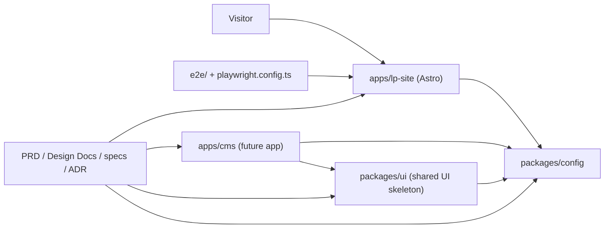
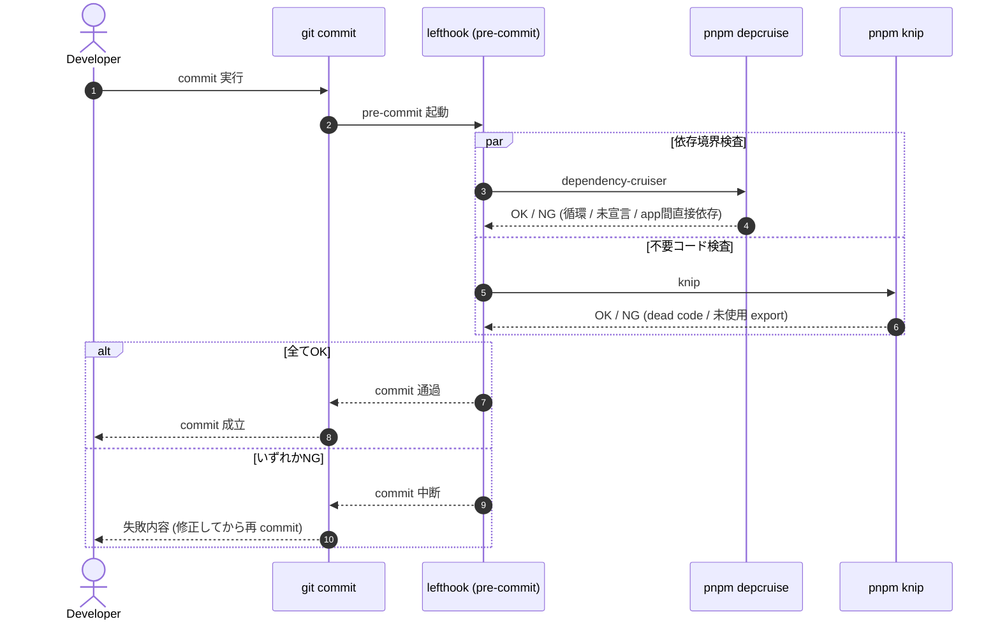
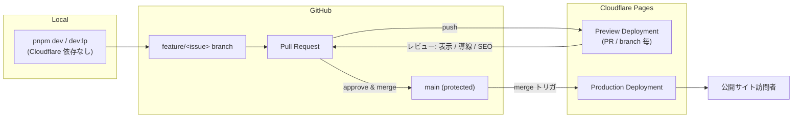

# Kufu Monorepo Design Docs

## Latest Updated At

- 2026-05-09

## Related PRD

- [PRD.md](../PRD.md)

## Related ADRs

| ADR                                                                | 決定                                                        | 本 Design Doc 内の関連節                                   |
| ------------------------------------------------------------------ | ----------------------------------------------------------- | ---------------------------------------------------------- |
| [ADR-0001](../adr/0001-terraform-infra-repository-boundary.md)     | Cloudflare の Terraform は別 repo (`kufu-infra`) で管理する | Infrastructure / Deployment, Infrastructure Code Ownership |
| [ADR-0002](../adr/0002-monorepo-scaffold-create-command-policy.md) | app scaffold は公式 create command を優先する               | Toolchain                                                  |
| [ADR-0003](../adr/0003-phase1-lp-only-and-cms-deferred.md)         | Phase 1 は `apps/lp-site` のみ。`apps/cms` は後続           | Phase 1 設計方針, CMS / React アプリ設計方針               |

## Repository References

- app repo: `$(ghq root)/github.com/Fukuemon/kufu-apps`
- infra repo: `$(ghq root)/github.com/Fukuemon/kufu-infra`

## Goal

Kufu の LP サイトを Astro で高いパフォーマンスと保守性を保って構築し、将来の CMS アプリ、管理画面、CMS/API 連携を追加できる pnpm monorepo の責務境界を定義する。

## Non Goals

- 初期段階で CMS/API、認証、管理画面、内部業務ツールを実装すること。
- Astro で完結できる LP 機能を React へ寄せること。
- `packages/ui` を将来未確定の用途まで見越して過剰に抽象化すること。

## Background

### 前提用語

- LP: Kufu のマーケティングサイト。
- Island: Astro ページ上で必要箇所だけクライアント実行される UI。
- app: `apps/*` 配下の実行単位。
- package: `packages/*` 配下の共有 UI、設定、ライブラリ。
- spec: issue / 機能単位で、要求、設計、テスト観点を整理する作業文書。
- ADR: 長期参照する意思決定ログ。

### 背景

Kufu Monorepo は、Phase 1 で LP サイトを作ることを主目的とする。
LP は表示速度、情報の分かりやすさ、公開前検証が重要であり、不要な React 化やクライアント JavaScript の増加を避ける必要がある。
一方で、将来は React ベースの CMS アプリや管理画面、CMS/API 連携が必要になる可能性がある。初期から app / package の責務と AI 向けルールを定義しておくことで、将来拡張時も LP の性能と monorepo の一貫性を守れる。

### 設計上の前提

- Phase 1 の主対象は `apps/lp-site` である。
- `apps/cms` は LP 掲載投稿を管理する将来 app 候補として定義し、Phase 1 では実装せず設計だけを後続 issue / spec に送る。
- UI の共通化は、Phase 1 で `packages/ui` skeleton を置き、本格運用は複数 consumer が出た時点で進める。
- TypeScript、lint、format、test 設定は `packages/config` に寄せる。
- pnpm workspace と Turborepo を使い、app / package 単位でタスクを実行する。
- CMS/API は初期スコープ外で、必要時に ADR と spec を作成して採否を決める。

## Overview

Kufu Monorepo は、`apps`、`packages`、root 管理の `e2e`、`docs workflow` の 4 つの領域で構成する。



## Detailed Design

### モジュール責務

| Module            | Responsibility                                                                                                |
| ----------------- | ------------------------------------------------------------------------------------------------------------- |
| `apps/lp-site`    | Astro による LP。静的生成、コンテンツ構成、必要最小限の island を担う。                                       |
| `apps/cms`        | LP 掲載投稿を管理する将来 app。Phase 1 では実装せず、Phase 2 で app shell と責務を設計する。                  |
| `packages/ui`     | 複数 app / feature で再利用が明確になった UI 基盤を置く。Phase 1 で skeleton を置き、共有需要に応じて育てる。 |
| `packages/config` | TypeScript、oxlint、Vitest など共有価値の高い設定を集約する。                                                 |
| `e2e`             | root 管理の Playwright による公開前検証と主要導線の回帰テストを担う。                                         |
| `specs`           | issue / 機能単位の要求、論点、設計、テスト観点を整理する。                                                    |
| `adr`             | 長期参照する技術選定や責務境界の意思決定を残す。                                                              |

### Phase 1 設計方針

- LP は Astro の `.astro` コンポーネントを基本にする。
- React island はフォーム、動的 UI、外部 widget など必要な箇所に限定する。
- LP の画像、フォント、スクリプトは性能予算を意識して管理する。
- 第一原則は feature / colocation とし、app や feature 内で閉じる UI はローカルに置く。
- 共通 UI は利用箇所が複数 app / feature にまたがる時点で `packages/ui` へ移す。
- Phase 1 では `packages/ui` の skeleton を置くが、LP 内で閉じる UI は引き続き `apps/lp-site` に置く。
- E2E は LP の表示、主要導線、問い合わせ導線を優先する。
- E2E 実行入口は root `playwright.config.ts` と `e2e/` 配下に置き、workspace package 化しない。

### CMS / React アプリ設計方針

- 以下は `apps/cms` を実装する場合の React app 標準であり、Phase 1 では設計対象に留める。
- ルーティングは TanStack Router を標準とする。
- データフェッチは TanStack Query を標準とし、axios などの追加は spec で必要性を確認する。
- 状態管理は Zustand を必要箇所に限定し、URL に表現できる状態は router 側へ寄せる。
- フォームは React Hook Form を標準とする。
- React Compiler を使う前提で実装する。
- React Compiler に対応していないライブラリや実装パターンを使う場合は、事前に公式情報や一次情報を確認し、必要なら `'use no memo'` を追加する。

### Shared Config Boundary

- `packages/config` は少なくとも `tsconfig`、`oxlint`、`vitest` の共有設定を export する。
- export は用途別 subpath を正とし、`tsconfig/base`、`tsconfig/react`、`tsconfig/astro`、`oxlint/base`、`vitest/base` を初期対象にする。
- `oxfmt` は config file をほぼ持たない前提のため、root script と実行ルールを正本にする。
- `knip` と `dependency-cruiser` は workspace 全体を検査するため、root config と root script を正とする。
- `Storybook` は `packages/ui` skeleton の入口として扱うが、本格運用ルールは後続 issue で定義する。

### Root Task Boundary

- workspace task は root script から `turbo run` で束ねる。
- `dev`、`dev:lp`、`build`、`lint`、`typecheck`、`test` は `turbo run` を使う。
- `format`、`e2e`、`knip`、`depcruise` は root 管理ツールとして直実行する。
- `e2e`、`knip`、`dependency-cruiser` は package task ではなく repository task として扱う。
- `lefthook` の `pre-commit` で `pnpm depcruise` と `pnpm knip` を自動実行し、commit 前に repository quality gate を通す。



### E2E Runtime Contract

- `pnpm e2e` は root `playwright.config.ts` を正本とし、`e2e/<target>/` 配下の suite を読む。
- root 側の標準 env contract は `E2E_TARGET`、`E2E_PORT`、`E2E_BASE_URL` とする。
- `E2E_TARGET` の既定値は `lp-site` とし、初期 port は `lp-site=4321`、`cms=4173` を割り当てる。
- 対象 app は `build`、`preview`、`e2e:serve` を持ち、root Playwright は `e2e:serve` だけを呼び出す。
- 初期実装の `apps/lp-site` は `e2e:serve` で `build` 後に `preview` を起動する。
- app 固有の preview command は root に直書きせず、workspace script contract で接続する。

```mermaid
flowchart TD
    Dev["Developer / CI<br/>pnpm e2e"] --> Root["root<br/>playwright.config.ts"]
    Root -->|"E2E_TARGET<br/>(既定: lp-site)"| Selector{対象 app}
    Root -->|"E2E_PORT / E2E_BASE_URL<br/>を解決"| Selector
    Selector -->|lp-site| LP["apps/lp-site<br/>e2e:serve"]
    Selector -->|cms (将来)| CMS["apps/cms<br/>e2e:serve"]
    LP --> LPBuild["build → preview<br/>:4321"]
    CMS --> CMSBuild["build → preview<br/>:4173"]
    LPBuild --> Suite["e2e/&lt;target&gt;/<br/>Playwright suite"]
    CMSBuild --> Suite
    Suite --> Result["pass / fail"]
```

図の要点:

- root は `e2e:serve` 契約だけに依存し、app 固有 command を知らない。
- 新 app を E2E 対象にするには `build` / `preview` / `e2e:serve` を実装し、`E2E_TARGET` に追加するだけで足りる。
- port 衝突を避けるため、各 app の preview port は本 contract で固定する。

### Repository Analysis Contract

- `knip` は workspace ごとの `project` / `entry` を持つ monorepo config を root `knip.json` に持つ。
- `dependency-cruiser` は root `.dependency-cruiser.cjs` を正本とし、少なくとも circular dependency、未宣言依存、devDependency 流入、app 間直接依存を検査する。
- app 間直接依存は禁止し、共有コードは `packages/*` の公開入口へ寄せる。
- false positive を避けるため、generated file や root 管理の設定ファイルは root config 側で除外する。

### Toolchain

- Package manager: pnpm workspace
- Task runner: Turborepo
- LP framework: Astro
- CMS app candidate: Hono + Inertia + React
- Bundler: Rolldown
- Language: TypeScript
- Linter: oxlint
- Formatter: oxfmt
- Unit test: Vitest
- UI catalog: Storybook
- E2E: Playwright
- Dead code detection: knip
- Dependency analysis: dependency-cruiser
- Library build: tsdown

- `Rolldown` は採用候補として先に固定し、将来 `apps/cms` を実装する場合の build 構成で採否を確認する。
- `React Compiler` は React app 導入時の標準として先に固定し、`packages/ui` と将来の `apps/cms` 実装時に適用する。
- `knip` と `dependency-cruiser` は issue #3 で実導入し、root script から実行できる状態まで整える。

### Infrastructure / Deployment

Phase 1 の公開基盤と infra repo 分離は [ADR-0001](../adr/0001-terraform-infra-repository-boundary.md) で決定済。本 Design Doc では **app 側が依存する contract** だけを定義する。

- 公開基盤: Cloudflare (Pages を第一候補、Workers は API / BFF 必要時のみ)。
- `apps/lp-site` は Astro 静的生成 → Cloudflare Pages への build artifact 配信を前提に構成する。
- API / BFF を導入しない限り、Node.js 常駐サーバや専用 VM を前提にしない。
- 静的 asset (画像 / 動画 / フォント) は Cloudflare CDN 配信を前提に最適化する。
- DNS / TLS / キャッシュ / 圧縮は Cloudflare 標準機能に寄せ、app 側で重複実装しない。
- Terraform の実体は `kufu-infra` repo を正本とし、本 monorepo には Terraform 本体を置かない。

### Infrastructure Contract (app → infra)

app 側から infra repo へ受け渡す contract:

- Pages project 名 (preview / production)
- preview / production の domain
- 必要な secret 名 (実値は repo に保存しない)
- Workers 依存の有無
- app 変更で infra 差分が必要な場合の参照リンク (spec / ADR → infra repo PR)

### Environment Strategy

| Environment | Purpose                | Cloudflare Role                                             |
| ----------- | ---------------------- | ----------------------------------------------------------- |
| local       | 開発者のローカル確認   | `pnpm dev` で app を起動し、Cloudflare 依存を持ち込まない。 |
| preview     | PR / branch ごとの確認 | Cloudflare Pages preview deployment で実ページ確認を行う。  |
| production  | 公開サイト             | Cloudflare Pages production deployment を正本とする。       |

- Preview URL を使って、レイアウト崩れ、リンク、フォーム導線、SEO メタデータをレビューする。
- 本番 deploy は `main` へのマージを起点に行う前提で設計する。
- branch 単位で安全に確認できることを、LP 改修の標準 workflow に含める。



図の要点:

- preview と production はどちらも Cloudflare Pages 上で同じ build 経路を通る。
- preview レビュー (レイアウト / リンク / フォーム / SEO) を通過しない PR は merge しない。
- production への昇格は **`main` へのマージのみ**が起点で、手動 deploy 経路を標準にしない。
- infra 側 (Pages project / domain / secret) の変更は [Infrastructure Contract (app → infra)](#infrastructure-contract-app--infra) 経由で `kufu-infra` repo へ依頼する。

### Runtime Boundary

- `apps/lp-site` は、Cloudflare 上でもできる限り静的配信で成立させる。
- React island は必要最小限とし、Cloudflare 上で配信する JavaScript 量を抑える。
- 環境変数が必要な値は build-time に閉じるものと runtime で参照するものを分けて扱う。
- 秘密情報を client bundle に含めない。Cloudflare の secret 管理に置くべき値は repo に保存しない。
- 問い合わせフォームや外部 API 連携を追加する場合は、ブラウザから直接第三者 API を叩く構成を標準にせず、必要に応じて Workers を中継点にする。

### Operations / Observability

- deploy 成功だけでなく、preview での導線確認を公開判定に含める。
- Cloudflare Analytics や Web Analytics を利用できる場合は、LP の performance と導線計測の一次観測点として使う。
- 監視、ログ、分析の詳細は、フォーム導線や API 連携の採用時に spec / ADR で追加定義する。
- Cloudflare 固有設定が app 実装に漏れ出さないよう、framework 設定と deploy 設定の責務を分ける。
- Terraform plan / apply の手順や state backend の詳細は infra repo 側で管理し、この monorepo に複製しない。

### 主要ユースケース

#### 1. LP ページを追加する

1. `apps/lp-site` に Astro ページまたは section component を追加する。
2. 静的な表示で足りる場合は `.astro` に閉じる。
3. 動的 UI が必要な場合だけ React island を使う。
4. 複数 app / feature をまたぐ再利用が明確な UI だけを `packages/ui` へ移す。
5. Playwright で主要導線を確認する。

#### 2. 共通 UI を追加する

1. 第一原則は feature / colocation とし、複数 app または feature をまたぐ再利用が明確な UI だけを `packages/ui` に追加する。
2. shadcn/ui ベースの実装は app 配下で重複定義しない。
3. Storybook は `packages/ui` skeleton の入口として置き、利用状態確認の本格運用は後続で整える。
4. LP 側で使う場合は、不要な client directive が増えないか確認する。

#### 3. CMS アプリを追加する

1. `apps/cms` または新規 `apps/*` に app shell を作る。
2. ルーティング、データフェッチ、フォーム、状態管理は標準ライブラリを使う。
3. UI は `@kufu/ui` を経由する。
4. React Compiler 互換性を確認する。
5. E2E と unit test の責務を spec で定義する。

#### 4. CMS/API 連携を検討する

1. CMS が必要な理由、更新頻度、運用者、公開フローを spec に書く。
2. Hono API、Inertia、React の採否を ADR で比較する。
3. API package や app 追加が必要な場合だけ monorepo 構成を拡張する。
4. LP の性能と公開安全性を満たすことを採用条件にする。

### Data / Content 設計

- LP の静的コンテンツは、初期段階では `apps/lp-site` 内に配置する。
- CMS 化するまでは、コンテンツ更新の責務とレビュー観点を spec に残す。
- 画像や動画などの assets は LP の性能予算を考慮して配置、圧縮、読み込み方式を決める。
- 公開 asset は Cloudflare CDN 配信を前提に、キャッシュ戦略と更新単位を意識して配置する。
- app から参照する infra 前提値は、実値ではなく contract 名称と責務だけをこの repo に残す。
- URL は状態管理の一部として扱い、React app では TanStack Router の route state に寄せる。

### Package Boundary

- app から別 app の内部実装へ依存しない。
- app から `packages/config` など公開 package を経由して共有する。
- UI は app 内に置き、複数 consumer が揃った時点で `packages/ui` へ昇格する。
- 共通 utility は必要性が明確な場合だけ package 化する。

### 設計上の重要ポイント

- LP の performance と SEO を最優先する。
- Astro で解決できるものを React island にしない。
- 初期インフラは Cloudflare の標準機能で閉じ、独自サーバ運用を前提にしない。
- Terraform は別 repo 管理とし、アプリ repo に本番基盤の apply 導線を持ち込まない。
- React アプリでは URL、server state、client state を分けて扱う。
- AI workflow は spec / ADR / package boundary を参照して、対象外の実装を避ける。
- CMS/API は「将来の選択肢」であり、初期の前提として実装しない。

## Alternatives Considered

### LP も React SPA で作る

- 利点: React app と技術を統一しやすい。
- 欠点: LP に不要な JavaScript が増えやすく、性能と静的生成の利点を失う。
- 不採用理由: Phase 1 の主価値は LP の高速公開と保守性であり、Astro の方が適しているため。

### app ごとに UI を個別実装する

- 利点: 初期実装は速い。
- 欠点: デザインや挙動が分岐し、将来の修正コストが上がる。
- 不採用理由: monorepo の価値は再利用性と一貫性にあるため。

### 初期から CMS/API を作る

- 利点: コンテンツ更新の自由度が高い。
- 欠点: 初期の LP 公開に対して複雑性が高く、運用や認証の設計も必要になる。
- 不採用理由: 現時点の主目的は Astro LP の構築であり、CMS は必要性が具体化してから判断するため。

## Caveats / Security / Privacy

- 問い合わせフォームや外部サービス連携を追加する場合は、個人情報の扱いを spec で明記する。
- Cloudflare 上で扱う secret、token、API key は client 側へ露出させず、環境ごとの secret 管理に分離する。
- Terraform variable や provider credential など infra 用の秘匿情報は app repo に持ち込まない。
- フォーム保護や bot 対策が必要な場合は、Cloudflare Turnstile など edge 側サービスを候補に含める。
- CMS/API を導入する場合は、認証、権限、公開フロー、プレビュー環境を設計する。
- LP の assets はライセンスと利用許諾を確認する。
- React Compiler 対応はライブラリ更新により変化するため、導入時点で確認する。

## Test Plan

- `apps/lp-site` が build できること。
- Cloudflare Pages preview deployment で主要ページが表示できること。
- LP の主要ページと問い合わせ導線が Playwright で確認できること。
- Astro ページに不要な React island や client directive が増えていないこと。
- `packages/ui` の共有 UI が Storybook / unit test で確認できること。
- `packages/config` の共有設定を各 app / package が利用できること。
- `apps/cms` 追加時に TanStack Router、TanStack Query、React Hook Form、Zustand、React Compiler 前提が守られること。
- CMS/API を導入する場合は、ADR と spec が先に作成されていること。

## Open Questions

- LP の具体的なページ構成とコンテンツ更新フローをどこまで初期 spec に含めるか。
- `packages/ui` skeleton から本格共有 package へ移行する判断条件をどの時点で固定するか。
- CMS が必要になる判断基準をどの指標で固定するか。
- infra repo と app repo の変更をどの workflow で相互参照し、review 漏れを防ぐか。
- Cloudflare Pages の preview / production に紐づく domain, branch, secret の運用ルールをどの粒度で repo に明文化するか。
