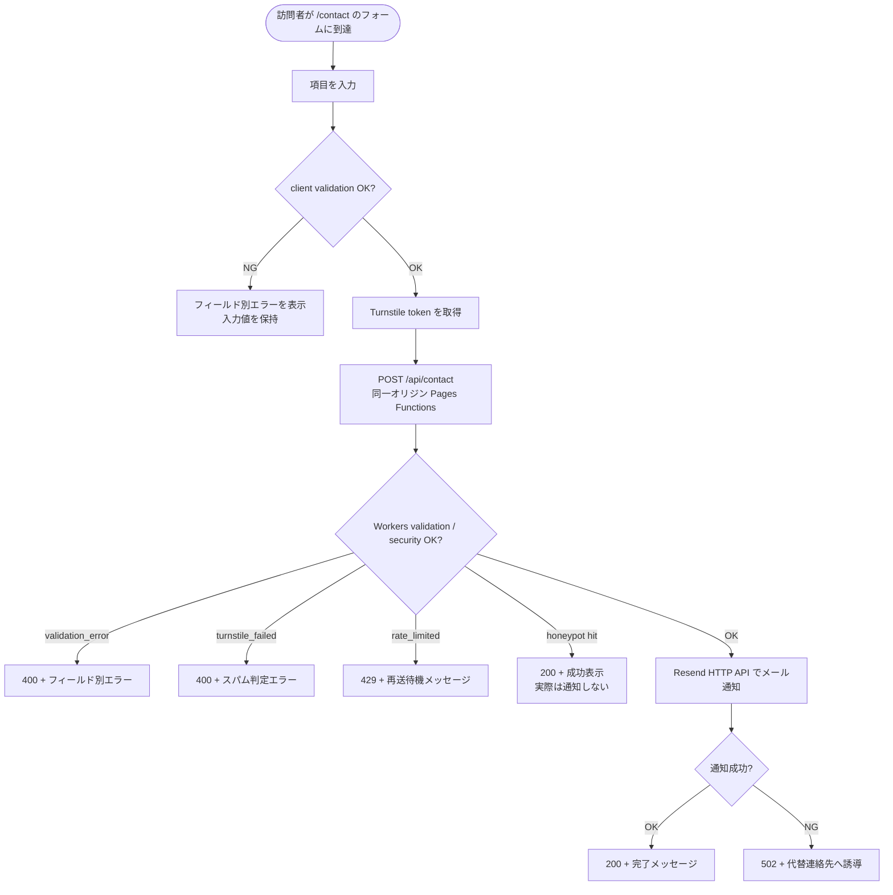
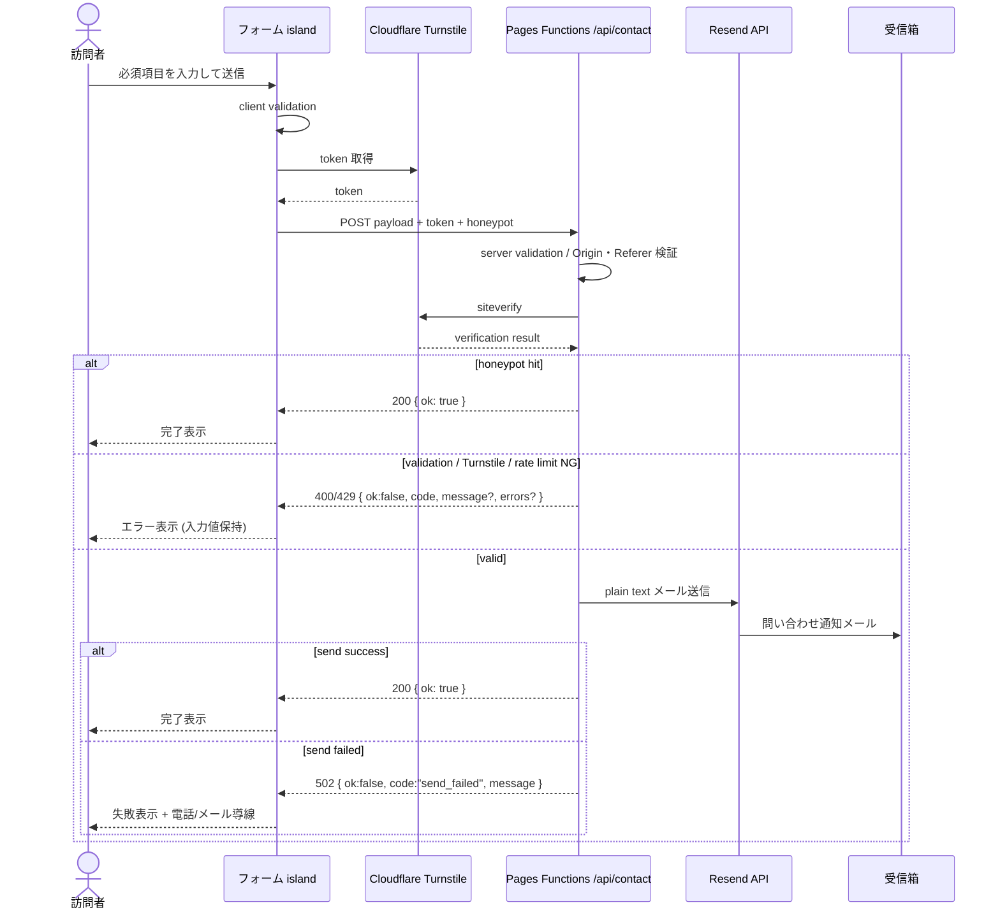
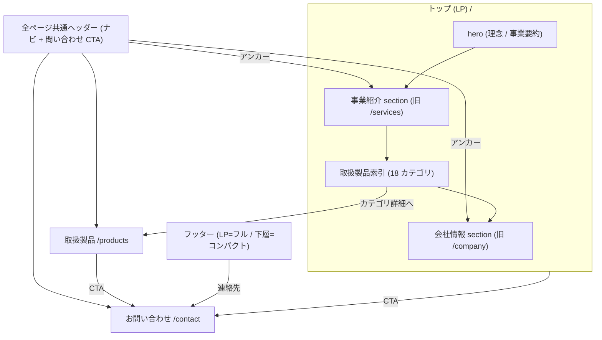
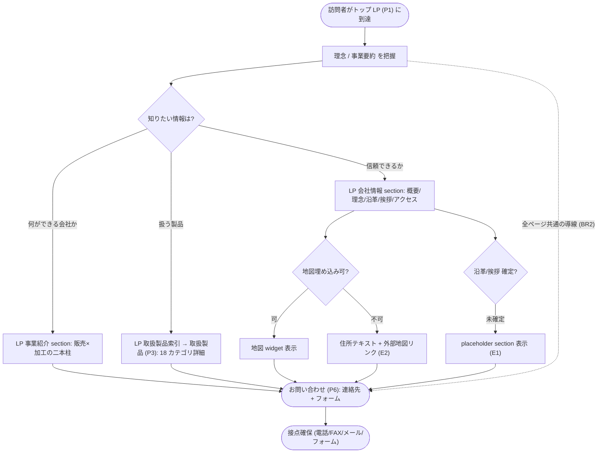
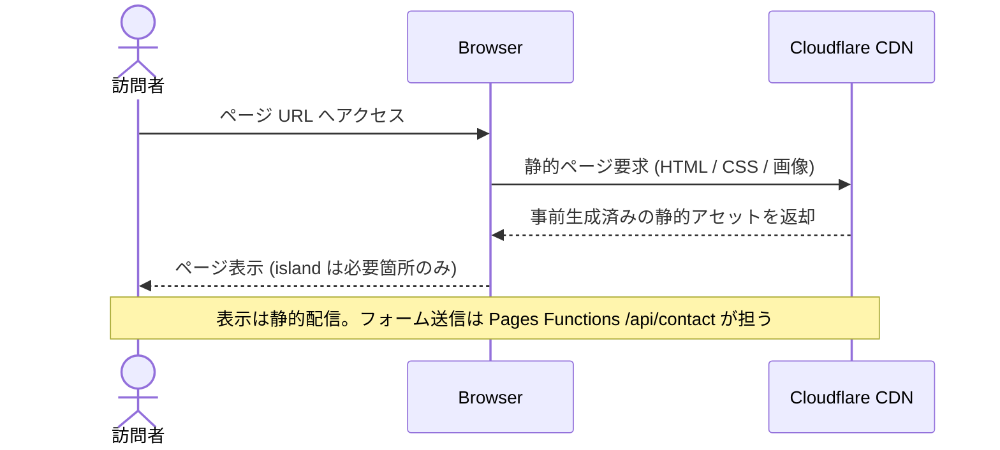

# Feature 設計: コーポレートサイト (apps/corporate-site)

> 最終更新: 2026-08-08 / Status: 設計確定・実装中 / IA 確定済 ([ADR-0006](../../../adr/0006-corporate-site-three-route-ia.md)) / デザイントークン体系確定 ([ADR-0007](../../../adr/0007-design-token-architecture.md)) / 問い合わせフォーム仕様確定 ([ADR-0009](../../../adr/0009-corporate-site-contact-form-backend.md)) / sections 再編・公開面規約確定 ([ADR-0014](../../../adr/0014-corporate-site-sections-architecture.md))

現行の主対象。Astro によるコーポレートサイトを高いパフォーマンスと保守性で公開する。全体像は [design/DesignDoc.md](../../DesignDoc.md)、横断規約は [context/](../../../context/) を参照する。

## メタ

| 項目            | 値                                                                                                                                                                                                                                                                                                                                                                                                                                                                                                                                                                                                                                                                                                                                  |
| --------------- | ----------------------------------------------------------------------------------------------------------------------------------------------------------------------------------------------------------------------------------------------------------------------------------------------------------------------------------------------------------------------------------------------------------------------------------------------------------------------------------------------------------------------------------------------------------------------------------------------------------------------------------------------------------------------------------------------------------------------------------- |
| 関連 DesignDoc  | [DesignDoc.md](../../DesignDoc.md) Why/What (コーポレートサイト関連要求・スコープ) / Goal / モジュール責務                                                                                                                                                                                                                                                                                                                                                                                                                                                                                                                                                                                                                          |
| 関連 context    | [architecture.md](../../../context/architecture.md), [testing.md](../../../context/testing.md), [infrastructure.md](../../../context/infrastructure.md)                                                                                                                                                                                                                                                                                                                                                                                                                                                                                                                                                                             |
| 関連 ADR        | [ADR-0002](../../../adr/0002-monorepo-scaffold-create-command-policy.md), [ADR-0003](../../../adr/0003-phase1-corporate-site-only-and-cms-deferred.md), [ADR-0006](../../../adr/0006-corporate-site-three-route-ia.md) (3 route IA), [ADR-0007](../../../adr/0007-design-token-architecture.md) (デザイントークン体系), [ADR-0008](../../../adr/0008-astro-react-island-policy.md) (React island / shadcn 消費ポリシー), [ADR-0009](../../../adr/0009-corporate-site-contact-form-backend.md) (問い合わせ送信 backend), [ADR-0012](../../../adr/0012-design-source-of-truth-implementation.md) (デザイン正本 = 実装 + Storybook), [ADR-0014](../../../adr/0014-corporate-site-sections-architecture.md) (sections 再編・公開面規約) |
| 関連 ADR (経緯) | 主要な変更経緯は上記 ADR と git history が持つ (issue 番号は記載しない)                                                                                                                                                                                                                                                                                                                                                                                                                                                                                                                                                                                                                                                             |
| 対象モジュール  | `corporate-site`                                                                                                                                                                                                                                                                                                                                                                                                                                                                                                                                                                                                                                                                                                                    |

## 背景・要件解釈

- コーポレートサイトは表示速度、情報の分かりやすさ、公開前検証が重要。不要な React 化やクライアント JavaScript の増加を避ける。
- `apps/corporate-site` を Astro コーポレートサイトとして成立させ、`packages/ui` と共有設定の入口を用意する。

## スコープ

### やること

- `apps/corporate-site` を Astro コーポレートサイトとして構築する。
- コーポレートサイトの主要ページと問い合わせ導線を E2E で検証できる状態にする。
- コーポレートサイト内で閉じる UI を colocation で配置する。

### やらないこと

- Astro で完結できるコーポレートサイト機能の React 化。
- CMS 化 (コンテンツ管理は未実装。[cms.md](../cms/DesignDoc_cms.md))。

## 設計

### 設計方針

- コーポレートサイトは Astro の `.astro` コンポーネントを基本にする。
- React island はフォーム、動的 UI、外部 widget など必要な箇所に限定する。表示専用 UI は `@kufu/ui` の shadcn を静的描画 (`client:*` なし、JS ゼロ) で使い、island 化の境界は [ADR-0008](../../../adr/0008-astro-react-island-policy.md) に従う。
- 問い合わせフォームは最初の主要 React island。送信は静的配信を維持しつつ Cloudflare Pages Functions (Workers) を中継する ([ADR-0009](../../../adr/0009-corporate-site-contact-form-backend.md))。機能仕様 (入力項目 / バリデーション / スパム対策 / 通知 / API 契約) の正本は本 doc。
- コーポレートサイトの画像、フォント、スクリプトは性能予算を意識して管理する。
- 第一原則は colocation とし、app や section 内で閉じる UI はローカルに置く。
- 共通 UI の昇格は 2 段階とする: 同一 app 内で複数 section / route にまたがるものは `components/common/`、**複数 app** にまたがる時点で `packages/ui` へ移す ([architecture.md](../../../context/architecture.md) / [component-design.md](../../../context/component-design.md))。
- コーポレートサイト内で閉じる UI は `apps/corporate-site` に置く。
- component は `components/sections/<section>/` の 1 階層フラット構成に置き、各 section の公開面は `index.ts` 再輸出のみとする ([ADR-0014](../../../adr/0014-corporate-site-sections-architecture.md))。section 名はドメインで付け、ページ対応は下記「section 構成」の表を正本とする (ディレクトリ構造には持たせない)。
- `src/styles/` は 4 ファイルに分割し `globals.css` は `@import` のみの entry とする: `base.css` (`:root` と要素セレクタの base) / `components.css` (クラスセレクタ群。cva / utility 移行で逐次削減し削除目標) / `animations.css` (site 固有演出の keyframes)。`utilities.css` は `@utility` が必要になるまで作らず、既存 CSS を `@layer` で包まない (優先順位が変わるため)。横断のスタイル規約 (cva 基準 / motion トークン境界) は [component-design.md](../../../context/component-design.md) を正本とする。
- E2E はコーポレートサイトの表示、主要導線、問い合わせ導線を優先し、実行入口は root `playwright.config.ts` と `e2e/` 配下に置く ([testing.md](../../../context/testing.md))。

### データ / コンテンツモデル

- コーポレートサイトの静的コンテンツは、初期段階では `apps/corporate-site` 内に配置する。
- 公開 asset は Cloudflare CDN 配信を前提に、キャッシュ戦略と更新単位を意識して配置する ([infrastructure.md](../../../context/infrastructure.md))。
- 画像は `apps/corporate-site/src/assets/` に置き、Astro Image / import 経由で扱う。build の asset graph に載せ、width / height / lazy loading / format 最適化を効かせる (`public` 直配置は参照追跡と最適化が弱いため使わない)。

#### ページ構成 (IA)

情報設計 (IA) の正本は本 feature doc。確定済のページ / section 構成・配置マッピング・回遊フローはここに集約する。構造変更の決定根拠は [ADR-0006](../../../adr/0006-corporate-site-three-route-ia.md)、それ以前の変更経緯は git history が持つ。

サイトマップ (**3 route 統合構成** + 全ページ共通レイアウト G。ADR-0006 で 5 ページ構成から変更):

| ID  | ページ       | route       | 主な section                                                                                   | 優先 | 担う成功条件                          |
| --- | ------------ | ----------- | ---------------------------------------------------------------------------------------------- | ---- | ------------------------------------- |
| P1  | トップ (LP)  | `/`         | hero(理念/事業要約) / 事業紹介(販売×加工・ジグザグ構成) / 取扱製品索引(18 カテゴリ) / 会社情報 | 高   | 訴求 + 信頼性 (入口〜中核)            |
| P3  | 取扱製品     | `/products` | 18 カテゴリ詳細 (INDEX パネル + カテゴリ→全メーカー一覧)                                       | 中   | 訴求 (網羅性) + 信頼性 (取扱メーカー) |
| P6  | お問い合わせ | `/contact`  | 連絡先(TEL/FAX/メール) / 問い合わせフォーム (仕様は本 doc / 送信は Workers 中継 ADR-0009)      | 中   | 接点確保 (BR2)                        |
| G   | 全ページ共通 | -           | ヘッダー(ナビ+CTA)。フッターは LP=フル(サイトマップ付き) / 下層=コンパクト(ブランド+連絡先)    | 高   | BR2 / BR3                             |

- 旧 P2 (事業内容 `/services`) / 旧 P4 (会社情報 `/company`) は LP 内 section に統合し、単独 route は設けない。直接導線は LP 内アンカーで提供する。
- コンテナ幅・横余白は全ページ 1440px・横 padding 56 に統一する。実装は単一 max-width + 共通 padding に正規化する。
- 3 route それぞれに desktop / モバイルの表示を用意する。hover / focus / form error 等の状態系は `@kufu/ui` 規約に従って実装し、Storybook で確認する。
- P3 のカテゴリ・メーカー検索は `q` query parameter を唯一の状態正本とする。初期表示・再読込・共有 URL から検索条件を復元し、入力中は履歴を増やさない。空文字では `q` を削除する。JavaScript 実行前の HTML には 18 カテゴリと全メーカーを保持する。
- reveal アニメーションは progressive enhancement とし、JavaScript が無効または `IntersectionObserver` が利用できない環境では全コンテンツを初期表示する。アニメーションのために HTML-first の可読性を損なわない。

情報項目 → 配置マッピング (コンテンツ正本: [reference/](reference/)):

| 項目                           | 配置先                            | 備考                                                |
| ------------------------------ | --------------------------------- | --------------------------------------------------- |
| 会社名/創立/資本金/代表/所在地 | P1 会社情報 section               | フッターにも要約 (BR3)                              |
| TEL/FAX/Eメール                | P1 会社情報 + P6 + 全ページ共通   | BR2                                                 |
| 経営理念                       | P1 hero + 会社情報 section        | 訴求/信頼性の中核                                   |
| 業務内容 (見積/販売・加工)     | P1 事業紹介 section               | 二本柱 (BR1)                                        |
| 取扱製品カテゴリ (18 区分)     | P1 索引 + P3                      | 単一データソースを共通参照。正本 company-profile.md |
| 取扱メーカー (延べ ~320 社)    | P3                                | カテゴリ→全メーカー一覧。正本 manufacturers.md      |
| アクセス/地図                  | P1 会社情報 section 内            | 地図埋め込み可否は性能予算で判断 (E2)               |
| 沿革 / 代表挨拶                | P1 会社情報 section (placeholder) | 本文は後追い                                        |

- 会社概要の一次情報 (社名 / 所在地 / 代表 / 連絡先) は LP 会社情報 section を正本とし、フッター等は参照に留める (BR3)。
- アクセス / 地図・沿革・代表挨拶は LP 会社情報 section 内とし、未確定分は placeholder で公開可能な状態を保つ (E1 / E2)。
- グローバルナビ (LP 内 section アンカー + 取扱製品 / お問い合わせ) と全ページ共通の問い合わせ CTA で、全ページから問い合わせ導線 (P6) に到達可能にする (BR2)。ナビ項目の詳細は実装 (`SiteHeader.astro`) を正本とする。

#### section 構成 (実装の配置)

`components/sections/<section>/` の 1 階層フラット構成における section と、その公開面・使用ページの対応 ([ADR-0014](../../../adr/0014-corporate-site-sections-architecture.md))。section 名はドメインで付けるためページ対応は物理構造から読めず、本表を正本とする。

| section             | 公開面 (`index.ts` が再輸出)    | 内部 component (presentation)                                                           | 使用ページ  |
| ------------------- | ------------------------------- | --------------------------------------------------------------------------------------- | ----------- |
| `hero`              | `Hero.astro`                    | —                                                                                       | `/`         |
| `business`          | `BusinessSection.astro`         | `BusinessFeatureRow.astro`                                                              | `/`         |
| `company`           | `CompanySection.astro`          | —                                                                                       | `/`         |
| `consultation`      | `ConsultationSection.astro`     | —                                                                                       | `/`         |
| `products-category` | `ProductsCategorySection.astro` | `FeaturedCategoryCarousel.astro`, `FeaturedCategoryCard.astro`                          | `/`         |
| `products-detail`   | `ProductsDetailSection.astro`   | `ProductsHero.astro`, `ProductsSidebarNav.astro`, `ProductsCategoryAccordionList.astro` | `/products` |
| `contact`           | `ContactSection.astro`          | —                                                                                       | `/contact`  |

複数 section / ページで使う site component (`BaseLayout` / `SiteHeader` / `SiteFooter` / `SectionHeading` / `ContactCtaLink`) は `components/common/` 直下にフラットに置く (sections には入れない)。

> `products-category` は products ドメインのデータ (`productCategories` / `categoryMakers` collection) を扱うが、掲載先は `/` である。ドメインと掲載ページが一致しないため、ディレクトリはドメインで、ページ対応は本表で表す。

#### 問い合わせフォーム仕様

本節を P6 `/contact` の問い合わせフォーム機能仕様の**正本**とする。送信 backend のアーキ決定は [ADR-0009](../../../adr/0009-corporate-site-contact-form-backend.md)、runtime / security contract は [architecture.md](../../../context/architecture.md) と [infrastructure.md](../../../context/infrastructure.md) を参照する。

フォームは `/contact` の連絡先 (TEL / FAX / Email) と並ぶ補助導線であり、フォーム送信が失敗しても電話・FAX・メールで接点を確保できる構成にする。

| 項目            | key                     | 必須 | 型       | 検証ルール                                          |
| --------------- | ----------------------- | ---- | -------- | --------------------------------------------------- |
| 会社名          | `company`               | 任意 | input    | 最大 100 文字                                       |
| 担当者名        | `name`                  | 必須 | input    | 1〜50 文字                                          |
| メールアドレス  | `email`                 | 必須 | input    | メール形式                                          |
| 電話番号        | `phone`                 | 任意 | input    | 数字・ハイフン、最大 20 文字                        |
| 問い合わせ種別  | `category`              | 必須 | select   | `quote` / `machining` / `other`                     |
| 問い合わせ内容  | `message`               | 必須 | textarea | 10〜2,000 文字                                      |
| honeypot        | `company_url`           | -    | hidden   | 人間の正常送信では常に空。値ありは成功を装って破棄  |
| Turnstile token | `cf-turnstile-response` | 必須 | hidden   | Workers が Cloudflare Turnstile `siteverify` で検証 |

- バリデーションは client と Workers の二重で行う。Workers は client の結果を信頼せず同一スキーマで再検証する。
- フォーム全体を単一 React island とし、既定 directive は `client:visible`。`/contact` の `client:*` は 1 個に収める。
- フォーム近傍に「入力情報は問い合わせ対応のみに利用する」旨と「送信をもって同意とみなす」旨を表示する。同意 checkbox は設けない。
- 問い合わせ内容はアプリ側 (Workers) で DB / ストレージ / ログに保存せず、Resend 経由のメール通知のみとする。通知経路 (Resend / 受信箱) には利用目的の範囲でデータが残る。

問い合わせ送信フロー:

送信 sequence:

API 契約:

| 項目     | 内容                                                                     |
| -------- | ------------------------------------------------------------------------ |
| endpoint | `POST /api/contact`                                                      |
| runtime  | Cloudflare Pages Functions (Workers)                                     |
| request  | 上記フォーム項目 + `company_url` + `cf-turnstile-response`               |
| success  | `200 { "ok": true }`                                                     |
| error    | `{ "ok": false, "code": string, "message"?: string, "errors"?: object }` |
| secret   | Resend API key / メール宛先 / Turnstile secret は Cloudflare secret 管理 |

| code               | HTTP | 発生条件                                    | client の扱い                         |
| ------------------ | ---- | ------------------------------------------- | ------------------------------------- |
| `validation_error` | 400  | server 側再検証で必須 / 形式 / 文字数が不正 | フィールド別 inline error、入力値保持 |
| `turnstile_failed` | 400  | Turnstile `siteverify` が失敗               | スパム判定エラーを表示、再試行可能    |
| `rate_limited`     | 429  | Cloudflare Rate Limiting 超過               | 時間を置く案内を表示、入力値保持      |
| `send_failed`      | 502  | Resend 送信失敗など通知経路の障害           | 失敗表示 + 電話 / メールへの代替導線  |
| honeypot hit       | 200  | `company_url` に値がある                    | 完了表示。server は通知せず破棄       |

テスト境界:

- Playwright E2E は `/api/contact` を route intercept して fixture 化し、実メール送信と Cloudflare runtime へ依存しない。
- E2E fixture は成功 (200) / `validation_error` (400) / `turnstile_failed` (400) / `rate_limited` (429) / `send_failed` (502) を用意し、導線・エラー表示・入力値保持を確認する。
- Turnstile は test mode key を使う。honeypot は正常系で空のままとし、honeypot 命中時の破棄ロジックは Workers unit test で検証する。
- Workers の validation / honeypot / Turnstile 分岐 / error code mapping は Vitest unit test で検証する。
- Cloudflare Pages Functions と Resend / secret の実結線は Cloudflare Pages preview で手動スモーク確認する。

#### コンテンツ正本 (source of truth)

- 掲載コンテンツの正本は committed の [reference/](reference/) に置く: [company-profile.md](reference/company-profile.md) (会社概要 / 業務内容 / 取扱製品カテゴリ 18 区分) と [manufacturers.md](reference/manufacturers.md) (取扱メーカー 延べ ~320 社)。
- `.ai-out/` は AI 取り込み用の未追跡スクラッチであり正本にしない。
- 取扱製品 (`/products`) は「カテゴリ (18 区分) → 当該カテゴリの取扱メーカー一覧」のモデルで提示する。同一メーカーの複数カテゴリ登場は取扱範囲として許容する。
- コードから消費するデータ実体は Astro Content Collection (`src/content/`) とし、[reference/](reference/) からの **手動転記**で維持する。転記したデータには参照元 reference path を明記し (`src/content/source-references.ts`)、drift は PR レビューと表示確認で検出する。
- 18 カテゴリ + メーカー一覧は LP 索引 (`/`) と取扱製品 (`/products`) の両方に表示されるため、単一のデータファイル (JSON / content collection 等) を正本として両ページが共通参照する。ページ直書きの二重管理はしない。

### デザイントークン

トークン (CSS 変数と値) の正本は `packages/ui` の stylesheet であり、**本 doc には値を複製しない** (二重管理防止)。参照先:

| 参照対象                                         | 正本                                                           |
| ------------------------------------------------ | -------------------------------------------------------------- |
| CSS 変数の定義 (primitive + semantic)            | `packages/ui/src/styles/tokens.css`                            |
| font-face 登録                                   | `packages/ui/src/styles/fonts.css`                             |
| token → utility の `@theme inline` 写像          | `packages/ui/src/styles/theme.css` (= `@kufu/ui/theme.css`)    |
| 全量エントリ (React app 用)                      | `packages/ui/src/styles/globals.css` (= `@kufu/ui/styles.css`) |
| 体系 (2 層構造 / shadcn 語彙 / inverse スコープ) | [ADR-0007](../../../adr/0007-design-token-architecture.md)     |

- CSS トークンを持たない (doc 管理の) ガイドのみ以下に置く:
  - **spacing**: CSS トークンなし。4px グリッド + 推奨リズム 12 / 16 / 24 / 32 / 48 / 80 (= Tailwind `3/4/6/8/12/20`)。`space-*` はこの写像として扱い fork 判定の対象外 ([design-workflow §6](../../../context/design-workflow.md))
  - **radius**: shadcn `--radius` に一本化し、基準値は `tokens.css` の 4px。Button 8px / Tag 4px など component 固有値は `@kufu/ui` の component variant で管理する
  - **type scale**: Tailwind 標準。見出し階層との対応は次節「トーン & マナー / ブランド指針」

### トーン & マナー / ブランド指針

本節をブランド表現の**正本**とする。現状の consumer は corporate-site のみであり、cms 等の consumer が増えた時点で platform 級の置き場へ昇格する。

- **デザイン言語**: 工業的な直線構成を基調に、基準 4px の控えめな角丸と 1px の細罫線 (`--border`) で面を区切る。寒色グレー基調 + teal アクセント
- **書体の役割分担**:
  - `--font-serif` (Noto Serif JP / weight 600) — 見出し・経営理念・ブランド名。信頼感の中核
  - `--font-sans` (Noto Sans JP) — 本文・リード・UI テキスト
  - `--font-mono` (Geist Mono) — eyebrow・ラベル・番号・連絡先。letter-spacing 広め (1〜2.2px) で工業的なアクセント
  - 読み込みは `@fontsource-variable/*` (可変フォント) を使い、日本語は unicode-range 分割サブセットで全 glyph の一括読み込みを避ける。`font-display: swap` (FOUT 許容)
- **見出し階層** (type scale は Tailwind 標準。トークン化しない):
  - hero 見出し: serif 48〜56px / 1.2 行間
  - section 見出し: serif 34〜44px、mono の eyebrow (10〜12px + tracking) と番号を併置
  - カード見出し: serif 20px / 本文: sans 13.5〜17px / 1.7〜1.85 行間
- **装飾の語彙**: 大型ウォーターマーク数字 (`--ghost-foreground`、140px mono)、写真への色被せ (`--photo-overlay` multiply + 彩度調整)、写真上のキャプションパネル (`--card-overlay`)
- **面の構成**: ライト面は `--background` と `--muted` の交互で section のリズムを作る。フッター・強い CTA 帯はダーク面 (inverse スコープ) に切り替え、アクセント文字は `--primary-soft` を使う
- **余白**: 前節「デザイントークン」の spacing ガイド (4px グリッド + 推奨リズム) に従う。section 縦 padding 80 / 横 56 (コンテナ幅 1440)
- **アクセントの使い所**: CTA ボタン (`--primary` 塗り + 白文字)・eyebrow・理念の強調語のみ。面積を絞り信頼感を優先する
- **使わない表現** (確定済みのビジュアル決定): 飾りの em-dash (区切りは `/` を使う)、数字を大きく並べる stat カード (事実は文章中で述べる)、カテゴリごとの「代表メーカー強調 + 全メーカー」の二重掲載 (全メーカー 1 リストに統一)。ダーク面はトーンを 1 つに統一する

## 主要シナリオ / フロー

アクター視点の使用シナリオを示す。確定済の回遊フロー / サイトマップ構造は本 doc を正本とする。具体的な作業分割や実装順序は後続の実装 issue で扱う。

- 訪問者は、コーポレートサイトで事業内容・サービスを把握し、問い合わせ導線へ進む。
- 運用者は、コーポレートサイトのセクションや文言を更新し、公開前に主要導線を検証して公開する。

### サイトマップ (ナビゲーション構造)

### 訪問者の回遊フロー

### 静的ページ配信

## テスト観点

- `apps/corporate-site` が build できること。
- Cloudflare Pages preview deployment で主要ページが表示できること。
- コーポレートサイトの主要ページと問い合わせ導線が Playwright で確認できること。
- 問い合わせ導線の E2E は `/api/contact` を route intercept し、成功・validation error・Turnstile error・rate limit・send failed の主要分岐を確認できること。
- 問い合わせ送信の Workers ロジックが Vitest で確認できること。
- Astro ページに不要な React island や client directive が増えていないこと。

## 上位資料からの変更点

| 対象資料                     | 変更種別 | 内容                                                                                                                                                                                                            |
| ---------------------------- | -------- | --------------------------------------------------------------------------------------------------------------------------------------------------------------------------------------------------------------- |
| DesignDoc                    | 継承     | Why/What (コーポレートサイト関連要求・スコープ)、Goal / モジュール責務 (`apps/corporate-site`) を実現方針へ具体化                                                                                               |
| 旧 spec (IA 検討)            | 集約     | IA (サイトマップ / section 構成 / 配置マッピング / 回遊フロー) の正本を本 doc へ移管                                                                                                                            |
| 旧 spec (デザイントークン)   | 追加     | デザイントークン節 (正本への参照ハブ + spacing / radius / type scale ガイド) とトーン & マナー / ブランド指針を新設。値の正本は `tokens.css`、体系は [ADR-0007](../../../adr/0007-design-token-architecture.md) |
| 旧 spec (3 route IA)         | 変更     | IA を 5 ページ構成から 3 route 統合構成へ変更 ([ADR-0006](../../../adr/0006-corporate-site-three-route-ia.md))。幅統一 (1440px/56)・モバイル variant 方針・18 カテゴリ単一データソースを追記                    |
| 旧 spec (問い合わせフォーム) | 集約     | 問い合わせフォーム仕様 (入力項目 / validation / flowchart / sequence / API 契約 / error code / test 境界) の正本を本 doc へ移管                                                                                 |
| 旧 spec (デザイン正本移行)   | 変更     | デザイン正本を `index.pen` から実装 (コード + Storybook) へ変更し、`.pen` 参照を削除 ([ADR-0012](../../../adr/0012-design-source-of-truth-implementation.md))                                                   |
