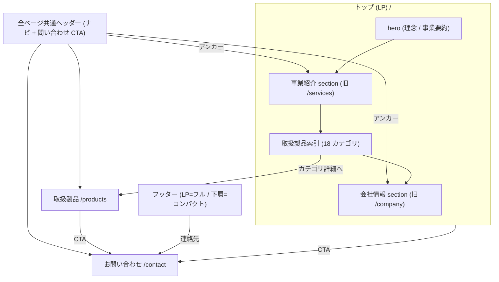
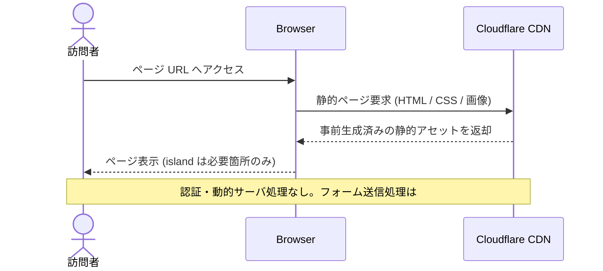

# Feature 設計: コーポレートサイト (apps/corporate-site)

> 最終更新: 2026-06-13 / Status: 設計済 (Phase 1 skeleton) / IA 確定済 (#11 を集約、#17 で 3 route 統合構成へ再確定 — [ADR-0006](../../../adr/0006-corporate-site-three-route-ia.md)) / デザイントークン体系確定 (#13 — [ADR-0007](../../../adr/0007-design-token-architecture.md))

Phase 1 の主対象。Astro によるコーポレートサイトを高いパフォーマンスと保守性で公開する。全体像は [design/DesignDoc.md](../../DesignDoc.md)、横断規約は [context/](../../../context/) を参照する。

## メタ

| 項目           | 値                                                                                                                                                                                                                                                                                                                                                                                                                      |
| -------------- | ----------------------------------------------------------------------------------------------------------------------------------------------------------------------------------------------------------------------------------------------------------------------------------------------------------------------------------------------------------------------------------------------------------------------- |
| 関連 PRD 要求  | [PRD.md](../../../PRD.md) 「コーポレートサイト要求」「Phase 1 スコープ」                                                                                                                                                                                                                                                                                                                                                |
| 関連 DesignDoc | [DesignDoc.md](../../DesignDoc.md) Goal / モジュール責務                                                                                                                                                                                                                                                                                                                                                                |
| 関連 context   | [architecture.md](../../../context/architecture.md), [testing.md](../../../context/testing.md), [infrastructure.md](../../../context/infrastructure.md)                                                                                                                                                                                                                                                                 |
| 関連 ADR       | [ADR-0002](../../../adr/0002-monorepo-scaffold-create-command-policy.md), [ADR-0003](../../../adr/0003-phase1-corporate-site-only-and-cms-deferred.md), [ADR-0006](../../../adr/0006-corporate-site-three-route-ia.md) (3 route IA), [ADR-0007](../../../adr/0007-design-token-architecture.md) (デザイントークン体系), [ADR-0008](../../../adr/0008-astro-react-island-policy.md) (React island / shadcn 消費ポリシー) |
| 関連 spec      | [specs/3-monorepo-foundation/](../../../specs/3-monorepo-foundation/), [specs/11-corporate-site-ia/](../../../specs/11-corporate-site-ia/) (旧 5p IA 決定経緯), [specs/17-corporate-site-ia/](../../../specs/17-corporate-site-ia/) (3 route IA 決定経緯), [specs/13-design-system-foundation/](../../../specs/13-design-system-foundation/) (デザイントークン決定経緯)                                                 |
| 対象モジュール | `corporate-site`                                                                                                                                                                                                                                                                                                                                                                                                        |

## 背景・要件解釈

- コーポレートサイトは表示速度、情報の分かりやすさ、公開前検証が重要。不要な React 化やクライアント JavaScript の増加を避ける。
- Phase 1 では `apps/corporate-site` を Astro コーポレートサイトとして成立させ、`packages/ui` skeleton と共有設定の入口を用意する。

## スコープ

### やること

- `apps/corporate-site` を Astro コーポレートサイトとして構築する。
- コーポレートサイトの主要ページと問い合わせ導線を E2E で検証できる状態にする。
- コーポレートサイト内で閉じる UI を colocation で配置する。

### やらないこと

- Astro で完結できるコーポレートサイト機能の React 化。
- CMS 化 (コンテンツ管理は Phase 2 以降、[cms.md](../cms/DesignDoc_cms.md))。

## 設計

### 設計方針

- コーポレートサイトは Astro の `.astro` コンポーネントを基本にする。
- React island はフォーム、動的 UI、外部 widget など必要な箇所に限定する。表示専用 UI は `@kufu/ui` の shadcn を静的描画 (`client:*` なし、JS ゼロ) で使い、island 化の境界は [ADR-0008](../../../adr/0008-astro-react-island-policy.md) に従う。
- 問い合わせフォームは最初の主要 React island。送信は静的配信を維持しつつ Cloudflare Pages Functions (Workers) を中継する ([ADR-0009](../../../adr/0009-corporate-site-contact-form-backend.md))。機能仕様 (入力項目 / バリデーション / スパム対策 / 通知) の正本は [spec #14](../../../specs/14-contact-form/index.md)。
- コーポレートサイトの画像、フォント、スクリプトは性能予算を意識して管理する。
- 第一原則は feature / colocation とし、app や feature 内で閉じる UI はローカルに置く。
- 共通 UI は利用箇所が複数 app / feature にまたがる時点で `packages/ui` へ移す ([architecture.md](../../../context/architecture.md))。
- Phase 1 では `packages/ui` の skeleton を置くが、コーポレートサイト内で閉じる UI は引き続き `apps/corporate-site` に置く。
- E2E はコーポレートサイトの表示、主要導線、問い合わせ導線を優先し、実行入口は root `playwright.config.ts` と `e2e/` 配下に置く ([testing.md](../../../context/testing.md))。

### データ / コンテンツモデル

- コーポレートサイトの静的コンテンツは、初期段階では `apps/corporate-site` 内に配置する。
- CMS 化するまでは、コンテンツ更新の責務とレビュー観点を spec に残す。
- 画像や動画などの assets はコーポレートサイトの性能予算を考慮して配置、圧縮、読み込み方式を決める。
- 公開 asset は Cloudflare CDN 配信を前提に、キャッシュ戦略と更新単位を意識して配置する ([infrastructure.md](../../../context/infrastructure.md))。

#### ページ構成 (IA)

情報設計 (IA) の正本は本 feature doc。確定済のページ / section 構成・配置マッピング・回遊フローはここに集約する。issue [#11 (spec)](../../../specs/11-corporate-site-ia/index.md) は旧 5 ページ IA、issue [#17 (spec)](../../../specs/17-corporate-site-ia/index.md) は 3 route 統合構成への変更の論点・決定経緯・受け入れ基準を記録する issue 単位の文書であり、構成・フローそのものは本 doc を正とする。構造変更の決定根拠は [ADR-0006](../../../adr/0006-corporate-site-three-route-ia.md)。

サイトマップ (**3 route 統合構成** + 全ページ共通レイアウト G。#17 / ADR-0006 で 5 ページ構成から変更。デザイン正本: [index.pen](index.pen)):

| ID  | ページ       | route       | 主な section                                                                                   | 優先 | 担う成功条件                          |
| --- | ------------ | ----------- | ---------------------------------------------------------------------------------------------- | ---- | ------------------------------------- |
| P1  | トップ (LP)  | `/`         | hero(理念/事業要約) / 事業紹介(販売×加工・ジグザグ構成) / 取扱製品索引(18 カテゴリ) / 会社情報 | 高   | 訴求 + 信頼性 (入口〜中核)            |
| P3  | 取扱製品     | `/products` | 18 カテゴリ詳細 (INDEX パネル + カテゴリ→全メーカー一覧)                                       | 中   | 訴求 (網羅性) + 信頼性 (取扱メーカー) |
| P6  | お問い合わせ | `/contact`  | 連絡先(TEL/FAX/メール) / 問い合わせフォーム (機能は #14 / 送信は Workers 中継 ADR-0009)        | 中   | 接点確保 (BR2)                        |
| G   | 全ページ共通 | -           | ヘッダー(ナビ+CTA)。フッターは LP=フル(サイトマップ付き) / 下層=コンパクト(ブランド+連絡先)    | 高   | BR2 / BR3                             |

- 旧 P2 (事業内容 `/services`) / 旧 P4 (会社情報 `/company`) は LP 内 section に統合し、単独 route は設けない。直接導線は LP 内アンカーで提供する。
- コンテナ幅・横余白は全ページ 1440px・横 padding 56 に統一する。実装は単一 max-width + 共通 padding に正規化する (#17 D6)。
- `.pen` 正本は 3 画面の desktop に加えてモバイル variant を含める。hover / focus / form error 等の状態系はデザイン正本に含めず、実装時に `@kufu/ui` 規約で判断する (#17 D7)。

情報項目 → 配置マッピング (コンテンツ正本: [reference/](reference/)):

| 項目                           | 配置先                            | 備考                                                         |
| ------------------------------ | --------------------------------- | ------------------------------------------------------------ |
| 会社名/創立/資本金/代表/所在地 | P1 会社情報 section               | フッターにも要約 (BR3)                                       |
| TEL/FAX/Eメール                | P1 会社情報 + P6 + 全ページ共通   | BR2                                                          |
| 経営理念                       | P1 hero + 会社情報 section        | 訴求/信頼性の中核                                            |
| 業務内容 (見積/販売・加工)     | P1 事業紹介 section               | 二本柱 (BR1)                                                 |
| 取扱製品カテゴリ (18 区分)     | P1 索引 + P3                      | 単一データソースを共通参照 (#17 D8)。正本 company-profile.md |
| 取扱メーカー (延べ ~320 社)    | P3                                | カテゴリ→全メーカー一覧。正本 manufacturers.md               |
| アクセス/地図                  | P1 会社情報 section 内            | 地図埋め込み可否は性能予算で判断 (E2)                        |
| 沿革 / 代表挨拶                | P1 会社情報 section (placeholder) | 本文は後追い                                                 |

- 会社概要の一次情報 (社名 / 所在地 / 代表 / 連絡先) は LP 会社情報 section を正本とし、フッター等は参照に留める (BR3)。
- アクセス / 地図・沿革・代表挨拶は LP 会社情報 section 内とし、未確定分は placeholder で公開可能な状態を保つ (E1 / E2)。
- グローバルナビ (LP 内 section アンカー + 取扱製品 / お問い合わせ) と全ページ共通の問い合わせ CTA で、全ページから問い合わせ導線 (P6) に到達可能にする (BR2)。ナビ項目の詳細はデザイン正本 ([index.pen](index.pen) Site Header) に従う。

#### コンテンツ正本 (source of truth)

- 掲載コンテンツの正本は committed の [reference/](reference/) に置く: [company-profile.md](reference/company-profile.md) (会社概要 / 業務内容 / 取扱製品カテゴリ 18 区分) と [manufacturers.md](reference/manufacturers.md) (取扱メーカー 延べ ~320 社)。
- `.ai-out/` は AI 取り込み用の未追跡スクラッチであり正本にしない。
- 取扱製品 (`/products`) は「カテゴリ (18 区分) → 当該カテゴリの取扱メーカー一覧」のモデルで提示する。同一メーカーの複数カテゴリ登場は取扱範囲として許容する。
- 一次情報・カテゴリ・メーカーをコードから消費するデータ実体 (JSON / Astro content collection の schema) は本体実装 (#10) で確定する。本 doc では正本の所在とモデルのみを規定する。
- 18 カテゴリ + メーカー一覧は LP 索引 (`/`) と取扱製品 (`/products`) の両方に表示されるため、単一のデータファイル (JSON / content collection 等) を正本として両ページが共通参照する。ページ直書きの二重管理はしない (#17 D8)。

### デザイントークン

トークン (CSS 変数と値) の正本は `packages/ui` の stylesheet であり、**本 doc には値を複製しない** (二重管理防止)。参照先:

| 参照対象                                              | 正本                                                                                                        |
| ----------------------------------------------------- | ----------------------------------------------------------------------------------------------------------- |
| CSS 変数の定義 (primitive + semantic)                 | `packages/ui/src/styles/tokens.css`                                                                         |
| font-face 登録                                        | `packages/ui/src/styles/fonts.css`                                                                          |
| 全量エントリ (React app 用)                           | `packages/ui/src/styles/globals.css` (= `@kufu/ui/styles.css`)                                              |
| 体系 (2 層構造 / shadcn 語彙 / inverse スコープ)      | [ADR-0007](../../../adr/0007-design-token-architecture.md)                                                  |
| 旧 `.pen` 比喩名 → 新 semantic 名の移行対応 (27 変数) | [spec #13](../../../specs/13-design-system-foundation/index.md) Content / Data 設計の決定時スナップショット |

- Pencil variables の rename (spec #13 実装分割 P2) 完了後は **Pencil 変数名 = CSS 変数名の 1:1** となり、対応表そのものが不要になる (移行対応は spec に履歴として残る)。
- CSS トークンを持たない (doc 管理の) ガイドのみ以下に置く:
  - **spacing**: CSS トークンなし。4px グリッド + 推奨リズム 12 / 16 / 24 / 32 / 48 / 80 (= Tailwind `3/4/6/8/12/20`)。`.pen` の `space-*` はこの写像として扱い fork 判定の対象外 ([design-workflow §6](../../../context/design-workflow.md))
  - **radius**: shadcn `--radius` に一本化、基準値 `0rem` (`.pen` 実測で全面直角)
  - **type scale**: Tailwind 標準。見出し階層との対応は次節「トーン & マナー / ブランド指針」

### トーン & マナー / ブランド指針

本節をブランド表現の**正本**とする (決定経緯: [spec #13](../../../specs/13-design-system-foundation/index.md) 論点 D7)。現状の consumer は corporate-site のみであり、cms 等の consumer が増えた時点で platform 級の置き場へ昇格する。

- **デザイン言語**: 工業的・直角。radius 0 (角丸なし)、1px の細罫線 (`--border`) で面を区切る。寒色グレー基調 + teal アクセント
- **書体の役割分担**:
  - `--font-serif` (Noto Serif JP / weight 600) — 見出し・経営理念・ブランド名。信頼感の中核
  - `--font-sans` (Noto Sans JP) — 本文・リード・UI テキスト
  - `--font-mono` (Geist Mono) — eyebrow・ラベル・番号・連絡先。letter-spacing 広め (1〜2.2px) で工業的なアクセント
- **見出し階層** (type scale は Tailwind 標準。トークン化しない):
  - hero 見出し: serif 48〜56px / 1.2 行間
  - section 見出し: serif 34〜44px、mono の eyebrow (10〜12px + tracking) と番号を併置
  - カード見出し: serif 20px / 本文: sans 13.5〜17px / 1.7〜1.85 行間
- **装飾の語彙**: 大型ウォーターマーク数字 (`--ghost-foreground`、140px mono)、写真への色被せ (`--photo-overlay` multiply + 彩度調整)、写真上のキャプションパネル (`--card-overlay`)
- **面の構成**: ライト面は `--background` と `--muted` の交互で section のリズムを作る。フッター・強い CTA 帯はダーク面 (inverse スコープ) に切り替え、アクセント文字は `--primary-soft` を使う
- **余白**: 4px グリッド。推奨リズム 12 / 16 / 24 / 32 / 48 / 80 (Tailwind `3/4/6/8/12/20`)。section 縦 padding 80 / 横 56 (コンテナ幅 1440 — #17 D6)
- **アクセントの使い所**: CTA ボタン (`--primary` 塗り + 白文字)・eyebrow・理念の強調語のみ。面積を絞り信頼感を優先する

## 主要シナリオ / フロー

アクター視点の使用シナリオを示す。確定済の回遊フロー / サイトマップ構造は本 doc を正本とする。具体的な実装手順 (ページ配置・client directive 判断・`packages/ui` 昇格・E2E の書き方) は spec の 実装分割へ委譲する。

- 訪問者は、コーポレートサイトで事業内容・サービスを把握し、問い合わせ導線へ進む。
- 運用者は、コーポレートサイトのセクションや文言を更新し、公開前に主要導線を検証して公開する。

### サイトマップ (ナビゲーション構造)

### 訪問者の回遊フロー

### 静的ページ配信

## テスト観点

- `apps/corporate-site` が build できること。
- Cloudflare Pages preview deployment で主要ページが表示できること。
- コーポレートサイトの主要ページと問い合わせ導線が Playwright で確認できること。
- Astro ページに不要な React island や client directive が増えていないこと。

## 上位資料からの変更点

| 対象資料  | 変更種別 | 内容                                                                                                                                                                                                                                                                                   |
| --------- | -------- | -------------------------------------------------------------------------------------------------------------------------------------------------------------------------------------------------------------------------------------------------------------------------------------- |
| PRD       | 継承     | 「コーポレートサイト要求」「Phase 1 スコープ」を実現方針へ落とし込み                                                                                                                                                                                                                   |
| DesignDoc | 継承     | Goal / モジュール責務 (`apps/corporate-site`) を具体化                                                                                                                                                                                                                                 |
| spec #11  | 集約     | IA (サイトマップ / section 構成 / 配置マッピング / 回遊フロー) の正本を spec から本 doc へ移管。spec は論点・決定経緯・受け入れ・実装分割を保持                                                                                                                                        |
| spec #13  | 追加     | デザイントークン節 (正本への参照ハブ + spacing / radius / type scale ガイド) とトーン & マナー / ブランド指針を新設。トークンの値の正本は `tokens.css`、体系は [ADR-0007](../../../adr/0007-design-token-architecture.md)、移行対応は spec #13 スナップショット (値の二重管理はしない) |
| spec #17  | 変更     | IA を 5 ページ構成から 3 route 統合構成へ変更 ([ADR-0006](../../../adr/0006-corporate-site-three-route-ia.md))。幅統一 (1440px/56)・モバイル variant 方針・18 カテゴリ単一データソースを追記。本 doc を以後の正本とし、spec #17 は決定経緯のスナップショットを保持                     |
