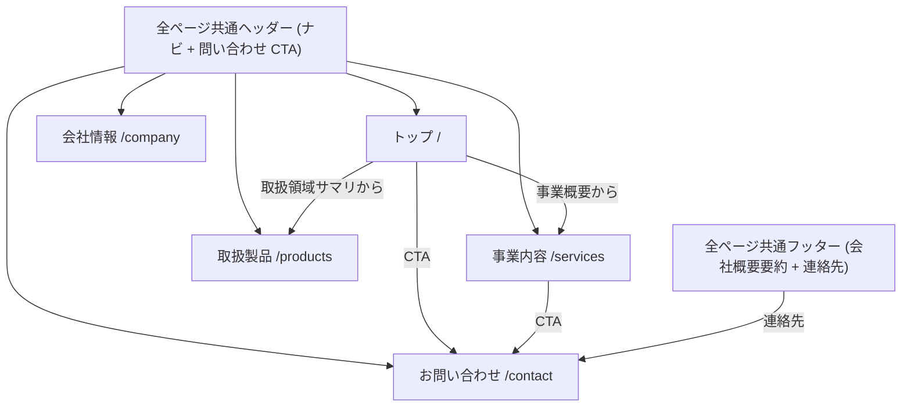
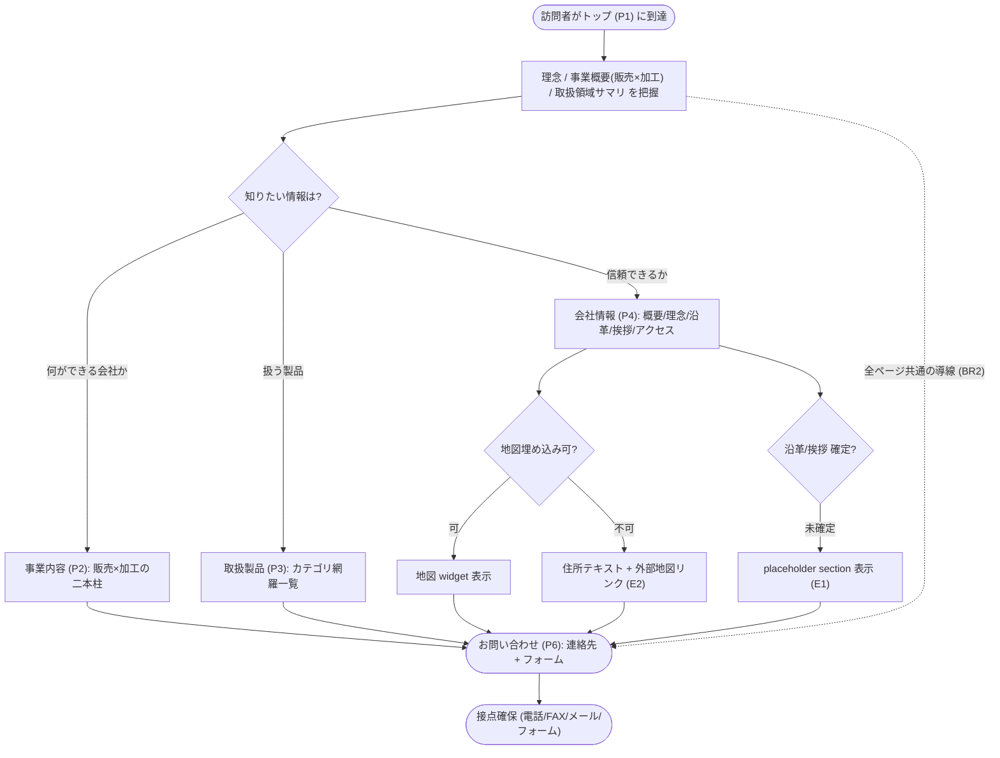
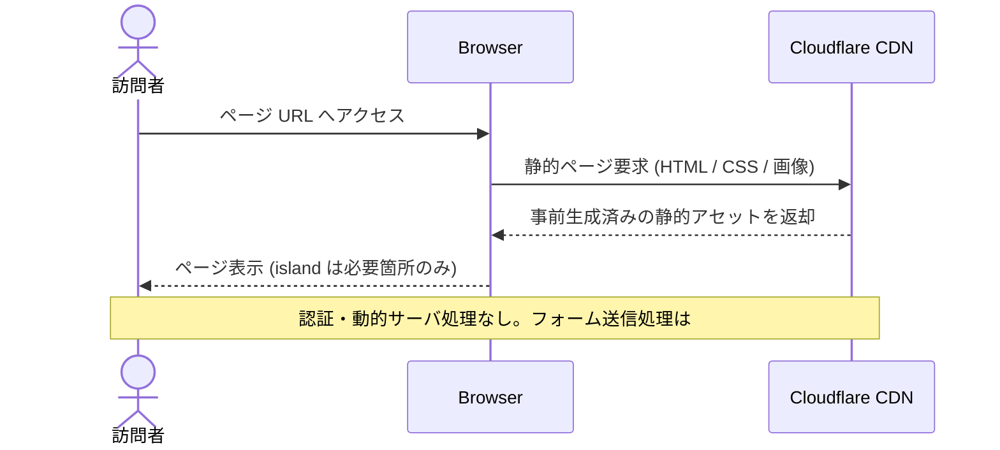

# Feature 設計: コーポレートサイト (apps/corporate-site)

> 最終更新: 2026-06-03 / Status: 設計済 (Phase 1 skeleton) / IA 確定済 (#11 を集約)

Phase 1 の主対象。Astro によるコーポレートサイトを高いパフォーマンスと保守性で公開する。全体像は [design/DesignDoc.md](../../DesignDoc.md)、横断規約は [context/](../../../context/) を参照する。

## メタ

| 項目           | 値                                                                                                                                                       |
| -------------- | -------------------------------------------------------------------------------------------------------------------------------------------------------- |
| 関連 PRD 要求  | [PRD.md](../../../PRD.md) 「コーポレートサイト要求」「Phase 1 スコープ」                                                                                 |
| 関連 DesignDoc | [DesignDoc.md](../../DesignDoc.md) Goal / モジュール責務                                                                                                 |
| 関連 context   | [architecture.md](../../../context/architecture.md), [testing.md](../../../context/testing.md), [infrastructure.md](../../../context/infrastructure.md)  |
| 関連 ADR       | [ADR-0002](../../../adr/0002-monorepo-scaffold-create-command-policy.md), [ADR-0003](../../../adr/0003-phase1-corporate-site-only-and-cms-deferred.md)   |
| 関連 spec      | [specs/3-monorepo-foundation/](../../../specs/3-monorepo-foundation/), [specs/11-corporate-site-ia/](../../../specs/11-corporate-site-ia/) (IA 決定経緯) |
| 対象モジュール | `corporate-site`                                                                                                                                         |

## 背景・要件解釈

- コーポレートサイトは表示速度、情報の分かりやすさ、公開前検証が重要。不要な React 化やクライアント JavaScript の増加を避ける。
- Phase 1 では `apps/corporate-site` を Astro コーポレートサイトとして成立させ、`packages/ui` skeleton と共有設定の入口を用意する。

## スコープ

### やること

- `apps/corporate-site` を Astro コーポレートサイトとして構築する。
- コーポレートサイトの主要ページと問い合わせ導線を E2E で検証できる状態にする。
- コーポレートサイト内で閉じる UI を colocation で配置する。

### やらないこと

- Astro で完結できるコーポレートサイト機能の React 化。
- CMS 化 (コンテンツ管理は Phase 2 以降、[cms.md](../cms/DesignDoc_cms.md))。

## 設計

### 設計方針

- コーポレートサイトは Astro の `.astro` コンポーネントを基本にする。
- React island はフォーム、動的 UI、外部 widget など必要な箇所に限定する。
- コーポレートサイトの画像、フォント、スクリプトは性能予算を意識して管理する。
- 第一原則は feature / colocation とし、app や feature 内で閉じる UI はローカルに置く。
- 共通 UI は利用箇所が複数 app / feature にまたがる時点で `packages/ui` へ移す ([architecture.md](../../../context/architecture.md))。
- Phase 1 では `packages/ui` の skeleton を置くが、コーポレートサイト内で閉じる UI は引き続き `apps/corporate-site` に置く。
- E2E はコーポレートサイトの表示、主要導線、問い合わせ導線を優先し、実行入口は root `playwright.config.ts` と `e2e/` 配下に置く ([testing.md](../../../context/testing.md))。

### データ / コンテンツモデル

- コーポレートサイトの静的コンテンツは、初期段階では `apps/corporate-site` 内に配置する。
- CMS 化するまでは、コンテンツ更新の責務とレビュー観点を spec に残す。
- 画像や動画などの assets はコーポレートサイトの性能予算を考慮して配置、圧縮、読み込み方式を決める。
- 公開 asset は Cloudflare CDN 配信を前提に、キャッシュ戦略と更新単位を意識して配置する ([infrastructure.md](../../../context/infrastructure.md))。

#### ページ構成 (IA)

情報設計 (IA) の正本は本 feature doc。確定済のページ / section 構成・配置マッピング・回遊フローはここに集約する。issue [#11 (spec)](../../../specs/11-corporate-site-ia/index.md) は IA を確定した際の論点・決定経緯・受け入れ基準・実装分割を記録する issue 単位の文書であり、構成・フローそのものは本 doc を正とする。

サイトマップ (主要 5 ページ + 全ページ共通レイアウト G。route は実装で最終確定):

| ID  | ページ       | route(案)   | 主な section                                                     | 優先 | 担う成功条件                          |
| --- | ------------ | ----------- | ---------------------------------------------------------------- | ---- | ------------------------------------- |
| P1  | トップ       | `/`         | hero(理念/事業要約) / 事業概要(販売×加工) / 取扱領域サマリ / CTA | 高   | 訴求 + 信頼性 (入口)                  |
| P2  | 事業内容     | `/services` | 見積もり・販売 / 加工(機械・樹脂・板金溶接・ゴム) / CTA          | 高   | 事業内容の訴求                        |
| P3  | 取扱製品     | `/products` | 製品カテゴリ × 代表メーカー (18 区分・カテゴリ→メーカー構成)     | 中   | 訴求 (網羅性) + 信頼性 (取扱メーカー) |
| P4  | 会社情報     | `/company`  | 会社概要 / 経営理念 / 沿革 / 代表挨拶 / アクセス・地図           | 高   | 信頼性の確立                          |
| P6  | お問い合わせ | `/contact`  | 連絡先(TEL/FAX/メール) / 問い合わせフォーム (機能は #14)         | 中   | 接点確保 (BR2)                        |
| G   | 全ページ共通 | -           | ヘッダー(ナビ+CTA) / フッター(会社概要要約+連絡先)               | 高   | BR2 / BR3                             |

情報項目 → 配置マッピング (コンテンツ正本: [reference/](reference/)):

| 項目                           | 配置先                 | 備考                                         |
| ------------------------------ | ---------------------- | -------------------------------------------- |
| 会社名/創立/資本金/代表/所在地 | P4 会社概要            | フッターにも要約 (BR3)                       |
| TEL/FAX/Eメール                | P4 + P6 + 全ページ共通 | BR2                                          |
| 経営理念                       | P1 hero + P4           | 訴求/信頼性の中核                            |
| 業務内容 (見積/販売・加工)     | P2                     | 二本柱 (BR1)                                 |
| 取扱製品カテゴリ (18 区分)     | P3                     | 重複削除し網羅提示。正本 company-profile.md  |
| 取扱メーカー (延べ ~320 社)    | P3                     | カテゴリ→代表メーカー。正本 manufacturers.md |
| アクセス/地図                  | P4 内 section          | 地図埋め込み可否は性能予算で判断 (E2)        |
| 沿革 / 代表挨拶                | P4 (placeholder)       | 本文は後追い                                 |

- 会社概要の一次情報 (社名 / 所在地 / 代表 / 連絡先) は会社情報ページ (P4) の単一 section を正本とし、フッター等は参照に留める (BR3)。
- アクセス / 地図・沿革・代表挨拶は会社情報ページ内 section とし、未確定分は placeholder で公開可能な状態を保つ (E1 / E2)。
- グローバルナビ 5 項目 (トップ / 事業内容 / 取扱製品 / 会社情報 / お問い合わせ) と全ページ共通の問い合わせ CTA で、全ページから問い合わせ導線 (P6) に到達可能にする (BR2)。

#### コンテンツ正本 (source of truth)

- 掲載コンテンツの正本は committed の [reference/](reference/) に置く: [company-profile.md](reference/company-profile.md) (会社概要 / 業務内容 / 取扱製品カテゴリ 18 区分) と [manufacturers.md](reference/manufacturers.md) (取扱メーカー 延べ ~320 社)。
- `.ai-out/` は AI 取り込み用の未追跡スクラッチであり正本にしない。
- 取扱製品 (`/products`) は「カテゴリ (18 区分) → 当該カテゴリの取扱メーカー一覧」のモデルで提示する。同一メーカーの複数カテゴリ登場は取扱範囲として許容する。
- 一次情報・カテゴリ・メーカーをコードから消費するデータ実体 (JSON / Astro content collection の schema) は本体実装 (#10) で確定する。本 doc では正本の所在とモデルのみを規定する。

## 主要シナリオ / フロー

アクター視点の使用シナリオを示す。確定済の回遊フロー / サイトマップ構造は本 doc を正本とする。具体的な実装手順 (ページ配置・client directive 判断・`packages/ui` 昇格・E2E の書き方) は spec の 実装分割へ委譲する。

- 訪問者は、コーポレートサイトで事業内容・サービスを把握し、問い合わせ導線へ進む。
- 運用者は、コーポレートサイトのセクションや文言を更新し、公開前に主要導線を検証して公開する。

### サイトマップ (ナビゲーション構造)

### 訪問者の回遊フロー

### 静的ページ配信

## テスト観点

- `apps/corporate-site` が build できること。
- Cloudflare Pages preview deployment で主要ページが表示できること。
- コーポレートサイトの主要ページと問い合わせ導線が Playwright で確認できること。
- Astro ページに不要な React island や client directive が増えていないこと。

## 上位資料からの変更点

| 対象資料  | 変更種別 | 内容                                                                                                                                            |
| --------- | -------- | ----------------------------------------------------------------------------------------------------------------------------------------------- |
| PRD       | 継承     | 「コーポレートサイト要求」「Phase 1 スコープ」を実現方針へ落とし込み                                                                            |
| DesignDoc | 継承     | Goal / モジュール責務 (`apps/corporate-site`) を具体化                                                                                          |
| spec #11  | 集約     | IA (サイトマップ / section 構成 / 配置マッピング / 回遊フロー) の正本を spec から本 doc へ移管。spec は論点・決定経緯・受け入れ・実装分割を保持 |
