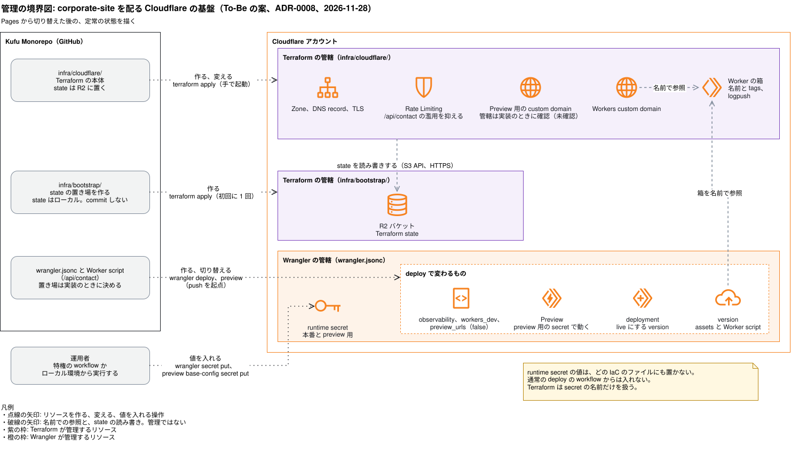
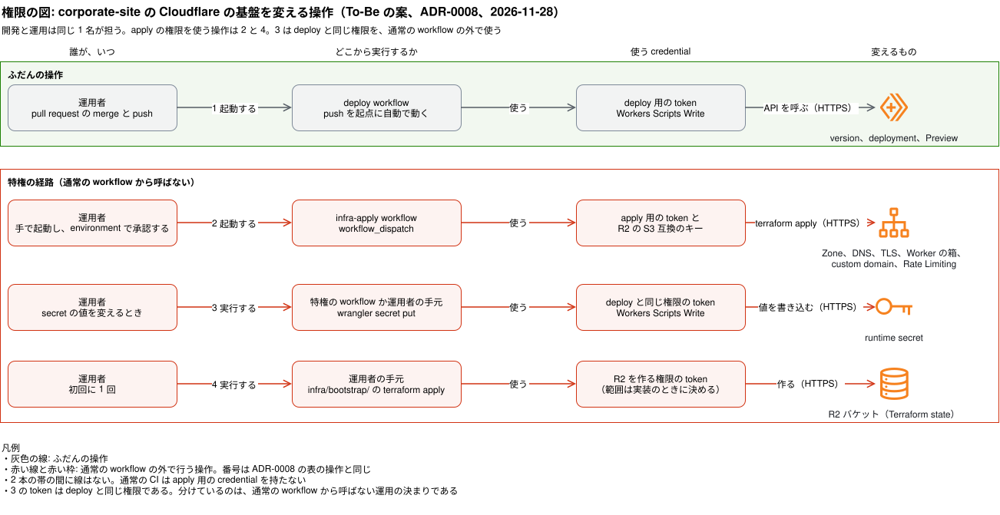

# ADR-0008: infra code を Kufu Monorepo に置き、Workers static assets で配信し、基盤を Terraform、deploy と runtime の設定を Wrangler で管理する

## Status

提案

## Context

- ADR-0007 は、Cloudflare の infra code を Terraform で管理し、その置き場を別のリポジトリ `kufu-infra` にすると決めた。
  - ADR-0007: [Terraform の infra code は kufu-apps と別のリポジトリで管理する](0007-terraform-infra-repository-boundary.md)
- `kufu-infra` には、決定から 6 か月たっても `.tf` ファイルが 1 つもない。
  最終コミットは 2026-05-08 にある。
  分離のコスト（別リポジトリの維持、基盤への取り決めの同期）だけを払い、利益を受け取っていない。
- Cloudflare の設定はすべて Dashboard 上にあり、コードで管理していない。
  `wrangler` の設定ファイルも、リポジトリにない。
  この状態は、ADR-0007 が Dashboard の運用の欠点として退けたものと同じになる。
- ADR-0007 の判断が誤っていたのではない。
  別リポジトリの運用は、そこへ書き込む頻度と担当があって初めて機能する。
  その前提が満たされなかった。
- ADR-0007 は、monorepo に同居させる案の弱みに「Terraform の apply の権限や Cloudflare の credential が app の開発の導線に近づく」を挙げた。
  この懸念は集約した後も残るので、管轄の分け方をこの懸念への対処と合わせる必要がある。
- Cloudflare は、リソースごとにツールを使い分けることを認めている。
  一方で、同じリソースを複数のツールから管理しないことを要件にしている。
  - 出典: [Cloudflare Terraform Best Practices](https://developers.cloudflare.com/terraform/advanced-topics/best-practices/) の「Manage some resources outside of Terraform」
- corporate-site は Astro で静的に生成し、Pages の GitHub 連携で公開している。
  問い合わせフォームの送信の endpoint `/api/contact` は、未実装である（`apps/corporate-site/functions/` がなく、issue #26 は open）。
- Cloudflare は Pages からの移行ガイドと機能の比較表を公開している。
  `wrangler` は、非対話で失敗したときのメッセージで、新規の project を Workers へ勧める。
  - 出典: [Cloudflare: Migrate from Pages to Workers](https://developers.cloudflare.com/workers/static-assets/migration-guides/migrate-from-pages/)
- provider の resource の分け方が、Pages と Workers で違う。
  provider 5.24.0 の schema を比べた結果は次のとおり。

  | resource                    | 必須の項目                                  | secret を持つか                           | assets を持つか |
  | --------------------------- | ------------------------------------------- | ----------------------------------------- | --------------- |
  | `cloudflare_pages_project`  | `account_id` / `name` / `production_branch` | **持つ**（`deployment_configs.env_vars`） | 持つ            |
  | `cloudflare_worker`         | `account_id` / `name`                       | **持たない**                              | **持たない**    |
  | `cloudflare_worker_version` | `account_id` / `worker_id`                  | 持つ                                      | 持つ            |

  **Pages は、箱と中身が 1 つの resource にまとまっている。**
  Terraform に持たせると secret まで抱え、`ignore_changes` で管理の外の範囲を作るしかない。
  **Workers は、箱と中身が別の resource に分かれている。**

- 開発は 1 名なので、自分の変更を自分が承認することになり、レビューによる職務の分離は成り立たない。
- 手本にした fukuemon.dev は、次の 5 つを承認し、初回の apply まで済ませている。
  monorepo の `infra/`、Workers static assets、custom domain を Terraform が持つこと、R2 の state、credential の 2 系統である。
  Worker の箱と Rate Limiting は Terraform で持たず、Worker は `wrangler deploy` が作る。
  この点は、この ADR と違う。
  - 出典: [fukuemon.dev の ADR-0005](https://github.com/Fukuemon/fukuemon.dev/blob/bb59afc0353a92d0137b3aa014f644176bf027a4/docs/adr/0005-workers-terraform-wrangler-boundary.md)

## Decision

### 1. infra code を Kufu Monorepo へ集約する

- **Cloudflare の infra code を Kufu Monorepo へ集約する。** ADR-0007 をこの ADR で置き換える。
- 基盤への取り決めは、app のリポジトリから infra のリポジトリへの受け渡しではなく、同じリポジトリの中の規約として残す。
- `kufu-infra` は、削除せずにアーカイブする。
  ADR-0007 のコピーと初期の検討の履歴を残して、判断の経緯を追えるようにする。
  read-only にして、誤って書き込みが再開されるのを防ぐ。
- `kufu-infra` の PRD と DesignDoc には、このリポジトリのどの文書にもない内容が 2 点ある。
  実装のときに、この 2 点を [context/operations.md](../../context/operations.md) に書き写す。
  書き写し終えるまで、`kufu-infra` をアーカイブしない。
  - preview と production で、secret の実値を共有しない。
  - resource の import と state の移動には、rollback と検証の手順を残す。

### 2. `infra/` をリポジトリの直下に置き、module を作らない

```text
infra/
├── README.md                    # apply の手順、bootstrap の順序、権限
├── bootstrap/                   # state の置き場を作るためだけの root module。初回に 1 回
│   ├── provider.tf
│   ├── r2_state_bucket.tf
│   └── vars.tf
└── cloudflare/                  # 本体。account と zone のレベルを 1 つのディレクトリにまとめる
    ├── provider.tf              # terraform{}、backend（R2）、provider
    ├── vars.tf
    ├── dns.tf                   # zone のレベル
    ├── worker.tf                # Worker の箱
    ├── workers_domain.tf        # custom domain
    └── rate_limiting.tf
```

- `infra/` はリポジトリの直下に置き、`packages/infra/` にしない。
  `packages/` は app から import される共有のライブラリの場所であり、infra はどこからも import されない。
- 実行は、`pnpm infra:plan` のような root の script から行う。
- ファイルは `provider.tf`、`<subject>.tf`、`vars.tf` の 3 種に分ける。
  - 出典: [Cloudflare Terraform Best Practices](https://developers.cloudflare.com/terraform/advanced-topics/best-practices/) の「Directory structure」
- bootstrap を別の root module にする。
  state の置き場の R2 バケットを Terraform 自身が作るため、`infra/cloudflare/` だけでは初回を実行できない。
  `bootstrap/` の state はローカルに置いて commit せず、失ったら `terraform import` で回復する。
- 環境をディレクトリで分けない（`envs/staging/` の形を採らない）。
  Cloudflare は staging、QA、production を別のアカウントと別のドメインで分けるよう定めている。
  - 出典: [Cloudflare Terraform Best Practices](https://developers.cloudflare.com/terraform/advanced-topics/best-practices/) の「Use separate environments」
- `modules/` を設けない。
  Cloudflare は、module を避けるか控えめに使うよう定める。
  対象は 1 アカウント、1 zone で、括り出す重複がない。
  module は、同じ形が 2 か所以上に実在し、かつリポジトリの中のローカルの module として持てるときに作る。
  - 出典: [Cloudflare Terraform Best Practices](https://developers.cloudflare.com/terraform/advanced-topics/best-practices/) の「Avoid modules (or use them sparingly)」
- 引き金を満たすまで、構成を展開しない。

  | 段階 | 状況                       | 形                                                  | 引き金                                                       |
  | ---- | -------------------------- | --------------------------------------------------- | ------------------------------------------------------------ |
  | 0    | 現在                       | `infra/cloudflare/` と `infra/bootstrap/`           | なし                                                         |
  | 1    | app ごとのリソースが増える | `infra/cloudflare/` を `shared/` と `<app>/` に分割 | app に固有のリソースが数個を超えるか、apply の頻度が分かれる |
  | 2    | staging などの環境を足す   | `infra/cloudflare/<account>/...`                    | 2 つ目の Cloudflare アカウントを使う                         |
  | 3    | AWS や GCP を併用する      | `infra/aws/` や `infra/gcp/` を並べる               | 別の provider を導入する                                     |

  root module を分けるときは、state を分ける作業（`terraform state mv` か import）が一度要る。
  最初から分けると、少ないリソースに常に運用のコストを払うことになるので、一度きりの作業として受け入れる。

### 3. state は R2 に置き、`s3` backend の AWS 向けの検証を切る

R2 は S3 互換だが AWS ではない。  
`s3` backend は STS、IAM、metadata API を前提にする箇所があるため、その検証を切る。  
state のロックは、R2 に DynamoDB がないので、`use_lockfile` で S3 の側のロックファイルを使って取る。  
state の key には scope を含め、`cloudflare/main/terraform.tfstate` とする。

```hcl
backend "s3" {
  bucket = "<state バケット名>"
  key    = "cloudflare/main/terraform.tfstate"
  region = "auto"

  endpoints = { s3 = "https://<ACCOUNT_ID>.r2.cloudflarestorage.com" }

  skip_credentials_validation = true # STS が無い
  skip_region_validation      = true # auto は AWS のリージョン名でない
  skip_requesting_account_id  = true # IAM / STS / metadata API が無い
  skip_s3_checksum            = true # R2 のチェックサム対応が限定的
  use_path_style              = true
  use_lockfile                = true # state ロックを S3 側のオブジェクトで取る
}
```

### 4. 配信を Workers static assets にし、Cloudflare Pages を使わない

- Workers では、箱と中身が別の resource に分かれ、5 の管轄の原則が例外なく当てはまる。
- Astro の出力は `output: "static"` のまま変えない。
  `dist/` を、そのまま Worker の static assets として配る。
- `/api/contact` は Worker script が処理する。
  Workers static assets は、何も設定しなければ assets を先に返し、一致しなければ Worker を呼ぶ。
  `/api/contact` は静的なファイルとして存在しないので、Worker に届く。
  `run_worker_first` は要らない。
- Astro の Cloudflare adapter は入れない。
  静的な出力のままなら要らない。

### 5. 基盤の設定は Terraform、アプリの deploy と runtime の設定は Wrangler が管理する

**1 つのリソースを、両方のツールから管理しない。**  
どちらのツールに属するか分からない新しいリソースは、次の順で判定する。

1. **データを保持するなら Terraform。** 消えると戻せないリソースを、deploy のたびに動く処理から切り離すためである。
2. deploy のたびに変わるなら Wrangler。
3. 変わらない場合、変更が本番の可用性かドメインへの到達に影響するなら Terraform。
4. どれでもなければ Terraform をデフォルトにする。変更の履歴と review を残せるためである。

| リソース                                                           | 管轄      | 根拠                                                                                                  |
| ------------------------------------------------------------------ | --------- | ----------------------------------------------------------------------------------------------------- |
| Zone / DNS record / TLS                                            | Terraform | deploy と独立し、ドメインへの到達に直結する                                                           |
| `cloudflare_worker`（箱）                                          | Terraform | 名前、`tags`、`logpush` だけを持つ。`observability` は設定しない                                      |
| `cloudflare_workers_custom_domain`                                 | Terraform | 必須の項目は `account_id` / `hostname` / `service` の 3 つ                                            |
| Rate Limiting ルール（`/api/contact`）                             | Terraform | deploy と独立した、濫用を抑える設定                                                                   |
| R2 バケット（Terraform state 用）                                  | Terraform | `infra/bootstrap/` が作る                                                                             |
| `workers_dev` / `preview_urls`                                     | Wrangler  | `wrangler.jsonc` に `false` と書く。wrangler のデフォルト値との衝突を避ける                           |
| Previews（`previews` ブロックと preview 用の secret）              | Wrangler  | branch ごとに作り直され、deploy のたびに変わる                                                        |
| Preview 用の custom domain（ワイルドカードの DNS record と証明書） | Terraform | ドメインへの到達に関わる。provider で持てるかは実装のときに確認し、持てなければ Wrangler の管轄にする |
| `cloudflare_worker_version`（中身）                                | Wrangler  | assets、bindings、secret を持ち、deploy のたびに変わる                                                |
| `cloudflare_workers_deployment`                                    | Wrangler  | どの version を live にするかを決める。deploy そのもの                                                |
| runtime secret（Resend / Turnstile）                               | Wrangler  | Terraform の state に載せない                                                                         |
| binding（R2 / KV など）                                            | Wrangler  | 決定のときは該当がない。要るときは `wrangler.jsonc` に置く                                            |

- `cloudflare_workers_script` を使わない。
  使うと deploy が Terraform を経由し、apply の権限が日常の CI へ降りる。
- `observability`、`workers_dev`、`preview_urls` は、`wrangler.jsonc` に書かなくても wrangler がデフォルト値を送る。
  Terraform でも持つと、deploy のたびに値を取り合う。
  そのため、この 3 つは Wrangler の管轄にし、`wrangler.jsonc` に明示する。
- `workers_dev` は `false` にする。
  有効にすると、本番の Worker が `workers.dev` のホスト名でも開き、zone の Rate Limiting を通らずに `/api/contact` へ届く見込みである（未確認）。
  `preview_urls` は、Version URL と、Previews の `workers.dev` の URL の両方を切り替える。7 のとおりどちらも使わないので `false` にする。
  `logpush` と `tags` は wrangler が送らないので、Terraform が持つ。
  `cloudflare_workers_script_subdomain` は Terraform で管理しない。
- この分担は、値の受け渡しを増やす。
  Worker の名前は、Terraform（箱と custom domain の `service`）と `wrangler.jsonc` の両方に現れる。
  受け渡しの方法は基盤への取り決めとして定め、対象が 2 つ目になる前に整える。
- 運用で使う管轄の表は context/operations.md に置き、リソースが増減したらそちらを更新する。
  この ADR の表は決定のときの割り当てで、後から書き換えない。

管轄の境界を次の図に描く。  
どのリソースも、Terraform の枠か Wrangler の枠のどちらか一方にだけ入るので、二重の管理は生じていない。  
破線は名前での参照で、管理ではない。  
runtime secret の値は、どの IaC のファイルにも置かない。



### 6. bootstrap の順序

Terraform が Worker の箱を作れるので、Pages のように運用者が手で project を作る手順はない。  
初回に運用者の手元で `infra/bootstrap/` を apply して state の置き場を作った後、次の順にする。

1. `terraform apply` が `cloudflare_worker` を作る。Zone / DNS / TLS は、11 のとおり import する。
2. deploy の workflow が `wrangler deploy` で version を上げ、deployment を切り替える。
3. `terraform apply` が `cloudflare_workers_custom_domain` を張る。

手順 1 と手順 3 は、同じ root module `infra/cloudflare/` の apply である。  
2 回に分ける方法（`-target` か、コミットを分けるか）は、実装のときに決める。

### 7. preview

pull request の確認には、Cloudflare の Previews（`wrangler preview`）を使う。  
Version URL（version ごとの URL）は使わない。

- Version URL は、本番の resource と secret で動く。
  preview から本番の Resend の key でメールが送られ、1 の「preview と production で secret の実値を共有しない」と両立しない。
  - 出典: [Cloudflare: Version URLs](https://developers.cloudflare.com/workers/configuration/previews/)
- Previews は、branch ごとに同じ Worker の下に作られ、本番の設定を引き継がない。
  変数と binding は `wrangler.jsonc` の `previews` ブロックに書き、preview 用の secret は `wrangler preview base-config secret put` で本番と別に入れる。
  - 出典: [Cloudflare: Previews](https://developers.cloudflare.com/workers/previews/)
- Previews には Wrangler 4.135.0 以上が要る。
- Preview の URL は、Preview 用の custom domain に出す。
  Cloudflare は、custom domain にワイルドカードの DNS record と証明書を作る。
  本番のサブドメインとワイルドカードがぶつからないよう、専用のホスト名（`previews.<ドメイン>`）にし、ADR-0009 の割り当ての表に載せる。
  - 出典: [Cloudflare: Previews の Custom domains](https://developers.cloudflare.com/workers/previews/custom-domains/)
- 実装のときに、次の 2 つを確認して決め、context/operations.md に書く。
  - custom domain の Preview を公開のままにするか。Preview の URL は誰でも開け、Cloudflare は custom domain の Preview に `X-Robots-Tag: noindex` を付けない。Cloudflare Access で閉じるか、`noindex` を返すかを決める。
  - `*.previews.<ドメイン>` を、corporate-site とほかの配信物の Preview で共有できるか。共有できなければ、配信物ごとのホスト名を決める。

### 8. runtime secret を Terraform の state に載せない

- secret の値は `wrangler secret put` で入れる。
- 日常の deploy の workflow からは入れない。preview 用の secret（`wrangler preview base-config secret put`）も同じである。
  手動で起動する特権の workflow（`workflow_dispatch` と GitHub の environment protection rules）か、運用者のローカルの実行に限る。
- Terraform は secret の**名前**だけを変数として扱い、値を扱わない。
- Cloudflare Secrets Store は採らない。
  open beta であり、消費者は Worker 1 つで共有する相手がおらず、参照が `env.X` から `await env.X.get()` に変わるためである。
  GA になり、secret を共有する 2 つ目の消費者が現れたら見直す。

### 9. credential を 2 系統に分け、apply の権限を通常の CI から外す

- 通常の deploy の workflow は、push を起点に自動で動き、deploy の scope に限った token だけを持つ。
- apply の workflow は、手で起動し（`workflow_dispatch`）、GitHub の environment protection rules を通す。
  apply 用の token と、state を読み書きする R2 の S3 互換のキーを持つ。
- 1 名の体制でも成り立つ分離は、apply を自動で実行せず必ず手動で起動することと、通常の CI に apply 用の credential を持たせないことの 2 つである。
  `.github/CODEOWNERS` での所有者の宣言は分離にならないため、設定しない。
- secret の投入は、credential では分けられない。
  secret を書き込む API の権限は `Workers Scripts Write` で、deploy に要る権限と同じである。
  そのため、secret の投入は「通常の workflow から呼ばない」という運用の決まりとする。
  - 出典: [Cloudflare API: Update a Worker script secret](https://developers.cloudflare.com/api/resources/workers/subresources/scripts/subresources/secrets/methods/update/) の Accepted Permissions

操作ごとの権限を次の図と表に示す。  
deploy より強い権限を使う操作は、2 と 4 に限る。  
3 は deploy と同じ権限を、通常の workflow の外で使う。



| 操作                                 | 使う権限                                                  | 誰が           | いつ                                          | 記録の残し方                                                                                                                           |
| ------------------------------------ | --------------------------------------------------------- | -------------- | --------------------------------------------- | -------------------------------------------------------------------------------------------------------------------------------------- |
| 1 deploy                             | deploy の scope に限った token（`Workers Scripts Write`） | 運用者（push） | push のたび。pull request では Preview を作る | GitHub Actions の実行の記録                                                                                                            |
| 2 Terraform の apply                 | apply 用の token と R2 の S3 互換のキー                   | 運用者         | `infra/cloudflare/` を変えたとき              | GitHub Actions の実行の記録と、environment の承認の記録                                                                                |
| 3 secret の投入（本番と preview 用） | deploy と同じ権限の token（`Workers Scripts Write`）      | 運用者         | secret の値を変えるとき                       | 特権の workflow なら GitHub Actions の実行の記録。ローカル環境で実行したときの残し方は、実装のときに決め、context/operations.md に書く |
| 4 bootstrap                          | R2 を作る権限の token                                     | 運用者         | 初回に 1 回                                   | token の範囲と記録の残し方は、実装のときに決め、context/operations.md に書く                                                           |

### 10. monorepo に同居する欠点に、1 つずつ対処する

ADR-0007 が monorepo に同居する欠点として挙げた点は、集約した後も消えない。

- UI の変更と本番の infra の変更が同じ差分に並ぶ。
  - Terraform を `infra/` に限り、差分の場所で見分けられるようにする。日常の deploy は Terraform を通らないので、UI の変更の pull request に infra の差分は入らない。
- apply の権限や Cloudflare の credential が、app の開発の導線に近づく。
  - 9 のとおり credential を 2 系統に分ける。
- DNS、secret のような本番への影響が大きい変更が、通常の pull request に埋もれる。
  - Terraform の管轄は、apply を自動で実行しない。merge しても、apply の workflow を手動で起動しなければ本番に反映されない。
  - Worker script の変更には対処しない。Worker のコードは app の側にあるので、リポジトリをどう分けても push で自動で deploy される。緩和は通常の pull request のレビューと自動テストに任せる。
  - runtime secret は、この欠点に当たらない。値が pull request の差分に現れず、通常の pull request に埋もれることがない。
- どこまで触ってよいかの境界が曖昧になる。
  - ディレクトリの構成で境界を定める。実装した後、その事実を [context/codebase.md](../../context/codebase.md) に書く。
- 将来 Cloudflare の基盤を複数の app やリポジトリで共有すると、monorepo の責務が広がりすぎる。
  - 対処せず、12 の見直しの条件を満たしたら再検討する。

### 11. 既存の Dashboard の設定は import し、稼働中のサイトを切り替える

- Zone、DNS record、TLS は、`cf-terraforming` で Terraform の state へ import する。公開中のサイトが依存しており、作り直さない。
- サイトのホスト名の DNS record は、import の対象から外し、custom domain に作らせる。
  custom domain は DNS record を自動で作り、既に CNAME があるホスト名には張れないためである。
  - 出典: [Cloudflare: Custom Domains](https://developers.cloudflare.com/workers/configuration/routing/custom-domains/)
- custom domain、Worker の箱、`/api/contact` の Rate Limiting のルール、state 用の R2 バケットは、新しく作る。
- apply の前に Dashboard を棚卸しして実在するリソースを確定し、見込みと食い違ったら棚卸しの結果を正とする。

稼働中のサイトは、次の順で Pages から Worker へ切り替える。

1. Worker を作り、Preview の URL で内容を確認する。`/api/contact` は preview 用の secret で動くので、本番の secret での確認は手順 4 に残る。
2. `cloudflare_workers_custom_domain` を張る前に、Pages の側の custom domain を外し、サイトのホスト名の CNAME の record を消す。
3. Worker の側へ custom domain を張り、DNS が Worker を指すことを確認する。
4. 表示と `/api/contact` を確認した後で、Pages の GitHub 連携を外し、Pages project を消す。

custom domain は同時に 2 つの宛先へ張れないので、手順 2 と 3 の間はサイトが落ちる。  
作業の時間帯を決め、切り戻しの手順（Pages の側へ custom domain を戻す）を残す。

### 12. 見直しの条件

次のどちらかが起きたら、この決定を再検討する。

- Kufu Monorepo の外の app が、同じ Cloudflare アカウントの基盤を共有する必要が生じた。
- 人が増え、infra の変更のレビューを担う人と app の開発を担う人を分けられるようになった。

## Verification

- `s3` backend の設定を、MinIO を S3 互換の代わりにして terraform 1.14.3 で確認した（2026-08-25）。
  - `init` と `apply` が通り、state が `cloudflare/main/terraform.tfstate` に書かれた。
  - apply の間は `terraform.tfstate.tflock` が現れ、ロックを持ったまま別の apply を実行すると `Error acquiring the state lock` で拒まれた。
  - R2 での読み書きとロックは、fukuemon.dev の初回の apply で、`skip_s3_checksum` を含む同じ設定で確認されている。S3 互換のキーは、R2 の画面で発行したものに限る。
- `kufu-infra` のブランチ（`develop`、`feature/1`）を確認した（2026-08-25）。
  - `.tf` は 1 つもない。2026-11-28 に `main` を含む 3 つのブランチを見直しても、変わっていない。
  - デフォルトのブランチは `main` ではなく `develop` である。アーカイブの前に内容を取り出すときは、参照するブランチを間違えない。
- `cloudflare_pages_project` の `deployment_configs` は secret を含む（`env_vars` の `secret_text` に `sensitive` が付く）。
- `wrangler` 4.126.0 の同梱の schema と bundle で、`wrangler.jsonc` に書かないときに送るデフォルト値を確認した。

  | 設定            | wrangler のデフォルト | 対応する Terraform                    | 管轄      |
  | --------------- | --------------------- | ------------------------------------- | --------- |
  | `observability` | `{ enabled: true }`   | `cloudflare_worker`                   | Wrangler  |
  | `workers_dev`   | `true`                | `cloudflare_workers_script_subdomain` | Wrangler  |
  | `preview_urls`  | `false`               | `cloudflare_workers_script_subdomain` | Wrangler  |
  | `logpush`       | 送らない              | `cloudflare_worker`                   | Terraform |
  | `tags`          | キーがない            | `cloudflare_worker`                   | Terraform |

- Previews には Wrangler 4.135.0 以上が要る（2026-11-28 に Cloudflare の文書で確認した）。Version URL は本番の resource で動き、Previews は変数、secret、binding を別に持つ。
- 今の Cloudflare の文書は、`preview_urls` を書かないときは `workers_dev` に従うと書く。この ADR は 2 つを `false` と明示するので、デフォルト値に依らない。
- Preview の URL は、`workers.dev` か custom domain の少なくとも 1 つを有効にしないと出ない。この ADR は custom domain を使う。
- `@astrojs/cloudflare` 14.2.5 は、Workers を配信先とする adapter である。peer dependency は `astro ^7.2.0` で、このリポジトリの Astro は 7.4.8 である。

## Considered Options

| 選択肢                                                                                                                                    | 強み                                                                                                                                                         | 弱み                                                                                                                                                                                                 |
| ----------------------------------------------------------------------------------------------------------------------------------------- | ------------------------------------------------------------------------------------------------------------------------------------------------------------ | ---------------------------------------------------------------------------------------------------------------------------------------------------------------------------------------------------- |
| **採用:** monorepo の `infra/` に集約し、Workers static assets で配信し、基盤を Terraform、deploy と runtime の設定を Wrangler で管理する | 1 つの pull request で app と infra の変更を揃えられる。管轄の原則が例外なく当てはまる。apply の権限を通常の CI から外せる。Terraform state に機密が入らない | 管理するツールが 2 つになる。権限の分離をリポジトリの境界ではなく、ディレクトリと workflow の組み合わせで行う。稼働中のサイトの切り替えで、サイトが落ちる時間が出る                                  |
| 別リポジトリのまま Terraform を書き始める（ADR-0007 を保つ）                                                                              | 決定を変えずに済む。apply の権限と credential を app の開発の導線から切り離す狙いを、設計どおりに実現できる                                                  | 着手されなかった原因に対処していない。同じ構造なら同じ結果になる見込みが高い。同期のコストを払い続ける                                                                                               |
| Terraform を使わず Dashboard で運用する                                                                                                   | 追加の学習と state の運用が要らない。今からの変更が最も小さい                                                                                                | ADR-0007 が挙げた欠点（変更の履歴、review、再現性、環境の差分の管理が弱く、secret と binding の運用が属人化する）がそのまま当たる                                                                    |
| すべてを Terraform で管理する（`cloudflare_workers_script` を使う）                                                                       | 管理するツールが 1 つに揃う。すべての変更が `terraform plan` の差分に出る                                                                                    | deploy のたびに apply するので、apply の権限が日常の CI に降りる。Worker の binding と secret を Terraform が持ち、state が機密になる                                                                |
| Cloudflare Pages を続ける                                                                                                                 | 稼働中のサイトを触らず、サイトが落ちない                                                                                                                     | Pages project を丸ごと Wrangler へ渡すか、Terraform に持たせて `ignore_changes` で管理の外の範囲を作るしかない。運用者が手で作る初回の手順が残る。Cloudflare が新規を Workers へ勧める向きと逆に進む |
| 3 層の module の構成を採る                                                                                                                | Terraform の一般的なベストプラクティスに沿う。app や provider が増えても構成を変えずに広げられる                                                             | Cloudflare が module を避けるよう定める。括り出す重複がなく、薄いラッパーにしかならない                                                                                                              |
| 集約するが、ディレクトリを分けず app と同じ並びに置く                                                                                     | 構成が最も単純になる                                                                                                                                         | 境界が曖昧になる欠点とレビューの観点が入り交じる欠点に対処できない。`infra/` の接頭辞がなく、CI の path filter で infra の変更だけを対象にできない                                                   |
| すべてを Wrangler と Dashboard で管理する                                                                                                 | 初期のセットアップが最も速い。Terraform の学習と state の運用が要らない                                                                                      | DNS、custom domain、Rate Limiting が Dashboard 上の属人的な設定として残る。変更の履歴、review、再現性が弱い                                                                                          |
| Pages と Workers を並べて使う                                                                                                             | 段階的に移せる                                                                                                                                               | 管轄の表とツールの分担が 2 系統になり、「どちらの管轄か」の判断が増える。このプロジェクトは app が 1 つで、分ける単位がない                                                                          |

Cloudflare は Pages の利点を 4 つ挙げる。Early Hints のネイティブの対応、file-based routing、Cloudflare の zone の外の custom domain、Pages Plugins である。  
このプロジェクトは、どれも使わない。  
ドメインは Cloudflare の zone の中にあり、API は `/api/contact` の 1 本で、Plugins は使っていない。  
Early Hints は、Workers でも `Link` header で出せる。

## Consequences

### Positive

- 1 つの pull request で app の変更と infra の変更を揃えられる。
- 基盤への取り決めと実体が同じリポジトリに置かれ、同期を忘れて食い違うことがなくなる。
- コードで管理していなかった Cloudflare のリソースが、初めてコードの管理に入る。
- Cloudflare の credential が 2 系統に分かれ、ADR-0007 が挙げた credential の懸念に直接に対処できる。
- Terraform state に機密が入らないので、state backend を守る要件が下がる。
- bootstrap が Terraform から始まり、運用者が手で作る手順がない。
- 将来 `/api/*` を足すときは、同じ Worker にハンドラを足すだけで済む。
- 将来 SSR へ移る道は残る。`@astrojs/cloudflare` は Workers を配信先とする adapter で、今の Astro のバージョンで入れられる。

### Negative

- monorepo の責務が広がる。frontend が中心のリポジトリに infra の関心が加わる。
- 権限の分離はリポジトリの境界より弱く、設定し忘れがそのままリスクになる。
- 管理するツールが 2 つになり、判定の手順と管轄の表を基準として保つ運用のコストがかかる。
- `wrangler.jsonc` が Worker の設定の基準になるので、このファイルを review の対象として扱う。
- secret の投入を自動化しないので、値を変えるたびに手で操作する。ローテーションの手順を、運用として残す。
- 稼働中のサイトの切り替えで、custom domain を付け替える間だけサイトが落ちる。落ちる時間の長さは見積もっていない。
- Pages の GitHub 連携を外す作業が、切り替えと同時になる。
- 初回の deploy の後に `terraform plan` が空になることを、まだ確認していない。実装の最初に確認する。
- 実装した後に、ADR-0007 と Pages を前提に書いた文書を直す。
  - [context/operations.md](../../context/operations.md): 基盤への取り決めの位置づけ、管轄の表、bootstrap の順序、state と secret の扱い
  - [context/codebase.md](../../context/codebase.md): `infra/` のディレクトリの境界
  - [context/tech-stack.md](../../context/tech-stack.md): root の script の `infra:plan` と `infra:apply`
  - [docs/design/DesignDoc.md](../design/DesignDoc.md): 「Terraform は別のリポジトリで管理する」の記述と、配信先の図
  - [docs/PRD.md](../PRD.md): 配信先の図と、Pages と Terraform をまたぐ未決事項
