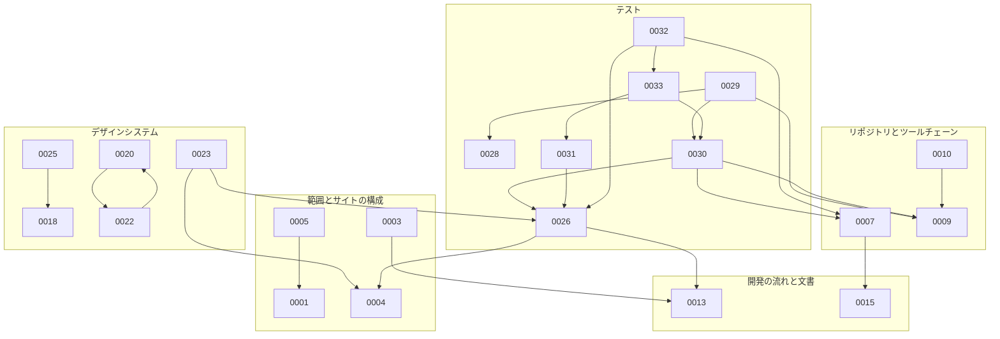

# ADR

`docs/adr/` は Kufu Monorepo の恒久的な意思決定ログを保存する場所である。仕様検討の途中メモや一時的な比較は `docs/specs/` に置き、長期参照価値のある判断だけを ADR に昇格する。

## 話題ごとの ADR

話題ごとに、今有効な ADR を並べる。

### 範囲とサイトの構成

| ADR                                                             | 題                                                                                                            | Status |
| --------------------------------------------------------------- | ------------------------------------------------------------------------------------------------------------- | ------ |
| [ADR-0001](0001-phase1-corporate-site-only-and-cms-deferred.md) | Phase 1 は `apps/corporate-site` だけを実装し、`apps/cms` の設計を後続へ送る                                  | 承認   |
| [ADR-0002](0002-astro-static-corporate-site.md)                 | コーポレートサイトを Astro の静的な生成で作り、UI を共有の package に置き、CMS を最初から作らない             | 承認   |
| [ADR-0003](0003-corporate-site-three-route-ia.md)               | corporate-site の IA を 5 ページ構成から 3 route の統合構成へ変更する                                         | 承認   |
| [ADR-0004](0004-corporate-site-sections-architecture.md)        | corporate-site の component を section 単位のフラットな構成にし、公開面を index.ts と独自のチェックで固定する | 承認   |
| [ADR-0005](0005-corporate-site-contact-form-backend.md)         | corporate-site の問い合わせの送信は Cloudflare Pages Functions（Workers）で中継する                           | 承認   |

### 基盤と配信

| ADR                                                     | 題                                                              | Status |
| ------------------------------------------------------- | --------------------------------------------------------------- | ------ |
| [ADR-0006](0006-terraform-infra-repository-boundary.md) | Terraform の infra code は kufu-apps と別のリポジトリで管理する | 承認   |

### リポジトリとツールチェーン

| ADR                                                   | 題                                                                                                        | Status |
| ----------------------------------------------------- | --------------------------------------------------------------------------------------------------------- | ------ |
| [ADR-0007](0007-documents-under-docs.md)              | PRD、Design Doc、ADR、spec を `docs/` の下に集める                                                        | 承認   |
| [ADR-0009](0009-vite-plus-toolchain.md)               | 整形、lint、unit test を Vite+ で実行し、Turborepo を外す                                                 | 承認   |
| [ADR-0010](0010-workspace-package-contract.md)        | workspace の package はソースを export し、ビルドの成果物、project references、packages/config を持たない | 承認   |
| [ADR-0011](0011-hook-path-resolution-via-ghq-root.md) | AI エージェントの hook の PATH の解決を `$(ghq root)/<repo-path>` ベースに統一する                        | 承認   |

- ADR-0008（[Monorepo の app の scaffold は公式の create command を優先し、Vite+ は見送る](0008-monorepo-scaffold-create-command-policy.md)）は、ADR-0009 に置換した。

### 開発の流れと文書

| ADR                                                       | 題                                                                                            | Status |
| --------------------------------------------------------- | --------------------------------------------------------------------------------------------- | ------ |
| [ADR-0013](0013-design-source-of-truth-implementation.md) | デザインの基準を実装（コードと Storybook）にし、Pencil（.pen）を廃止する                      | 承認   |
| [ADR-0014](0014-designdoc-present-facts-only.md)          | Design Doc の各節には今の事実だけを書き、将来の計画は Open Questions / Future Work 節に集める | 承認   |
| [ADR-0015](0015-specs-closeout-enforcement.md)            | spec を残し、issue を閉じるときの削除をチェックと削除の pull request の自動の起票で徹底する   | 承認   |
| [ADR-0016](0016-ci-local-hook-responsibility.md)          | CI とローカルのフックの役割を、同じチェックを両方で動かすことを許す形で分ける                 | 承認   |

- ADR-0012（[デザイン制作のワークフローを Claude Design → Pencil.dev → AI Agent の 3 段構成で確定する](0012-design-production-workflow.md)）は、ADR-0013 に置換した。

### デザインシステム

画面を作るときに使う側の規則は、[DESIGN.md](../../packages/ui/DESIGN.md) にある。この話題の ADR は、その規則を決めた理由と、比べた案を持つ。

| ADR                                               | 題                                                                                                                                                  | Status |
| ------------------------------------------------- | --------------------------------------------------------------------------------------------------------------------------------------------------- | ------ |
| [ADR-0018](0018-design-tokens-three-layers.md)    | トークンを、Kufu の色と DADS の値を持つプリミティブトークン、セマンティックトークン、テーマ変数の 3 つの層にし、shadcn の語彙をやめる               | 承認   |
| [ADR-0020](0020-ui-components-native-elements.md) | packages/ui のコンポーネントを、ネイティブの要素と clsx で書いた Base と Case にし、shadcn と Base UI を外す                                        | 承認   |
| [ADR-0022](0022-corporate-site-island-policy.md)  | corporate-site は @kufu/ui のコンポーネントを静的に描画して使い、client:\* の island は操作が要るものに限る                                         | 承認   |
| [ADR-0023](0023-storybook-catalog.md)             | packages/ui の Storybook をカタログの本体にし、corporate-site の Storybook を画面のカタログとして並べて公開する                                     | 承認   |
| [ADR-0025](0025-kufu-identity-japanese-labels.md) | Kufu の色、書体、ロゴ、装飾の語彙を残し、状態の色、フォーカス、文字の最小の大きさ、押せる領域を DADS に合わせ、見出しの上のラベルを日本語だけにする | 承認   |

- ADR-0017（[デザイントークンを primitive と shadcn の語彙の 2 層に分け、tokens、fonts、theme、全量の entry で配る](0017-design-token-architecture.md)）は、ADR-0018 に置換した。
- ADR-0019（[shadcn の primitive の基盤に Base UI を採る](0019-shadcn-base-ui-primitive-policy.md)）は、ADR-0020 に置換した。
- ADR-0021（[corporate-site は shadcn を静的に描画して使い、client:\* の island は操作が要るものに限る](0021-astro-react-island-policy.md)）は、ADR-0022 に置換した。
- ADR-0024（[Kufu の色、書体、ロゴ、装飾の語彙を残し、状態の色、フォーカス、文字の最小の大きさ、押せる領域を DADS に合わせる](0024-keep-kufu-identity.md)）は、ADR-0025 に置換した。

### テスト

| ADR                                                         | 題                                                                      | Status |
| ----------------------------------------------------------- | ----------------------------------------------------------------------- | ------ |
| [ADR-0026](0026-visual-regression-testing-policy.md)        | VRT（visual regression testing）を story と route の 2 系統で導入する   | 承認   |
| [ADR-0028](0028-e2e-test-code-layers.md)                    | E2E のテストのコードを層に分けて書き、ページ単位の Page Object をやめる | 承認   |
| [ADR-0029](0029-oxlint-js-plugin-for-e2e-authoring-rule.md) | テストの書き方の規則を、ESLint を入れずに oxlint の JS プラグインで流す | 承認   |
| [ADR-0030](0030-e2e-workspace-at-root.md)                   | E2E をルートの e2e/ に置いたまま、workspace の package にする           | 承認   |
| [ADR-0031](0031-playwright-upgrade.md)                      | Playwright を 1.64.1 に上げる                                           | 承認   |
| [ADR-0032](0032-verification-scenarios-and-evidence.md)     | 検証のシナリオを文書として置き、エビデンスを pull request に載せる      | 承認   |
| [ADR-0033](0033-capture-evidence-with-playwright.md)        | エビデンスを、Playwright の録画と字幕で撮る                             | 承認   |

- ADR-0027（[play テストと E2E の役割を分け、Page Object と locator の規約を定める](0027-ui-test-structure-policy.md)）は、ADR-0028 に置換した。

## ADR の間の依存

次の図は、今有効な ADR から、その ADR が Context で前提にした ADR への向きを示す。  
置換した ADR を前提にした辺は、置換した先の ADR に付け替えて描く。  
付け替えた先が自分になる辺は描かない。

- ADR-0002、ADR-0006、ADR-0011、ADR-0014、ADR-0016 は、Context でほかの ADR を前提にせず、前提にもされないので、図に描かない。

## 旧番号と新番号

#115 で、ADR を話題の順に並べるために番号を振り直し、旧 ADR-0018 を旧 ADR-0015 に統合して今の ADR-0026 にした。  
コミット、issue、pull request に書いた旧番号は、この表で今の ADR を探す。  
統合した ADR の行は、統合した判断を今持つ ADR を指す。

| 旧番号   | 今の番号         | 変えた issue |
| -------- | ---------------- | ------------ |
| ADR-0001 | ADR-0006         | #115         |
| ADR-0002 | ADR-0008         | #115         |
| ADR-0003 | ADR-0001         | #115         |
| ADR-0004 | ADR-0012         | #115         |
| ADR-0005 | ADR-0011         | #115         |
| ADR-0006 | ADR-0003         | #115         |
| ADR-0007 | ADR-0017         | #115         |
| ADR-0008 | ADR-0021         | #115         |
| ADR-0009 | ADR-0005         | #115         |
| ADR-0010 | ADR-0019         | #115         |
| ADR-0011 | ADR-0015         | #115         |
| ADR-0012 | ADR-0013         | #115         |
| ADR-0013 | ADR-0014         | #115         |
| ADR-0014 | ADR-0004         | #115         |
| ADR-0015 | ADR-0026（統合） | #115         |
| ADR-0016 | ADR-0016         | #115         |
| ADR-0017 | ADR-0027         | #115         |
| ADR-0018 | ADR-0026（統合） | #115         |
| ADR-0019 | ADR-0002         | #115         |
| ADR-0024 | ADR-0007         | #115         |
| ADR-0025 | ADR-0009         | #115         |
| ADR-0026 | ADR-0010         | #115         |
| ADR-0027 | ADR-0018         | #115         |
| ADR-0028 | ADR-0020         | #115         |
| ADR-0029 | ADR-0023         | #115         |
| ADR-0030 | ADR-0024         | #115         |
| ADR-0031 | ADR-0028         | #115         |
| ADR-0032 | ADR-0029         | #115         |
| ADR-0033 | ADR-0030         | #115         |
| ADR-0034 | ADR-0031         | #115         |
| ADR-0035 | ADR-0032         | #115         |
| ADR-0036 | ADR-0033         | #115         |
| ADR-0037 | ADR-0025         | #115         |
| ADR-0038 | ADR-0022         | #115         |

## 命名規約

- ファイル名: `docs/adr/NNNN-<title>.md`
- 番号が、先にマージされた pull request の ADR と重なったら、後からマージする pull request が番号を振り直す。
- 例 (実在 ADR):
  - [`docs/adr/0006-terraform-infra-repository-boundary.md`](0006-terraform-infra-repository-boundary.md)
  - [`docs/adr/0018-design-tokens-three-layers.md`](0018-design-tokens-three-layers.md)
  - [`docs/adr/0005-corporate-site-contact-form-backend.md`](0005-corporate-site-contact-form-backend.md)

## ADR にする判断

- コーポレートサイトの技術選定や rendering 方針を固定した。
- app / package の責務境界を固定した。
- UI の共有の方針や、共有のコンポーネントの書き方を固定した。
- React Compiler 対応方針を固定した。
- CMS/API、認証、管理画面など将来拡張の採否を決めた。
- 代替案比較を経て、採用方針を明示的に残す必要がある。

テンプレートは [template.md](template.md) を使う。
