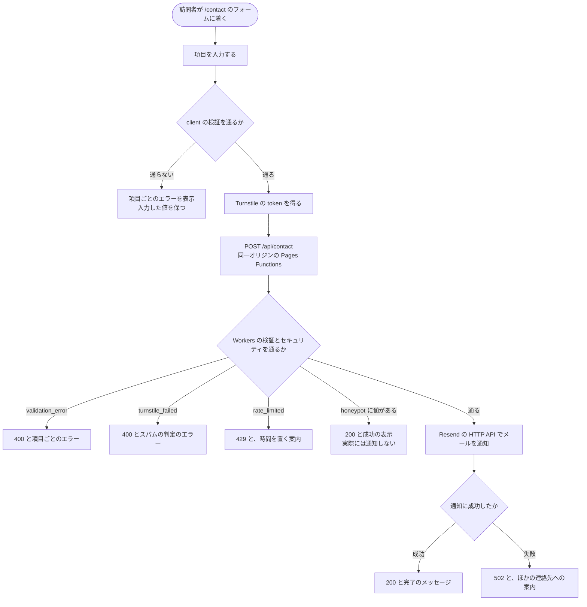
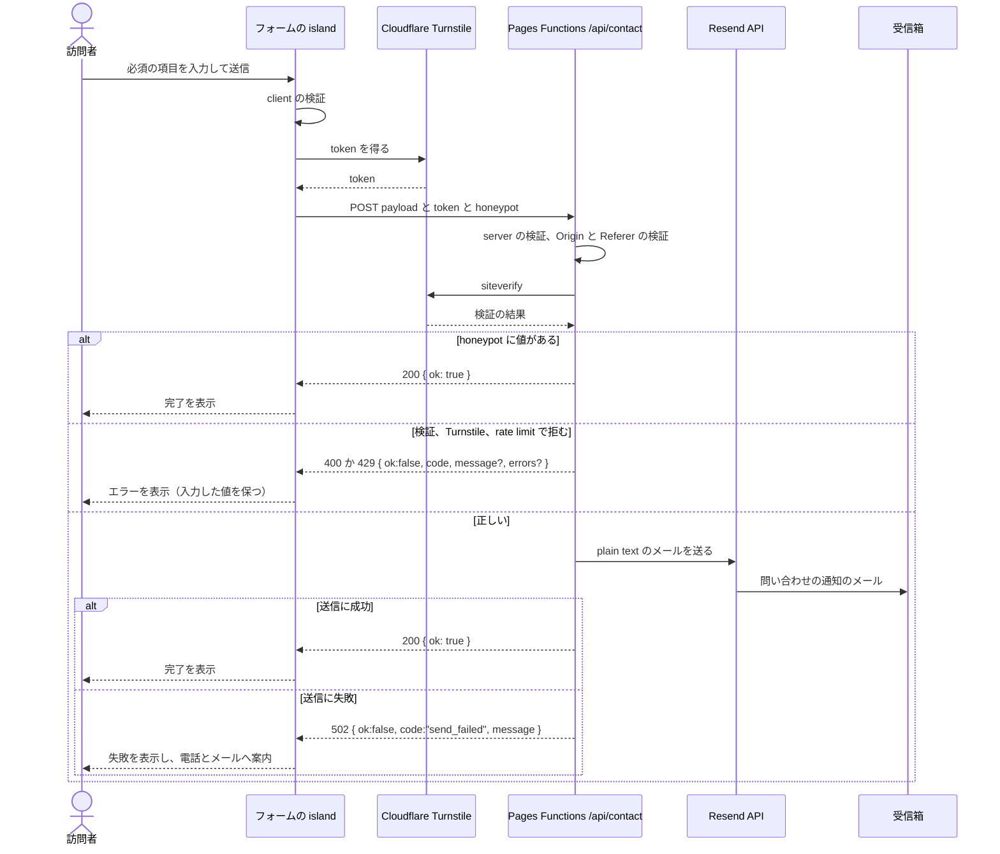

# 問い合わせフォーム

## Overview

`/contact` の問い合わせフォームから、訪問者の問い合わせを Kufu へメールで知らせる。  
コーポレートサイトの静的な配信を保ったまま、送信だけを Cloudflare Pages Functions（Workers）で中継する。  
ADR-0005: [corporate-site の問い合わせフォームの backend](../../../adr/0005-corporate-site-contact-form-backend.md)

全体像は [design/DesignDoc.md](../../DesignDoc.md) に、フォームを置くページは [コーポレートサイトの Design Doc](../../../../apps/corporate-site/DesignDoc.md#問い合わせフォーム) にある。  
まだ実装していないので、この文書は設計文書のディレクトリに置く。

## Scope

持つものは次のとおり。

- フォームの React の island と、client の検証
- 送信の endpoint `POST /api/contact` と、Workers の側の検証とセキュリティの判断
- Resend によるメールの通知

持たないものは次のとおり。

- 問い合わせの内容の保存。アプリの側（Workers）で DB、ストレージ、ログに残さない。
  - 扱いの規則は [context/codebase.md](../../../../context/codebase.md#state-ownership) にある。
- 基盤の設定（secret、Rate Limiting のルール、送信のドメイン）。基盤に求めるものは [context/operations.md](../../../../context/operations.md#問い合わせフォームが基盤に求めるもの) にある。
- Edge API に共通の契約。[context/codebase.md](../../../../context/codebase.md#edge-api) にある。

## Design

### 入力の項目と検証

| 項目               | key                     | 必須 | 型       | 検証の規則                                                 |
| ------------------ | ----------------------- | ---- | -------- | ---------------------------------------------------------- |
| 会社名             | `company`               | 任意 | input    | 最大 100 文字                                              |
| 担当者名           | `name`                  | 必須 | input    | 1〜50 文字                                                 |
| メールアドレス     | `email`                 | 必須 | input    | メールの形式                                               |
| 電話番号           | `phone`                 | 任意 | input    | 数字とハイフン、最大 20 文字                               |
| 問い合わせの種別   | `category`              | 必須 | select   | `quote`、`machining`、`other`                              |
| 問い合わせの内容   | `message`               | 必須 | textarea | 10〜2,000 文字                                             |
| honeypot           | `company_url`           | なし | hidden   | 人の正常な送信では常に空。値があれば成功を装って捨てる     |
| Turnstile の token | `cf-turnstile-response` | 必須 | hidden   | Workers が Cloudflare Turnstile の `siteverify` で検証する |

- 検証は client と Workers の両方で行う。Workers は client の結果を信頼せず、同じスキーマで検証し直す。
- フォームの全体を 1 つの React の island にし、デフォルトのディレクティブは `client:visible` にする。`/contact` の `client:*` は 1 個に収める。
- フォームの近くに、入力した情報を問い合わせへの対応にだけ使うことと、送信をもって同意とみなすことを表示する。同意の checkbox は置かない。
- 通知の流れ（Resend と受信箱）には、利用目的の範囲でデータが残る。

### 送信の流れ

入力から、検証の結果ごとの応答までの流れは次のとおり。

island、Pages Functions、外部のサービスの間のやりとりは次のとおり。

### セキュリティの規則

`/api/contact` は、次の規則に従う。

- Cloudflare Turnstile と honeypot で、Workers の側で多層に検証する。
  - Turnstile の token の `siteverify`、honeypot の判定、入力の検証し直しは、すべて `/api/contact` で行う。
- Turnstile の token は 1 回だけ使える。`siteverify` が 2 回目を拒むことに依拠する。
- リクエストの Origin と Referer を、自分のサイトに限る。
- Resend へ渡す宛先と件名は、サーバーの固定の値にする。
  - 利用者の入力は、本文に plain text としてだけ埋め込み、改行と制御文字（CRLF）を無害にする。
  - email を Reply-To に使うときも、CRLF を除き、1 つの値に限る。

## Interface

- endpoint: `POST /api/contact`
- runtime: Cloudflare Pages Functions（Workers）
- request: [入力の項目と検証](#入力の項目と検証) の項目と、`company_url` と `cf-turnstile-response`
- 成功: `200 { "ok": true }`
- 失敗: `{ "ok": false, "code": string, "message"?: string, "errors"?: object }`
- secret: Resend の API key、メールの宛先、Turnstile の secret は、Cloudflare の secret の管理に置く。

エラーのコードごとの条件と、client の扱いは次のとおり。

| code                        | HTTP | 起きる条件                                          | client の扱い                                |
| --------------------------- | ---- | --------------------------------------------------- | -------------------------------------------- |
| `validation_error`          | 400  | server の側の検証で、必須、形式、文字数が正しくない | 項目ごとの inline のエラー。入力した値を保つ |
| `turnstile_failed`          | 400  | Turnstile の `siteverify` が失敗した                | スパムの判定のエラーを表示し、もう一度試せる |
| `rate_limited`              | 429  | Cloudflare Rate Limiting を超えた                   | 時間を置く案内を表示し、入力した値を保つ     |
| `send_failed`               | 502  | Resend の送信の失敗など、通知の流れの障害           | 失敗を表示し、電話とメールへ案内する         |
| なし（honeypot に値がある） | 200  | `company_url` に値がある                            | 完了を表示する。server は通知せずに捨てる    |

## Verification

確認する範囲は次のとおり。  
置き換え方の共通の規則は [context/testing.md](../../../../context/testing.md#mocking-and-test-data) にある。

- Playwright の E2E は `/api/contact` を route の intercept で fixture にし、実際のメールの送信と Cloudflare の実行環境に依存しない。
- E2E の fixture は、成功（200）、`validation_error`（400）、`turnstile_failed`（400）、`rate_limited`（429）、`send_failed`（502）を用意する。
  - 導線、エラーの表示、入力した値が保たれることを確認する。
- Turnstile は test mode の key を使う。honeypot は正常な場合に空のままにし、値があるときに捨てる処理は Workers の unit test で確認する。
- Workers の検証、honeypot、Turnstile の分岐、エラーのコードの対応づけは、Vitest の unit test で確認する。
- Cloudflare Pages Functions と、Resend と secret の実際の結線は、Cloudflare Pages の preview で手で smoke test をする。
