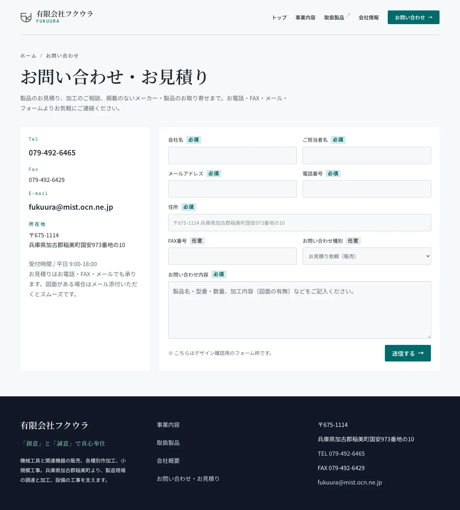

# contact-info お問い合わせ

連絡の手段（電話、FAX、メール）と所在地を示すページである。問い合わせフォームの枠も置く。フォームは、まだ送信できない。

| 項目   | 値                                            |
| ------ | --------------------------------------------- |
| URL    | `/contact`                                    |
| 使う人 | 取引先と見込み顧客。誰でも開ける              |
| 実装   | `apps/corporate-site/src/pages/contact.astro` |

画面の項目と、API の項目の対応は [API との対応](api.md) にある。

この仕様書は、作り直しの案（案 A を整えた案）を書いている。運営者が、案と論点を決めた。今の実装との違いは「全体動作」の「決めたこと」にある。フォームの入力の確認と送信は、問い合わせフォームの要求で決める。

案の画面を、試作で撮った画像で示す。モックは配置と番号だけを示すので、見た目は画像で確認する。

- 幅 1280px: [plan-a2-1280](images/plan-a2-1280.webp)
- 幅 390px: [plan-a2-390](images/plan-a2-390.webp)

## 構成

=== "初期表示"

    ページを開いたとき。

    <iframe class="mock" title="お問い合わせの初期表示" src="mocks/01-initial.html"></iframe>
    <a class="mock-open" href="mocks/01-initial.html" target="_blank">別タブで開く</a>

    | 番号 | 種別 | 要素名 | 仕様 |
    | --- | --- | --- | --- |
    | 1 | 領域 | ヘッダー | |
    | 2 | 領域 | ナビゲーション | |
    | 3 | ボタン | メニューを開く | [メニューを開く](#メニューを開く) |
    | 4 | リンク | ヘッダーのお問い合わせ | |
    | 5 | 領域 | パンくず | |
    | 6 | ラベル | ページのタイトル | |
    | 7 | 領域 | 連絡先 | [連絡先](#連絡先) |
    | 8 | リンク | 電話 | [電話](#電話) |
    | 9 | リンク | メール | [メール](#メール) |
    | 10 | 領域 | 問い合わせフォームの枠 | [問い合わせフォームの枠](#問い合わせフォームの枠) |
    | 11 | ボタン | 送信する | [送信する](#送信する) |
    | 12 | 領域 | フッター | |

    ナビゲーションの印は、幅 768px 未満では、メニューを開くを押すと出る。

## メニューを開く

**概要**: ナビゲーションを開閉するボタン。幅の狭い画面で、ナビゲーションをたたんで置くために使う。

**表示**: 次の全てに当てはまるとき。

- 画面の幅が 768px 未満である

**操作**: 押すと、ナビゲーションをヘッダーの下に開く。もう一度押すと閉じる。

## 連絡先

**概要**: 電話、FAX、メール、所在地、受付時間をまとめた領域。今、実際に連絡できる手段を示す。

**値のソース**: 「Tel」「Fax」「E-mail」「所在地」のラベルと、それぞれの値。受付時間と、見積もりの受け方の説明の文。

## 電話

**概要**: 電話をかけるリンク。

**値のソース**: 電話の番号。20px の太い文字で、押せる高さを 44px 以上にする。

**操作**: 押すと、端末の電話の機能で番号を開く。

## メール

**概要**: メールを書くリンク。

**値のソース**: メールのアドレス。20px の太い文字で、押せる高さを 44px 以上にする。

**操作**: 押すと、端末のメールの機能で宛先を開く。

## 問い合わせフォームの枠

**概要**: 問い合わせの入力の項目を並べた領域。項目の並びを確認するための枠で、送信はできない。

**値のソース**: 会社名、ご担当者名、メールアドレス、電話番号、住所、FAX番号、お問い合わせ種別、お問い合わせ内容の項目と、必須と任意の印。枠の下に、デザインの確認用の枠であることを知らせる注記の文。

## 送信する

**概要**: 問い合わせを送るボタン。今は、押しても送信しない。

**値のソース**: 「送信する」と右向きの矢印。

## 全体動作

### 使う場面

- トップか取扱製品を読んだ訪問者が、連絡の手段を確認するために開く。
- 急ぎの用件の訪問者は、電話を使う。図面がある訪問者は、メールを使う。

### 決めたこと

今の実装から変えることは次のとおり。ページの形は変えない。

- 電話とメールのリンクを、20px の太い文字と、44px 以上の押せる高さにする。
- 文字を、本文と操作は 16px、補足は 14px、番号と値の種類のラベルは 12px にそろえる。
- 見出しの上の英字だけのラベルを外す。「Tel」「Fax」「E-mail」は、値の種類を示すラベルなので残す。
- パンくずの先頭を、取扱製品と同じ「トップ」にする。
- ヘッダーのナビの「会社情報」を「会社概要」にする。
- 見出しを、文節で折り返す。
- フッターを、トップと同じ、サイトマップ付きの形にする。

画像は、決める前の試作で撮っている。パンくずは「ホーム」、ヘッダーは「会社情報」のままで、1280px の見出しは 48px である。実装の見出しは、768px 未満で 36px、768px 以上で 57px にする。

### 初期処理

- 開いた直後に、連絡先と問い合わせフォームの枠を表示する。読み込みを待つ表示はない。
- URL の search params は読まない。

### 幅による配置

- 幅 1024px 以上では、左に連絡先、右に問い合わせフォームの枠を置く。幅 1024px 未満では、連絡先、問い合わせフォームの枠の順に縦に並べる。

## 未決

### 決まっていないこと

- 送信できない間、問い合わせフォームの枠を今の位置と大きさのまま置くか。
  - 今の動き: 幅 390px では、連絡先の下に、約 1200px の枠が続く。試作は変えていない。
  - 決める人: 運営者
  - 期限: 問い合わせフォームの要求の設計のとき
