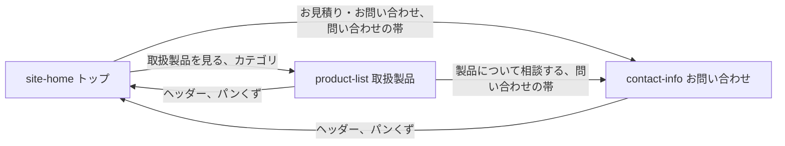

# 画面仕様書

画面ごとに、何を表示し、何ができるかを書く。  
画面の一覧は、PRD の提供する機能を元にする。  
新しい画面の仕様書は、テンプレートの `_template/` をコピーし、[画面仕様書の規約](rules.md) に従って書く。

## 画面の一覧

| 画面の ID      | 名前         | URL         | 使う人             | 仕様書                                             |
| -------------- | ------------ | ----------- | ------------------ | -------------------------------------------------- |
| `site-home`    | トップ       | `/`         | 取引先と見込み顧客 | [site-home](site-home_トップ/index.md)             |
| `product-list` | 取扱製品     | `/products` | 取引先と見込み顧客 | [product-list](product-list_取扱製品/index.md)     |
| `contact-info` | お問い合わせ | `/contact`  | 取引先と見込み顧客 | [contact-info](contact-info_お問い合わせ/index.md) |

## 画面の ID の規則

- 形は `<ドメイン>-<種類>` にする。小文字の英語を `-` で 1 回だけつなぐ。
- ドメインは、業務の領域を表す名詞にする。使うドメインを次の一覧に足す。
  - `site`: サイトの全体。トップのページに使う
  - `product`: 取扱製品
  - `contact`: 問い合わせ
- 種類は次の語から選ぶ。足すときはこの表に足す。

| 種類                        | 意味                                                                   |
| --------------------------- | ---------------------------------------------------------------------- |
| `home`                      | サイトのトップ                                                         |
| `list`                      | 一覧                                                                   |
| `info`                      | 案内。連絡先のように、決まった内容を示す                               |
| `detail`                    | 1 件の詳細                                                             |
| `new`                       | 作成                                                                   |
| `edit`                      | 編集                                                                   |
| `upload`                    | ファイルを受け取る                                                     |
| `result`                    | 処理の結果                                                             |
| `link`                      | 外部のサービスとの結び付け                                             |
| `import`                    | 外部のサービスからの取り込み                                           |
| `review`                    | 人が確認して決める必要があるものの一覧                                 |
| `login`、`profile`、`error` | ログインと利用者のアカウントの画面だけで使う。`error` はログインの失敗 |

- 固有の URL を持つものを 1 つの画面に数える。URL を持つモーダルも画面にする。URL を持たない確認のダイアログは、親の画面の構成要素にする。
- URL と ID をそろえる。`/order/new` は `order-new` にする。コーポレートサイトの `/products` と `/contact` は、URL が種類を持たないので、ページの役割から種類を選ぶ。
- 一度決めた ID は、画面の名前を変えても変えない。仕様書のディレクトリの名前、モックの testid、テストが ID を使うためである。

## 画面の間の遷移

3 つの画面の間の移動を示す。どの画面からも、ヘッダーでほかの画面へ移れる。フッターのリンクは、今はトップにだけある。作り直しでは、下層のページのフッターも、トップと同じサイトマップ付きの形にする。

## 全ての画面に共通する状態

全ての画面に共通する状態はない。3 つの画面は静的なページで、読み込みの失敗と権限の状態を持たない。
