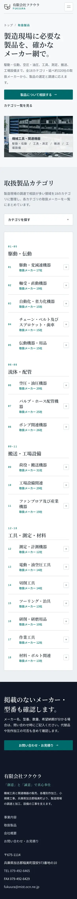

# product-list 取扱製品

取扱製品の 18 のカテゴリと、カテゴリごとの取扱メーカーを一覧するページである。担当者が、目当てのカテゴリかメーカーを扱っているかを確認する。

| 項目   | 値                                             |
| ------ | ---------------------------------------------- |
| URL    | `/products`                                    |
| 使う人 | 取引先と見込み顧客。誰でも開ける               |
| 実装   | `apps/corporate-site/src/pages/products.astro` |

画面の項目と、API の項目の対応は [API との対応](api.md) にある。

この仕様書は、作り直しの案（案 A を整えた案）を書いている。運営者が、案と論点を決めた。今の実装との違いは「全体動作」の「決めたこと」にある。

案の画面を、試作で撮った画像で示す。モックは配置と番号だけを示すので、見た目は画像で確認する。試作は操作を作っていないので、検索の結果の画像はない。

- 幅 1280px: [plan-a2-1280](images/plan-a2-1280.webp)
- 幅 390px: [plan-a2-390](images/plan-a2-390.webp)

## 構成

=== "初期表示"

    ページを開いたとき。

    <iframe class="mock" title="取扱製品の初期表示" src="mocks/01-initial.html"></iframe>
    <a class="mock-open" href="mocks/01-initial.html" target="_blank">別タブで開く</a>

    | 番号 | 種別 | 要素名 | 仕様 |
    | --- | --- | --- | --- |
    | 1 | 領域 | ヘッダー | |
    | 2 | 領域 | ナビゲーション | |
    | 3 | ボタン | メニューを開く | [メニューを開く](#メニューを開く) |
    | 4 | リンク | ヘッダーのお問い合わせ | |
    | 5 | 領域 | パンくず | |
    | 6 | ラベル | ページのタイトル | |
    | 7 | リンク | 製品について相談する | |
    | 8 | リンク | カテゴリ一覧を見る | |
    | 9 | 領域 | カテゴリの索引 | [カテゴリの索引](#カテゴリの索引) |
    | 10 | テキストボックス | 検索 | [検索](#検索) |
    | 11 | ボタン | すべて開く | |
    | 12 | ボタン | すべて閉じる | |
    | 13 | リンク | 索引のカテゴリ | |
    | 14 | ボタン | カテゴリの見出し | [カテゴリの見出し](#カテゴリの見出し) |
    | 15 | 領域 | メーカーの一覧 | [メーカーの一覧](#メーカーの一覧) |
    | 16 | 領域 | 問い合わせの帯 | |
    | 17 | リンク | 帯のお問い合わせ・お見積り | |
    | 18 | リンク | 帯の電話 | [帯の電話](#帯の電話) |
    | 19 | ボタン | カテゴリ先頭へ | [カテゴリ先頭へ](#カテゴリ先頭へ) |
    | 20 | 領域 | フッター | |

    ナビゲーションの印は、幅 768px 未満では、メニューを開くを押すと出る。検索、すべて開く、すべて閉じる、索引のカテゴリの印は、幅 1024px 未満では、カテゴリの索引を押すと出る。メーカーの一覧の印は、幅 1024px 未満では、カテゴリの見出しを押すと出る。

=== "検索の結果が 0 件"

    検索に入れた語が、どのカテゴリの名前にもメーカーの名前にも当たらないとき。

    <iframe class="mock" title="取扱製品の検索の結果が 0 件" src="mocks/02-empty.html"></iframe>
    <a class="mock-open" href="mocks/02-empty.html" target="_blank">別タブで開く</a>

    | 番号 | 種別 | 要素名 | 仕様 |
    | --- | --- | --- | --- |
    | 1 | 領域 | ヘッダー | |
    | 2 | 領域 | ナビゲーション | |
    | 3 | ボタン | メニューを開く | [メニューを開く](#メニューを開く) |
    | 4 | リンク | ヘッダーのお問い合わせ | |
    | 5 | 領域 | パンくず | |
    | 6 | ラベル | ページのタイトル | |
    | 7 | リンク | 製品について相談する | |
    | 8 | リンク | カテゴリ一覧を見る | |
    | 9 | 領域 | カテゴリの索引 | [カテゴリの索引](#カテゴリの索引) |
    | 10 | テキストボックス | 検索 | [検索](#検索) |
    | 11 | ボタン | すべて開く | |
    | 12 | ボタン | すべて閉じる | |
    | 13 | リンク | 索引のカテゴリ | |
    | 14 | メッセージ | カテゴリとメーカーが無いことの文 | [カテゴリとメーカーが無いことの文](#カテゴリとメーカーが無いことの文) |
    | 15 | 領域 | 問い合わせの帯 | |
    | 16 | リンク | 帯のお問い合わせ・お見積り | |
    | 17 | リンク | 帯の電話 | [帯の電話](#帯の電話) |
    | 18 | ボタン | カテゴリ先頭へ | [カテゴリ先頭へ](#カテゴリ先頭へ) |
    | 19 | 領域 | フッター | |

## メニューを開く

**概要**: ナビゲーションを開閉するボタン。幅の狭い画面で、ナビゲーションをたたんで置くために使う。

**表示**: 次の全てに当てはまるとき。

- 画面の幅が 768px 未満である

**操作**: 押すと、ナビゲーションをヘッダーの下に開く。もう一度押すと閉じる。

## カテゴリの索引

**概要**: 検索と、18 のカテゴリへのリンクをまとめた領域。目当てのカテゴリへ直接進むために使う。

**値のソース**: カテゴリを 4 つのグループに分け、番号、名前、メーカーの社数を並べる。幅 1024px 未満では、見出し「カテゴリを探す」だけを示し、閉じた形で始める。

**操作**: 幅 1024px 未満で見出しを押すと、検索と索引を開く。もう一度押すと閉じる。

## 検索

**概要**: カテゴリの名前とメーカーの名前で一覧を絞るテキストボックス。

**値のソース**: 入力の前は「カテゴリ・メーカー名で検索」を薄く示す。

**操作**: 文字を入れると、名前に語を含むカテゴリとメーカーだけを残し、当たった件数を検索の下に示す。

1. 当たったカテゴリは、開いた形にする。
2. 語を消すと、絞る前の表示に戻る。
3. どれにも当たらなければ、「検索の結果が 0 件」の状態になる。

## カテゴリの見出し

**概要**: カテゴリのメーカーの一覧を開閉するボタン。カテゴリの番号、名前、メーカーの社数を示す。

**操作**: 押すと、そのカテゴリのメーカーの一覧を開く。もう一度押すと閉じる。

## メーカーの一覧

**概要**: 1 つのカテゴリの取扱メーカーの名前を並べた領域。

**値のソース**: メーカーの名前。幅 1024px 以上では開いた形で、幅 1024px 未満では閉じた形で始める。

## カテゴリとメーカーが無いことの文

**概要**: 検索に当たるカテゴリとメーカーが無いことを知らせる文。

**値のソース**: 「該当するカテゴリ・メーカーが見つかりませんでした。検索条件を変えてお試しください。」

## 帯の電話

**概要**: 問い合わせの帯の中の、電話をかけるリンク。電話の番号と受付時間を、枠で囲んで示す。トップの帯と同じ形である。

**値のソース**: 「TEL」、電話の番号、「受付時間 / 平日 9:00-18:00」。

**操作**: 押すと、端末の電話の機能で番号を開く。

## カテゴリ先頭へ

**概要**: カテゴリの索引の先頭へ戻るボタン。長い一覧の途中から、検索と索引へ戻るために使う。

**表示**: 次の全てに当てはまるとき。

- カテゴリの一覧が、画面に入っている

**操作**: 押すと、カテゴリの索引の先頭へ移る。

## 全体動作

### 使う場面

- 担当者が、型番かメーカーの名前を手元に持って開く。知りたいのは、そのメーカーかカテゴリを扱っているかである。
- スマートフォンで、現場から開く担当者がいる。

### 決めたこと

今の実装から変えることは次のとおり。ページの形は変えない。

- 幅 1024px 未満では、カテゴリの索引と、全てのカテゴリのメーカーの一覧を、閉じた形で始める。幅 390px のページの高さは、13631px から約 4500px になる。
- 最初の画面の写真の幅を狭め、リードの文字の背面に掛からないようにする。
- 文字を、本文と操作は 16px、補足は 14px、番号と値の種類のラベルは 12px にそろえる。
- 見出しの上のラベルのうち、英字だけのもの（最初の画面、索引、帯の見出しの上）を外す。カテゴリの番号は残す。
- 問い合わせの帯を、トップと同じ共通の帯にし、電話の番号と受付時間を置く。帯は、カテゴリの一覧の section の外の、ページの末尾に置く。
- 見出しを、文節で折り返す。
- フッターを、トップと同じ、サイトマップ付きの形にする。
- ヘッダーのナビの「会社情報」を「会社概要」にする。

画像は、決める前の試作で撮っている。帯は電話の番号を持たず、ヘッダーは「会社情報」のままである。

### 初期処理

- 開いた直後に、カテゴリの索引と一覧を表示する。読み込みを待つ表示はない。
- スクリプトを動かせない端末では、全てのカテゴリのメーカーの一覧を、開いた形で表示する。

### URL の search params からの復元

- `q` を読む。値があれば、検索にその語を入れ、絞った一覧を表示する。
- 検索に文字を入れるたびに、`q` を今の語に書き換える。履歴は増やさない。語を消すと、`q` を消す。
- `q` のほかの search params は読まない。

### 幅による配置

- 幅 1024px 以上では、左にカテゴリの索引、右にカテゴリの一覧を置く。索引は、画面を送っても上に留まる。
- 幅 1024px 未満では、カテゴリの索引を一覧の上に置く。

## 未決

### 決まっていないこと

- 問い合わせの帯の見出しとボタンに、取扱製品の今の文言を残すか、ボタンだけトップの帯の「お見積り・お問い合わせ」にそろえるか。
  - 今の動き: 今の実装とモックは、取扱製品の今の見出しと、ボタン「お問い合わせ・お見積り」を置いている。見出しの文言は、モックの問い合わせの帯にある。
  - 決める人: 運営者
  - 期限: 問い合わせの帯を共通にする実装のタスクの前
- `q` の付いた URL で開いたときに、幅 1024px 未満で、閉じて始めるカテゴリの索引を開くか。
  - 今の動き: 今の実装は、索引を開いた形で始めるので、検索の語が見える。試作は作っていない。
  - 決める人: 開発者
  - 期限: 取扱製品を 1024px 未満で閉じて始める実装のタスクのとき
- URL がカテゴリを指しているときに、幅 1024px 未満でそのカテゴリを開く動きを、どう作るか。
  - 今の動き: 試作は作っていない。
  - 決める人: 開発者
  - 期限: 取扱製品を 1024px 未満で閉じて始める実装のタスクのとき
