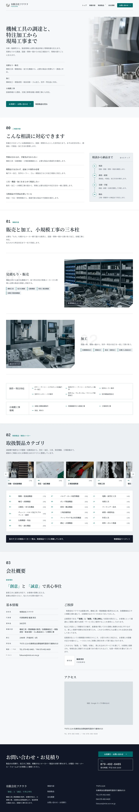

# site-home トップ

Kufu が何をする会社かを示し、取扱製品とお問い合わせへ進む道筋を示すページである。事業、相談の内容、取扱製品のカテゴリ、会社概要を 1 ページで読める。

| 項目   | 値                                          |
| ------ | ------------------------------------------- |
| URL    | `/`                                         |
| 使う人 | 取引先と見込み顧客。誰でも開ける            |
| 実装   | `apps/corporate-site/src/pages/index.astro` |

画面の項目と、API の項目の対応は [API との対応](api.md) にある。

この仕様書は、作り直しの案（案 A を整えた案）を書いている。今の実装との違いは「全体動作」の「決めたこと」にある。運営者が決めていない点は「未決」にある。

案の画面を、試作で撮った画像で示す。モックは配置と番号だけを示すので、見た目は画像で確認する。

- 幅 1280px: [plan-a2-1280](images/plan-a2-1280.webp)
- 幅 390px: [plan-a2-390](images/plan-a2-390.webp)

## 構成

=== "初期表示"

    ページを開いたとき。

    <iframe class="mock" title="トップの初期表示" src="mocks/01-initial.html"></iframe>
    <a class="mock-open" href="mocks/01-initial.html" target="_blank">別タブで開く</a>

    | 番号 | 種別 | 要素名 | 仕様 |
    | --- | --- | --- | --- |
    | 1 | 領域 | ヘッダー | |
    | 2 | 領域 | ナビゲーション | [ナビゲーション](#ナビゲーション) |
    | 3 | ボタン | メニューを開く | [メニューを開く](#メニューを開く) |
    | 4 | リンク | ヘッダーのお問い合わせ | |
    | 5 | ラベル | ページのタイトル | |
    | 6 | 領域 | 3 本の柱 | [3 本の柱](#3-本の柱) |
    | 7 | リンク | お見積り・お問い合わせ | [お見積り・お問い合わせ](#お見積りお問い合わせ) |
    | 8 | リンク | 取扱製品を見る | |
    | 9 | 領域 | 相談の内容 | [相談の内容](#相談の内容) |
    | 10 | 領域 | 相談から納品まで | |
    | 11 | 領域 | 事業の紹介 | |
    | 12 | 領域 | 別作と小規模工事の事例 | |
    | 13 | 領域 | 取扱製品カテゴリ | |
    | 14 | リンク | カテゴリの写真のカード | [カテゴリの写真のカード](#カテゴリの写真のカード) |
    | 15 | 領域 | カテゴリの索引 | [カテゴリの索引](#カテゴリの索引) |
    | 16 | リンク | 取扱製品ページへ | |
    | 17 | 領域 | 会社概要 | |
    | 18 | 領域 | アクセスの地図 | |
    | 19 | 領域 | 問い合わせの帯 | [問い合わせの帯](#問い合わせの帯) |
    | 20 | リンク | 帯のお見積り・お問い合わせ | |
    | 21 | リンク | 帯の電話 | [帯の電話](#帯の電話) |
    | 22 | 領域 | フッター | |

    ナビゲーションの印は、幅 768px 未満では、メニューを開くを押すと出る。

## ナビゲーション

**概要**: ページの中のセクションと、ほかのページへ進むリンクを並べた領域。全てのページで同じ並びにする。

**値のソース**: 「トップ」「事業内容」「取扱製品」「会社情報」と、ボタンの形の「お問い合わせ」。

**操作**:

- 「事業内容」と「会社情報」を押す
  - トップの中のセクションへ移る。ほかのページで押したときは、トップを開いてからセクションへ移る。
- 「取扱製品」と「お問い合わせ」を押す
  - それぞれのページを開く。

## メニューを開く

**概要**: ナビゲーションを開閉するボタン。幅の狭い画面で、ナビゲーションをたたんで置くために使う。

**表示**: 次の全てに当てはまるとき。

- 画面の幅が 768px 未満である

**操作**: 押すと、ナビゲーションをヘッダーの下に開く。もう一度押すと閉じる。

## 3 本の柱

**概要**: 事業の 3 本の柱を、題と 1 文の説明で示す領域。ページのタイトルの下で、何をする会社かを最初の画面で伝える。

**値のソース**: 「見積もり・販売」「加工」「小規模工事」の題と、それぞれの説明の文。試作は、順のない並びとして、番号を外している。

## お見積り・お問い合わせ

**概要**: お問い合わせのページを開くリンク。ページの中で最も目立つ操作にする。

**値のソース**: 「お見積り・お問い合わせ」と右向きの矢印。

**操作**: 押すと、お問い合わせのページを開く。

1. 幅 390px でも、ページを開いた最初の画面に入る位置に置く。

## 相談の内容

**概要**: よくある相談の事例を 4 つ並べた領域。訪問者が、自分の用件を相談してよいかを判断するために読む。

**値のソース**: 事例ごとの題と説明の文。試作は、順のない並びとして、番号を外している。右の「相談から納品まで」は手順なので、番号を付ける。

## カテゴリの写真のカード

**概要**: 写真のあるカテゴリを横に並べたリンク。取扱製品の領域を、写真で伝える。

**値のソース**: カテゴリの番号、名前、メーカーの社数、写真。

**操作**: 押すと、取扱製品のページを開き、そのカテゴリの位置へ移る。

## カテゴリの索引

**概要**: 18 のカテゴリを番号の順に並べたリンクの領域。目当てのカテゴリへ直接進むために使う。

**値のソース**: カテゴリの番号、名前、メーカーの社数。

**操作**: カテゴリを押すと、取扱製品のページを開き、そのカテゴリの位置へ移る。

## 問い合わせの帯

**概要**: ページの末尾で、お問い合わせへ進む操作をまとめた暗い面の領域。会社概要まで読んだ訪問者が、その場で連絡へ進めるようにする。

**値のソース**: 見出し「お問い合わせ・お見積り」と、お問い合わせのページのリードの文。

## 帯の電話

**概要**: 電話をかけるリンク。電話の番号と受付時間を、枠で囲んで示す。

**値のソース**: 「TEL」、電話の番号、「受付時間 / 平日 9:00-18:00」。

**操作**: 押すと、端末の電話の機能で番号を開く。

## 全体動作

### 使う場面

- 取引先と見込み顧客が、検索か紹介で初めて開く。知りたいのは、何を扱う会社か、自分の用件を相談できるか、どう連絡するかである。
- 会社概要まで読んでから、連絡するかを決める訪問者がいる。

### 決めたこと

今の実装から変える案は次のとおり。セクションと順は変えない。運営者が決めていない点は、試作の描き方として書き、未決に挙げている。

- 文字を、本文と操作は 16px、補足は 14px、欧文と数字の短いラベルは 12px にそろえる。
- 順のない並び（3 本の柱、相談の事例）から番号を外す。番号は、セクション、手順、カテゴリのように、順か索引の意味があるものにだけ付ける。
- 背景の方眼、写真の上の目盛、事業の紹介の霧のような背景、タグの下の短い線を外し、面を平らにする。写真への色の被せ、背面の大きな数字、罫線、暗い面は残す。
- 写真の下の「SCROLL」のリンクを外す。
- 幅 768px 未満では、お見積り・お問い合わせを、写真と 3 本の柱の上に置く。
- カテゴリの写真のカードを、取扱製品のページへのリンクにする。
- 会社概要の後に、問い合わせの帯を足す。
- 見出しを、文節で折り返す。

### 初期処理

- 開いた直後に、全てのセクションを表示する。読み込みを待つ表示はない。
- 動きを減らす設定の端末では、セクションが現れる動きを出さない。
- URL の search params は読まない。

### 幅による配置

- 幅 768px 以上では、ページのタイトルの右に写真を置く。幅 768px 未満では、タイトル、リード、お見積り・お問い合わせ、写真、3 本の柱の順に縦に並べる。
- カテゴリの索引は、幅 768px 以上で 3 列、幅 768px 未満で 1 列にする。
- 問い合わせの帯は、幅 768px 以上で見出しの右に操作を置き、幅 768px 未満で縦に並べる。

## 未決

### 決まっていないこと

- 見出しの上の英字のラベル（eyebrow）を、残すか、日本語だけにするか、外すか。
  - 今の動き: 試作の画像は、日本語だけにした形で撮っている。モックは、未決の印で示している。
  - 決める人: 運営者
  - 期限: 作り直しの実装のタスクに分ける前
- ヘッダーの「会社情報」を、見出しとフッターの「会社概要」にそろえるか。
  - 今の動き: ヘッダーは「会社情報」、フッターと見出しは「会社概要」である。
  - 決める人: 運営者
  - 期限: 作り直しの実装のタスクに分ける前
- 問い合わせの帯の見出し、リード、ボタンの文言に、お問い合わせのページとトップの最初の画面の文言を使ってよいか。
  - 今の動き: 試作は、見出しとリードにお問い合わせのページの文言を、ボタンに「お見積り・お問い合わせ」を使っている。
  - 決める人: 運営者
  - 期限: 作り直しの実装のタスクに分ける前
- 順のない並び（3 本の柱、相談の事例）から、番号を外してよいか。
  - 今の動き: 今の実装は、01 からの番号を付けている。試作は、外している。
  - 決める人: 運営者
  - 期限: 作り直しの実装のタスクに分ける前
- 背景の方眼と、写真の上の目盛を外してよいか。
  - 今の動き: 今の実装は、最初の画面、事業の写真、カテゴリの索引に置いている。試作は、外している。
  - 決める人: 運営者
  - 期限: 作り直しの実装のタスクに分ける前
- 事業の紹介の霧のような背景と、タグの下の短い線を外してよいか。
  - 今の動き: 試作は、外している。
  - 決める人: 運営者
  - 期限: 作り直しの実装のタスクに分ける前
- 写真の下の「SCROLL」のリンクを外してよいか。
  - 今の動き: 今の実装は、幅 768px 以上でだけ出している。試作は、外している。
  - 決める人: 運営者
  - 期限: 作り直しの実装のタスクに分ける前
- 問い合わせの帯に、電話の番号と受付時間を置くか。
  - 今の動き: 今の取扱製品の帯は、ボタンだけを持つ。試作のトップの帯は、ボタンの下に電話の番号と受付時間を置いている。
  - 決める人: 運営者
  - 期限: 作り直しの実装のタスクに分ける前
- セクションの番号を、00 からでなく 01 から始めるか。
  - 今の動き: 相談の内容が 00、事業の紹介が 01 である。試作は変えていない。
  - 決める人: 運営者
  - 期限: 作り直しの実装のタスクに分ける前
