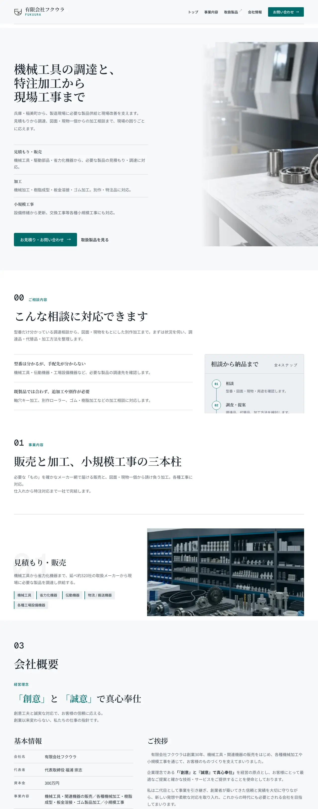

# corporate-site のページのデザインと中の構成を、今の形を保って整える

## Requirements

要求は [issue 98](https://github.com/Fukuemon/kufu-apps/issues/98) にある。  
この spec は、設計を扱う。運営者は、3 つの改善案から、今の形を保つ案 A を選び、案 A を整えた案の論点を全て推奨どおりに決めた。この spec は、整えた案と、決めたことと、実装のタスクの分け方を書く。

- 訪問者は、Kufu が何をする会社かと、取扱製品と問い合わせへの道筋を、トップから迷わずにたどれる。
- 訪問者は、モバイルでもデスクトップでも、同じ情報を読みやすく見られる。
- 運営者は、セクションを足す、並べ替える、ページを足すときに、置き場と分け方の規則に従って作れる。

運営者は、案 A を選ぶときに、次の方針を示した。

- 元のレイアウトは保つ。
- AI が作ったように見える点をなくし、見やすくする。個性は残す。
- 見出しの上の英字が、日本の企業向けのサイトに要るかを検討する。
- ほかの会社のサイトを参考にしてよい。

## Non-Goals

- Kufu の色、書体、ロゴの変更
- FB で反映した文言とコンテンツの変更。配置は変えてよい。運営者が決定 3 で認めた呼び名と、帯のボタンの文言は除く
- トークンとコンポーネントの作り直し。デザインシステムの要求が扱う
- 問い合わせフォームの実装。問い合わせフォームの要求が扱う
- 3 ジャーニーの E2E の実装。E2E の要求のタスクが扱う
- ページの追加

## Acceptance Criteria

issue 98 の受け入れ条件のとおりである。この spec の時点で確認できるのは、次の 3 つ。

- 今の 3 つのページと `apps/corporate-site` の中の構成の課題を、[調査の結果](issues.md) に書いている。
- 改善案を 3 つ出し、運営者が案 A を選んでいる。
- 選んだ案の画面の設計を、3 つのページの画面仕様書と、corporate-site の Design Doc に書いている。

残りの 4 つは、実装のタスクと検証のタスクで確認する。受け入れ条件ごとの確認の方法は、[Verification](#verification) にある。

## Open Points

運営者の答えの後に、実装のタスクの範囲で、決めていないことが 3 つ残る。どれも、issue と設計の文書にない動きか文言なので、推奨を添えて運営者に尋ねる。

### 残る論点 1: カルーセルの、自動で流すのをやめた後の動き

決定 8 で、カルーセルは自動で流すのをやめ、矢印とスワイプで動かす形にする。今のカルーセルは、カードを 2 組並べて端で戻す（無限に回る）作りで、マウスのドラッグでも動く。

| 案        | 内容                                                                                 | 強み                                                           | 弱み                                   |
| --------- | ------------------------------------------------------------------------------------ | -------------------------------------------------------------- | -------------------------------------- |
| A（推奨） | 端で止める。カードの複製を外し、端では矢印を押せない形にする。マウスのドラッグは残す | 支援技術から隠す複製のカードがなくなる。どこまで見たかが分かる | 端に着いたら、逆の矢印で戻すことになる |
| B         | 無限に回る作りを残し、自動で流すのだけをやめる                                       | 直しが最も小さい                                               | 複製のカードと、端で戻す処理が残る     |

- 決まらないと進めない作業は、トップの最初の画面とカルーセルを直すタスク（「最初の画面とカルーセル」）である。

### 残る論点 2: 取扱製品の帯の、見出しとリードの文言

問い合わせの帯を共通のコンポーネントにすると、取扱製品の帯も同じ形になる。決定 3 で、両方の帯のボタンは「お見積り・お問い合わせ」にし、電話の番号と受付時間を置く。残るのは見出しとリードである。取扱製品の帯は、今、見出しの `掲載のないメーカー・型番も確認します。` と、取扱製品に合わせたリードを持つ。どちらも FB で入れた文言である。

| 案        | 内容                                           | 強み                                                            | 弱み                                              |
| --------- | ---------------------------------------------- | --------------------------------------------------------------- | ------------------------------------------------- |
| A（推奨） | 見出しとリードは、取扱製品の今の文言のまま置く | 取扱製品のページに合う見出しが残る。FB で入れた見出しを変えない | 帯の見出しが、ページごとに違う                    |
| B         | トップの帯と同じ見出しとリードにする           | 帯が 1 つの形になる                                             | `掲載のないメーカー・型番も確認します。` が消える |

- 決まらないと進めない作業は、問い合わせの帯を共通にするタスク（「問い合わせの帯」）である。

### 残る論点 3: 12px の文字のスタイルの名前

ADR-0037 を承認すると、12px のスタイルを使うのは、番号と、値の種類のラベル（Tel、Fax、E-mail）だけになる。文字のスタイルのタスク（issue 79）は、名前を `text-eyebrow` にしている。

| 案        | 内容                                                       | 強み                                                 | 弱み                                                           |
| --------- | ---------------------------------------------------------- | ---------------------------------------------------- | -------------------------------------------------------------- |
| A（推奨） | 名前は `text-eyebrow` のまま残し、使う場面の説明だけを直す | 文字のスタイルのタスクのチェックと文書を直さずに済む | 名前と使う場面が合わない                                       |
| B         | `text-numeral` のような使う場面の名前に改める              | 名前から使う場面が読める                             | トークン、テーマ変数、チェック、約 30 か所の画面のコードを直す |

- 決まらないと進めない作業は、見出しの上のラベルを日本語にするタスク（「ラベルと装飾」）の、デザインシステムの文書の直しである。

## Decisions

運営者が決めたことは、次のとおり。論点 1〜6 と、追加の 2 つは、2026-11-11 に、全て推奨どおりに決めた。

| 決めたこと                                                                                                                                      | 理由                                                                                          |
| ----------------------------------------------------------------------------------------------------------------------------------------------- | --------------------------------------------------------------------------------------------- |
| 3 つの改善案から、案 A（今の形を整える）を元にする                                                                                              | 元のレイアウトを保つ。AI が作ったように見える点をなくし、見やすくし、個性を残す               |
| 案の確認は、画面仕様書に画像を載せる形で行う。パッケージ screens を入れる                                                                       | 画面ごとに、画像、構成、未決をまとめて確認できる                                              |
| 3 ジャーニーの E2E は、作り直しの実装の前に実装する。書き方はパッケージ e2e に従い、今の E2E も合わせる                                         | 作り直しの前後で同じジャーニーが通ることで、導線を壊していないと確認できる                    |
| 文字のスタイルのタスク（issue 79）は、今の範囲のまま、作り直しより先に進める                                                                    | そのタスクが置く文字のスタイルとチェックは、作り直しでもそのまま使う                          |
| 決定 1: 見出しの上のラベルは、英字を外し、併記の日本語だけを残す。見出しと同じ語のラベルと、英字だけのラベルは外す。ADR-0037 を「提案」で書いた | 意味を運ぶのは日本語の側で、英字を外しても情報は減らない。案 3 は、ラベルだけが持つ情報を消す |
| 決定 2: 順のない並びの番号、背景の方眼と目盛、霧の背景とタグの下の線、SCROLL の 4 つを外す                                                      | 内容を持たない飾りか、順を表さない番号である                                                  |
| 決定 3: 文言と配置の 8 つは、全て推奨のとおりにする                                                                                             | 下の「決定 3 の内訳」にある                                                                   |
| 決定 4: 問い合わせの帯を `components/common/` に置き、取扱製品の帯を `ProductsDetailSection` の中からページに出す                               | トップの末尾に帯を置くために要る。3 つの route と section の構成の決定は保つ                  |
| 決定 5: 見出しの折り返しは、`word-break: auto-phrase` と `text-wrap: balance` で始め、実装のときに Safari と Firefox の対応を調べる             | 文言と content を変えず、直しが小さい                                                         |
| 決定 6: 画面の ID は `site-home`、`product-list`、`contact-info` で確定する。`e2e_dir` は、3 ジャーニーの E2E のタスク（issue 7）で足す         | ID は一度決めたら変えない。そのタスクが、テストの層と testid を直す                           |
| 決定 7: 事業の一覧の行頭の線は、今のまま残す                                                                                                    | 文字のスタイルのタスクで、1 行目の中央に出るように直した                                      |
| 決定 8: 取扱製品カテゴリのカルーセルは、自動で流すのをやめ、矢印とスワイプで動かす形にする                                                      | WCAG 2.2 の 2.2.2（自動で動くものを止める手段）に当たる                                       |
| 文字のスタイルのタスクの見出しの大きさは、Tailwind のデフォルトのブレークポイントだけで段を切り替える案にする（そのタスクで運営者が選んだ）     | 下の「見出しの大きさ」にある                                                                  |

決定 3 の内訳は、次のとおり。

1. 呼び名を「会社概要」と「トップ」にそろえる。ヘッダーの「会社情報」と、お問い合わせのパンくずの「ホーム」を改める。
2. トップの末尾の問い合わせの帯に、`/contact` の見出しとリードの文言を使う。
3. 帯のボタンの文言は「お見積り・お問い合わせ」にする。
4. 下層のページのフッターを、トップと同じサイトマップ付きの形にそろえる。
5. ヘッダーのナビに、相談の内容の項目を足さない。
6. セクションの番号を 01 から始める。相談の内容が 01、事業の紹介が 02 になる。
7. 写真の上の「取扱製品イメージ」「加工イメージ」のラベルと、代表の挨拶の「顔写真」の枠は、写真が届くまで今のまま置く。
8. 問い合わせの帯に、電話の番号と受付時間を置く。トップと取扱製品の帯を同じ形にそろえる。

### 見出しの大きさ

実装の見出しは、文字のスタイルのタスクの段で組む。値は、そのタスクの pull request（PR 101、コミット 03edef3）のものである。マージの前に変わることがある。

| 見出し                           | 768px 未満 | 768px 以上 | 1024px 以上 | 1280px 以上 | 1536px 以上 |
| -------------------------------- | ---------- | ---------- | ----------- | ----------- | ----------- |
| トップの最初の画面の見出し（h1） | 36px       | 48px       | 48px        | 45px        | 57px        |
| 取扱製品の見出し（h1）           | 36px       | 48px       | 48px        | 48px        | 48px        |
| お問い合わせの見出し（h1）       | 36px       | 57px       | 57px        | 57px        | 57px        |
| セクションの見出し（h2）         | 32px       | 36px       | 45px        | 45px        | 45px        |

- 試作は、h1 を 1280px で 48px、390px で 36px にし、h2 を 1280px で 45px、390px で 32px にして撮った。1280px の h1 は、トップが 45px、お問い合わせが 57px になるので、画像とは違う。

### 決定 1 の比較: 見出しの上の英字のラベル（eyebrow）

運営者は、案 2 を選んだ。以下は、選ぶときに比べた内容である。

今の画面は、見出しの上に、Geist Mono の小さな英字のラベルを置いている。対象は [英字の表示の一覧](#英字の表示の一覧) にある。

| 案        | 内容                                                                                 | 画像                                                             |
| --------- | ------------------------------------------------------------------------------------ | ---------------------------------------------------------------- |
| 1         | 今のまま残す。文字だけ 12px にそろえる                                               | [1280px](eyebrow-keep-1280.webp)、[390px](eyebrow-keep-390.webp) |
| 2（推奨） | 英字を外し、併記の日本語だけを残す。見出しと同じ語のラベルと、英字だけのラベルは外す | [1280px](eyebrow-ja-1280.webp)、[390px](eyebrow-ja-390.webp)     |
| 3         | ラベルを全て外し、見出しだけにする                                                   | [1280px](eyebrow-none-1280.webp)、[390px](eyebrow-none-390.webp) |

画像は、トップのヘッダー、最初の画面、相談の内容、事業の紹介、会社概要の先頭を切り出して、縦に並べている。トップの全体の画像は、案 1 が [1280px](plan-a2-keep-home-1280.webp) と [390px](plan-a2-keep-home-390.webp)、案 3 が [1280px](plan-a2-none-home-1280.webp) と [390px](plan-a2-none-home-390.webp) である。案 2 の全体は [トップの画面仕様書](../../screens/site-home_トップ/index.md) にある。

| 案  | 利点                                                                                         | 欠点                                                                                                                         |
| --- | -------------------------------------------------------------------------------------------- | ---------------------------------------------------------------------------------------------------------------------------- |
| 1   | 見た目が今と変わらない。決定を変えない                                                       | 見出しと同じ意味の英字を、全ての見出しで読むことになる。調べた記事が、AI が作ったように見える型に挙げる形のままである        |
| 2   | 日本語で内容を補うラベルだけが残る（ご相談内容、事業内容、取扱製品・取扱メーカー、経営理念） | ラベルのある見出しと、ない見出しができる。和文のラベルは 14px の本文の書体になり、Geist Mono の出番が番号と連絡先だけになる  |
| 3   | 見出しだけになり、読む行が最も少ない                                                         | 「経営理念」のように、見出しにない情報を持つラベルも消える。新しい文言を足さない限り、理念の見出しが何の言葉かを示せなくなる |

- 案 2 と案 3 は、新しい文言を足さない。英字と日本語を併記したラベルから、日本語の側だけを使う。
- 案 2 で外すラベルは、次の 3 種類である。
  - 見出しと同じ語のラベル: 会社概要、基本情報、アクセス
  - 見出しとほぼ同じ語のラベル: 代表挨拶
  - 英字だけのラベル: 最初の画面、事業の行、別作と小規模工事のパネル、カテゴリ、取扱製品の見出しと索引、お問い合わせの見出しの下、帯、フッター、ナビの添え字
- どの案でも残すものは、ロゴに添えた社名の欧文「FUKUURA」、値の種類を示す「Tel」「Fax」「E-mail」「TEL」「FAX」、番号である。ロゴは変えない。
- 日本の企業のサイトでの使われ方は、[参照したサイト](#参照したサイト) にある。開いて確認した 19 のサイトのうち、英字を主にするものが 7、日本語を主にして英字を添えるものが 4、日本語だけが 6、混在が 2 だった。デザインのギャラリーから選んだ 5 つには、日本語だけのサイトがなかった。業種の語の検索などで選んだ 14 では、日本語だけが 6 で最も多かった。標本が少なく、選び方も偏っているので、割合としては一般化できない。
- 見出しの英字の利点と欠点を、読みやすさか読み上げの観点で論じた記事は、見つからなかった。

推奨は案 2 である。

- 運営者の「日本の企業向けのサイトに要るか」に対して、意味を運ぶのは日本語の側である。英字を外しても、情報は減らない。
- 案 3 は、ラベルだけが持つ情報を消す。
- 参照したサイトのうち、今の Kufu の形に近いサカイと中村機材は、小さいラベルを日本語にするか、日本語の見出しの下に英字を 1 行だけ置いている。

案 1 は、決定を変えない。ただし、ADR-0030 は、12px の理由を「同じ内容を見出しが伝える」とし、和文の補足には使わないとしている。今のラベルは和文を併記し、「経営理念」のように見出しにない情報も持つ。案 1 でも、和文の側の大きさをどうするかは、文字のスタイルのタスクで決めることになる。

ほかの文書への影響は、次のとおり。

| 文書                                              | 案 1     | 案 2                                                                                                                            | 案 3                              |
| ------------------------------------------------- | -------- | ------------------------------------------------------------------------------------------------------------------------------- | --------------------------------- |
| ADR-0030（Kufu の見た目として残すもの）           | 変えない | 「ラベルの書体」の使う場所から eyebrow を外す。12px の例外の対象が「番号のラベル」だけになる。書き直しか、置き換えの ADR が要る | 案 2 と同じ                       |
| `packages/ui/DESIGN.md` の 14px 未満の規則        | 変えない | 12px の例外の説明は、まだない。文字のスタイルのタスクが書く説明を、番号と値の種類のラベルにする                                 | 案 2 と同じ                       |
| 文字のスタイルのタスク（issue 79）                | 変えない | 12px のスタイルは残る。名前を `eyebrow` のままにするかを、そのタスクの後に決める。和文のラベルは補足のスタイルを使う            | 12px のスタイルは、番号だけが使う |
| corporate-site の Design Doc の「トーンとマナー」 | 変えない | eyebrow の記述を、日本語のラベルと番号に改める                                                                                  | eyebrow の記述を外す              |
| content 層                                        | 変えない | 見出しの `eyebrow` の値から英字を外す。英字だけの値は消す                                                                       | `eyebrow` の項目を消す            |

- ADR-0030: [Kufu の色、書体、ロゴ、装飾の語彙を残す](../../adr/0030-keep-kufu-identity.md)
- 番号は、どの案でも Geist Mono の 12px のまま残る。番号も 14px に上げると、12px の例外そのものをなくせる。上げるかは、この要求の範囲の外とし、文字のスタイルのタスクの後に決められる。
- 文字のスタイルのタスクは、eyebrow を今のまま（12px）で進めている。この決定は、そのタスクの後の作り直しの実装（「ラベルと装飾」）で反映する。
- 案 2 で ADR-0030 の決定が変わるので、ADR-0030 を丸ごと置き換える ADR-0037 を「提案」で書いた。運営者が本文を認めたら、この pull request の中で ADR-0037 を「承認」に、ADR-0030 を「ADR-0037 に置換」にする。corporate-site の Design Doc の「トーンとマナー」は、ADR-0037 の内容で書いたので、この pull request のマージは ADR-0037 の承認を前提にする。
  - ADR-0037: [Kufu の色、書体、ロゴ、装飾の語彙を残し、状態の色、フォーカス、文字の最小の大きさ、押せる領域を DADS に合わせ、見出しの上のラベルを日本語だけにする](../../adr/0037-kufu-identity-japanese-labels.md)

### 決定 2 の比較: 見た目から外す要素

[案 A を整えた案](#案-a-を整えた案) は、次の 4 つを画面から外している。どれも、文言とコンテンツではなく、装飾か並びの印である。1 つずつ、外すか残すかを選べる。

| 外すもの                                                | 外す理由                                                                             | 残すときの扱い          |
| ------------------------------------------------------- | ------------------------------------------------------------------------------------ | ----------------------- |
| 順のない並びの番号（最初の画面の 3 本の柱、相談の事例） | 番号が順も索引も表さない。調べた記事は、番号を順のある内容に限るよう勧めている       | 12px のラベルとして残す |
| 背景の方眼と、写真の上の目盛                            | 内容を持たない飾りで、文字の背面に線が入る。調べた記事が、装飾の方眼の線を型に挙げる | 今のまま残す            |
| 事業の紹介の、霧のような背景と、タグの下の短い線        | 内容を持たない飾りである                                                             | 今のまま残す            |
| 最初の画面の「SCROLL」のリンク                          | 英字の飾りで、768px 以上でだけ出る。次のセクションへは、画面を送れば着く             | 今のまま残す            |

- 推奨は、4 つとも外す。運営者の「AI が作ったように見える点をなくす」に当たる。
- ADR-0030 が残すとした装飾（4px の角丸、1px の罫線、背面の大きな数字、写真への色の被せ、写真の上のパネル、暗い面）は、どれも残している。方眼と目盛は、ADR-0030 の残すものに入っていない。
- 方眼と目盛は、最初の画面の背景、最初の画面の写真、事業の写真、カテゴリの索引の面の 4 か所にある。4 か所とも外すと、方眼の線の色のトークンが使われなくなる。霧の背景を外すと、`primary-glow` のトークンも使われなくなる。使われなくなったトークンは、装飾を外すタスク（「ラベルと装飾」）で消す。
- 順のある並び（相談から納品までの手順）、セクションの番号、カテゴリの番号、事業の行の背面の数字は、残している。
- 事業のタグの左の色の線は、残している。調べた記事は、片側の色の線も型に挙げる。外すかは、コンポーネントの見た目を決めるデザインシステムのタスクで扱う。

### 決定 3 の比較: 文言と配置に関わる確認

整えた案は、新しい文言を足していない。次の 8 つは、文言かコンテンツの配置に関わるので、決めずに尋ねる。

1. 呼び名をそろえるか。ヘッダーは「会社情報」、フッターと見出しは「会社概要」である。パンくずの先頭は、取扱製品が「トップ」、お問い合わせが「ホーム」である。推奨は「会社概要」と「トップ」にそろえる。試作は、そろえていない。
2. トップの末尾の問い合わせの帯に、`/contact` の見出しとリードの文言をそのまま使ってよいか。推奨は、使う。
3. 帯のボタンの文言に、どれを使うか。`/contact` へのリンクの文言は、今 4 通りある。試作は、最初の画面の「お見積り・お問い合わせ」を使っている。推奨は、試作のとおりにする。
4. 下層のページのフッターを、サイトマップ付きにするか。試作は、サイトマップ付きで撮っている。Design Doc は、トップをフル、下層をコンパクトと決めている。選択肢は、フルにそろえる、コンパクトのままリンクの行を足す、今のまま、の 3 つである。推奨は、フルにそろえる。
5. ヘッダーのナビに、相談の内容の項目を足すか。足すなら、新しいラベルが要る。推奨は、足さない。最初の画面の次にあり、画面を送れば着く。
6. セクションの番号を、00 からでなく 01 から始めるか。今は、相談の内容が 00、事業の紹介が 01 である。事業の行の背面の数字 01 と 02 は、事業の紹介の中の番号である。推奨は、01 から始める。試作は、変えていない。
7. 写真の上の「取扱製品イメージ」「加工イメージ」のラベルと、代表の挨拶の「顔写真」の枠を、今のまま置くか。仮の表示に見える課題は残る。推奨は、写真が届くまで、今のまま置く。
8. 問い合わせの帯に、電話の番号と受付時間を置くか。今の取扱製品の帯は、ボタンだけを持つ。試作のトップの帯は、ボタンの下に置いている。推奨は、トップの帯に置く。会社概要まで読んだ訪問者が、その場で電話をかけられる。取扱製品の帯にも置くかは、同じ形にそろえる方を勧める。

### 決定 4 の比較: 構成の決定を変える範囲

- 整えた案は、ページの構成の決定（3 つの route）と、section を 1 階層に並べる決定を保つ。置き換える ADR はない。
  - ADR-0006: [corporate-site の IA を 3 route にする](../../adr/0006-corporate-site-three-route-ia.md)
  - ADR-0014: [corporate-site の sections 構成](../../adr/0014-corporate-site-sections-architecture.md)
- 変わる決定は、決定 1 の ADR-0030 と、決定 3 の 4 の Design Doc のページの構成である。
- `styles/components.css` は、この要求では消さない。`context/codebase.md` は、utility へ移して減らすと決めている。整えた案で要らなくなるクラス（方眼、目盛、霧の背景、SCROLL）だけを消す。
- testid は改名しない。`context/testing/e2e.md` の、今ある testid は改名しない決定に従う。
- 尋ねたのは、問い合わせの帯を `components/common/` に置き、`ProductsDetailSection` の中の帯をページに出す直しである。取扱製品のページが、1 つの section から 2 つの要素を並べる形に変わる。推奨は、行う。トップの末尾に帯を置くために要る。

### 決定 5 の比較: 見出しの折り返しの方法

試作は、見出しに `word-break: auto-phrase` と `text-wrap: balance` を付け、文節で折り返している。撮影は Chromium で行った。Safari と Firefox が `auto-phrase` に対応しているかは、未確認である。

| 案        | 内容                                                                                     | 強み                                               | 弱み                                                    |
| --------- | ---------------------------------------------------------------------------------------- | -------------------------------------------------- | ------------------------------------------------------- |
| A（推奨） | `auto-phrase` と `balance` を CSS で付ける。対応しないブラウザは、今と同じ折り返しになる | 文言と content を変えない。直しが小さい            | 対応しないブラウザでは、語の途中の折り返しが残る        |
| B         | content の見出しに、折り返してよい位置を持たせる                                         | どのブラウザでも同じ位置で折り返す                 | 見出しを足すたびに位置を書く。content の型が変わる      |
| C         | build のときに、文節の区切りを自動で入れる                                               | content を変えずに、どのブラウザでも同じに折り返す | 依存が 1 つ増える。区切りの誤りを、見出しごとに確認する |

- 推奨は案 A で始め、実装のときに Safari と Firefox の対応を調べる。足りなければ、案 B と案 C を比べる。調べるまで、見出しの折り返しの課題は、解けたと数えない。
- 文字のスタイルのタスクの後は、390px の最初の画面の見出しを 36px で組める。試作では、「機械工具の調達と、」が 1 行に収まった。

### 決定 6 の比較: パッケージ screens の設定

- `context/project.yml` の `screens` には、`dir` だけを書いた。`tokens_css` と `catalog_url` は、`design_system` と同じく、条件が整うまで省いている。
- `e2e_dir` を書くと、点検が、E2E のテストの testid を、画面仕様書のモックと照らす。今のテストがリテラルで書く testid は、3 つの画面のモックに載せた。点検そのものは、`e2e_dir` を書いていないので流していない。推奨は、3 ジャーニーの E2E のタスクで足す。そのタスクが、テストの層と testid を直すためである。
- 画面の ID は、`site-home`、`product-list`、`contact-info` にした。一度決めた ID は変えない規則である。

### 試作の作り方

選ばなかった案 B と案 C の内容は、[選ばなかった案](#選ばなかった案) にある。

改善案を作るために、推奨で決めたことは次のとおり。どれも、試作の作り方であり、実装には残らない。

- 試作は、Astro の使い捨てのページとして作り、今のセクションと `src/content/` をそのまま読ませた。試作のコードはコミットしていない。
- 整えた案の試作は、文字のスタイルのタスクの後の大きさで組んだ。本文と操作は 16px、補足は 14px、欧文と数字のラベルは 12px である。見出しの値は、[見出しの大きさ](#見出しの大きさ) にある。
- 画像は、動きを減らす設定を有効にし、地図の埋め込みを灰色の枠に置き換えて撮った。形式は webp にした。

## Design

### 課題の要約

根拠と画面の場所は、[調査の結果](issues.md) にある。「整えた案」の列は、○ が解く、△ が一部を解く、空欄が残る、である。

| 課題                                                                                        | 観点           | 整えた案 |
| ------------------------------------------------------------------------------------------- | -------------- | -------- |
| 768px 未満のトップで、最初の画面より下に問い合わせへのボタンが出ない                        | 導線           | ○        |
| トップが長く、390px では 10484px ある。会社概要は約 8300px 下にある                         | モバイル、並び |          |
| 最初の画面に要素が多く、390px ではボタンが入らない。3 本の柱を 2 回示す                     | モバイル、並び | △        |
| 相談の内容が事業の紹介より先にあり、ナビにも項目がない                                      | 並び           |          |
| 取扱製品のページが 390px で 13631px あり、検索と目当てのメーカーまでが遠い                  | モバイル       | ○        |
| トップの取扱製品が、同じカテゴリをカルーセルと索引で 2 回示す。カルーセルのカードは押せない | 並び、導線     | △        |
| お問い合わせで、送れないフォームの枠が大半を占め、電話が目立たない                          | 導線           | △        |
| 取扱製品の最初の画面で、背面の写真の上のリードが読みにくい                                  | 読みやすさ     | ○        |
| 見出しが、390px で語の途中か 2 文字で折り返す                                               | 読みやすさ     | △        |
| 同じ行き先の呼び名が、場所ごとに違う                                                        | 導線           | 論点     |
| 下層のページのフッターに、ほかのページへのリンクがない                                      | 導線           | 論点     |
| 写真の上の「イメージ」のラベルと、顔写真の枠が、仮の表示に見える                            | 読みやすさ     |          |

| 課題                                                                           | 困る場面               | 整えた案 |
| ------------------------------------------------------------------------------ | ---------------------- | -------- |
| 文言と連絡先が、content 層の外の、主な 9 つのファイルにある。電話番号は 4 か所 | セクションを移す、直す | ○        |
| セクションの番号を、4 つのファイルに直接書いている                             | 並べ替える、足す       | ○        |
| ページの組み方がトップと下層でそろわず、問い合わせの帯をトップに置けない       | ページを足す           | △        |
| セクションの外枠（面、余白、幅）を、セクションごとに書き写している             | 並べ替える、足す       |          |
| セクションのスタイルが、664 行の 1 つのファイルにまとまっている                | 足す、消す             |          |
| reveal の対象を、共通の layout がセクションのクラス名で持っている              | 足す                   | ○        |
| ナビの項目を、ヘッダーとフッターが別々に持っている                             | ページを足す           | ○        |
| 写真と内容を、配列の順で対応づけている                                         | 並べ替える             | ○        |
| testid がページの名前を含む                                                    | セクションを移す       |          |
| カテゴリとメーカーの数の集計を、2 つのセクションが別々に書いている             | 足す                   |          |
| 取扱製品のスクリプトが、3 つのコンポーネントの属性に依存している               | 直す                   |          |

- トップの長さと、相談の内容の位置は、今の順を保つので残る。運営者は、元のレイアウトを保つと決めている。
- 残る構成の課題は、セクションを書き直すときに扱う。この要求では扱わない。

### 参照したサイト

日本の、機械工具の商社、加工、設備工事、建設の会社のサイトを 19、トップページを開いて確認した。主なものを挙げる。他社の色、書体、ロゴ、文言、画像は写していない。

| サイト                                        | 業種           | 見出しの形                                                          | 取り入れる点                                                           | 取り入れない点                                   |
| --------------------------------------------- | -------------- | ------------------------------------------------------------------- | ---------------------------------------------------------------------- | ------------------------------------------------ |
| [サカイ](https://www.sakai-tool.co.jp/)       | 切削工具の問屋 | 日本語の見出しの上に、日本語の小さいラベル。英字と番号はない        | 小さいラベルを日本語にする。色を 2 色に絞る                            | 写真と文を半分ずつ置く並び。今の形を保つ         |
| [中村機材](https://www.nakamura-kizai.co.jp/) | 厚板の溶断加工 | 明朝の日本語の見出しに、小さい英字を添える。番号は 3 つの強みにだけ | 番号を、数える意味のある所に限る。ヘッダーに電話の番号と受付時間を出す | 見出しの英字の添え字                             |
| [由紀精密](https://www.yukiseimitsu.co.jp/)   | 精密切削       | 日本語だけ。装飾も番号もない                                        | 装飾を減らし、品物の写真と数値で会社を示す                             | 白と黒だけの配色。Kufu の色を保つ                |
| [中川工業](https://nakagawa-kougyou1188.com/) | 設備工事       | 英字の小さいラベル、番号、アイコンのカード                          | ヘッダーの電話の番号と、末尾の問い合わせの帯                           | 全ての見出しの英字のラベルと、理由のカードの番号 |
| [喜一工具](https://www.kiichi.co.jp/)         | 工具の専門商社 | 大きい英字に、小さい日本語を添える                                  | 末尾の問い合わせの帯                                                   | 英字を主にする見出し                             |

- 開いた 19 のサイトのうち、番号を付けていたのは 4 つだった。セクションの全てに通し番号を振るサイトは、なかった。見出しのラベルに等幅の書体を使うサイトも、なかった。
- 見やすさと個性を両立していた例に共通するのは、色を 1 色か 2 色に絞ること、その会社にしかない写真を使うこと、見出しが日本語で内容を言うことだった。これは、観察からの推測である。
- ヘッダーに電話の番号を出す形は、整えた案に入れていない。ヘッダーの形を変えるので、入れるかは、作り直しの後の要求で扱える。

AI が作ったように見える型は、次の記事が挙げている。

- [Impeccable の型の一覧](https://impeccable.style/slop): 見出しの上の小さいラベル、見出しの脇の小さい番号、装飾の方眼の線、片側の色の線、同じ形のカードの並び。ラベルは見出しと重なるなら外し、番号は順のある内容に限るよう勧めている。
- [Brafton の記事](https://www.brafton.com/blog/graphics/weve-seen-this-website-before-ai-design-and-development/): 見出しの上の丸い小さいラベル、01、02、03 の列、アイコン付きのカードの 3 列、全てのセクションの同じ現れ方。

今の Kufu の画面と重なるのは、全ての見出しの上の英字のラベル、順のない並びの番号、装飾の方眼、片側の色の線である。記事は、ラベルと番号を置くこと自体は否定していない。全ての見出しに繰り返すことと、情報を足さないことを問題にしている。

### 英字の表示の一覧

| 場所                   | 今の表示                                                                                                                 | 種類               |
| ---------------------- | ------------------------------------------------------------------------------------------------------------------------ | ------------------ |
| ヘッダー               | ロゴの下の「FUKUURA」                                                                                                    | ロゴ。残す         |
| ヘッダー               | ナビの添え字「TOP」「BUSINESS」「PRODUCTS」「COMPANY」                                                                   | 英字だけ           |
| トップの最初の画面     | 「INDUSTRIAL SUPPLY & CUSTOM MACHINING」「SCROLL」                                                                       | 英字だけ           |
| セクションの見出し     | 「CONSULTATION / ご相談内容」「BUSINESS / 事業内容」「PRODUCTS & MAKERS / 取扱製品・取扱メーカー」「COMPANY / 会社概要」 | 英字と日本語の併記 |
| 事業の紹介             | 「BUSINESS 01 / SALES & SUPPLY」「BUSINESS 02 / MACHINING & CUSTOM」「CUSTOM ORDER」「SMALL WORKS」                      | 英字だけ           |
| カテゴリ               | 「CATEGORY 01」、取扱製品のページの「CATEGORY 01–05」                                                                    | 英字と番号         |
| 会社概要               | 「PHILOSOPHY / 経営理念」「PROFILE / 基本情報」「MESSAGE / 代表挨拶」「ACCESS / アクセス」                               | 英字と日本語の併記 |
| 取扱製品とお問い合わせ | 「PRODUCTS & MAKERS」「MAKER SEARCH」「Contact & Estimate」                                                              | 英字だけ           |
| 連絡先                 | 「Tel」「Fax」「E-mail」「TEL」                                                                                          | 値の種類。残す     |
| 取扱製品の索引         | 「CATEGORY INDEX」「INDEX」「CATEGORY NAVIGATION」                                                                       | 英字だけ           |
| フッター               | 「SITEMAP」「CONTACT」                                                                                                   | 英字だけ           |

- 番号は、セクション（00〜03）、最初の画面の 3 本の柱（01〜03）、相談の事例（01〜04）、相談から納品までの手順（01〜04）、事業の行の背面の数字（01、02）、カテゴリ（01〜18）にある。
- 決定 1 では、英字と番号のラベルは番号だけにする。事業の行は、背面の数字が同じ番号を示すので、ラベルごと外す。

### 案 A を整えた案

今のセクション、順、レイアウトを保つ。直すのは、文字の大きさ、装飾の量、問い合わせへの道筋、モバイルの長さである。画面ごとの構成と決めたことは、画面仕様書にある。

| ページ       | 画面仕様書                                                       | 1280px                                                                   | 390px                                                                   |
| ------------ | ---------------------------------------------------------------- | ------------------------------------------------------------------------ | ----------------------------------------------------------------------- |
| トップ       | [site-home](../../screens/site-home_トップ/index.md)             | [画像](../../screens/site-home_トップ/images/plan-a2-1280.webp)          | [画像](../../screens/site-home_トップ/images/plan-a2-390.webp)          |
| 取扱製品     | [product-list](../../screens/product-list_取扱製品/index.md)     | [画像](../../screens/product-list_取扱製品/images/plan-a2-1280.webp)     | [画像](../../screens/product-list_取扱製品/images/plan-a2-390.webp)     |
| お問い合わせ | [contact-info](../../screens/contact-info_お問い合わせ/index.md) | [画像](../../screens/contact-info_お問い合わせ/images/plan-a2-1280.webp) | [画像](../../screens/contact-info_お問い合わせ/images/plan-a2-390.webp) |

画像は、決定 1 の案 2（日本語のラベル）で撮っている。画像と、決めた内容の違いは、次のとおり。実装は、決めた内容で組む。

- セクションの番号は、画像では 00 から始まる。決定 3 の 6 で、01 から始める。
- ヘッダーは「会社情報」、お問い合わせのパンくずは「ホーム」のままである。決定 3 の 1 で、「会社概要」と「トップ」にそろえる。
- 取扱製品の帯は、ボタンだけを持つ。決定 3 の 8 で、電話の番号と受付時間を置く。
- カルーセルは、静止した画像である。決定 8 で、自動で流すのをやめる。
- 見出しの大きさは、[見出しの大きさ](#見出しの大きさ) の表のとおり、1280px の h1 が画像と違う。

直す点は、次のとおり。

| 直す点                                                                              | 狙い                              | 決定        | タスク                     |
| ----------------------------------------------------------------------------------- | --------------------------------- | ----------- | -------------------------- |
| 文字を、本文と操作は 16px、補足は 14px、番号と値の種類のラベルは 12px にそろえる    | 見やすさ                          | issue 79    | issue 79                   |
| 見出しの上のラベルから英字を外し、日本語だけを残す                                  | AI が作ったように見える点をなくす | 決定 1      | 「ラベルと装飾」           |
| 順のない並びの番号、背景の方眼と目盛、霧の背景、タグの下の線、SCROLL のリンクを外す | AI が作ったように見える点をなくす | 決定 2      | 「ラベルと装飾」           |
| セクションの番号を 01 から始める                                                    | 番号を順の意味に合わせる          | 決定 3 の 6 | 「ラベルと装飾」           |
| 390px の最初の画面で、問い合わせへのボタンを、写真と 3 本の柱の上に置く             | 問い合わせへの道筋                | なし        | 「最初の画面とカルーセル」 |
| トップの会社概要の後に、電話の番号と受付時間を持つ問い合わせの帯を足す              | 問い合わせへの道筋                | 決定 3、4   | 「問い合わせの帯」         |
| 取扱製品の帯を、トップと同じ共通の帯にする                                          | 問い合わせへの道筋                | 決定 3、4   | 「問い合わせの帯」         |
| カルーセルのカードを、取扱製品のカテゴリへのリンクにする                            | 取扱製品への道筋                  | なし        | 「最初の画面とカルーセル」 |
| カルーセルを自動で流すのをやめ、矢印とスワイプで動かす                              | 動きを止められる                  | 決定 8      | 「最初の画面とカルーセル」 |
| 取扱製品を、1024px 未満では索引と一覧を閉じて始める                                 | モバイルの長さ                    | なし        | 「取扱製品とお問い合わせ」 |
| 取扱製品の最初の画面の写真の幅を狭め、リードの背面に掛からないようにする            | 見やすさ                          | なし        | 「取扱製品とお問い合わせ」 |
| お問い合わせの電話とメールのリンクを、20px の文字と 44px 以上の高さにする           | 問い合わせへの道筋                | なし        | 「取扱製品とお問い合わせ」 |
| 呼び名を「会社概要」と「トップ」にそろえる                                          | 同じ行き先を同じ名前で示す        | 決定 3 の 1 | 「ナビとフッター」         |
| 下層のページのフッターを、サイトマップ付きにする                                    | ほかのページへの道筋              | 決定 3 の 4 | 「ナビとフッター」         |
| 見出しを、文節で折り返す                                                            | 見やすさ                          | 決定 5      | 「見出しの折り返し」       |

個性として残すものは、明朝の見出し、teal のアクセント、寒色のグレーの面、事業の行の背面の大きな数字、写真への色の被せ、写真の上のパネル、1px の罫線、末尾の暗い面である。新しい装飾は足していない。

ページの高さは次のとおり。

| ページ       | 幅     | 今      | 最初の案 A | 整えた案 |
| ------------ | ------ | ------- | ---------- | -------- |
| トップ       | 1280px | 6987px  | 7285px     | 7400px   |
| トップ       | 390px  | 10484px | 10847px    | 10956px  |
| 取扱製品     | 1280px | 7067px  | 7295px     | 7520px   |
| 取扱製品     | 390px  | 13631px | 4576px     | 4496px   |
| お問い合わせ | 1280px | 1241px  | 1470px     | 1418px   |
| お問い合わせ | 390px  | 2132px  | 2712px     | 2677px   |

- 整えた案は、本文を 16px で組むので、今より長くなる。今の画面も、文字のスタイルのタスクの後は、今の高さより長くなる。
- トップは、末尾の帯の分も長くなる。整えた案は、トップの長さの課題を直さない。
- 取扱製品の 390px の値は、一覧を閉じた状態の高さである。

構成は、ディレクトリを変えずに、次を直す。

- 文言と連絡先を `content/` へ移す。連絡先は `content/contact.ts` の 1 か所にする。
- セクションの番号を、ページから props で渡す。
- 問い合わせの帯を `components/common/ContactBand.astro` に置き、`ProductsDetailSection` の中の帯を、ページに出す。
- reveal の対象を、`data-reveal` の属性 1 つで指す。
- ナビの項目を `content/navigation.ts` に置き、ヘッダーとフッターが読む。
- 写真を、配列の順でなく、`features` のキーで対応づける。
- 整えた案で要らなくなるスタイル（方眼、目盛、霧の背景、タグの下の線、SCROLL）を、`styles/components.css` から消す。

| 項目                     | 内容                                                                                                                                                                                            |
| ------------------------ | ----------------------------------------------------------------------------------------------------------------------------------------------------------------------------------------------- |
| 利点                     | レイアウトが変わらず、運営者の確認が軽い。デザインシステムのタスクが直した箇所が、そのまま残る。装飾と英字が減り、文字が大きくなる                                                              |
| 欠点                     | トップの長さ、最初の画面と事業の紹介の重複、相談の内容の位置、カルーセルと索引の重複が残る。構成では、セクションの外枠、1 つのスタイルのファイル、集計の重複が残る                              |
| デザインシステムとの関係 | 文字のスタイル、フォーカスの表示、暗い面の文字の色のタスクの直しを、そのまま使う。帯は暗い面を 1 つ増やす。新しく押せる要素は、フォーカスの表示と 44px の押せる領域を付ける                     |
| 実装の量                 | 実装のタスクは 7 つ（[タスクの分け方](#タスクの分け方)）。変えるファイルは約 25。子のセッションで、見積もりで合わせて約 8 時間。route の VRT の 6 枚と、変わるコンポーネントの story を撮り直す |

- 実装の量は見積もりで、根拠は変えるファイルの数の概算だけである。
- 画面の直しは、文字のスタイルのタスクの後に行う。そのタスクが置く文字のスタイルを使うためである。

### タスクの分け方

実装のタスクを 7 つと、検証のタスクを 1 つに分ける。見た目を変えない「構成の整理」を先に置き、見た目を変える 6 つのタスクは、その後に並べて進められる。起票の下書きは、運営者に見せてから起票する。

前提のタスクは、次のとおり。

- issue の前提により、作り直しの実装は、デザインシステムの見た目を変えるタスク（issue 78〜81）が終わってから行う。
- 3 ジャーニーの E2E（issue 7）は、作り直しの前に入れる（運営者、2026-11-11）。issue 7 は、E2E の workspace のタスク（issue 85）の後に行う。
- 問い合わせフォーム（issue 26）とは独立に進める。「取扱製品とお問い合わせ」 と同じ `ContactSection.astro` を触るので、後からマージする方が合わせる。
- デザインシステムの文書を埋めるタスク（issue 83）は、Design Doc の「トーンとマナー」をデザインシステムの文書へのリンクにし、`packages/ui/DESIGN.md` と `packages/ui/design/` を埋める。この pull request と「ラベルと装飾」も同じ節と文書を直すので、後からマージする方が合わせる。
- カタログのタスク（issue 82）は、`packages/ui` のカタログと a11y のテストを扱う。この要求のタスクとは依存しない。帯の story を足すときは、そのタスクが置くカタログの形に合わせる。

| タスク                 | 題                                                                                               | 範囲                                                                                                                                                                                                                                                                                                                              | 完了の条件                                                                                                                                                                                                                                                                                                                                                                 | 依存                                                           | 見た目     |
| ---------------------- | ------------------------------------------------------------------------------------------------ | --------------------------------------------------------------------------------------------------------------------------------------------------------------------------------------------------------------------------------------------------------------------------------------------------------------------------------- | -------------------------------------------------------------------------------------------------------------------------------------------------------------------------------------------------------------------------------------------------------------------------------------------------------------------------------------------------------------------------- | -------------------------------------------------------------- | ---------- |
| 構成の整理             | 【実装】corporate-site の文言と連絡先とナビの項目を content に移し、見た目を変えずに構成を整える | 文言と連絡先を `content/` へ移し、連絡先は `content/contact.ts` の 1 か所にする。ナビの項目を `content/navigation.ts` へ移し、ヘッダーとフッターが読む。セクションの番号をページから props で渡す。reveal の対象を `data-reveal` で指す。写真を `features` のキーで対応づける。`context/codebase.md` に置き場と分け方の規則を書く | `pnpm check`、`pnpm typecheck`、`pnpm test`、`pnpm e2e` が通る。CI の `vrt-route` と `vrt-story-corporate` が、baseline を撮り直さずに通る。`rg -l '079-?492-?6465\|0794926465\|079-?492-?6429' apps/corporate-site/src` が `src/content/contact.ts` の 1 ファイルだけを返す。`context/codebase.md` に、番号、問い合わせの帯、ナビの項目、文言と連絡先の置き場の規則がある | issue 7、issue 78〜81 のマージ                                 | 変わらない |
| 問い合わせの帯         | 【実装】問い合わせの帯を共通のコンポーネントにし、トップの末尾と取扱製品に置く                   | `components/common/ContactBand.astro` を足す。`ProductsDetailSection` の中の帯をページに出す。トップの会社概要の後に帯を置く。両方の帯に、電話の番号と受付時間と「お見積り・お問い合わせ」のボタンを置く。帯の story を足す                                                                                                       | `pnpm check`、`pnpm typecheck`、`pnpm e2e` が通る。`pnpm check:screens` が通る。運営者が route と story の VRT の差分を見て、撮り直した baseline を認めている                                                                                                                                                                                                              | 「構成の整理」。残る論点 2                                     | 変わる     |
| ラベルと装飾           | 【実装】見出しの上のラベルを日本語だけにし、順のない番号と装飾を外す                             | content の見出しのラベルから英字を外し、英字だけのラベルを消す。順のない並びの番号、方眼と目盛、霧の背景とタグの下の線、SCROLL と、そのスタイルとトークンを消す。セクションの番号を 01 から始める。`packages/ui/DESIGN.md` と `packages/ui/design/tokens.md` の 12px の例外の説明と ADR-0030 へのリンクを、ADR-0037 に合わせる    | `pnpm check`（`check:design` を含む）、`pnpm typecheck`、`pnpm e2e` が通る。`rg -n 'INDUSTRIAL SUPPLY\|SCROLL\|primary-glow' apps/corporate-site/src packages/ui/src` が何も返さない。運営者が VRT の差分を見て、撮り直した baseline を認めている                                                                                                                          | 「構成の整理」。ADR-0037 の承認。issue 79 のマージ。残る論点 3 | 変わる     |
| ナビとフッター         | 【実装】ナビとフッターの呼び名をそろえ、下層のページのフッターをサイトマップ付きにする           | ヘッダーの「会社情報」を「会社概要」、お問い合わせのパンくずの「ホーム」を「トップ」に改める。全てのページのフッターを、サイトマップ付きの 1 つの形にする。E2E の selectors に呼び名の文字列があれば直す                                                                                                                          | `pnpm check`、`pnpm typecheck`、`pnpm e2e` が通る。運営者が VRT の差分を見て、撮り直した baseline を認めている                                                                                                                                                                                                                                                             | 「構成の整理」                                                 | 変わる     |
| 最初の画面とカルーセル | 【実装】トップの最初の画面の問い合わせのボタンを上に置き、カルーセルを自動で流さない形にする     | 768px 未満で、お見積り・お問い合わせを写真と 3 本の柱の上に置く。カルーセルの自動で流す処理を消し、矢印とスワイプで動かす。カードを取扱製品のカテゴリへのリンクにする                                                                                                                                                             | `pnpm check`、`pnpm typecheck`、`pnpm e2e` が通る。カルーセルの story の play で、矢印を押すとカードが送られ、時間が経っても動かないことを確認して通る。運営者が VRT の差分を見て、撮り直した baseline を認めている                                                                                                                                                        | 「構成の整理」。残る論点 1                                     | 変わる     |
| 取扱製品とお問い合わせ | 【実装】取扱製品を 1024px 未満で閉じて始め、お問い合わせの電話とメールを押しやすくする           | 1024px 未満で、カテゴリの索引と一覧を閉じて始める。最初の画面の写真の幅を狭める。お問い合わせの電話とメールのリンクを 20px と 44px 以上の高さにする。取扱製品の画面仕様書の未決の 2 件（`q` とカテゴリを指す URL で開いたとき）を決めて書く                                                                                       | `pnpm check`、`pnpm typecheck`、`pnpm e2e` が通る。1024px 未満の幅の回遊のジャーニーで、検索の後に、当たったカテゴリが開いている（このタスクが回遊のジャーニーに確認を足す）。運営者が VRT の差分を見て、撮り直した baseline を認めている                                                                                                                                  | 「構成の整理」                                                 | 変わる     |
| 見出しの折り返し       | 【実装】見出しを文節で折り返す                                                                   | 見出しに `word-break: auto-phrase` と `text-wrap: balance` を付ける。Safari と Firefox の対応を調べ、結果を pull request に書く。足りなければ、決定 5 の比較の案 B と案 C を運営者に尋ねる                                                                                                                                        | `pnpm check`、`pnpm typecheck`、`pnpm e2e` が通る。390px のトップで「機械工具の調達と、」が 1 行に収まる。Safari と Firefox の対応の調べの結果が pull request の本文にある。運営者が VRT の差分を見て、撮り直した baseline を認めている                                                                                                                                    | 「構成の整理」                                                 | 変わる     |
| 受け入れの検証         | 【検証】作り直した 3 つのページで、受け入れ条件を確認する                                        | 7 つの実装のタスクのマージの後に、受け入れ条件を確認する。画面仕様書を実装と読み合わせ、「決めたこと」と「未決」を直す。spec の Carry Over を移し、spec を消す                                                                                                                                                                    | [Verification](#verification) の表の確認が全て済み、結果を検証の pull request に書いている。`pnpm check:screens` と `pnpm check:specs` が通る                                                                                                                                                                                                                              | 7 つの実装のタスク                                             | 変わらない |

- 見た目の変わる 6 つのタスクは、同じ route の VRT の baseline を撮り直す。並べて進めると baseline が衝突するので、マージの順に、後の pull request が撮り直す。
- 「最初の画面とカルーセル」の play と、「取扱製品とお問い合わせ」の回遊の確認は、確認の方法の案である。テストの観点は、各タスクでスキル design-test-cases が設計する。

### 選ばなかった案

最初に比べた 3 つの案のうち、案 B と案 C は選ばなかった。

| 項目       | 案 A 今の形を整える（選んだ）  | 案 B 並べ替えて、共通のコンポーネントを足す                | 案 C トップを短くし、ブロックに改める                   |
| ---------- | ------------------------------ | ---------------------------------------------------------- | ------------------------------------------------------- |
| トップの順 | 今のまま。末尾に問い合わせの帯 | 最初の画面、事業、取扱製品、相談、問い合わせの帯、会社概要 | 最初の画面、事業、取扱製品、会社概要、問い合わせの帯    |
| 構成       | ディレクトリは変えない         | `common/` に 4 つのコンポーネントを足す                    | section をやめ、ブロックとページごとの content に改める |
| 実装の量   | 約 4 時間（見積もり）          | 約 10 時間（見積もり）                                     | 約 16 時間（見積もり）                                  |

- 案 B は、導線と並びの課題を解くが、セクションの多くを書き直す。案 C は、最も短くなるが、構成の決定の置き換えと、コンテンツの移動の確認が要る。
- 選ばなかった理由は、運営者が元のレイアウトを保つと決めたことである。

| ページ       | 幅     | 今                                                  | 最初の案 A                                        | 案 B                                              | 案 C                                              |
| ------------ | ------ | --------------------------------------------------- | ------------------------------------------------- | ------------------------------------------------- | ------------------------------------------------- |
| トップ       | 1280px | [current-home-1280](current-home-1280.webp)         | [plan-a-home-1280](plan-a-home-1280.webp)         | [plan-b-home-1280](plan-b-home-1280.webp)         | [plan-c-home-1280](plan-c-home-1280.webp)         |
| トップ       | 390px  | [current-home-390](current-home-390.webp)           | [plan-a-home-390](plan-a-home-390.webp)           | [plan-b-home-390](plan-b-home-390.webp)           | [plan-c-home-390](plan-c-home-390.webp)           |
| 取扱製品     | 1280px | [current-products-1280](current-products-1280.webp) | [plan-a-products-1280](plan-a-products-1280.webp) | [plan-b-products-1280](plan-b-products-1280.webp) | [plan-c-products-1280](plan-c-products-1280.webp) |
| 取扱製品     | 390px  | [current-products-390](current-products-390.webp)   | [plan-a-products-390](plan-a-products-390.webp)   | [plan-b-products-390](plan-b-products-390.webp)   | [plan-c-products-390](plan-c-products-390.webp)   |
| お問い合わせ | 1280px | [current-contact-1280](current-contact-1280.webp)   | [plan-a-contact-1280](plan-a-contact-1280.webp)   | [plan-b-contact-1280](plan-b-contact-1280.webp)   | [plan-c-contact-1280](plan-c-contact-1280.webp)   |
| お問い合わせ | 390px  | [current-contact-390](current-contact-390.webp)     | [plan-a-contact-390](plan-a-contact-390.webp)     | [plan-b-contact-390](plan-b-contact-390.webp)     | [plan-c-contact-390](plan-c-contact-390.webp)     |

### 試作の限界

- 画像は、Chromium で撮った。ほかのブラウザでの見え方は、未確認である。
- 操作（検索、開閉、モバイルのナビ）は、試作では作っていない。hover、フォーカス、検索の 0 件の状態は、撮っていない。
- 試作は、今のセクションの上から、文字の大きさと表示をスクリプトで上書きしている。実装の文字のスタイルで組むと、行の高さと余白が少し変わる。
- 390px の最初の画面の写真は、キャプションのパネルが写真の半分を覆っている。キャプションの大きさと位置は、実装で整える。
- 性能（Lighthouse、JavaScript の量）は、測っていない。

## Verification

- 調査の結果の根拠の行は、コミット 6beb42f のコードを読んで書いた。レビューで 20 か所あまりを抜き取り、合わなかった箇所を直した。抜き取っていない行は、未確認である。
- 整えた案の画面は、文字のスタイルのタスクより前のコードを手元で build し、preview をして、1280px と 390px で撮った。最後に撮り直した画像で、次を開いて見た。
  - 案 1 の切り出し（1280px と 390px）。併記のラベルが 12px で描かれている。
  - 案 3 の 390px の切り出し、案 2 の 1280px の会社概要（代表挨拶のラベルを外した結果）、案 2 の 390px のトップの末尾（問い合わせの帯とフッター）、案 2 の 390px のお問い合わせ。
  - 案 2 と案 3 の画像は、前に撮ったものと高さが同じだったので、差し替えていない。上の高さの表は、コミットした画像の高さと合っている。
- 画面仕様書は、規約の点検（`pnpm check:screens`）に通し、モックを Chromium で開いて、番号の印、モバイルのナビの開閉、取扱製品の 390px の「カテゴリを探す」の開閉を確認した。
- 参照したサイトは、19 のトップページを開いて確認した。表に挙げた 5 つと、2 つの記事は、もう一度取得して、見出し、番号、問い合わせへの導線を確認した。残りの 14 のサイトは、1 回の確認だけである。
- 決めた内容を反映した後の画面仕様書のモックは、`pnpm check:screens` に通した。ブラウザでは開いていない。

受け入れ条件ごとの確認の方法は、次のとおり。

| 受け入れ条件                                                                             | 確認する時点                                    | 確認の方法                                                                                                                                                                            |
| ---------------------------------------------------------------------------------------- | ----------------------------------------------- | ------------------------------------------------------------------------------------------------------------------------------------------------------------------------------------- |
| 今の 3 つのページと `apps/corporate-site` の中の構成の課題を、調査の結果に書いている     | この pull request                               | [調査の結果](issues.md) がある。根拠の行の抜き取りの結果は、上の 1 つ目の項目にある                                                                                                   |
| 改善案を 2 つ以上、画像か Storybook で比べられる形で出し、運営者が 1 つを選んでいる      | この pull request                               | [選ばなかった案](#選ばなかった案) の画像と、[Decisions](#decisions) の 1 行目                                                                                                         |
| 選んだ案の画面の設計を、Design Doc か画面仕様書に書いている                              | この pull request                               | 3 つの画面仕様書と、corporate-site の Design Doc の「ページの構成」と「トーンとマナー」。`pnpm check:screens` が通る                                                                  |
| 選んだ案で 3 つのページを作り直し、route の VRT の baseline を運営者が見て撮り直している | 見た目を変える 6 つのタスクと「受け入れの検証」 | 見た目を変える 6 つのタスクの pull request ごとに、運営者が VRT の差分を見て baseline を認める。「受け入れの検証」で、3 つのページを 1280px と 390px で開き、画面仕様書と読み合わせる |
| `apps/corporate-site` の中の置き場と分け方の規則を、`context/codebase.md` に書いている   | 「構成の整理」と「受け入れの検証」              | 「構成の整理」が書く。「受け入れの検証」で、全てのタスクの後のコードと読み比べる                                                                                                      |
| E2E の smoke と 3 ジャーニー（issue 7）が、作り直した画面で通る                          | issue 7、7 つの実装のタスク、「受け入れの検証」 | issue 7 が 3 ジャーニーを入れる。各タスクの完了の条件の `pnpm e2e`。「受け入れの検証」で、最後のマージの後の develop の CI の `e2e` job を確認する                                    |
| CI の全ての job が通る                                                                   | 各 pull request と「受け入れの検証」            | 各タスクの pull request の CI。「受け入れの検証」で、最後のマージの後の develop の CI を確認する                                                                                      |

## Carry Over

- corporate-site の Design Doc: ページの構成、ナビゲーションの構造と流れの図、`common/` の例、「トーンとマナー」の見出しの上のラベルと使わない表現は、この pull request で移した。実装の後に、「受け入れの検証」で実装と読み比べて `verified_commit` を進める
- ADR: 見出しの上のラベルの扱いは、ADR-0037（提案）に書いた。承認したら、この pull request の中で ADR-0037 を「承認」に、ADR-0030 を「ADR-0037 に置換」にする。`packages/ui` の ADR-0030 へのリンクは「ラベルと装飾」で張り替える
- corporate-site の Design Doc の文字の大きさの pxと、ナビの項目の置き場: issue 79 と「構成の整理」のマージの後に直す。issue 83 が同じ節をリンクにするなら、そちらに任せる
- `packages/ui/DESIGN.md` と `packages/ui/design/`: 12px の例外の対象と、使わなくなる方眼の線と `primary-glow` のトークン。「ラベルと装飾」で直す
- `context/testing/e2e.md`: 画面の ID の体系がないとする記述。issue 7 で `e2e_dir` を足すときに改める
- `context/codebase.md`: `apps/corporate-site` の中の置き場と分け方の規則（番号を並べる側が持つ、問い合わせの帯の置き場、ナビの項目の置き場）。「構成の整理」で書く
- 画面仕様書: 決まった内容は、この pull request で直した。実装の後に、「受け入れの検証」で仕様と実装を読み合わせる
