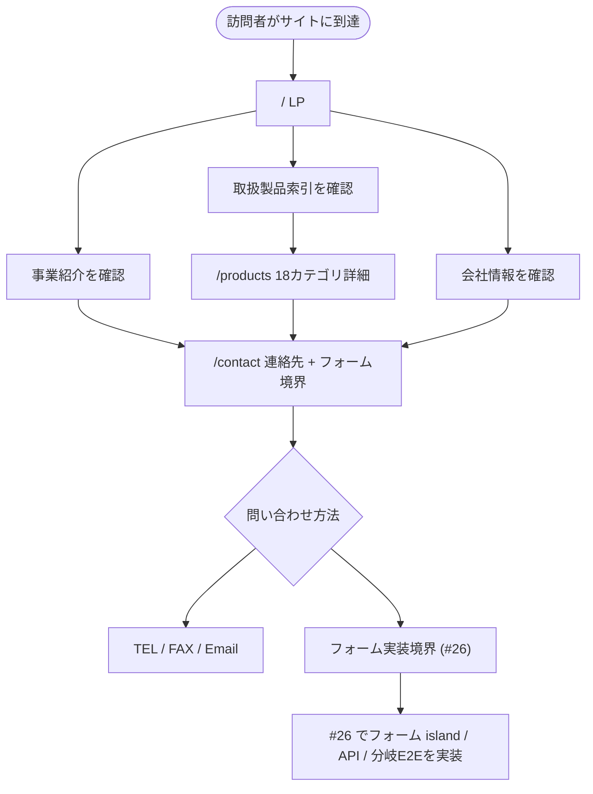
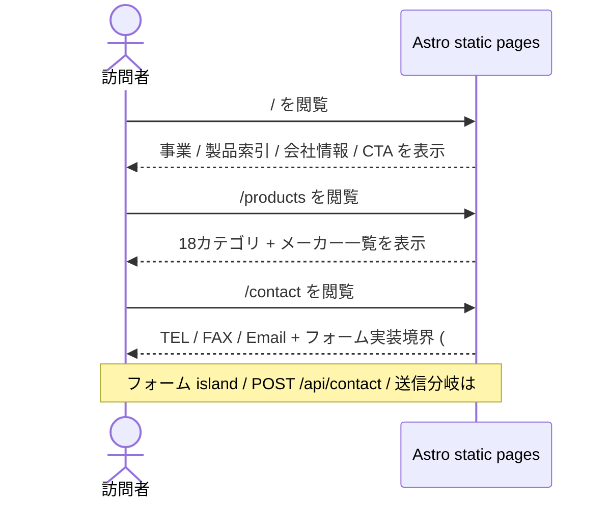

# コーポレートサイト本体実装

> issue #10 の設計 spec。IA / デザイン / 問い合わせフォーム / トークン体系は上位文書へハンドオフ済みの正本を継承し、本 spec は `apps/corporate-site` 本体実装へ落とす作業正本として扱う。

## メタ情報

- Issue: `#10`
- ステータス: `Draft`
- 作成日: 2026-06-23
- 更新日: 2026-06-23
- Branch: `feature/10`
- Owner: Fukuemon

## 設計フェーズ状況

状態は `未着手 / 進行中 / 完了 / レビュー済 / 保留` のいずれか。保留の場合は理由を備考に残す。

| #   | フェーズ                    | 状態   | 最終更新   | 備考                                                              |
| --- | --------------------------- | ------ | ---------- | ----------------------------------------------------------------- |
| 1   | 起票                        | 完了   | 2026-06-23 | issue #10 を intake。#3 / #6 / #11 / #13 / #14 / #16 / #17 を継承 |
| 2   | 下書き                      | 完了   | 2026-06-23 | spec-draft で初版生成                                             |
| 3   | 上位文書突合                | 完了   | 2026-06-23 | 矛盾なし。既存正本を継承し、上位文書更新は不要                    |
| 4   | 論点整理                    | 完了   | 2026-06-23 | 初期論点 D1〜D8 を抽出                                            |
| 5   | 論点解決                    | 完了   | 2026-06-23 | D1〜D8 を `spec-resolve` で全件確定                               |
| 6   | Interface / Routing 設計    | 完了   | 2026-06-23 | 3 route / header / footer / CTA / anchors を確定                  |
| 7   | Content / Data 設計         | 完了   | 2026-06-23 | reference から content 層 / collection への変換方針を確定         |
| 8   | Performance / Security 設計 | 完了   | 2026-06-23 | island 数、画像、#26 への security 委譲境界を確定                 |
| 9   | Test / Metrics 設計         | 完了   | 2026-06-23 | E2E 主要導線 / data-testid / visual QA 対象を確定                 |
| 10  | 実装分割                    | 完了   | 2026-06-23 | prompts 生成前の実装タスクへ分解済み                              |
| 11  | レビュー済                  | 進行中 | 2026-06-23 | multi-agent review は NEEDS_WORK。指摘対応後に再 review           |

## 上位文書整合

正本 ([PRD](../../PRD.md) / [Design Doc](../../design/DesignDoc.md) / [feature doc](../../design/features/corporate-site/DesignDoc_corporate-site.md) / [context](../../context/) / ADR) のどの節と、どう整合させたかを記録する。

- PRD 更新要否: 不要
- Design Doc 更新要否: 不要
- ADR 起票要否: 不要

| 上位文書    | 節 / 該当箇所                                                                                   | 整合方針 (継承 / 補足 / 変更提案)                                                      |
| ----------- | ----------------------------------------------------------------------------------------------- | -------------------------------------------------------------------------------------- |
| PRD         | Phase 1 スコープ / 成功条件「取扱領域と問い合わせ先へ到達」「Astro 静的生成と最小 island」      | 継承                                                                                   |
| Design Doc  | Goal / モジュール責務 `apps/corporate-site` / Non Goals「CMS/API・不要な React 化は初期対象外」 | 継承                                                                                   |
| feature doc | ページ構成 (IA) / コンテンツ正本 / デザイントークン / 問い合わせフォーム仕様                    | 正本を継承。P6 の完成形は feature doc、#10 は連絡先表示と #26 用フォーム境界までを実装 |
| context     | architecture → Package Boundary / Runtime Boundary / Edge API                                   | 継承。表示 UI は静的描画、フォーム API は #26 に委譲する                               |
| context     | component-design → content 層 / section assembly / presentation / Content Collection の選び分け | 継承。#6 の component map を実装配置へ展開                                             |
| context     | design-workflow → `.pen` 正本 / token guard / Phase C 実装                                      | 継承。`index.pen` を参照し、コードから `.pen` へ round-trip しない                     |
| context     | testing → E2E Runtime Contract / API・Functions の検証境界                                      | 継承。root Playwright と route intercept を使う                                        |
| context     | infrastructure → Cloudflare Pages / Functions / secret / preview smoke                          | 継承。アプリ側 contract を満たす                                                       |
| ADR-0006    | 3 route IA (`/`, `/products`, `/contact`)                                                       | 継承                                                                                   |
| ADR-0007    | デザイントークン 2 層構造 + app-local lean Tailwind v4                                          | 継承                                                                                   |
| ADR-0008    | shadcn 静的描画 / `client:*` island はインタラクション限定                                      | 継承                                                                                   |
| ADR-0009    | 問い合わせ送信は Cloudflare Pages Functions (Workers) 中継                                      | 継承                                                                                   |

> 現時点の突合では、issue #10 は既存正本の範囲内で実装詳細を補足する作業であり、`spec-sync` が必要な変更提案はない。

## 関連資料

- `PRD.md`: Phase 1 要求、成功条件、ガードレール
- `design/DesignDoc.md`: system landscape、モジュール責務
- `design/features/corporate-site/DesignDoc_corporate-site.md`: IA / コンテンツ / 問い合わせフォーム / トークン / フローの正本
- `design/features/corporate-site/index.pen`: デザイン正本
- `design/features/corporate-site/component-map.md`: `.pen` section / component と実装 component の対応
- `design/features/corporate-site/reference/company-profile.md`: 会社概要 / 業務内容 / 取扱製品カテゴリのコンテンツ正本
- `design/features/corporate-site/reference/manufacturers.md`: 取扱メーカー一覧のコンテンツ正本
- `specs/17-corporate-site-ia/`: 3 route IA の決定経緯
- `specs/14-contact-form/`: 問い合わせフォーム仕様の決定経緯
- `specs/13-design-system-foundation/`: トークン体系の決定経緯
- `specs/6-storybook-component-catalog/`: component / Storybook / content 層規約の決定経緯
- 関連 issue: #3 / #6 / #7 / #11 / #13 / #14 / #16 / #17

## 背景

- issue #3 で monorepo foundation と `apps/corporate-site` の Astro skeleton は成立したが、本体ページは scaffold のまま残っている。
- Phase 1 の主目的は、訪問者が事業内容・取扱製品・会社情報・問い合わせ方法に到達できるコーポレートサイトを公開可能にすること。
- IA (#17 / ADR-0006)、問い合わせフォーム仕様 (#14 / ADR-0009)、トークン体系 (#13 / ADR-0007)、component 規約 (#6 / component-design) は既に決定済み。本 issue はそれらを矛盾なく `apps/corporate-site` と root `e2e` へ実装する。フォーム本体と backend は #26 に委譲する。

## スコープ

### やること

- 3 route (`/`, `/products`, `/contact`) と全ページ共通 header / footer / CTA を実装する。
- `index.pen` と component map に沿って、LP / Products / Contact の section を実装する。
- content 層を追加し、company-profile / manufacturers の正本からページ表示用データへ変換する。
- 18 カテゴリ + メーカー一覧を単一データソース化し、LP 索引と Products 詳細で共通参照する。
- 問い合わせページに TEL / FAX / Email の連絡先導線と、#26 がフォームを差し込むための section 境界を用意する。
- 表示専用 UI は Astro / 静的描画を基本とし、モバイルナビは Astro + minimal script で実装する。問い合わせフォーム island / API は #26 に委譲する。
- `@kufu/ui` の semantic token / shared primitive を参照し、raw hex / 色 arbitrary value / `.pen` token fork を避ける。
- raw hex / 色 arbitrary value の混入を検出する rg ベースの軽量 token guard を追加する。
- root Playwright で主要 route と問い合わせ導線を検証できる状態にする。
- `pnpm build` / `pnpm typecheck` の通過を完了条件に含める。

### やらないこと

- CMS / 管理画面 / 認証 / 投稿管理の実装。
- `/services` / `/company` の単独 route 復活。
- 既存の IA / token / form backend 方針の再決定。
- 問い合わせフォーム island / `POST /api/contact` / Turnstile / Resend / Workers unit / form 分岐 E2E の実装 (issue #26 で扱う)。
- 問い合わせ内容の DB / storage 永続化。
- `packages/ui` を将来用途まで見越して過剰に拡張すること。
- デザイン正本 `.pen` の構造変更。実装中に drift を見つけた場合は論点化し、必要なら `spec-sync` / design workflow 側で扱う。

## 要件の解釈

### 実現したいユーザー価値

- 調達 / 保全 / 購買担当者が、Kufu の取扱領域と相談できる内容を短時間で判断できる。
- 既存取引先・紹介経由の見込み顧客が、会社情報と問い合わせ先へ迷わず到達できる。
- 内容更新者が、会社情報・取扱製品・メーカー情報の正本と掲載先を追跡できる。
- 開発者 / AI エージェントが、Astro 静的生成、最小 island、token guard、component 置き場を外さずに実装できる。

### 成功条件

- `apps/corporate-site` に `/`, `/products`, `/contact` が実装され、主要 section が実コンテンツで表示される。
- LP / Products / Contact のどこからでも問い合わせ導線へ到達できる。
- 18 カテゴリ + メーカー一覧が単一データソースから表示され、LP と Products で二重管理されない。
- 表示専用 UI に不要な `client:*` が付かず、#10 の範囲では React island を追加しない。
- `/contact` はフォーム本体なしでも TEL / FAX / Email で接点確保でき、#26 がフォームを実装できる配置境界を持つ。
- E2E で主要 route、ナビ、CTA、問い合わせ導線を検証できる。
- `pnpm build` と `pnpm typecheck` が通る。

### 対象ユーザー / 操作主体

- Primary user: 工業製品・機械工具の調達 / 保全 / 購買担当者、既存取引先、紹介経由の見込み顧客。
- Operator: Kufu 側の内容更新者 / 公開作業者。
- Developer: 実装・保守を行う開発者 / AI エージェント。

EARS 風で振る舞いを記述する。

- WHEN 訪問者が `/` に到達した時、システムは 理念 / 事業内容 / 取扱製品索引 / 会社情報 / 問い合わせ導線を順に提示する。
- WHEN 訪問者が取扱製品の詳細を知りたい時、システムは `/products` で 18 カテゴリとメーカー一覧を表示する。
- WHEN 訪問者が問い合わせたい時、システムは 全ページ共通 CTA と `/contact` で電話 / FAX / メールの接点を提示し、`contact-form-slot` として #26 のフォーム実装境界を表示する。
- IF #26 のフォーム本体が未実装の時、システムは TEL / FAX / Email の代替導線で接点確保を維持する。
- WHERE 表示専用 UI において、システムは Astro 静的描画を優先し、不要な React island を追加しない。
- THE SYSTEM SHALL 実装データに参照元 reference path を明記し、代表コンテンツの表示確認と PR review で content 正本と表示先の対応を確認できるようにする。

## 設計時の論点

設計 / 実装フェーズへ持ち越す残課題を 1 件ずつ管理する。確定したものは「解決済みの論点」へ移す。

| #   | 論点                                                      | 決定候補                                                                               | 決定                                                                                        |
| --- | --------------------------------------------------------- | -------------------------------------------------------------------------------------- | ------------------------------------------------------------------------------------------- |
| D1  | ProductCategory / CategoryMakers の実体形式               | Astro Content Collection / typed TS data / JSON + schema                               | **確定: Astro Content Collection**                                                          |
| D2  | `reference/*.md` から content 層へ変換する運用            | 手動 typed data 化 / build-time parser / content collection loader                     | **確定: 手動で collection data 化**                                                         |
| D3  | モバイルナビの実装方式と island 数                        | React island / CSS-only details / Astro + minimal script                               | **確定: Astro + minimal script**                                                            |
| D4  | 問い合わせフォーム island の実装範囲                      | #14 の単一 React islandを本 issueで実装 / #26へ委譲 / backendのみ先行                  | **確定: #26へ委譲**                                                                         |
| D5  | `@kufu/ui` shared primitive と app-local component の境界 | shared primitiveを静的描画で利用 / app-local Astro component中心 / 新規 shared昇格あり | **確定: shared primitiveを静的描画で利用し、section / business wordingはapp-local**         |
| D6  | 画像 asset の最終配置・最適化                             | `src/assets` import / `public` 配置 / remoteなし / Astro Image利用                     | **確定: `apps/corporate-site/src/assets` に配信用コピーを置き、Astro Image / importで扱う** |
| D7  | E2E の最小合格導線                                        | 3 route smokeのみ / CTA + Contact境界まで / visual screenshotを含める                  | **確定: CTA + Contact境界まで。visual screenshot / VRT は #28 で検討**                      |
| D8  | token guard の自動化を本 issue に含めるか                 | 手動 review維持 / lintやrgベース検査追加 / 後続issue化                                 | **確定: rgベースの軽量検査を#10に含める**                                                   |

## 解決済みの論点

(`spec-resolve` で確定したものをここに移動する)

- **D1 ProductCategory / CategoryMakers の実体形式** → **Astro Content Collection**。18 カテゴリとカテゴリ別メーカー一覧は、同形エントリ集合であり LP (`/`) と Products (`/products`) の両方が共通参照するため、Astro Content Collection を単一データソースにする。`context/component-design.md` の「同形エントリ集合は Content Collection 候補」に沿い、将来 CMS / loader 差し替えの境界も確保する。plain typed TS data は初期実装は軽いが、将来の所有境界が弱いため不採用。JSON + schema は Astro 標準機構を使わない検証が別途必要になるため不採用。D2 では `reference/*.md` から collection data へ変換する運用を決める。
- **D2 `reference/*.md` から content 層へ変換する運用** → **手動で collection data 化**。`design/features/corporate-site/reference/` の markdown をコンテンツ正本として維持し、実装では `apps/corporate-site/src/content/` の Astro Content Collection entry / plain TS data へ手動で写す。build-time parser は markdown の表記揺れに弱く、#10 の本筋ではない実装コストが増えるため不採用。content collection loader は将来 CMS 化には近いが、現時点の committed reference 運用には過剰なため不採用。drift 防止は、実装データに参照元を明記し、PR review / E2E / content 表示確認で同期差分を確認する。
- **D3 モバイルナビの実装方式と island 数** → **Astro + minimal script**。SiteHeader は Astro component とし、モバイルナビの開閉、`aria-expanded` / hidden 状態、Escape key、ナビ選択後の close だけを小さな inline / module script で扱う。React island は全ページ共通 header に載せず、問い合わせフォームなど実質的な React UI に限定する。CSS-only details / summary は JS ゼロだが、閉じる挙動や a11y 制御の自由度が低いため不採用。React island は実装は素直だが、全ページに React runtime を載せる費用対効果が弱いため不採用。
- **D4 問い合わせフォーム island の実装範囲** → **#26へ委譲**。#10 では `/contact` route、静的な連絡先表示、フォームを差し込む section 境界までを扱い、React form island / `POST /api/contact` Pages Functions / Turnstile / Resend / Workers unit / form 分岐 E2E は issue #26 の実装スコープにする。#26 は #14 / feature doc / ADR-0009 に基づくフォーム実装専用 issue として既に切られているため、#10 に含めると本体ページ実装とフォーム backend が混ざりすぎる。backend のみ先行は訪問者価値に直結しないため不採用。
- **D5 `@kufu/ui` shared primitive と app-local component の境界** → **shared primitive を静的描画で利用し、section / business wording は app-local**。`Button` / `LinkButton` / `Tag` / `Separator` / `DefinitionRow` など business wording を持たない primitive / pattern は `@kufu/ui` を Astro から `client:*` なしで静的描画して使う。`Hero` / `BusinessSection` / `ProductsDetailSection` / `ContactSection` / `SiteHeader` / `SiteFooter` など page 文脈や business wording を持つ component は `apps/corporate-site` に colocation する。app-local Astro component 中心に寄せる案は `@kufu/ui` と drift しやすいため不採用。新規 shared 昇格は現時点の consumer が corporate-site だけで過剰共通化になりやすいため不採用。
- **D6 画像 asset の最終配置・最適化** → **`apps/corporate-site/src/assets` に配信用コピーを置き、Astro Image / import で扱う**。`design/features/corporate-site/assets/` は design source とし、runtime で使う画像は app 側 `src/assets` へコピーして build の asset graph に乗せる。Astro Image / import を使い、width / height / lazy loading / format 最適化を管理する。`public` 配置は参照追跡と最適化が弱いため不採用。design 配下の直接参照は app 実装が design 正本ツリーへ依存して責務境界が曖昧になるため不採用。remote 画像は Phase 1 では不要で、外部配信・権利管理が増えるため不採用。同期は PR で design source → app asset の派生関係を確認する。
- **D7 E2E の最小合格導線** → **CTA + Contact 境界まで**。#10 の E2E は `/`, `/products`, `/contact` の表示、header / footer / CTA の遷移、LP から Products / Contact への導線、Products の 18 カテゴリと代表的メーカー、Contact の TEL / FAX / Email と `contact-form-slot`、モバイル viewport の `site-nav-toggle` 開閉までを最小合格にする。3 route smoke のみでは #10 の訪問者価値を検証できないため不採用。visual screenshot / VRT は有用だが、flake / 更新コストとデザイン QA 境界の検討が必要なため [#28](https://github.com/Fukuemon/kufu-apps/issues/28) で扱う。
- **D8 token guard の自動化を本 issue に含めるか** → **rg ベースの軽量検査を #10 に含める**。#10 は corporate-site 本体の実装量が大きく、手動 review のみでは raw hex / 色 arbitrary value (`text-[#...]` 等) の混入を見落としやすいため、`apps/corporate-site/src` を対象に `#[0-9a-fA-F]{3,8}` や Tailwind 色 arbitrary value を検出する軽量 check を追加する。正式 lint / pre-commit 自動化は保守コストが増え、#10 の本体実装から外れやすいため不採用。手動 review のみは token guard の事故防止として弱いため不採用。false positive は許容コメントまたは対象除外を最小限に留める。

## 未確定事項

(決定できない項目を理由とともに残す。1 件でも残っていれば下流 phase は止める)

- 未解決事項なし。次 phase では Interface / Routing 設計、Content / Data 設計、実装分割を具体化する。

## 実装対象

正規 target は `context/project.md` の対象ドメイン一覧を正本とする。

| モジュール       | 実装有無 | 主な責務                                                                 |
| ---------------- | :------: | ------------------------------------------------------------------------ |
| `corporate-site` |    ◯     | 3 route / section / content 層 / Contact section 境界 (#26連携)          |
| `cms`            |    -     | 対象外                                                                   |
| `ui`             |    ◯     | 既存 token / shared primitive を静的描画で consume。新規昇格は原則しない |
| `config`         |    -     | 対象外。既存 task / lint / typecheck contract を利用                     |
| `e2e`            |    ◯     | 主要 route / CTA / 問い合わせ導線の Playwright 検証                      |
| `core`           |    -     | 対象外                                                                   |

## 機能仕様

### User Flow

1. 訪問者が `/` に到達し、hero で会社の理念と事業要約を把握する。
2. 訪問者が LP 内の事業紹介 section で販売・加工の二本柱を把握する。
3. 訪問者が LP の取扱製品索引から `/products` へ進み、18 カテゴリとメーカー一覧を確認する。
4. 訪問者が LP 会社情報 section または共通 footer で会社概要 / 連絡先を確認する。
5. 訪問者が header CTA / section CTA / footer から `/contact` へ進む。
6. 訪問者が電話 / FAX / メールのいずれかで問い合わせる。フォーム送信は #26 で実装する。

### Reuse Policy

- 第一原則は feature / colocation とする。
- 共通化は複数 feature / app をまたぐ再利用が明確になってから行う。
- app や feature 内で閉じる UI / utility / asset はローカルに置く。
- `@kufu/ui` の shared primitive / pattern は Astro から `client:*` なしで静的描画して consume する (D5)。
- section / page 文脈 / business wording を持つ component は `apps/corporate-site` に置く (D5)。
- #10 では新規 shared 昇格を原則行わない。複数 consumer が明確になった場合だけ別論点化する。

### Performance

- Astro 静的生成を維持する。
- 表示専用 UI に `client:*` を付けない。
- モバイルナビは Astro + minimal script で実装し、React island にしない (D3)。
- #10 の範囲では React island を追加しない。問い合わせフォーム island は #26 で実装する (D4)。
- LP は縦長になるため、画像 lazy-load / dimensions 指定 / above-the-fold asset の最適化を行う。
- `/products` はメーカー一覧が長いため、初期 JS なしで走査できる HTML 構造を優先する。

### React Compiler

- #10 は Astro 静的描画を主対象とし、React component を新規 island として追加しないため React Compiler の適用対象外とする。
- `@kufu/ui` の表示専用 React component は Astro から `client:*` なしで静的描画し、React runtime / React Compiler 前提の client 挙動を持ち込まない。
- 問い合わせフォーム island / `POST /api/contact` の React 実装は #26 に委譲し、React Compiler 互換性の確認も #26 の実装 scope で扱う。

### Routing / URL State

- route は `/`, `/products`, `/contact` の 3 つ。
- `/services` / `/company` は作らず、LP 内アンカー (`#business`, `#company` など) で直接導線を提供する。
- URL state を持つフィルタ / 検索は初期実装では導入しない。必要になった場合は別論点として扱う。

### Content / Assets

- 会社概要 / 業務内容 / 連絡先 / 取扱製品カテゴリの正本は `design/features/corporate-site/reference/company-profile.md`。
- 取扱メーカーの正本は `design/features/corporate-site/reference/manufacturers.md`。
- 実装側の content 層は `apps/corporate-site/src/content/` に置く。
- reference markdown は実装時に手動で content data へ転記する (D2)。実装データには参照元 reference を明記し、PR review で同期を確認する。
- singleton / bespoke は plain `content/<feature>.ts`、同形エントリ集合の ProductCategory / CategoryMakers は Astro Content Collection とする (D1)。
- 画像 asset は `design/features/corporate-site/assets/` を design source とし、runtime で使う配信用コピーを `apps/corporate-site/src/assets` に置く (D6)。
- app asset は Astro Image / import で扱い、width / height / lazy loading / format 最適化を build に乗せる (D6)。

### UI Reuse

- `SectionHeading`, `BusinessFeatureRow`, `FeaturedCategoryCard`, `ContactInfoRow`, `ServicePillar` は #6 実装済み presentation component を再利用する。
- `Button` / `LinkButton` / `Tag` / `Separator` / `DefinitionRow` など business wording を持たない shared primitive / pattern は `@kufu/ui` を静的描画で consume する (D5)。
- 新規 section assembly は `Hero.astro`, `BusinessSection.astro`, `ProductsCategorySection.astro`, `ContactSection.astro` を基本に追加する。
- `ContactSection.astro` は #10 では連絡先表示とフォーム差し込み境界までを持ち、フォーム island 本体は #26 に委譲する (D4)。
- `SiteHeader` / `SiteFooter` / `Layout` は `components/common/` に置く。
- `SiteHeader` のモバイル開閉は Astro + minimal script で扱い、React island 化しない (D3)。
- page は route / metadata / section assembly の呼び出しに絞る。

### Testing

- route smoke: `/`, `/products`, `/contact` が 200 で表示される。
- navigation: header nav / CTA / footer link が期待 route / anchor へ遷移する。
- content: 主要コピー、18 カテゴリ、代表的なメーカー、会社連絡先が表示される。
- form 分岐 E2E は #26 に委譲する。#10 では `/contact` の連絡先表示とフォーム差し込み境界を確認する。
- island guard: 表示専用 component に不要な `client:*` を追加していないことを review / 必要なら検査で確認する。

## Interface 設計

### UI / API / Event Interface

- UI route:
  - `GET /`: LP。
  - `GET /products`: 取扱製品。
  - `GET /contact`: お問い合わせ。
- API route:
  - #10 では実装しない。`POST /api/contact` は #26 で実装し、詳細 contract は [feature doc](../../design/features/corporate-site/DesignDoc_corporate-site.md#問い合わせフォーム仕様) と [spec #14](../14-contact-form/index.md) を正本とする。
- UI events:
  - Header nav click。
  - Mobile nav toggle / close。
  - CTA click。
  - Product category anchor click。
  - Contact form slot / boundary display。

### Props / Request / Response

- section assembly は content 層を読み、presentation component へ props を渡す。
- presentation component は props だけで描画し、URL / API / secret / runtime env を読まない。
- `POST /api/contact` request / response は #26 の実装対象。#10 では #14 の contract と矛盾しないフォーム配置境界だけを用意する。

## Content / Data 設計

### 保存・管理するデータ

- アプリ側で永続化する問い合わせデータはない。
- 表示用 content:
  - hero コピー。
  - business features。
  - service pillars / 加工対応。
  - contact info。
  - company profile。
  - product categories (Astro Content Collection, D1)。
  - category makers / manufacturer list (Astro Content Collection, D1)。

### コンテンツ配置 / package / route

| データ                  | 配置候補                  | 利用 route              | 備考                                                                 |
| ----------------------- | ------------------------- | ----------------------- | -------------------------------------------------------------------- |
| hero コピー             | `src/content/hero.ts`     | `/`                     | singleton。reference から手動転記 (D2)                               |
| business features       | `src/content/business.ts` | `/`                     | bespoke。reference から手動転記 (D2)                                 |
| service pillars         | `src/content/services.ts` | `/`                     | #6 component を利用。reference から手動転記 (D2)                     |
| contact info            | `src/content/contact.ts`  | `/`, `/contact`, footer | 連絡先は単一 export。reference から手動転記 (D2)                     |
| company profile         | `src/content/company.ts`  | `/`, footer             | company-profile.md 由来。手動転記 (D2)                               |
| product categories      | Astro Content Collection  | `/`, `/products`        | D1 で確定。18カテゴリの単一データソース。reference から手動転記 (D2) |
| category makers         | Astro Content Collection  | `/products`             | D1 で確定。カテゴリ別メーカー一覧。reference から手動転記 (D2)       |
| contact form categories | #26 で定義                | `/contact`              | #14 category contract と合わせる。#10 では扱わない                   |

## Performance / Security 設計

### Performance

- HTML first。Products の長い一覧も JS なしで読める構造にする。
- `@kufu/ui` の表示専用 React component は Astro 静的描画 (`client:*` なし) で使い、React runtime を出荷しない (D5)。
- raw hex / 色 arbitrary value は使わず、semantic token utility (`text-foreground`, `bg-background`, `border-border` 等) を使う。rg ベースの軽量 token guard で混入を検出する (D8)。
- 画像は `apps/corporate-site/src/assets` から import し、Astro Image / import で幅 / 高さ / lazy loading を明示する (D6)。
- LP hero など above-the-fold 画像以外は遅延読み込みを基本にする。
- #10 の範囲では React island を追加しない。#26 でフォーム island を実装する場合は `client:visible` / `client:idle` を既定にし、`client:load` は原則使わない。
- SiteHeader のモバイル開閉は minimal script とし、全ページ共通 header に React runtime を載せない (D3)。
- `@kufu/ui/styles.css` 全量ではなく、corporate-site の lean Tailwind entry を継続する。

### Security / Privacy

- #10 では secret / token / API key / 宛先を扱わない。問い合わせフォームの secret / Workers security は #26 に委譲する。
- `/contact` には TEL / FAX / Email を表示し、フォーム未実装状態でも接点確保を維持する。
- 問い合わせフォーム実装時の privacy 注記は #26 で #14 / feature doc に従って配置する。

## Error / Fallback 設計

### エラーケース

| #   | ケース                              | ユーザーへの見せ方                                                                 | リカバリ                          |
| --- | ----------------------------------- | ---------------------------------------------------------------------------------- | --------------------------------- |
| 1   | `/products` のカテゴリデータ不備    | build / typecheck で検出。公開画面では空表示を避ける                               | schema / fixture 修正             |
| 2   | 画像 asset 不足                     | 代替画像または画像なし layout で崩れないようにする                                 | asset 追加 / 差し替え             |
| 3   | design source と app asset の不一致 | PR review で検出。表示は app asset を正とする                                      | `src/assets` の配信用コピーを更新 |
| 4   | フォーム本体が未実装 (#26 未完了)   | TEL / FAX / Email の代替導線を表示し、フォーム領域は後続実装境界として破綻なく表示 | #26 でフォーム実装                |
| 5   | Cloudflare preview 表示崩れ         | PR の preview smoke で検出                                                         | layout / asset を修正             |

### Fallback

- #10 ではフォーム未実装でも、TEL / FAX / Email を `/contact` と footer に表示し、接点確保を維持する。
- 地図埋め込みが性能や privacy の観点で不適切な場合は、住所テキスト + 外部地図リンクにする。
- 沿革 / 代表挨拶など未確定本文は placeholder とし、公開に必要な一次情報を優先する。

## テスト / 評価方針

### テスト観点

- Build / typecheck:
  - `pnpm build`
  - `pnpm typecheck`
- E2E:
  - `/`, `/products`, `/contact` の表示。
  - header / footer / CTA の遷移。
  - LP から Products / Contact への導線。
  - Products の 18 カテゴリ表示。
  - Products の代表的なメーカー表示。
  - Contact の連絡先表示。
  - Contact の連絡先表示とフォーム差し込み境界。
  - mobile viewport で `site-nav-toggle` が開閉し、nav link が使えること。
- Unit:
  - Astro Content Collection / content data の schema validation。
  - `/api/contact` validation / honeypot / error mapping は #26 で検証する。
- Review:
  - content data に参照元 reference path が明記され、reference markdown からの手動転記差分が PR review で確認されていること。
  - rg ベースの token guard で raw hex / 色 arbitrary value が混入していないこと。
  - design source と `src/assets` の配信用コピーの対応。
  - 画像の width / height / lazy loading / above-the-fold 扱い。
  - token guard。
  - island 数。
  - `.pen` と実装 component の対応。

### 計測指標

- Phase 1 中は PRD と同様に build / E2E / island 方針 / 正本リンクを検証可能な成功条件とする。
- Lighthouse / bundle size / 問い合わせ転換率などの数値目標は公開前検証または公開後運用で別途確定する。

## フロー / シーケンス

(`spec-diagrams` で生成。spec の主要操作を Mermaid 図に落とす)

### Flowchart (ユーザー操作起点)



### Sequence



## 実装分割

### 実装タスク案

| Phase | 対象             | 概要                                                                                                    | 依存          |
| ----- | ---------------- | ------------------------------------------------------------------------------------------------------- | ------------- |
| P1    | `corporate-site` | reference markdown を手動転記した content data / Astro Content Collection 整備                          | -             |
| P2    | `corporate-site` | Layout / SiteHeader (minimal script mobile nav) / SiteFooter / route skeleton (`/products`, `/contact`) | P1            |
| P3    | `corporate-site` | LP sections (Hero / Business / Products index / Company / CTA)                                          | P1 / P2       |
| P4    | `corporate-site` | Products page (18カテゴリ詳細 / INDEX / メーカー一覧)                                                   | P1 / P2       |
| P5    | `corporate-site` | Contact page の連絡先表示 + #26 用フォーム差し込み境界                                                  | P1 / P2 / #14 |
| P6    | `corporate-site` | design source から `src/assets` への配信用 asset 整備 / 画像最適化                                      | P3〜P5        |
| P7    | `e2e`            | 3 route / nav / CTA / Products / Contact境界 / mobile nav E2E                                           | P2〜P6        |
| P8    | `corporate-site` | performance / rg token guard / accessibility / preview smoke 修正                                       | P3〜P7        |

### prompts 生成方針

- Astro Content Collection で product data model を最初に切り、LP と Products の重複を防ぐ (D1)。
- reference markdown は正本として残し、実装用 content data へ手動転記する前提を prompt に明記する (D2)。
- layout / common component を先に実装し、各 route を薄く保つ。
- SiteHeader は Astro component + minimal script とし、React island 化しない方針を prompt に明記する (D3)。
- `@kufu/ui` の shared primitive は静的描画で consume し、business wording を持つ section / site component は app-local に置く方針を prompt に明記する (D5)。
- 画像は `design/features/corporate-site/assets/` を design source、`apps/corporate-site/src/assets` を配信用コピーとして扱い、Astro Image / import で最適化する方針を prompt に明記する (D6)。
- Products と Contact は並列化可能だが、content / layout の確定後に分ける。
- 問い合わせフォーム本体は #26 に委譲し、#10 prompt にはフォーム差し込み境界のみ含める。
- E2E は UI 実装後にまとめて作るが、data-testid は実装 prompt に先に渡す。
- visual screenshot / VRT は #10 の最小合格に含めず、[#28](https://github.com/Fukuemon/kufu-apps/issues/28) で導入可否・対象・更新運用を検討する (D7)。
- raw hex / 色 arbitrary value の混入を検出する rg ベースの軽量 token guard を #10 prompt に含める (D8)。

## 上位資料からの変更点

本 spec で PRD / Design Doc / feature doc / context / 既存 ADR から変更・追加した内容を、反映先別に記録する。`spec-track` / `spec-sync` で更新する。

### PRD への影響

| 対象節 | 変更内容 | 理由                                |
| ------ | -------- | ----------------------------------- |
| -      | 影響なし | 既存 Phase 1 要求を実装へ落とすため |

### Design Doc への影響

| 対象節 | 変更内容 | 理由                                         |
| ------ | -------- | -------------------------------------------- |
| -      | 影響なし | モジュール責務 / 3 route IA は反映済みのため |

### feature doc への影響

| 対象 doc / 節                                          | 変更内容                                                                                                                                                                                                      | 理由                                                                                              |
| ------------------------------------------------------ | ------------------------------------------------------------------------------------------------------------------------------------------------------------------------------------------------------------- | ------------------------------------------------------------------------------------------------- |
| -                                                      | 現時点では影響なし                                                                                                                                                                                            | IA / form / token / content 正本は既に定義済み                                                    |
| DesignDoc_corporate-site.md / コンテンツ正本           | 影響なし (spec 内補足のみ)。ProductCategory / CategoryMakers の実装実体を Astro Content Collection として確定 (source: spec-resolve D1)                                                                       | feature doc が #10 に委譲していた実装形式の範囲内で具体化するため                                 |
| DesignDoc_corporate-site.md / コンテンツ正本           | 影響なし (spec 内補足のみ)。reference markdown を正本に残し、実装用 content data / collection entry へ手動転記する運用を確定 (source: spec-resolve D2)                                                        | feature doc の正本境界を変えず、#10 の実装運用だけを具体化するため                                |
| DesignDoc_corporate-site.md / ページ構成 (IA) G        | 影響なし (spec 内補足のみ)。全ページ共通 SiteHeader のモバイルナビを Astro + minimal script で実装すると確定 (source: spec-resolve D3)                                                                        | ADR-0008 の最小 island 方針を守りつつ、モバイルナビの操作性を確保するため                         |
| DesignDoc_corporate-site.md / 問い合わせフォーム仕様   | 影響なし (spec 内補足のみ)。#10 は `/contact` の連絡先表示とフォーム差し込み境界まで、フォーム island / API / 検証は #26 に委譲すると確定 (source: spec-resolve D4)                                           | #26 が #14 / ADR-0009 に基づく専用実装 issue として存在し、#10 の本体ページ実装と責務を分けるため |
| DesignDoc_corporate-site.md / 設計方針                 | 影響なし (spec 内補足のみ)。`@kufu/ui` の shared primitive は静的描画で consume し、section / business wording は app-local に置くと確定 (source: spec-resolve D5)                                            | ADR-0008 と component-design の colocation / shared primitive 境界を #10 実装へ具体化するため     |
| DesignDoc_corporate-site.md / データ・コンテンツモデル | 影響なし (spec 内補足のみ)。design source 画像は `design/features/corporate-site/assets/`、配信用コピーは `apps/corporate-site/src/assets` に置き Astro Image / import で扱うと確定 (source: spec-resolve D6) | design 正本と runtime asset の責務境界を保ちつつ、Astro build の asset graph に乗せるため         |
| DesignDoc_corporate-site.md / テスト観点               | 影響なし (spec 内補足のみ)。#10 の E2E 最小合格は CTA + Contact 境界までとし、visual screenshot / VRT は #28 で検討すると確定 (source: spec-resolve D7)                                                       | #10 の主要導線検証と、デザイン回帰検知の検討を責務分離するため                                    |
| DesignDoc_corporate-site.md / デザイントークン         | 影響なし (spec 内補足のみ)。raw hex / 色 arbitrary value の混入を検出する rg ベースの軽量 token guard を #10 に含めると確定 (source: spec-resolve D8)                                                         | design-workflow §6 の token guard を本体実装時に最低限機械検査するため                            |

### context への影響

| 対象 doc / 節 | 変更内容           | 理由                                                    |
| ------------- | ------------------ | ------------------------------------------------------- |
| -             | 現時点では影響なし | component / testing / infra contract は既存方針で足りる |

### ADR の新規 / 更新

| ADR ID | 変更内容 | 理由                                          |
| ------ | -------- | --------------------------------------------- |
| -      | なし     | 既存 ADR-0006 / 0007 / 0008 / 0009 を継承する |

## レビュー

`spec-review` (fresh-context evaluator) の最新結果。完全な記録は `review.md` を参照。

| 日付       | 結果 (PASS / NEEDS_WORK) | 指摘要点                                                                                                                | 対応                                                    |
| ---------- | ------------------------ | ----------------------------------------------------------------------------------------------------------------------- | ------------------------------------------------------- |
| 2026-06-23 | NEEDS_WORK               | React Compiler 必須節欠落、P5 の #26 依存、設計フェーズ状況、Screen Spec ツリー、EARS / test 表現、フォーム境界の再確認 | 対応済み。再 review 待ち。詳細は [review.md](review.md) |

## 変更履歴

| 日付       | 変更者 | 変更内容                                                                         |
| ---------- | ------ | -------------------------------------------------------------------------------- |
| 2026-06-23 | Codex  | spec-draft で初版生成                                                            |
| 2026-06-23 | Codex  | spec-resolve: D1 を Astro Content Collection で確定                              |
| 2026-06-23 | Codex  | spec-resolve: D2 を手動で collection data 化する方針で確定                       |
| 2026-06-23 | Codex  | spec-resolve: D3 を Astro + minimal script のモバイルナビで確定                  |
| 2026-06-23 | Codex  | spec-resolve: D4 を #26 へ委譲する方針で確定                                     |
| 2026-06-23 | Codex  | spec-resolve: D5 を shared primitive 静的描画 + app-local section 境界で確定     |
| 2026-06-23 | Codex  | spec-resolve: D6 を `src/assets` 配信用コピー + Astro Image / import で確定      |
| 2026-06-23 | Codex  | spec-resolve: D7 を CTA + Contact 境界までの E2E で確定し、VRT 検討を #28 へ分離 |
| 2026-06-23 | Codex  | spec-resolve: D8 を rg ベースの軽量 token guard 追加で確定                       |
| 2026-06-23 | Codex  | multi-agent review の NEEDS_WORK 指摘を反映                                      |

## 備考

- 取り込み済 appendix: Screen Spec / data-testid 一覧。
- API appendix は本 spec に重複させず、問い合わせ API の実装は #26 に委譲する。仕様詳細は [spec #14](../14-contact-form/index.md) と feature doc を正本参照する。

## Screen Spec

spec が画面 / 主要 UI を追加・変更する場合のみ取り込む。

### 画面一覧

| 画面 ID | 画面名       | パス / Route | 備考                                                       |
| ------- | ------------ | ------------ | ---------------------------------------------------------- |
| P1      | トップ (LP)  | `/`          | hero / 事業紹介 / 取扱製品索引 / 会社情報 / フルフッター   |
| P3      | 取扱製品     | `/products`  | 18カテゴリ詳細 / INDEX / メーカー一覧 / コンパクトフッター |
| P6      | お問い合わせ | `/contact`   | 連絡先 / フォーム差し込み境界 (#26) / コンパクトフッター   |
| G       | 全ページ共通 | -            | SiteHeader / nav / CTA / footer variants                   |

### コンポーネントツリー

```text
<BaseLayout>
├── <SiteHeader />
├── <Page route="/">
│   ├── <Hero />
│   ├── <BusinessSection />
│   ├── <ProductsCategorySection />
│   └── <CompanySection />
├── <Page route="/products">
│   └── <ProductsDetailSection />
├── <Page route="/contact">
│   └── <ContactSection />
└── <SiteFooter variant="full" | "compact" />
```

### 各コンポーネント仕様

| #   | コンポーネント            | 概要                                                                | 表示条件    | 活性条件                             |
| --- | ------------------------- | ------------------------------------------------------------------- | ----------- | ------------------------------------ |
| 1   | `BaseLayout`              | meta / styles / header / footer を束ねる                            | 全 route    | -                                    |
| 2   | `SiteHeader`              | ブランド / nav / contact CTA。モバイル開閉は Astro + minimal script | 全 route    | nav / CTA click / mobile toggle 可能 |
| 3   | `SiteFooter`              | LP は full、下層は compact                                          | 全 route    | link click 可能                      |
| 4   | `Hero`                    | 理念 / 事業要約 / primary CTA                                       | `/`         | CTA click 可能                       |
| 5   | `BusinessSection`         | 販売・加工の二本柱と補足                                            | `/`         | link / CTA がある場合のみ            |
| 6   | `ProductsCategorySection` | LP の18カテゴリ索引と featured cards                                | `/`         | `/products` link / anchor            |
| 7   | `CompanySection`          | 会社概要 / 連絡先 / アクセス                                        | `/`         | contact CTA                          |
| 8   | `ProductsDetailSection`   | 18カテゴリ詳細 / メーカー一覧                                       | `/products` | category anchor                      |
| 9   | `ContactSection`          | 連絡先 / フォーム差し込み境界 (#26)                                 | `/contact`  | 連絡先リンク click                   |

## data-testid 一覧

spec が E2E 対象 UI を追加する場合のみ取り込む。
命名規則: `{画面}-{要素種別}-{名前}`

| data-testid                | 要素                  | 用途                           |
| -------------------------- | --------------------- | ------------------------------ |
| `site-header`              | header                | 全ページ共通 header 表示       |
| `site-nav-toggle`          | button                | モバイルナビ開閉               |
| `site-nav-menu`            | nav/list              | モバイルナビ表示状態           |
| `site-nav-home`            | nav link              | `/` 遷移                       |
| `site-nav-products`        | nav link              | `/products` 遷移               |
| `site-nav-contact`         | nav link / CTA        | `/contact` 遷移                |
| `site-footer`              | footer                | footer 表示                    |
| `home-section-hero`        | section               | LP hero 表示                   |
| `home-section-business`    | section               | LP 事業紹介表示                |
| `home-section-products`    | section               | LP 取扱製品索引表示            |
| `home-section-company`     | section               | LP 会社情報表示                |
| `home-link-products`       | link / CTA            | LP から Products への導線      |
| `home-link-contact`        | link / CTA            | LP から Contact への導線       |
| `products-section-index`   | section               | Products INDEX 表示            |
| `products-category-list`   | list                  | 18カテゴリ一覧表示             |
| `products-category-{id}`   | category section      | 各カテゴリ詳細表示             |
| `products-maker-list-{id}` | list                  | 各カテゴリのメーカー一覧表示   |
| `products-link-contact`    | link / CTA            | Products から Contact への導線 |
| `contact-section-info`     | section               | 電話 / FAX / メール表示        |
| `contact-form-slot`        | section / placeholder | #26 がフォームを差し込む境界   |
