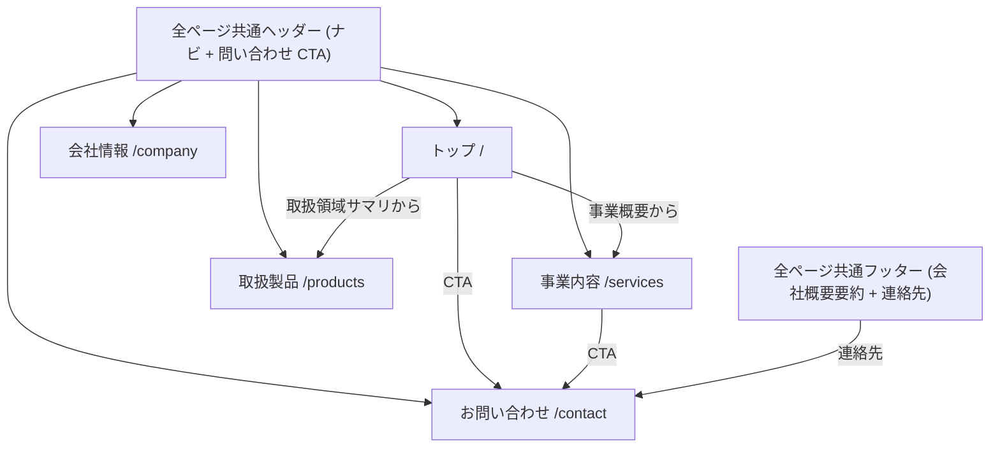
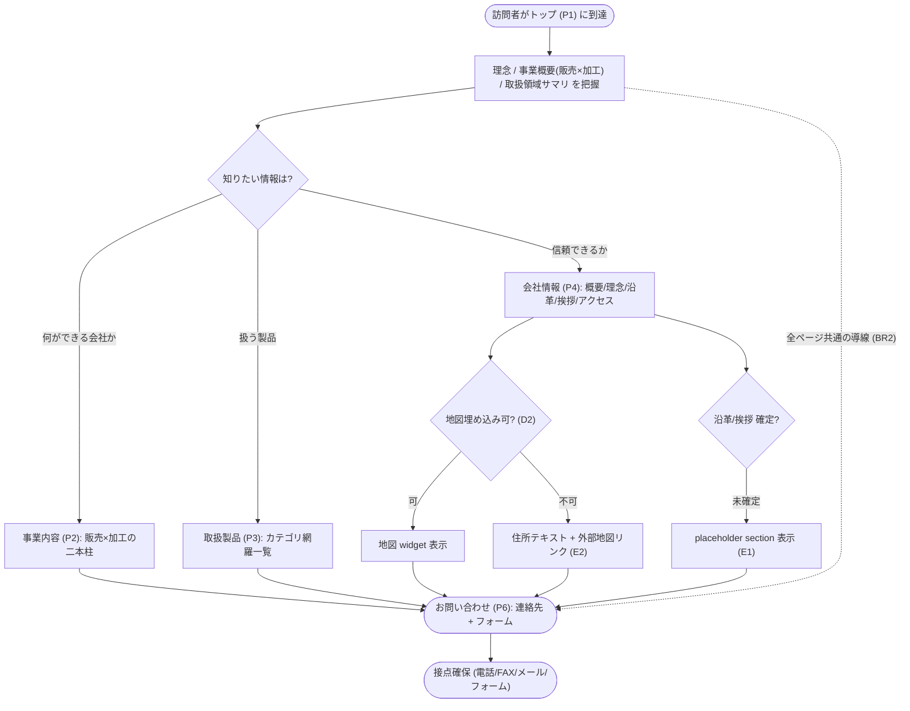
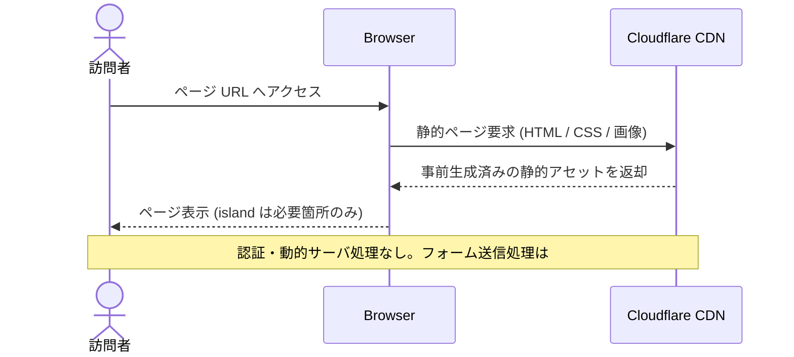

# コーポレートサイト情報設計 (IA)

> 対象: 有限会社フクウラ コーポレートサイト / コンテンツ正本: [`design/features/corporate-site/reference/company-profile.md`](../../design/features/corporate-site/reference/company-profile.md) + [`design/features/corporate-site/reference/manufacturers.md`](../../design/features/corporate-site/reference/manufacturers.md)
> (`.ai-out/企業情報/` は AI 取り込み用の未追跡スクラッチ。gitignore 対象のため source-of-truth にしない)
> スコープ: ページ / section / コンテンツ構成 (情報設計) に限定。デザイントークンは #13、問い合わせフォーム機能は #14。

## メタ情報

- Issue: #11
- ステータス: Draft
- 作成日: 2026-06-02
- 更新日: 2026-06-02
- Branch: `feature/11`
- Owner: Fukuemon

## 設計フェーズ状況

状態は `未着手 / 進行中 / 完了 / レビュー済 / 保留` のいずれか。保留の場合は理由を備考に残す。

| #   | フェーズ                    | 状態   | 最終更新   | 備考                                                                                                     |
| --- | --------------------------- | ------ | ---------- | -------------------------------------------------------------------------------------------------------- |
| 1   | 起票                        | 完了   | 2026-06-02 | issue #11 (IA に再スコープ済)                                                                            |
| 2   | 下書き                      | 完了   | 2026-06-02 | requirements.md 確定済                                                                                   |
| 3   | 上位文書突合                | 完了   | 2026-06-02 | 変更提案なし (継承 / 補足)                                                                               |
| 4   | 論点整理                    | 完了   | 2026-06-02 | Q1〜Q5 を抽出                                                                                            |
| 5   | 論点解決                    | 完了   | 2026-06-02 | Q1〜Q5 を spec-resolve で確定                                                                            |
| 6   | Interface / Routing 設計    | 完了   | 2026-06-02 | サイトマップ / 回遊フローを図化済。route 名は実装で                                                      |
| 7   | Content / Data 設計         | 進行中 | 2026-06-02 | 配置マッピング + 取扱メーカー統合確定。正本 = design/features/corporate-site/reference/\* (実体形は #10) |
| 8   | Performance / Security 設計 | 進行中 | 2026-06-02 | Astro 静的生成方針                                                                                       |
| 9   | Test / Metrics 設計         | 進行中 | 2026-06-02 | E2E 主要導線方針                                                                                         |
| 10  | 実装分割                    | 未着手 |            | `spec-prompts` で生成                                                                                    |
| 11  | レビュー済                  | 未着手 |            | `spec-review` 待ち                                                                                       |

## 上位ドキュメント確認

- PRD 更新要否: 不要 (継承。Open Questions に補足回答する範囲)
- Design Docs 更新要否: 反映済 (`spec-sync`) — Open Questions「具体的なページ構成」に spec #11 で回答を追記
- ADR 起票要否: 不要 (新規意思決定なし)

> 上位文書整合 (継承 / 補足 / 変更提案):
>
> | 上位文書    | 節 / 該当箇所                                  | 整合方針                  |
> | ----------- | ---------------------------------------------- | ------------------------- |
> | PRD         | スコープ → Phase 1 / コーポレートサイト要求    | 継承                      |
> | Design Doc  | モジュール責務 → `apps/corporate-site`         | 継承                      |
> | Design Doc  | Open Questions「具体的なページ構成」           | 補足 (反映済)             |
> | feature doc | corporate-site → データ / コンテンツモデル     | 補足 (`spec-sync` 反映済) |
> | context     | architecture → colocation / `packages/ui` 昇格 | 継承                      |
> | context     | testing → E2E 主要導線                         | 継承                      |
> | ADR-0003    | Phase 1 は corporate-site のみ                 | 継承                      |
>
> 変更提案は検出していない。

## 関連資料

- `PRD.md`: コーポレートサイト要求 / Phase 1 スコープ
- `design/DesignDoc.md`: モジュール責務 (`apps/corporate-site`) / Open Questions
- [requirements.md](requirements.md): 要求定義 (確定済)
- [design/features/corporate-site/reference/company-profile.md](../../design/features/corporate-site/reference/company-profile.md): 会社概要 / 業務内容 / 取扱製品カテゴリの正本
- [design/features/corporate-site/reference/manufacturers.md](../../design/features/corporate-site/reference/manufacturers.md): 取扱メーカー一覧の正本
- [design/features/corporate-site/DesignDoc_corporate-site.md](../../design/features/corporate-site/DesignDoc_corporate-site.md): feature doc
- 関連 issue: #10 (本体実装) / #6 (Storybook) / #13 (デザインシステム) / #14 (問い合わせフォーム)

## 背景

- #3 で `apps/corporate-site` の Astro skeleton は成立済み。本命 #10 (本体実装) の前に、記載内容 (情報設計) の構成を先に固める。
- Phase 1 完成条件「コーポレートサイトの主要ページと問い合わせ導線」の前提となる情報設計を担う。
- いきなり実装に入るとページ / section / コンテンツの粒度が場当たり的になり、一貫性 (Decision Priority「一貫性」) を担保できない。
- 影響範囲は **コーポレートサイト** (`apps/corporate-site`)。提供企業情報 (有限会社フクウラ: 機械工具・省力化機器の見積/販売 + 各種加工) を素材にする。

## スコープ

### やること

- コーポレートサイトのページ一覧と各ページの section 構成 / コンテンツ粒度 / 優先順位を定義する。
- グローバルナビゲーション / 問い合わせ CTA の配置方針を定義する。
- 企業情報の各データ項目を、どのページ / section に割り当てるかをマッピングする。
- 追加予定コンテンツ (アクセス/地図、沿革、代表挨拶) の置き場所を IA に組み込む。
- 成果の feature doc (`corporate-site.md`「データ / コンテンツモデル」) への反映方針を示す。

### やらないこと

- デザイントークン (配色 / タイポ / spacing 等) の定義 → #13。
- 問い合わせフォームの機能仕様 (送信処理 / バリデーション / スパム対策) → #14。IA 上は P6 に「設置する」のみ扱う。
- 採用情報ページ (Q5: 今回スコープ外)。
- 実装手順 (Astro ページ配置 / client directive 判断 / `packages/ui` 昇格 / E2E の書き方) → 実装フェーズ。
- 実コンテンツの本文ライティング (最終文言)。
- CMS 化 (Phase 2 以降、[cms.md](../../design/features/cms/DesignDoc_cms.md))。

## 要件の解釈

### 実現したいユーザー価値

- 訪問者が「フクウラは何ができる会社か (販売×加工)」と「信頼できるか (沿革・理念・所在)」を、迷わず短時間で把握できる。
- ページ / section 構成が文書化され、#10 の実装が情報設計を再考せずに着手できる。

### 成功条件

- 主目的は **事業内容の訴求** と **信頼性の確立**。問い合わせ導線は全ページから到達可能な副次目標。
- 成功条件に紐づくページ (P1 トップ / P2 事業内容 / P4 会社情報) が存在する (V2)。

### 対象ユーザー / 操作主体

- 主要訪問者: フクウラへ機械工具/加工を発注検討する B2B の取引先・見込み顧客の担当者。
- 副次訪問者: 取引可否を判断する仕入/購買担当、既存取引先の窓口確認。
- サイト運用者 / 後続実装者 (#10, #6)。

EARS 風の振る舞い:

- WHEN 訪問者がトップを訪れたとき、システムは 理念 / 事業概要 (販売×加工) / 取扱領域サマリ / 問い合わせ CTA を表示する。
- WHEN 訪問者が事業内容ページを開いたとき、システムは「見積もり・販売」と「加工」を対等の二本柱で提示する (BR1)。
- WHERE 取扱製品ページ、システムは製品カテゴリ (18 区分) を重複なく網羅し、各カテゴリの代表取扱メーカーを併せて表示する (BR4 / Q1。正本 manufacturers.md)。
- THE SYSTEM SHALL 会社概要の一次情報 (社名 / 所在地 / 代表 / 連絡先) を会社情報ページの単一 section に集約する (BR3)。
- THE SYSTEM SHALL アクセス / 地図を会社情報ページ内の section として提供する (Q2)。
- THE SYSTEM SHALL 全ページのヘッダー / フッターから問い合わせ導線 (TEL / FAX / メール) に到達できるようにする (BR2)。
- WHERE お問い合わせページ、システムは連絡先掲載に加えて問い合わせフォームを設置する (Q4。機能仕様は #14)。
- IF 沿革 / 代表挨拶の実コンテンツが未確定の場合、システムは placeholder section を保持し、会社概要のみで公開可能とする (E1 / Q3)。
- IF 地図埋め込みが性能予算上不可の場合、システムは住所テキスト + 外部地図リンクで代替する (E2)。

## 論点一覧

設計/実装フェーズへ持ち越す残課題のみ。requirements で確定済の Q1〜Q5 は「解決済みの論点」へ。

| #   | 論点                                 | 決定候補                          | 決定                                                                                                                      |
| --- | ------------------------------------ | --------------------------------- | ------------------------------------------------------------------------------------------------------------------------- |
| D1  | 取扱製品カテゴリの具体グルーピング   | 業務別 / 機能別 / 五十音 等       | manufacturers.md の 18 区分を既定の体系とする。表示順 (業務別/機能別 等) は設計フェーズで決定 (網羅一覧の前提は確定済 Q1) |
| D2  | 地図の見せ方                         | 埋め込み widget / 住所+外部リンク | 性能予算と併せ設計フェーズで判断 (E2)                                                                                     |
| D3  | 沿革年表・代表挨拶の実コンテンツ調達 | 先行調達 / placeholder 後追い     | placeholder で進める方針は確定 (Q3)。調達時期は運用判断                                                                   |

## 解決済みの論点

- **Q1** 取扱製品カテゴリの重複/表記揺れ整理 → 重複削除し網羅一覧で提示。具体グルーピングは D1 へ。
- **Q2** アクセスの扱い → 会社情報 (P4) 内 section に統合。独立ページは廃止。
- **Q3** 追加コンテンツの実コンテンツ調達 → placeholder で設計を進め、本文/地図は後追い。
- **Q4** 問い合わせフォーム設置の要否 → P6 に設置する。機能仕様は #14 で別途。
- **Q5** 採用情報ページの要否 → 今回は含めない。将来必要なら IA を拡張。

## 未確定事項

- なし (D1〜D3 は設計/実装フェーズで判断する残課題として管理し、IA 設計自体はブロックしない)。

## 実装対象

| モジュール       | 実装有無 | 主な責務                                                   |
| ---------------- | :------: | ---------------------------------------------------------- |
| `corporate-site` |    ◯     | ページ / section 構成の正本。実装は #10                    |
| `cms`            |    -     | Phase 2 以降                                               |
| `ui`             |    △     | 共通化需要が出た UI のみ昇格。design token 正本は #13      |
| `config`         |    -     | 影響なし                                                   |
| `e2e`            |    △     | 主要ページ表示 / 問い合わせ導線到達の検証対象 (実装は #10) |
| `future-api`     |    -     | 影響なし                                                   |

## 機能仕様

### User Flow

1. 訪問者がトップ (P1) に到達し、理念・事業概要 (販売×加工)・取扱領域サマリを把握する。
2. 興味に応じて 事業内容 (P2) / 取扱製品 (P3) / 会社情報 (P4) へ回遊する。
3. どのページからでもヘッダー/フッターの問い合わせ導線で お問い合わせ (P6) に到達し、連絡先またはフォームで接点を持つ。

### Reuse Policy

- 第一原則は feature / colocation とする。
- ヘッダー / フッター / 各 section はまず `apps/corporate-site` 内に colocation する。
- 共通化は複数 feature / app をまたぐ再利用が明確になってから行う。

### Performance

- 各ページは Astro 静的生成を基本とし、不要な client JS / island を増やさない (PRD プロダクト原則)。
- 地図埋め込み等の外部 widget は性能予算を踏まえ導入可否を判断する (D2 / E2)。
- 画像 (製品カテゴリ等) は性能予算内で圧縮・遅延読み込みを検討する。

### Routing / URL State

- 各ページは静的ルート (`/`, `/services`, `/products`, `/company`, `/contact` 等。最終パスは実装で確定)。
- 動的な client state はほぼ不要。グローバルナビ 5 項目で全ページへ到達可能にする。

### Content / Assets

- 静的コンテンツは初期段階では `apps/corporate-site` 内に配置 (CMS 化は Phase 2)。
- 会社概要の一次情報は単一 section を正本とし、フッター等は参照に留める (BR3)。
- 沿革 / 代表挨拶 / 地図は placeholder で設計し、実コンテンツは後追い (Q3 / D3)。
- 公開 asset は Cloudflare CDN 配信前提でキャッシュ戦略を意識 (infrastructure.md)。

### UI Reuse

- ヘッダー / フッター / section は colocation を起点とし、横断再利用が明確化した時点で `packages/ui` へ昇格 (architecture.md)。
- デザイントークン (配色 / タイポ等) の正本化は #13。本 spec では構成のみ扱う。

### デザイン進め方 (ドキュメント分担)

Figma / Pencil で画面イメージを作成し、その成果を既存ドキュメント階層に落とし込む。新規の root `DESIGN.md` / 独立「画面仕様書」は作らず、以下に分担する (Decision Priority「一貫性」)。

- **デザイントークン (配色 / タイポ / spacing)**: 正本は #13。token 実体は `apps/corporate-site/src/styles/globals.css` / Tailwind 設定として実装する。
- **コンポーネント inventory / レイアウト構造**: 共通 UI は `packages/ui` (shadcn/ui ベース) を正本とし、Figma コンポーネントと対応付ける。app 内独自 init はしない (Forbidden Patterns)。
- **振る舞い / 状態 (画面仕様相当)**: 各 spec の「機能仕様」「Interface 設計」「Error / Fallback 設計」に記載する。静的 Astro サイトのため interactive state は最小 (ナビ + 問い合わせフォーム #14)。
- **Figma / Pencil ファイル**: バイナリは commit せず、reference リンク (関連資料) として参照する。

### React Compiler

- Astro 主体のため基本該当なし。問い合わせフォームを React island 化する場合の互換性確認は #14。

### Testing

- Playwright で主要ページ (P1/P2/P3/P4/P6) の表示と、全ページからの問い合わせ導線到達を検証する (testing.md)。
- Astro ページに不要な island / client directive が増えていないことを確認する。

## Interface 設計

### UI / API / Event Interface

- 公開コーポレートサイトの閲覧のみ。API / イベントインターフェースは持たない (フォーム送信 IF は #14)。
- ナビゲーション IF: グローバルナビ 5 項目 (トップ / 事業内容 / 取扱製品 / 会社情報 / お問い合わせ) と全ページ共通の問い合わせ CTA。

### Props / Request / Response

- IA レベルでは props / request / response 契約は定義しない (実装 #10 / フォーム #14 へ委譲)。
- section 単位の表示契約 (どの情報項目を表示するか) は「Content / Data 設計」の配置マッピングを正とする。

## Content / Data 設計

### 保存・管理するデータ

- 永続データ層は持たない。コンテンツは `apps/corporate-site` 内の静的コンテンツとして管理する (CMS 化は Phase 2)。
- コンテンツ正本は committed の `design/features/corporate-site/reference/company-profile.md` (会社概要 / 業務内容 / 取扱製品カテゴリ) と `design/features/corporate-site/reference/manufacturers.md` (取扱メーカー)。`.ai-out/` は未追跡スクラッチで正本にしない。
- データ実体の形 (JSON / Astro content collection の schema) は #10 で決める。本 IA では正本の所在と配置先のみ確定する。
- 取扱メーカーは「カテゴリ (18 区分) → 当該カテゴリの取扱メーカー一覧」のモデルで P3 に提示する。同一メーカーの複数カテゴリ登場は取扱範囲として許容する。
- 一次情報 (会社名 / 所在地 / 代表 / 連絡先) は company-profile.md を出所とし、サイト内では P4 の単一 section を正本とする (BR3 / V1)。

### コンテンツ配置 / package / route

サイトマップ (確定構成):

| ID  | ページ       | route(案)   | 主な section                                                     | 優先 | 担う成功条件                          |
| --- | ------------ | ----------- | ---------------------------------------------------------------- | ---- | ------------------------------------- |
| P1  | トップ       | `/`         | hero(理念/事業要約) / 事業概要(販売×加工) / 取扱領域サマリ / CTA | 高   | 訴求 + 信頼性 (入口)                  |
| P2  | 事業内容     | `/services` | 見積もり・販売 / 加工(機械・樹脂・板金溶接・ゴム) / CTA          | 高   | 事業内容の訴求                        |
| P3  | 取扱製品     | `/products` | 製品カテゴリ × 代表メーカー (18 区分・カテゴリ→メーカー構成)     | 中   | 訴求 (網羅性) + 信頼性 (取扱メーカー) |
| P4  | 会社情報     | `/company`  | 会社概要 / 経営理念 / 沿革 / 代表挨拶 / アクセス・地図           | 高   | 信頼性の確立                          |
| P6  | お問い合わせ | `/contact`  | 連絡先(TEL/FAX/メール) / 問い合わせフォーム                      | 中   | 接点確保 (BR2)                        |
| G   | 全ページ共通 | -           | ヘッダー(ナビ+CTA) / フッター(会社概要要約+連絡先)               | 高   | BR2 / BR3                             |

情報項目 → 配置マッピング (企業情報.md):

| 項目                           | 配置先                 | 備考                                             |
| ------------------------------ | ---------------------- | ------------------------------------------------ |
| 会社名/創立/資本金/代表/所在地 | P4 会社概要            | フッターにも要約                                 |
| TEL/FAX/Eメール                | P4 + P6 + 全ページ共通 | BR2                                              |
| 経営理念                       | P1 hero + P4           | 訴求/信頼性の中核                                |
| 業務内容 (見積/販売・加工)     | P2                     | 二本柱 (BR1)                                     |
| 取扱製品カテゴリ (18 区分)     | P3                     | 重複削除し網羅提示 (Q1)。正本 company-profile.md |
| 取扱メーカー (延べ ~320 社)    | P3                     | カテゴリ→代表メーカー。正本 manufacturers.md     |
| アクセス/地図                  | P4 内 section          | 地図埋め込み可否は E2 で判断                     |
| 沿革 / 代表挨拶                | P4 (placeholder)       | 本文は後追い (Q3)                                |

## Performance / Security 設計

### Performance

- Astro 静的生成を基本とし、island は問い合わせフォーム等の必要箇所に限定する (#14)。
- 地図埋め込みは性能予算と併せて判断し、不可なら住所テキスト + 外部リンクで代替 (D2 / E2)。
- 画像・フォントは性能予算内で最適化する。

### Security / Privacy

- 公開閲覧のみで認証・個人情報の保存はなし (ロールベース制御は対象外)。
- 問い合わせフォーム経由の個人情報取り扱い・スパム対策は #14 で扱う。

## Error / Fallback 設計

### エラーケース

| #   | ケース                              | ユーザーへの見せ方                          | リカバリ                         |
| --- | ----------------------------------- | ------------------------------------------- | -------------------------------- |
| 1   | 沿革/代表挨拶の実コンテンツが未確定 | 該当 section を暫定 placeholder で表示 (E1) | 確定までは会社概要のみで公開可能 |
| 2   | 地図埋め込みが性能予算上不可        | 住所テキスト + 外部地図リンクで代替 (E2)    | 埋め込みは後日判断 (D2)          |

### Fallback

- 追加コンテンツ未確定時も、確定済の会社概要・事業内容・取扱製品で公開可能な状態を保つ。

## テスト / 評価方針

### テスト観点

- 主要ページ (P1/P2/P3/P4/P6) が表示できること。
- 全ページから問い合わせ導線 (P6) に到達できること (BR2)。
- 連絡先 (TEL/FAX/メール/住所) が企業情報.md と一致すること (V1)。
- 成功条件に紐づくページ (P1/P2/P4) が欠落していないこと (V2)。
- Astro ページに不要な island / client directive が増えていないこと。

### 計測指標

- Corporate Site Performance Budget Pass Rate (PRD アウトカム)。
- E2E Critical Flow Coverage (主要導線 + 問い合わせ導線)。

## フロー / シーケンス

### Flowchart 1: サイトマップ (ナビゲーション構造)

### Flowchart 2: 訪問者の回遊フロー (ユーザー操作起点)

### Sequence: 静的ページ配信

## 実装分割

### 実装タスク案

| Phase | 対象             | 概要                                                    | 依存    |
| ----- | ---------------- | ------------------------------------------------------- | ------- |
| P1    | `corporate-site` | 全ページ共通レイアウト (ヘッダー/ナビ/フッター + CTA)   | -       |
| P2    | `corporate-site` | トップ (P1) の section 実装                             | P1      |
| P3    | `corporate-site` | 事業内容 (P2) / 取扱製品 (P3)                           | P1      |
| P4    | `corporate-site` | 会社情報 (P4: 概要/理念/沿革/挨拶/アクセス placeholder) | P1      |
| P5    | `corporate-site` | お問い合わせ (P6: 連絡先 + フォーム枠。機能は #14)      | P1, #14 |
| P6    | `e2e`            | 主要ページ表示 + 問い合わせ導線到達の検証               | P1〜P5  |

> 実装は #10 で行う。デザイントークン適用は #13、フォーム機能は #14 と協調する。

### prompts 生成方針

- `corporate-site` 単位で section/ページごとに分割し、共通レイアウト → 個別ページ → e2e の順で依存付け。
- デザイントークン (#13) 確定後にスタイル適用、フォーム (#14) 確定後に P6 を仕上げる前提を prompt に明記。

## 既存資料からの変更点

| 対象                                                       | 変更内容                                                                                                                                               | 理由                                                                                           |
| ---------------------------------------------------------- | ------------------------------------------------------------------------------------------------------------------------------------------------------ | ---------------------------------------------------------------------------------------------- |
| design/features/corporate-site/DesignDoc_corporate-site.md | 「データ / コンテンツモデル」にページ構成 (IA サマリ) + 取扱メーカーモデル + コンテンツ正本の所在 (design/features/corporate-site/reference/\*) を追記 | **反映済** (`spec-sync`)。現状は方針のみで具体構成が未記載だった                               |
| design/features/corporate-site/reference/ (新設)           | company-profile.md / manufacturers.md を committed 正本として追加                                                                                      | **反映済**。企業情報の正本が gitignore 対象 (`.ai-out/`) にあり source-of-truth が未追跡だった |
| design/DesignDoc.md                                        | Open Questions「具体的なページ構成」に spec #11 で初期回答 + Feature 設計リンクを新パスへ                                                              | **反映済** (`spec-sync`)。IA を確定したため (継承範囲内)                                       |
| issue #11                                                  | デザインシステムを #13、フォームを #14 へ切り出し、IA に再スコープ済                                                                                   | 1 issue:1 spec / 論点単一テーマ規約に整合                                                      |

## 変更履歴

| 日付       | 変更者   | 変更内容                                                                                                           |
| ---------- | -------- | ------------------------------------------------------------------------------------------------------------------ |
| 2026-06-02 | Fukuemon | spec-draft で index.md 初版生成 (requirements 取り込み)                                                            |
| 2026-06-02 | Fukuemon | spec-diagrams: サイトマップ / 回遊フロー / 静的配信 sequence を追加                                                |
| 2026-06-02 | Fukuemon | コンテンツ正本を design/features/corporate-site/reference/\* へ移行 / P3 に取扱メーカー統合 / デザイン進め方を明記 |

## 備考

- 分割経緯: 当初 #11 はデザインシステムも含んでいたが、別テーマのため #13 (デザインシステム) / #14 (問い合わせフォーム) へ切り出し、本 spec は情報設計 (IA) に絞った。
- appendix は未取り込み (Astro コーポレートサイトの IA スコープのみ。API / DB / 権限なし)。
- コンテンツ充足性: 5 ページ構成は妥当。取扱メーカー (~320 社) を P3 に統合したことで網羅性・信頼性が補強される。一方で本文コピーが薄い箇所が残る — P2 事業内容は項目ラベルのみで説明文が未作成 / P1 hero の訴求コピー未作成 / P4 沿革・代表挨拶は placeholder (E1 / Q3)。これらの本文は `.ai-out/企業情報/パンフレット/1-6.jpg` を調達元の候補として #10 で確定する。
