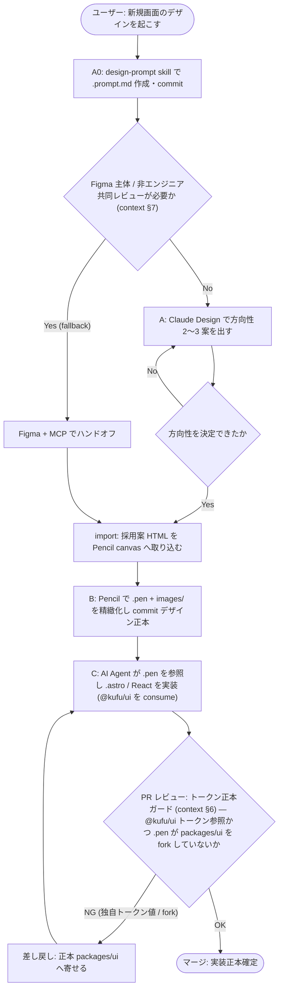
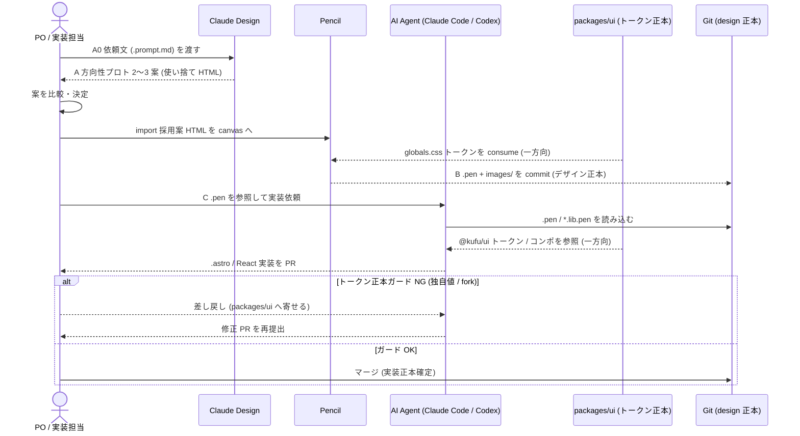

# デザイン制作ワークフロー (Claude Design → Pencil.dev → AI Agent) 設計 spec

> 本 spec は **薄い決定記録 + 正本リンク**。durable な設計成果 (ツール選定 / フェーズ規約 / ディレクトリ規約 / 拡張ポリシー) は既に design 側へハンドオフ済み:
>
> - 意思決定 正本: [ADR-0004](../../adr/0004-design-production-workflow.md)
> - 運用ワークフロー 正本: [context/design-workflow.md](../../context/design-workflow.md)
>
> spec はこれらを二重に持たず、論点 / 受け入れ基準 / 決定経緯 / パイロット実装分割のみを保持する (`Spec Workflow Contract` 正本境界)。

## メタ情報

- Issue: `#16`
- ステータス: `In Progress`
- 作成日: 2026-06-06
- 更新日: 2026-06-06 (D1〜D4 すべて解決 / #17 分離)
- Branch: `feature/16`
- Owner: Fukuemon

## 設計フェーズ状況

状態は `未着手 / 進行中 / 完了 / レビュー済 / 保留` のいずれか。保留の場合は理由を備考に残す。

| #   | フェーズ                    | 状態       | 最終更新   | 備考                                          |
| --- | --------------------------- | ---------- | ---------- | --------------------------------------------- |
| 1   | 起票                        | 完了       | 2026-06-06 | requirements intake 済                        |
| 2   | 下書き                      | 完了       | 2026-06-06 | spec-draft scaffold                           |
| 3   | 上位文書突合                | 完了       | 2026-06-06 | 矛盾なし / ADR-0004・context へハンドオフ済み |
| 4   | 論点整理                    | 完了       | 2026-06-06 | 設計時論点 D1〜D4 を洗い出し                  |
| 5   | 論点解決                    | 完了       | 2026-06-06 | D1〜D4 すべて解決                             |
| 6   | Interface / Routing 設計    | 未着手     |            | process spec のため最小                       |
| 7   | Content / Data 設計         | 未着手     |            | process spec のため該当なし見込み             |
| 8   | Performance / Security 設計 | 未着手     |            | Astro 静的生成・最小 island 維持              |
| 9   | Test / Metrics 設計         | 未着手     |            | パイロットで `.pen`→`.astro` 精度検証         |
| 10  | 実装分割                    | 進行中     | 2026-06-06 | パイロット P1〜P4                             |
| 11  | レビュー済                  | レビュー済 | 2026-06-06 | `spec-review` PASS (指摘なし)                 |

## 上位文書整合

正本 ([Design Doc `## Why / What`](../../design/DesignDoc.md#why--what) / [Design Doc landscape](../../design/DesignDoc.md) / [feature doc](../../design/features/) / [context](../../context/) / ADR) のどの節と、どう整合させたかを記録する。

- Design Doc Why / What 更新要否: 不要
- Design Doc 更新要否: 不要
- ADR 起票要否: 不要 (ADR-0004 が本ブランチで作成済み・状態=提案)

> **正本ハンドオフ済み**: durable な設計成果は ADR-0004 / context/design-workflow.md が正本。整合チェックの結果は全件 継承 / 補足 で **変更提案ゼロ → `spec-sync` 不要**。

| 上位文書    | 節 / 該当箇所                                                           | 整合方針 (継承 / 補足 / 変更提案) |
| ----------- | ----------------------------------------------------------------------- | --------------------------------- |
| Design Doc  | Why / What → Phase 1 スコープ (corporate-site + `packages/ui` skeleton) | 継承                              |
| Design Doc  | feature 単位設計は `design/features/` を正本                            | 継承                              |
| feature doc | `design/features/corporate-site/` (IA=#11、reference 実素材)            | 補足 (back-propagation 先)        |
| context     | `context/design-workflow.md` (本 issue が新規作成、運用正本)            | 補足 (spec が参照)                |
| ADR-0004    | デザイン制作ワークフロー3段構成 (提案)                                  | 継承 (spec が決定経緯を参照)      |

> 矛盾を検出した場合は `spec-sync` で Design Doc Why / What / Design Doc landscape / feature doc / context / ADR への back-propagation を提案する。本 spec では矛盾なし。

## 関連資料

- `design/DesignDoc.md` `## Why / What`: Phase 1 スコープ (corporate-site / `packages/ui` skeleton)
- `design/DesignDoc.md`: feature 単位設計は `design/features/` を正本とする landscape
- 意思決定 正本: [adr/0004-design-production-workflow.md](../../adr/0004-design-production-workflow.md)
- 運用ワークフロー 正本: [context/design-workflow.md](../../context/design-workflow.md)
- Phase A0 skill (成果物): [.rulesync/skills/design-prompt/SKILL.md](../../.rulesync/skills/design-prompt/SKILL.md)
- 要求定義: [requirements.md](requirements.md)
- 関連 issue: [#11 IA/サイトマップ](https://github.com/Fukuemon/kufu-apps/issues/11) / [#13 デザイントークン](https://github.com/Fukuemon/kufu-apps/issues/13) / [#10 corporate-site 本体](https://github.com/Fukuemon/kufu-apps/issues/10) / [#6 Storybook](https://github.com/Fukuemon/kufu-apps/issues/6) / [#17 IA 多ページ構成の妥当性再検討 (D1 から分離)](https://github.com/Fukuemon/kufu-apps/issues/17)

## 背景

デザイン制作を本格化するにあたり「ワイヤー作成 → デザインシステム定義 → 実装」を **Claude Design → Pencil.dev → AI Agent (Claude Code / Codex)** で回す想定がある。本 issue はデザインを _どう作るか_ の **プロセス / ツール選定** を確定し、プラットフォーム共通の正本にする (デザイントークンの _中身_ は #13、corporate-site 本体実装は #10、Storybook は #6 が担う)。

durable な設計成果 (ツール選定の根拠 / フェーズ規約 / ディレクトリ規約 / shadcn 拡張ポリシー / 既知課題の緩和策) は本ブランチで既に **ADR-0004** と **context/design-workflow.md** に確定・反映済み (正本ハンドオフ済み)。よって本 spec は決定経緯と受け入れ基準、未確定の設計時論点、corporate-site パイロットの実装分割のみを保持し、ワークフロー本体は context/design-workflow.md を正本参照する。

影響範囲はプロセス横断 (全 app / feature) だが、最初の適用対象は `apps/corporate-site` の 1 ページパイロットと、消費される `packages/ui` トークン正本。

## スコープ

### やること

- ツール比較 (Claude Design / Pencil.dev / Figma+MCP) の結論を ADR 化する → [ADR-0004](../../adr/0004-design-production-workflow.md) で確定済み。
- 確定ワークフロー (phase A0/A/import/B/C、ツール境界、`.pen` の Git commit 方針、ディレクトリ規約、back-propagation 手順、Figma fallback、既知課題と緩和策) を文書化する → [context/design-workflow.md](../../context/design-workflow.md) で確定済み。
- ツール導入・環境設定 (Claude Design アクセス枠 / Pencil + MCP セットアップ)。
- corporate-site の 1 ページでフローを実走するパイロット検証。

### やらないこと

- デザイントークンの中身定義 (= [#13](https://github.com/Fukuemon/kufu-apps/issues/13))
- corporate-site 本体実装 (= [#10](https://github.com/Fukuemon/kufu-apps/issues/10))
- Storybook 構築 (= [#6](https://github.com/Fukuemon/kufu-apps/issues/6))
- コーポレートサイトの IA / 多ページ構成の妥当性再検討 (= [#17](https://github.com/Fukuemon/kufu-apps/issues/17))。本 spec は確定 IA (feature doc / #11) を前提とする。

## 要件の解釈

### 実現したいユーザー価値

- app / feature 横断で再利用できる Kufu 標準のデザイン制作ワークフローが正本化される。
- デザインシステム正本 (`packages/ui`) をツールが消費し fork しない原則が明文化される。
- 方向性探索 (発散) から実装 (収束) までのツール境界が明確で、成果物の正本所在が一意になる。

### 成功条件

- 確定ワークフローが ADR-0004 / context/design-workflow.md に正本化され、corporate-site パイロットで phase A→C を実走できる。
- 実装成果が `@kufu/ui` トークンを参照し、`.pen` がデザイン正本として Git 管理される。

### 対象ユーザー / 操作主体

- プロダクトオーナー / 非デザイナー (方向性決定)、実装担当 (AI Agent と協働)、デザインシステム保守者 (`packages/ui` トークン正本オーナー)。

EARS 風で振る舞いを記述する (`<who>` `<trigger>` 時、システムは `<expected behavior>` する)。

- WHEN 新規画面のデザインを起こす時、システムは A0→A→import→B→C のフェーズ境界 (context §2) に沿って、`packages/ui` を consume する成果物を生成する。
- IF 実装コードが独自トークン値を抱えている、システムは正本 (`packages/ui`) へ寄せるよう差し戻す (トークン正本ガード / context §6)。
- WHERE チームが Figma 主体または非エンジニア共同レビューが必要な場合、システムは Figma + MCP fallback (context §7) を採用する。
- THE SYSTEM SHALL デザイン → コードを一方向に保ち、`.pen` をデザイン正本、コードを実装正本として drift を最小化する。

## 設計時の論点

設計 / 実装フェーズへ持ち越す残課題を 1 件ずつ管理する。確定したものは「解決済みの論点」へ移す。

| #   | 論点                                         | 決定候補 | 決定 |
| --- | -------------------------------------------- | -------- | ---- |
| —   | (すべて解決済み。下記「解決済みの論点」参照) | —        | —    |

## 解決済みの論点

(`spec-resolve` で確定したものをここに移動する)

- **Claude Design のライセンス枠**: **Pro 枠で利用**可 (research preview 対象)。使用上限到達時のみ Max へアップグレード (別購入不要)。決定日 2026-06-06。
- **Pencil.dev の有償プラン要否**: **無償枠を既定**。有償化トリガーは ① 非エンジニア含む共同レビュー / 本格デザインオペが必要 → Figma + MCP、② Pencil の seat / 機能上限のみ → Pencil 有償。決定日 2026-06-06。
- **D1 パイロット対象ページの選定**: 具体ページ選定は **パイロット起動時に #10 (本体実装) と協調して確定**する (ページ選定は IA 決定ではなくパイロット運用判断)。検討中に出た「多ページ構成そのものの是非」は #16 のスコープ外 (IA = #11 / feature doc が正本) のため [#17](https://github.com/Fukuemon/kufu-apps/issues/17) へ分離。本 spec は確定 IA を前提とする。決定日 2026-06-06。
- **D2 `.pen` の分割粒度**: **分割する方針を採用**。共通要素 (header / footer / nav / CTA / card 等) は Pencil の **Design Library `*.lib.pen`** に集約し、各画面は `<screen>.pen` がそれを `imports` で取り込む構成とする。根拠: Pencil は `imports` (alias → 相対 `.pen` URI) と Design Library (`*.lib.pen`、編集が使用箇所へ伝播) を備え、複数ファイル + ファイル間再利用が標準パターン。単一ファイルは共通デザイン意図が画面ごとに重複し drift を招く ([§8 課題7](../../context/design-workflow.md))。**`*.lib.pen` はデザイン意図に限定**し、コードのコンポーネント正本は `packages/ui` + Storybook (#6)、実装時に `@kufu/ui` へ写像する。拡張子 / 命名 / `imports` 運用の実用性は**パイロットで確認**し、最終ルールを context §4 へ確定反映 (spec-sync)。決定日 2026-06-06。
- **D3 トークン正本ガードの運用**: **段階的アプローチ**を採用。当面は **手動ガード**（[context §6](../../context/design-workflow.md) を正本とし、PR レビュー観点でチェック: ①実装コードが `@kufu/ui` トークンを参照しているか ②`.pen` が `packages/ui` を fork していないか）。**コード側 lint の自動化**（raw hex / arbitrary value `text-[#fff]` 禁止 → semantic token 強制を `pnpm lint` / pre-commit へ統合）は **corporate-site 本体実装 (#10) で実コードが出てから別途検討**する（早すぎる infra を避ける = Decision Priority）。`.pen` の fork 検出は幾何 JSON で自動判定が脆いため（[§8 課題6/7](../../context/design-workflow.md)）**レンダリング/レビューの手動を継続**。決定日 2026-06-06。
  - **手動ガードの運用導線を先回り整備済み**: ① `.rulesync/rules/CLAUDE.md` Forbidden Patterns に「実装コードでのトークン直書き禁止（`@kufu/ui` / `globals.css` 参照）」を追加（generated 反映済）② `.github/PULL_REQUEST_TEMPLATE.md` と workflow-git PR 本文テンプレに **Design Guard チェックリスト**（§6: トークン参照 / `.pen` fork なし）を追加。実コードが出る #10 で即発火する。
- **D4 `.pen` の配置ディレクトリ**: **`design/features/<feature>/` を維持**する (確定済み規約 [context §4](../../context/design-workflow.md) / [ADR-0004](../../adr/0004-design-production-workflow.md) を再確認)。理由: 依頼文 / `.pen` / `*.lib.pen` / `images/` を feature 設計 home (`DesignDoc_<feature>.md` + `reference/`) と同居させ **単一の design 正本ツリー**にする。`apps/<app>/` は実装コードのみ (ADR-0004)、`packages/ui` はトークン / コード正本に保ち `.pen` を混ぜない (§8 課題7 の二重正本回避)。`.pencil/` 隠しディレクトリは採らない (commit するデザイン正本の可視性を優先)。feature 内共通要素は `design/features/<feature>/<feature>.lib.pen`。**app 横断の platform 級共通 lib は `design/ui/` を予約** (YAGNI: 必要時に追加し context §4 へ反映)。決定日 2026-06-06。

## 未確定事項

(決定できない項目を理由とともに残す。1 件でも残っていれば下流 phase は止める)

- なし (D1〜D4 すべて解決済み)。実装フェーズへ持ち越す follow-up: ① パイロットでの `.pen` 拡張子/命名/`imports` 運用の最終確定 (D2) ② コード側トークン lint の自動化検討 (D3、#10 実装後)。いずれも本 spec の下流 phase を止めない。

## 実装対象

正規 target は `corporate-site / cms / ui / config / e2e / core`。

| モジュール       | 実装有無 | 主な責務                                                                |
| ---------------- | :------: | ----------------------------------------------------------------------- |
| `corporate-site` |    ◯     | パイロット実走対象 (phase A→C)、`.pen` 参照での `.astro` 実装           |
| `cms`            |    -     | 対象外                                                                  |
| `ui`             |    ◯     | デザインシステム正本。全フェーズが consume するトークン (`globals.css`) |
| `config`         |    -     | 対象外                                                                  |
| `e2e`            |    -     | 対象外 (パイロットの導線検証は #10 実装時)                              |

> docs / skill (ADR-0004 / context/design-workflow.md / `design-prompt` skill / `design/features/` ディレクトリ規約) は target 一覧外。成果物として「上位資料からの変更点」に記録する。

## 機能仕様

> ワークフロー本体 (フェーズ詳細・ディレクトリ規約・拡張ポリシー・既知課題) は [context/design-workflow.md](../../context/design-workflow.md) が正本。ここでは spec 観点の要点のみを示し、本文を重複させない。

### User Flow

1. A0: Claude Design 依頼文 (`.prompt.md`) を `design-prompt` skill で作成・commit。
2. A: Claude Design で方向性プロトを 2〜3 案出し比較・決定 (使い捨て HTML、`design/.staging/`)。
3. import: 採用案 HTML を Pencil canvas へ取り込む。
4. B: Pencil + 内蔵 Agent で pixel 精緻化し `.pen` + `images/` を commit (デザイン正本)。
5. C: Claude Code / Codex が `.pen` を参照して `.astro` / React を実装 (`@kufu/ui` 参照)。

(詳細は context §2 / §3。本 spec で重複定義しない)

### Reuse Policy

- デザインシステム正本は `packages/ui` に一元化し、各ツールは consume・fork しない (context §1)。
- shadcn/ui で表現できない場合は token → 既存編集 → wrapper → 新規 の優先順 (context §5)。
- 第一原則は feature / colocation。共通化は複数 feature / app をまたぐ再利用が明確になってから。

### Performance

- 実装フェーズは Astro 静的生成・最小 island を維持する (Decision Priority「パフォーマンス」)。インタラクションが要る所だけ React island (`client:*`)。

### Routing / URL State

- 該当なし (process spec)。パイロットページの routing は #10 実装時に扱う。

### Content / Assets

- 依頼文 / `.pen` / `images/` は `design/features/<feature>/` に集約 commit、Claude Design 仮置きは `design/.staging/` (gitignore)、実装は `apps/<app>/src/`、トークン正本は `packages/ui/src/styles/globals.css` (context §4)。
- **`.pen` は分割する (D2 決定)**: 共通要素を Design Library `<feature>.lib.pen` (仮) に集約し、各画面 `<screen>.pen` が `imports` で取り込む。`*.lib.pen` はデザイン意図のみ持ち、コード正本は `packages/ui` + Storybook (#6)。拡張子 / 命名はパイロットで確定し context §4 へ反映。
- A0/A では実コンテンツ素材 (company-profile / manufacturers の実テキスト) を使い、ダミー前提の破綻を回避する (context §8 課題4)。

### UI Reuse

- 実装は `@kufu/ui` のトークン / コンポを参照する。Pencil は `globals.css` から変数を consume するのみ (一方向)。

### React Compiler

- 該当なし (process spec)。パイロット実装で React island を使う場合の互換性は #10 実装時に確認する。

### Testing

- パイロットで **`.pen` 参照の `.astro` 実装精度** を確認する (context §9)。許容差を決めて目視確認とし、`.pen`→コードは AI 再生成で非決定的である前提を持つ (context §8 課題5)。
- **トークン正本ガード (D3) は当面手動**: PR レビュー観点で ①実装が `@kufu/ui` トークンを参照 ②`.pen` が `packages/ui` を fork していない、を確認する (context §6)。コード側 lint 自動化は #10 実装後に別途検討。

## Interface 設計

### UI / API / Event Interface

- 該当なし (process spec)。UI / API インターフェースは扱わない。

### Props / Request / Response

- 該当なし (process spec)。

## Content / Data 設計

### 保存・管理するデータ

- 永続データ層なし。Git 管理する成果物: `.prompt.md` (A0)、`.pen` + `images/` (B、デザイン正本)、実装コード (C)。
- `.pen` は **Design Library `*.lib.pen` (共通要素) + 画面単位 `<screen>.pen`** に分割する (D2)。`<screen>.pen` は `imports` で `*.lib.pen` を参照する。

### コンテンツ配置 / package / route

- context §4 のディレクトリ規約に従う (`design/features/<feature>/` にデザイン成果物を集約)。本 spec で重複定義しない。

## Performance / Security 設計

### Performance

- 実装成果は Astro 静的生成・最小 island を維持 (Decision Priority)。詳細は [context/architecture.md](../../context/architecture.md) / [context/toolchain.md](../../context/toolchain.md)。

### Security / Privacy

- 公開コーポレートサイトの制作プロセスで機微データなし。ロール別アクセス制御の対象外 (権限要件 = 該当なし)。

## Error / Fallback 設計

### エラーケース

| #   | ケース                                       | ユーザーへの見せ方              | リカバリ                              |
| --- | -------------------------------------------- | ------------------------------- | ------------------------------------- |
| 1   | Claude Design のライセンス枠が確保できない   | パイロットで phase A をスキップ | Pencil/Figma で方向性も実施           |
| 2   | チーム Figma 主体 / 非エンジニア共同レビュー | fallback 適用を案内             | Figma + MCP でハンドオフ (context §7) |
| 3   | 実装コードが独自トークン値を抱える           | レビューで差し戻し              | 正本 (`packages/ui`) へ寄せる         |

### Fallback

- Figma + Figma MCP Server を fallback とする (context §7)。その場合も正本は `packages/ui`。

## テスト / 評価方針

### テスト観点

- パイロットで A0→C を通し、`.pen` 参照での `.astro` 実装が `@kufu/ui` トークンを参照し、独自値 / fork がないことを確認する (トークン正本ガード / context §6)。

### 計測指標

- `.pen` とレンダリング結果の許容差内一致 (目視 / スクショ)、実装の Astro 静的生成・最小 island 維持。

## フロー / シーケンス

(`spec-diagrams` で生成。spec の主要操作を Mermaid 図に落とす。ワークフロー全体図は context/design-workflow.md §2 に既存)

### Flowchart (ユーザー操作起点)

新規画面デザインを起こす操作の起点から、トークン正本ガードの差し戻しループまでを描く (本 spec の主要操作。フェーズ詳細は context §2)。

### Sequence

ツール / 正本間のやり取り (デザイン → コードの一方向、トークンは `packages/ui` から consume のみ) を描く。

## 実装分割

### 実装タスク案

corporate-site の 1 ページパイロットを phase 順に分割する。

| Phase | 対象               | 概要                                                                | 依存         |
| ----- | ------------------ | ------------------------------------------------------------------- | ------------ |
| P1    | corporate-site     | design system link 設定 + A0 依頼文作成 (`design-prompt` skill)     | #13 トークン |
| P2    | corporate-site     | phase A: Claude Design で方向性 2〜3 案を出し決定                   | P1           |
| P3    | corporate-site     | import + phase B: Pencil で `.pen` 確定し commit (デザイン正本)     | P2           |
| P4    | corporate-site, ui | phase C: `.pen` 参照で `.astro` 実装、durable 判断を back-propagate | P3           |

### prompts 生成方針

- `corporate-site` 中心。`ui` はトークン整備が必要になれば #13 へ分離する。
- 並列実装できる境界: P1〜P4 は逐次依存のため直列。パイロット完了後の横展開で feature 単位に並列化する。

## 上位資料からの変更点

本 spec で Design Doc Why / What / landscape / feature doc / context / 既存 ADR から変更・追加した内容を、反映先別に記録する。`spec-track` / `spec-sync` で更新する。本 issue は durable 成果を本ブランチで反映済み (正本ハンドオフ完了)。

### Design Doc Why / What への影響

| 対象節 | 変更内容 | 理由                            |
| ------ | -------- | ------------------------------- |
| -      | なし     | Phase 1 スコープ内で完結 (継承) |

### Design Doc への影響

| 対象節 | 変更内容 | 理由                                                     |
| ------ | -------- | -------------------------------------------------------- |
| -      | なし     | feature 設計は `design/features/` を正本とする方針を継承 |

### feature doc への影響

| 対象 doc / 節                     | 変更内容                                                                                        | 理由           |
| --------------------------------- | ----------------------------------------------------------------------------------------------- | -------------- |
| `design/features/corporate-site/` | 実装後の durable 判断 (IA / レイアウト / フロー) の back-propagation 先 (変更は phase C 実装時) | 正本境界の維持 |

> D1 解決に伴い、コーポレートサイトの**多ページ IA (ページ構成) の妥当性再検討を [#17](https://github.com/Fukuemon/kufu-apps/issues/17) へ分離**した。#16 は確定 IA を前提とし feature doc の IA 本体は改変しない (見直しは #17 / 実装フェーズで扱う)。<!-- source: spec-resolve -->

### context への影響

| 対象 doc / 節                    | 変更内容                                | 理由                         |
| -------------------------------- | --------------------------------------- | ---------------------------- |
| `context/design-workflow.md`     | 新規作成 (運用ワークフロー正本、反映済) | 確定プロセスを横断正本に置く |
| `context/README.md` ファイル一覧 | design-workflow.md の行を追記 (反映済)  | 索引整合                     |

> **D2 (反映済: context §4)**: `.pen` 分割ルール — 共通要素を Design Library `<feature>.lib.pen` に集約し、各画面 `<screen>.pen` が `imports` で参照 — を [context/design-workflow.md §4](../../context/design-workflow.md) に反映済 (表 + 分割方針の本文 + ディレクトリ構成図)。**拡張子 `.lib.pen` / 命名 / `imports` 運用の細部はパイロットで確認後に §4 を更新**する。<!-- source: spec-resolve / spec-sync -->
>
> **D4 (反映済: context §4)**: `.pen` 配置は `design/features/<feature>/` 維持 (§4 / ADR-0004 を再確認)。**app 横断の platform 級共通 lib 置き場 `design/ui/`（予約・未作成）** を §4 の表とディレクトリ構成図に追記済。<!-- source: spec-resolve / spec-sync -->

### ADR の新規 / 更新

| ADR ID   | 変更内容                                               | 理由                         |
| -------- | ------------------------------------------------------ | ---------------------------- |
| ADR-0004 | 新規作成 (デザイン制作ワークフロー、状態=提案、反映済) | ツール選定の意思決定を正本化 |

> その他 (target 一覧外の成果物、反映済): `.rulesync/skills/design-prompt/` 新規 + 各 provider 生成物 (`.claude/` / `.codex/` / `.cursor/`)、`design/features/<feature>/` のデザイン成果物集約規約の確定、`.gitignore` に `design/.staging/` を追記。
>
> **D3 手動ガード導線 (反映済)**: `.rulesync/rules/CLAUDE.md` Forbidden Patterns にトークン直書き禁止を追記 (generated 再生成済)、`.github/PULL_REQUEST_TEMPLATE.md` 新規作成 + workflow-git PR 本文テンプレに Design Guard チェックリスト (§6) を追加。<!-- source: spec-resolve -->

## レビュー

`spec-review` (fresh-context evaluator) の最新結果。完全な記録は `review.md` を参照。

| 日付       | 結果 (PASS / NEEDS_WORK) | 指摘要点                                                                     | 対応                                                                                                               |
| ---------- | ------------------------ | ---------------------------------------------------------------------------- | ------------------------------------------------------------------------------------------------------------------ |
| 2026-06-06 | NEEDS_WORK               | フロー/シーケンス節の Mermaid フェンスが空 (index.md:262-272)                | 対応済: `spec-diagrams` で flowchart (A0→C + 正本ガード差し戻し) + sequence を生成し mmdc 検証通過。再 review 待ち |
| 2026-06-06 | PASS                     | 指摘なし。空 Mermaid フェンス解消を確認、反映済主張も実ファイル突合で全件 真 | phase gate クリア。次 phase (`spec-prompts`) へ進める                                                              |

## 変更履歴

| 日付       | 変更者   | 変更内容                   |
| ---------- | -------- | -------------------------- |
| 2026-06-06 | Fukuemon | 初版 (spec-draft scaffold) |

## 備考

<!--
追加 appendix が必要な spec は、templates/specs/appendices/ から該当 topic を取り込むこと:

- API endpoint / request / response → appendices/api.md
- ER 図 / DDL / シードデータ → appendices/database.md
- ロール別 UI 制御 / API 認可マトリクス → appendices/authorization.md
- 画面コンポーネントツリー / 表示条件 → appendices/screen-spec.md
- data-testid 一覧 → appendices/testid.md

本 spec は Astro コーポレートサイトの process / docs spec のため appendix なし。
-->
