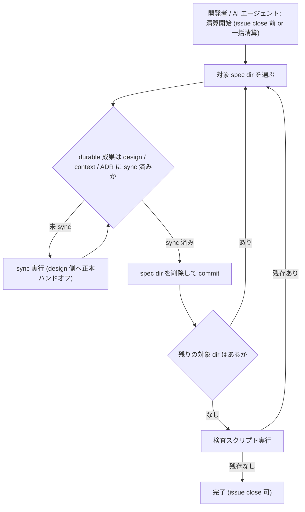
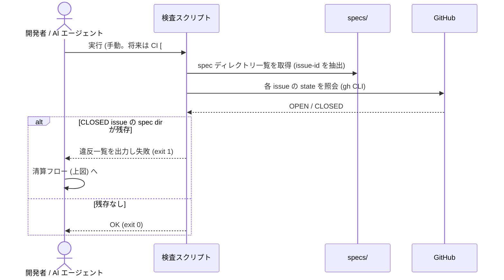
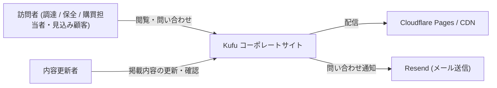
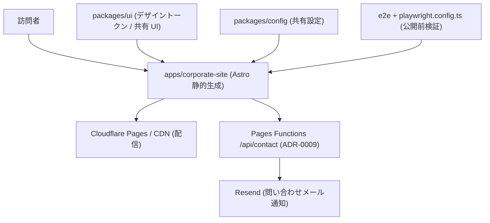

# ドキュメント体制の見直し (specs closeout 徹底 / Pencil 削除 / DesignDoc 現状事実化)

> 対象: リポジトリの設計文書運用 (specs / design / ADR / DesignDoc 記述方針) の再設計。issue #31 の論点・決定経緯を記録する。
> スコープ: 方針決定 (ADR 化) と、決定に基づく文書再編成の実施まで (2026-07-26 にスコープ拡大)。
> 要求正本: [requirements.md](requirements.md) (要求レベル論点 4 件は解決済み。決定事項 #1 は 2026-07-25 の clarify で「廃止」→「存続 + closeout 徹底」に更新)。

## メタ情報

- Issue: `#31`
- ステータス: `Review`
- 作成日: 2026-07-25
- 更新日: 2026-07-26
- Branch: `feature/31`
- Owner: Fukuemon

## 設計フェーズ状況

状態は `未着手 / 進行中 / 完了 / レビュー済 / 保留` のいずれか。保留の場合は理由を備考に残す。

| #   | フェーズ                    | 状態       | 最終更新   | 備考                                                                                |
| --- | --------------------------- | ---------- | ---------- | ----------------------------------------------------------------------------------- |
| 1   | 起票                        | 完了       | 2026-07-25 | issue #31。requirements.md の intake 再検証済 (欠落なし)                            |
| 2   | 下書き                      | 完了       | 2026-07-25 | scaffold で index.md 初版生成。実装突合: 対象 (既存文書群への増分)                  |
| 3   | 上位文書突合                | 完了       | 2026-07-25 | sync 完了: ADR-0011/0012/0013 起票、0004 置換、注記反映。本文書き換えは実装フェーズ |
| 4   | 論点整理                    | 完了       | 2026-07-25 | D1〜D6 を抽出                                                                       |
| 5   | 論点解決                    | レビュー済 | 2026-07-25 | D1〜D6 全件解決。未決定ゼロ (D6: Future Work 一元化 + C4 L1/L2 内容再設計)          |
| 6   | Interface / Routing 設計    | 完了       | 2026-07-25 | 対象外で確定 (文書運用 issue のため。clarify 全件解決時に判定)                      |
| 7   | Content / Data 設計         | 完了       | 2026-07-25 | 文書構成は D1/D3/D6 で確定。diagram で清算フロー・検査・C4 再設計案を図化           |
| 8   | Performance / Security 設計 | 完了       | 2026-07-25 | 対象外で確定 (文書運用 issue のため)                                                |
| 9   | Test / Metrics 設計         | 完了       | 2026-07-25 | テスト観点 = EARS 7 件の成果物充足 + 整合検証で確定 (計測指標は対象外)              |
| 10  | 実装分割                    | 完了       | 2026-07-26 | prompts: 差分修正モード。P1×2 (specs 清算系) / P2×2 (文書再編成系、並列可)          |
| 11  | レビュー済                  | レビュー済 | 2026-07-26 | 最終 gate PASS (指摘 5 件対応後の再判定)。実装フェーズへ                            |

## 上位文書整合

正本 ([Design Doc `## Why / What`](../../design/DesignDoc.md#why--what) / [Design Doc landscape](../../design/DesignDoc.md) / [context](../../context/) / ADR) のどの節と、どう整合させたかを記録する。

- Design Doc Why / What 更新要否: 要 → **方針を ADR-0013 に反映済**。書き換え実施は本 issue の実装フェーズ
- Design Doc 更新要否: **要** → **Related ADRs 表へ ADR-0011/0012/0013 追記済**。現状事実化・C4 再設計の書き換えは本 issue の実装フェーズ
- ADR 起票要否: **要 → 反映済**。[ADR-0011](../../adr/0011-specs-closeout-enforcement.md) (specs 運用是正) / [ADR-0012](../../adr/0012-design-source-of-truth-implementation.md) (デザイン正本 = 実装、0004 置換) / [ADR-0013](../../adr/0013-designdoc-present-facts-only.md) (DesignDoc 記述方針)

本 issue は上位文書の変更**そのもの**を成果物とするため、以下の「変更提案」は矛盾による停止対象ではなく、clarify で内容を確定し sync phase で反映するハンドオフ対象として扱う。spec 単独で上位文書を書き換えない原則は維持する。

| 上位文書         | 節 / 該当箇所                                                                                           | 整合方針 (継承 / 補足 / 変更提案)                                             |
| ---------------- | ------------------------------------------------------------------------------------------------------- | ----------------------------------------------------------------------------- |
| Design Doc       | アーキテクチャ概観 (C4 L1/L2)                                                                           | 変更提案 (L1/L2 を維持し内容再設計)                                           |
| Design Doc       | Why / What のフェーズ展望・Phase 1 記述                                                                 | 変更提案 (現状事実のみ化)                                                     |
| Design Doc       | モジュール責務 `specs` 行                                                                               | 継承 (specs 存続のため変更不要)                                               |
| CLAUDE.md (契約) | Spec Workflow Contract (正本境界 / closeout)                                                            | 継承 + 補足 (closeout 契約は現行のまま。徹底する運用 / 検査を追加)            |
| context          | design-workflow.md (§1 正本 / §2 フロー / §4 配置規約の `.pen` 前提)                                    | 変更提案 (Pencil 削除に伴う改訂)                                              |
| context          | component-design.md (`.pen` を design 正本として扱う記述)                                               | 変更提案 (D5 / ADR-0012 に伴う改訂。正本 = 実装 + Storybook へ)               |
| feature doc      | corporate-site → デザイン正本 = `index.pen` の参照記述 (概要 / デザイントークン / コンポーネント節ほか) | 変更提案 (D5 に伴う `.pen` 正本参照の改訂。正本 = コード + Storybook へ)      |
| ADR-0003 / 0004  | phase 分割 / design workflow (Pencil 中核採用)                                                          | 変更提案 → 反映済 (0004 は ADR-0012 で置換。将来計画の集約先として 0003 参照) |

> sync (2026-07-25) で ADR-0011/0012/0013 起票・0004 置換・注記反映を実施済み。以後これらの判断の正本は ADR 側にあり、本 spec の記述は決定時スナップショット。DesignDoc / design-workflow / feature doc の本文書き換えは本 issue の実装フェーズで実施する。

## 関連資料

- `design/DesignDoc.md`: ## アーキテクチャ概観 / ## 詳細の所在 / ## Open Questions / Future Work
- `CLAUDE.md`: Spec Workflow Contract (正本境界 / closeout)
- 本 issue で起票した ADR: [ADR-0011](../../adr/0011-specs-closeout-enforcement.md) / [ADR-0012](../../adr/0012-design-source-of-truth-implementation.md) / [ADR-0013](../../adr/0013-designdoc-present-facts-only.md)
- `adr/0003` (Phase 1 分割) / `adr/0004` (design workflow — ADR-0012 により置換済み) / `context/design-workflow.md` / `context/component-design.md`
- 関連 issue / ticket: [#31](https://github.com/Fukuemon/kufu-apps/issues/31)

## 背景

- SDD 契約上 spec は issue close 時に削除するが、close 済み issue 分の 9 ディレクトリが `specs/` に残存し、契約と実態が乖離している。当初は spec 廃止 (design / ADR への集約) も検討したが、clarify (2026-07-25) で **spec 運用は現行契約のまま存続し、closeout の徹底を是正する** 方針に確定した (D1)。
- `design/features/corporate-site/index.pen` (Pencil デザイン正本) が実装に追従できておらず乖離。実装 (コード + Storybook) を正とし削除する判断が確定した。
- `design/DesignDoc.md` に Phase 1/2/3 の時系列記述が多く「今の事実」が読み取りにくい。C4 L1/L2 の 2 枚も要点が掴みにくい。
- 影響先はコーポレートサイト実装ではなく、リポジトリ横断の文書運用 (`domain:core`)。

## スコープ

### やること

2026-07-26 のスコープ拡大により、方針決定 (ADR 化) に加えて **文書再編成の実施まで本 issue で行う**。

- specs closeout 徹底の是正: 残存 9 ディレクトリの sync 状況確認 → 清算手順の文書化 → 全件削除、close 時削除を担保する検査スクリプトの導入
- DesignDoc の全面改訂: 現状事実のみ化、将来計画の Future Work 節への一元化、C4 図 (L1/L2) の再設計内容への差し替え
- `context/design-workflow.md` の改訂: Pencil / `.pen` 前提を廃し、Claude Design → 実装直結フローへ
- feature doc (`DesignDoc_corporate-site.md`) の `.pen` 正本参照の改訂
- `design/features/corporate-site/index.pen` と付随アセットの削除
- 決定の ADR 化 (sync phase で完了) と反映先文書のメタ情報同期

### やらないこと

- sdd-template repo 側の skill / rule 本体の改修 ([sdd-template#7](https://github.com/Fukuemon/sdd-template/issues/7) で実施)
- CI への検査常設化 (issue #12 へ委譲。本 issue はローカル実行可能なスクリプトとコマンド登録まで)

## 要件の解釈

### 実現したいユーザー価値

- 開発者 (リポジトリ管理者): 文書のメンテナンスコストを下げ、実装と乖離しない状態を保てる
- AI エージェント: 正本文書が少なく・新鮮で・矛盾がないほど設計 / 実装の精度が上がる

### 成功条件

- 文書の種類と正本境界が削減・単純化され、「どこを読めば今の事実が分かるか」が一意になる
- 実装と乖離した文書 (Pencil / 残存 spec / phase 記述) が残らない運用になる

### 対象ユーザー / 操作主体

- 開発者 (本人) / AI エージェント (SDD workflow 実行主体)

EARS 風受け入れ基準 (requirements.md より):

- WHEN 本 issue が完了したとき、システム (文書群) は specs 存続 + closeout 徹底 (廃止案の却下理由を含む) の判断と、残存 spec の清算手順・削除を担保する運用 / 検査の方針を ADR として保持している。
- WHEN 本 issue が完了したとき、システムは Pencil 削除 (実装を正とする) の判断を ADR として保持し、`context/design-workflow.md` と feature doc から `.pen` 正本前提の記述が排除されている。
- WHEN 本 issue が完了したとき、`design/features/corporate-site/index.pen` と付随アセットが repo に存在しない。
- WHEN 本 issue が完了したとき、`design/DesignDoc.md` は現状事実のみを記載し (Phase 語彙・将来記述が Future Work 節以外に無い)、C4 図が L1/L2 の再設計内容に置き換わっている。
- WHEN 本 issue が完了したとき、`specs/` に close 済み issue の spec ディレクトリが残存しておらず、残存を検出する検査コマンドが実行可能である。
- IF specs の清算手順 (残存 9 ディレクトリごとの sync 済み確認) が文書化されていない場合、THEN 実削除を行わない。
- IF 改訂対象文書の durable な設計情報が他に転記されていない場合、THEN 該当記述を削除しない。

## 設計時の論点

設計 / 実装フェーズへ持ち越す残課題を 1 件ずつ管理する。確定したものは「解決済みの論点」へ移す。

| #   | 論点                                                        | 決定候補 | 決定 |
| --- | ----------------------------------------------------------- | -------- | ---- |
| —   | (未決の設計論点なし。D1〜D7 は全件「解決済みの論点」へ移動) | —        | —    |

## 解決済みの論点

要求レベルの論点 4 件 (specs 存廃 / Pencil / phase 記述 / C4 図) は requirements.md の「決定事項」で確定済み (決定事項 #1 は下記 D1 で更新)。

- **D1: specs は存続し closeout (issue close 時削除) を徹底する** (2026-07-25, ユーザー)。当初の要求決定「廃止し design / ADR に集約」と clarify 中の暫定決定「issue 集約」を撤回し、requirements.md 決定事項 #1 を更新した。spec 運用 (作成 → 設計 → sync → close 時削除) は現行契約のまま。本 issue の成果は残存 9 dir の清算手順と、削除を担保する運用 / 検査の設計。**反映先: ADR ([ADR-0011](../../adr/0011-specs-closeout-enforcement.md) — 反映済)**
- **D2: phase gate (spec-review) は現行のまま存続する** (2026-07-25, ユーザー)。specs が存続するため評価対象の差し替えは不要。gate 代替の設計は論点から取り下げ。**反映先: spec で閉じる (現行契約の継承であり上位文書の変更なし)**
- **D3: 残存 9 dir は本 issue で全件清算し、検査はスクリプト方式とする** (2026-07-25, ユーザー)。清算は「dir ごとの sync 済み確認 → 未 sync 分の sync → 手順文書化 → 全件削除」の順 (IF 基準: 手順文書化前の削除は禁止)。今後の close 時削除は、closed issue × `specs/` 残存を照合する検査スクリプト (手動 + 将来 CI [#12] で実行、hook には組み込まない) で担保する。requirements.md のスコープを「削除実施まで」に拡大済み。**反映先: ADR ([ADR-0011](../../adr/0011-specs-closeout-enforcement.md) — 反映済)。検査スクリプト実装は実装フェーズ**
- **D4: 検査は本 repo ローカル完結とし、テンプレ側の手順改修は派生 issue を起票する** (2026-07-25, ユーザー)。検査スクリプト + コマンド登録 + context/engineering.md 記載は本 repo に閉じる。closeout 手順 (`spec-lifecycle` の closeout.md) へ検査実行ステップを足す sdd-template 側の派生 issue を sync phase で起票する (他の消費 repo にも展開されるため)。**反映先: ADR ([ADR-0011](../../adr/0011-specs-closeout-enforcement.md)) + [sdd-template#7](https://github.com/Fukuemon/sdd-template/issues/7) — いずれも反映済**
- **D5: 新 ADR で ADR-0004 を supersede し、デザインフローは「Claude Design → 実装直結」とする** (2026-07-25, ユーザー)。新 ADR「デザイン正本を実装 (コード + Storybook) とする」を起票し、0004 は superseded に更新。フローは A0 依頼文 (.prompt.md, commit) → A: Claude Design で発散 (使い捨て) → C: 採用案を参照し直接実装 → 確認は Storybook + 実画面。Pencil (phase B) と `.pen` 中間正本を廃止。`index.pen` の実削除と context/design-workflow.md の書き換えは、改訂方針を示した上で本 issue の実装フェーズで実施する (2026-07-26 スコープ拡大)。**反映先: ADR ([ADR-0012](../../adr/0012-design-source-of-truth-implementation.md) — 反映済、ADR-0004 は置換) + context / feature doc へ注記追加済**
- **D6: 将来計画は DesignDoc の Open Questions / Future Work 節に一元化し、C4 図は L1/L2 の階層を維持して内容を再設計する** (2026-07-25, ユーザー。要求決定 #3/#4 の詳細化。#4 の「1 枚統合」は撤回し requirements.md を更新)。他の全節から Phase 語彙・将来記述を排除し「今の事実」のみにする (根拠は ADR-0003 へリンク)。L1 = 利用者視点に絞る: 訪問者・内容更新者 → コーポレートサイト → 外部サービス (Cloudflare / Resend)。開発者・GitHub・docs workflow は除外し、記法は C4Context → flowchart。L2 = 実在の実行単位とデータの流れのみ: corporate-site / Pages Functions / packages (ui・config) / e2e / 外部サービス。未実装 `apps/cms` (点線) と正本ドキュメント群のノードは除外 (cms は Future Work 節、docs は「詳細の所在」節へ)。図の具体化は diagram phase で行う。**反映先: ADR ([ADR-0013](../../adr/0013-designdoc-present-facts-only.md) — 反映済)。DesignDoc 本文の書き換えは本 issue の実装フェーズ**
- **D7: `design/features/corporate-site/assets/` (画像 4 点) も削除し、`apps/corporate-site/src/assets/` を唯一の置き場とする** (2026-07-26, ユーザー。prompts phase で検出した論点)。両者は現状バイト完全一致 (SHA 一致 4/4) で、design 側は重複コピーにすぎない。spec #10 D6 の「design 側 = design source / app 側 = 配信用コピー」という二重管理ルールは、ADR-0012 (正本 = 実装) に吸収されたものとして廃止する。**反映先: ADR ([ADR-0012](../../adr/0012-design-source-of-truth-implementation.md) へ追記)**
- **D8: `component-map.md` と `ia-exploration-single-lp.prompt.md` も削除する** (2026-07-26, ユーザー。実装中に検出した論点)。`component-map.md` は `.pen` → 実装の対応表であり、`.pen` 廃止後は実装 + Storybook と重複する drift 源になる。`ia-exploration-single-lp.prompt.md` は却下された「単一 LP 案」の A0 依頼文で、IA は 3 route に確定済み (ADR-0006) の上、運用メモのトークン値が ADR-0007 の現行体系と食い違っており誤情報になっていた。**反映先: 両ファイルを削除し、参照元 (spec #32 requirements) を是正**

## 未確定事項

(決定できない項目を理由とともに残す。1 件でも残っていれば下流 phase は止める)

- なし (設計論点 D1〜D7 は全件解決済み)

## 実装対象

正規 target は `context/project.yml` の対象ドメイン一覧を正本とする。

| モジュール       | 実装有無 | 主な責務                                                  |
| ---------------- | :------: | --------------------------------------------------------- |
| `corporate-site` |    -     |                                                           |
| `cms`            |    -     |                                                           |
| `ui`             |    -     |                                                           |
| `config`         |    -     |                                                           |
| `e2e`            |    -     |                                                           |
| `core`           |    ◯     | リポジトリ横断の文書運用 (specs / design / adr / context) |

## 機能仕様

### User Flow

1. 開発者 / AI エージェントが「今の事実」を知りたいとき、design / context / ADR のいずれかを読めば一意に到達できる
2. 設計判断が発生したとき、ADR に 1 判断 1 ファイルで記録し、design / context の該当節を更新する
3. issue が close されたとき、spec は sync 済み確認の上削除され、`specs/` に乖離した文書が残らない
4. 実装と文書が乖離したとき、実装を正として文書側を追従させる (Pencil のような追従不能な中間正本を持たない)

### Reuse Policy

- 対象外 (文書運用 issue のため)

### Performance

- 対象外

### Routing / URL State

- 対象外

### Content / Assets

- 文書の配置と正本境界の再設計そのものが本 issue の対象 (D3 / D5 / D6 / D7)。画像アセットの置き場は `apps/corporate-site/src/assets/` に一本化する (D7)

### UI Reuse

- 対象外

### Testing

- 受け入れ基準 (EARS 7 件: WHEN 5 + IF 2) の充足を最終 gate の spec-review で検証する

## Interface 設計

### UI / API / Event Interface

- 対象外 (文書運用 issue のため)

### Props / Request / Response

- 対象外

## Content / Data 設計

### 保存・管理するデータ

- 対象: 文書群の構成 (specs 清算後の状態、DesignDoc の節構成、ADR 一覧)
- D1 決定 (存続 + closeout 徹底): spec の役割・置き場は現行契約のまま。変わるのは「close 時削除の担保」(清算手順 + 検査スクリプト) のみ
- D3 決定: 残存 9 dir は sync 確認 → 手順文書化 → 本 issue で全件削除。検査スクリプトは scripts 配下 + コマンド登録 (CI 常設化は #12)

### コンテンツ配置 / package / route

- 清算後の `specs/` は「open issue の spec のみ存在」が定常状態。DesignDoc の節構成は D6 (Future Work 一元化 + C4 L1/L2 再設計) に従い sync で確定

## Performance / Security 設計

### Performance

- 対象外

### Security / Privacy

- 対象外 (secret / 個人情報を扱わない)

## Error / Fallback 設計

### エラーケース

| #   | ケース                                                            | ユーザーへの見せ方       | リカバリ                                                                  |
| --- | ----------------------------------------------------------------- | ------------------------ | ------------------------------------------------------------------------- |
| 1   | closeout 検査の追加が sdd-template の共有プロセス層の変更を要する | 検討結果に影響範囲を明記 | 本 repo ローカルの運用差分として扱うか、テンプレ側改修の派生 issue を切る |
| 2   | 清算手順が未文書化のまま削除が進みそうになる                      | IF 基準 (EARS) で禁止    | 手順文書化を先行させる                                                    |

### Fallback

- 自動検査 (hook / CI) が導入できない場合でも、closeout 手順 (`spec-lifecycle` の closeout.md) の手動運用で削除を担保する。判断は ADR に代替案込みで記録する

## テスト / 評価方針

### テスト観点

- EARS 受け入れ基準 7 件 (WHEN 5 + IF 2) が成果物 (ADR / 改訂済み文書 / 清算完了 / 削除完了) で充足されているか
- 上位文書整合テーブルの変更提案が sync で反映され、上位文書間に矛盾が残っていないか

### 計測指標

- 対象外 (定量指標なし。成功条件は文書構造の単純化)

## フロー / シーケンス

### Flowchart (ユーザー操作起点): specs 清算 / closeout フロー

残存 9 dir の一括清算と、今後の issue close 時の closeout 運用は同じフローに乗る (D1 / D3)。

- IF 基準 (EARS): 清算手順が文書化される前に Delete へ進むことは禁止 (D3)
- 一括清算では 9 dir を順に Pick する。今後の closeout では close 対象 issue の 1 dir のみ

### Sequence: 検査スクリプト (closed issue × specs/ 照合)

### C4 再設計案 (D6。DesignDoc への差し替えは本 issue の実装フェーズ)

L1 (System Context) — 利用者視点に絞る。開発者 / GitHub / docs workflow は載せない:

L2 (Container) — 実在の実行単位とデータの流れのみ。未実装 `apps/cms` と正本ドキュメント群は載せない:

## 実装分割

### 実装タスク案

生成モード: **差分修正モード** (既存文書の書き換えが主。検査スクリプトのみ新規ファイル追加)。

| Phase | 対象   | prompt                                  | 概要                                                                        | 依存  | 並列      |
| ----- | ------ | --------------------------------------- | --------------------------------------------------------------------------- | ----- | --------- |
| P1    | `core` | `P1_01_core_specs_residue_check.md`     | 検査スクリプト新規作成 + コマンド登録 + engineering.md 追記                 | なし  | -         |
| P1    | `core` | `P1_02_core_specs_cleanup.md`           | 清算手順文書化 → sync 判定 → 参照元リンク是正 → 9 dir 削除 → 検証           | P1_01 | -         |
| P2    | `core` | `P2_01_core_designdoc_rewrite.md`       | DesignDoc の現状事実化 + C4 L1/L2 差し替え                                  | なし  | 全 prompt |
| P2    | `core` | `P2_02_core_design_workflow_rewrite.md` | design-workflow / feature doc / component-design 改訂 + `.pen`・assets 削除 | P1_02 | P2_01     |

- P1 は順次実行 (検査スクリプトを先に用意し、清算の検証手段として使う)
- P2_01 は編集対象が `design/DesignDoc.md` のみで他 prompt と重複しないため、P1 を待たず並列実行できる (phase 番号は作業のまとまりを示すもので、実依存は `depends_on` が正)
- P2_02 は P1_02 のリンク是正対象 (feature doc / component-design.md) を編集するため P1_02 の後

### prompts 生成方針

- 対象ドメインは `core` のみ。specs 清算系 (P1) と文書再編成系 (P2) で phase を分け、P2 は編集対象ファイルの非重複を根拠に 2 本へ並列分割した
- ADR 起票は sync phase で完了済みのため prompt を作らない

## 上位資料からの変更点

本 spec で Design Doc / context / 既存 ADR から変更・追加した内容を、反映先別に記録する。clarify / track で更新する。

### PRD への影響

統合モード (PRD = `design/DesignDoc.md` の `## Why / What` 節) のため、対象ファイルは Design Doc と同一。

| 対象節                                                                                | 変更内容                                                                                                                                                | 理由                                                                                                          |
| ------------------------------------------------------------------------------------- | ------------------------------------------------------------------------------------------------------------------------------------------------------- | ------------------------------------------------------------------------------------------------------------- |
| Why / What → フェーズ展望・想定ユーザー表の Phase 優先度列・成功条件の Phase 1 target | 時系列 (Phase 1/2/3) 記述を現状事実化し、将来計画は Open Questions / Future Work 節へ一元化 (Design Doc への影響 3 行目と同一変更の PRD 相当節への適用) | D6 決定 (source: track で補完)。**反映済: 方針を ADR-0013 として記録。書き換え実施は本 issue の実装フェーズ** |

### Design Doc への影響

| 対象節                                                                                                 | 変更内容                                                                                                                | 理由                                                                                                                                                                                                 |
| ------------------------------------------------------------------------------------------------------ | ----------------------------------------------------------------------------------------------------------------------- | ---------------------------------------------------------------------------------------------------------------------------------------------------------------------------------------------------- |
| アーキテクチャ概観 → System Context (L1)                                                               | 利用者視点に絞る (訪問者・内容更新者 → サイト → Cloudflare / Resend)。開発者・GitHub を除外し flowchart 記法へ          | D6 決定 (source: clarify)                                                                                                                                                                            |
| アーキテクチャ概観 → Container (L2)                                                                    | 実在の実行単位とデータの流れのみに絞る。未実装 `apps/cms` 点線と正本ドキュメント群ノードを除外                          | D6 決定 (source: clarify)                                                                                                                                                                            |
| Why/What フェーズ展望・スコープ・Lower-Priority Goals・設計上の前提・モジュール責務 `apps/cms` 行 ほか | Phase 語彙・将来記述を排除し現状事実のみ化。将来計画は Open Questions / Future Work 節へ一元化 (根拠は ADR-0003 リンク) | D6 決定 (source: clarify)。**反映済: 方針 = ADR-0013 (L1/L2 の内容基準含む)、Related ADRs 表へ追記済。書き換え実施は本 issue の実装フェーズ (C4 再設計図案は本 spec のフロー / シーケンス節を使う)** |

### feature doc への影響

| 対象 doc / 節                                                                                              | 変更内容                                                                                           | 理由                                                                                                                                                           |
| ---------------------------------------------------------------------------------------------------------- | -------------------------------------------------------------------------------------------------- | -------------------------------------------------------------------------------------------------------------------------------------------------------------- |
| corporate-site → DesignDoc_corporate-site.md の `index.pen` 正本参照 (デザイン正本リンク・`.pen` 運用記述) | 「デザイン正本 = index.pen」記述を「正本 = 実装 (コード + Storybook)」へ改訂し、`index.pen` を削除 | D5 決定 (source: clarify)。**反映済 (2026-07-26): `.pen` 参照 6 箇所を改訂し暫定注記を削除。`index.pen` / design assets / component-map.md / A0 依頼文を削除** |

### context への影響

| 対象 doc / 節                                             | 変更内容                                                                                                 | 理由                                                                                                                                                |
| --------------------------------------------------------- | -------------------------------------------------------------------------------------------------------- | --------------------------------------------------------------------------------------------------------------------------------------------------- |
| engineering.md (quality gate) / project.yml (commands)    | specs 残存検査スクリプト (closed issue × `specs/` 照合) の追加とコマンド登録。CI 常設化は #12 に委譲     | D3 決定 (source: clarify)。**反映済 (2026-07-26): `scripts/check-specs-residue.sh` + `pnpm check:specs` + engineering.md の Docs Closeout Gate 節** |
| design-workflow.md (§1 正本 / §2 フロー / §4 配置規約)    | Pencil (phase B) と `.pen` 正本の記述を廃し、Claude Design → 実装直結 + 正本 = コード + Storybook に改訂 | D5 決定 (source: clarify)。**反映済 (2026-07-26): 全面改訂 (Pencil / `.pen` 前提を除去し A0→A→C の 3 段フローへ。§5〜§8 の知見は保全)**             |
| component-design.md (`.pen` を design 正本として扱う記述) | `.pen` / Pencil 前提の記述を廃し、正本 = 実装 (コード + Storybook) の記述に改訂                          | D5 決定。**反映済 (2026-07-26): 「デザイン正本との関係」節へ改訂**                                                                                  |

### ADR の新規 / 更新

| ADR ID                    | 変更内容                                                                                                           | 理由                                                                                                                                                                                             |
| ------------------------- | ------------------------------------------------------------------------------------------------------------------ | ------------------------------------------------------------------------------------------------------------------------------------------------------------------------------------------------ |
| 新規 (specs 運用是正)     | specs 存続 + closeout 徹底 (廃止案の却下理由含む) と残存 9 dir の清算手順・検査方針を起票                          | D1・D3・D4 決定 (source: clarify)。**反映済: [ADR-0011](../../adr/0011-specs-closeout-enforcement.md)。テンプレ側は [sdd-template#7](https://github.com/Fukuemon/sdd-template/issues/7) 起票済** |
| 新規 (デザイン正本)       | デザイン正本を実装 (コード + Storybook) とし、Claude Design → 実装直結フローを定める                               | D5 決定 (source: clarify)。**反映済: [ADR-0012](../../adr/0012-design-source-of-truth-implementation.md)**                                                                                       |
| ADR-0004                  | 状態を superseded (新デザイン正本 ADR による置換) に更新                                                           | D5 決定 (source: clarify)。**反映済: 状態 = 置換 (ADR-0012)**                                                                                                                                    |
| 新規 (DesignDoc 記述方針) | 現状事実のみ記載 + Future Work 一元化 + C4 L1/L2 内容基準を起票 (業務ルール 1: 1 判断 1 ファイルにより独立 ADR 化) | D6 決定 (source: sync)。**反映済: [ADR-0013](../../adr/0013-designdoc-present-facts-only.md)**                                                                                                   |

## レビュー

`spec-review` (fresh-context evaluator) の最新結果。完全な記録は `review.md` を参照。

| 日付       | 結果 (PASS / NEEDS_WORK) | 指摘要点                                                                                                         | 対応                                                                |
| ---------- | ------------------------ | ---------------------------------------------------------------------------------------------------------------- | ------------------------------------------------------------------- |
| 2026-07-25 | NEEDS_WORK               | D5 と矛盾する feature doc (`.pen` 正本記述) が上位文書整合・影響テーブルから漏れ (+軽微: placeholder 残存)       | 3 件対応済 (feature doc 行を 2 テーブルへ追記、placeholder 是正)    |
| 2026-07-25 | PASS                     | 再判定: 指摘 3 件の対応を確認。全観点 PASS (prompts / 正本境界は N/A)                                            | —                                                                   |
| 2026-07-25 | PASS                     | track gate 累積 (diagram + track): 図 4 点の構文・D6 整合・変更点テーブル反映漏れなし。軽微 2 件                 | EARS 件数表記を 5 件に統一済。清算手順文書化の明示は prompts で対応 |
| 2026-07-26 | NEEDS_WORK               | 最終 gate 累積 (sync + スコープ拡大 + prompts): component-design.md の整合漏れ、EARS 件数表記のずれ (+軽微 3 件) | 5 件すべて対応済                                                    |
| 2026-07-26 | PASS                     | 最終 gate 再判定: 指摘 5 件の対応を確認。全観点 PASS                                                             | —                                                                   |

## 変更履歴

| 日付       | 変更者                   | 変更内容                                                                                                                                                                                                |
| ---------- | ------------------------ | ------------------------------------------------------------------------------------------------------------------------------------------------------------------------------------------------------- |
| 2026-07-25 | spec-lifecycle           | scaffold: index.md 初版生成、初期論点 D1〜D6 を抽出                                                                                                                                                     |
| 2026-07-25 | spec-lifecycle (clarify) | D1 を「存続 + closeout 徹底」へ方針転換 (issue 集約案を撤回)、D2 を取り下げ。requirements.md も同期                                                                                                     |
| 2026-07-25 | spec-lifecycle (clarify) | D3 解決: 残存 9 dir を本 issue で全件清算、検査はスクリプト方式。スコープ / EARS を同期                                                                                                                 |
| 2026-07-25 | spec-lifecycle (clarify) | D4 解決: 検査はローカル完結、closeout 手順改修の sdd-template 派生 issue を sync で起票                                                                                                                 |
| 2026-07-25 | spec-lifecycle (clarify) | D5 解決: 新 ADR で 0004 を supersede、フローは Claude Design → 実装直結 (正本 = コード + Storybook)                                                                                                     |
| 2026-07-25 | spec-lifecycle (clarify) | D6 解決: 将来計画は Future Work 節へ一元化、C4 は L1/L2 維持で内容再設計 (要求決定 #4 を更新)。全論点解決                                                                                               |
| 2026-07-25 | spec-review 対応         | gate レビュー指摘 3 件対応: feature doc 整合行 (D5 起因) を 2 テーブルへ追記、Content/Data の placeholder 是正                                                                                          |
| 2026-07-25 | spec-lifecycle (diagram) | 清算 / closeout フロー図・検査スクリプトシーケンス・C4 L1/L2 再設計案 (D6) を生成                                                                                                                       |
| 2026-07-25 | spec-lifecycle (track)   | PRD への影響 (統合モードの Why/What 現状事実化) を補完。変更点テーブルの反映漏れ突合完了                                                                                                                |
| 2026-07-25 | spec-review (track gate) | 累積レビュー PASS。軽微指摘: EARS 件数表記を 5 件に統一 (対応済)、清算手順文書化の明示は prompts へ持ち越し                                                                                             |
| 2026-07-25 | spec-lifecycle (sync)    | ADR-0011/0012/0013 起票、ADR-0004 を置換、DesignDoc Related ADRs 追記、context/feature doc へ注記、impact-index 追加、sdd-template#7 起票                                                               |
| 2026-07-26 | spec-lifecycle (clarify) | スコープ拡大: 大規模な文書再編成 (DesignDoc / design-workflow / feature doc の書き換え、index.pen 削除) を本 issue で実施。EARS を実施完了ベースに更新し、ADR / 注記の「別 issue」記述を #31 実施へ統一 |
| 2026-07-26 | 実装 (P1_01〜P2_02)      | 検査スクリプト追加 / spec 9 dir 清算 / DesignDoc 現状事実化 + C4 再設計 / design-workflow 改訂 + `.pen`・assets・component-map・A0 依頼文の削除。D8 を実装中に検出・解決                                |
| 2026-07-26 | spec-lifecycle (prompts) | 実装 prompt 4 本を生成 (差分修正モード)。生成中に D7 (design 側画像アセットの扱い) を検出・解決し ADR-0012 へ追記                                                                                       |
| 2026-07-26 | spec-review 対応         | 最終 gate 指摘 5 件対応: component-design.md の整合行追加 (spec 2 表 + ADR-0012)、EARS 件数を 7 件に統一、関連資料に ADR 追記、Content/Assets の論点参照更新、P2_01 の depends_on を解消                |

## 備考

- 文書運用 issue のため appendix (api / database / authorization / screen-spec / testid) は取り込まない
