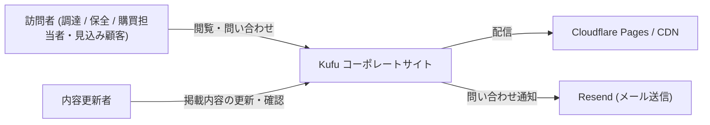
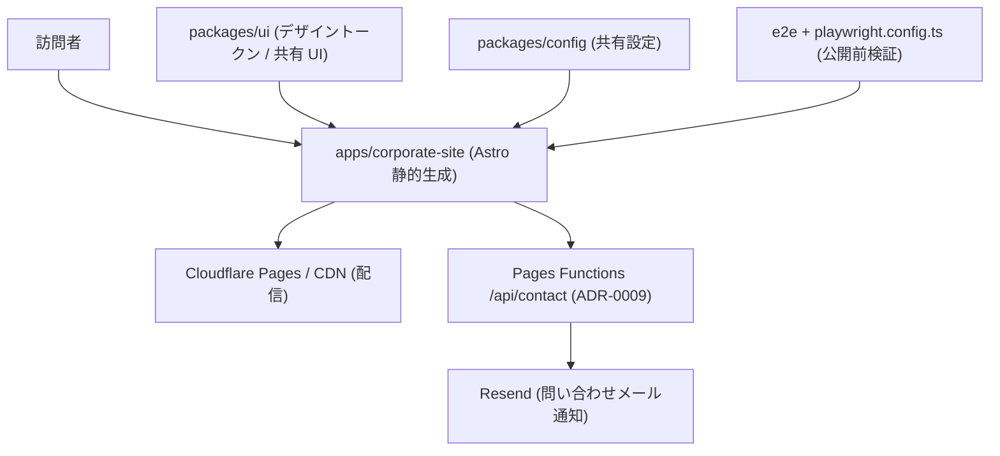

# DesignDoc の現状事実化と C4 図 (L1/L2) の差し替え

## 絶対ルール

- spec に明記された範囲だけを対象にする
- 不明点は推測で埋めず、停止してユーザーに確認する
- 参照 path を外れて広く探索しない (Grep / Glob / 既存実装の探索は禁止)
- 別 app / package を追加探索せず、この prompt 内の情報だけで判断する
- 各作業ステップに含まれる検証 / レビュー手順をスキップしない
- **IF 基準 (spec 受け入れ基準)**: 削除する記述に、他へ転記されていない durable な設計情報が含まれている場合、転記先を確定・反映するまで削除しない
- **完了条件のタスク化**: 作業開始前に「完了条件」セクションの各項目を todo として登録し、各ステップ完了時に状態を更新すること。タスク化せずに作業を開始することは禁止

### 実装アンチパターンの回避 (必守)

- スコープ厳守: spec / 本 prompt に明記された機能のみ実装する。未要求の機能追加・
  先回りの抽象化・無関係なリファクタ・暗黙の互換維持をしない。
- 既存規約への整合: 命名・エラー処理・ログ・テスト・API 連携方式は、対象コードベースの
  既存パターンに合わせる。新方式を持ち込む場合は理由を述べて確認を取る。
- 観測可能な契約の保持: UI 文言・イベント名・戻り値・エラーメッセージ・ログ形式・API を
  要求なく変更しない。変更が必要なら理由と影響を明記する。
- 推測の排除: 要件・業務ルール・API 仕様が不明なら停止して確認する。それらしいが
  誤った実装 (存在しない API 呼び出し / 非互換な引数) を避け、import と API の実在を確認する。
- fallback の最小化: `??` / `||` / 既定引数 / 多段 fallback / 暗黙のエラー握り潰しは
  「任意データ」に限定する。必須データの欠落は隠さず明示的に失敗させる。
- 過剰実装の排除: 単純な条件分岐を strategy / handler map に置換しない。
  要求も計測もない caching / memoization を入れない。
- dead code を残さない: 到達不能コード・未使用の変数 / 関数 / import / export・
  変更後に不要化した型定義を削除する。
- 判断の記録: 非自明な設計判断は理由 (or spec / ADR へのリンク) を残す。

## 作業ステップ (この順序で実行する)

### ステップ 0: ブランチ準備と着手記録

1. issue #31 の `status:*` が `status:implementing` であることを確認する
2. `feature/31` ブランチ上で作業する
3. 既存 Draft PR に本作業を含める

### ステップ 1: C4 図の差し替え

1. `design/DesignDoc.md` の `## アーキテクチャ概観 (Overview)` を Read する
2. `### System Context (C4 L1)` の `C4Context` 図を、`## 設計仕様` の L1 flowchart に差し替える
3. `### Container (C4 L2)` の図を、`## 設計仕様` の L2 flowchart に差し替える
4. 図の前後の説明文から Phase 語彙・未実装要素への言及を除去する
5. `styleguide-documents` skill の品質基準に照らして文章を確認する
6. diff レビュー (`multi-agent-review` または `spec-review`) を回し、指摘を対応する

### ステップ 2: 現状事実化 (Phase 語彙・将来記述の排除)

対象節と方針は `## 設計仕様` の一覧に従う。各節について:

1. 節を Read し、Phase 1/2/3 等の時系列語彙と将来記述を特定する
2. 現状の事実に書き換える (例: 「Phase 1 では〜する」→ 現在成立している構成の記述)
3. 将来構想は `## Open Questions / Future Work` 節へ移し、根拠 ADR (ADR-0003 等) にリンクする
4. **転記先の無い durable 情報を見つけたら停止**し、転記先をユーザーに確認する (IF 基準)
5. `styleguide-documents` の品質基準に照らして確認する
6. diff レビューを回し、指摘を対応する

### ステップ 3: メタ情報同期と検証

1. `design/DesignDoc.md` の最終更新日・変更履歴を更新する
2. `Future Work` 節以外に Phase 語彙・将来記述が残っていないことを、doc 全体を通読して確認する
3. リンク切れが無いことを確認する
4. diff レビューを回し、指摘を対応する

### ステップ最終: 最終確認

1. `## 検証コマンド` がすべてパスすることを確認
2. spec の `## 上位資料からの変更点` の Design Doc / PRD テーブルに反映結果を追記する

## 実装コンテキスト

- spec: `specs/31-docs-restructure/index.md`
- 参照する spec 節:
  - `## フロー / シーケンス` → 「C4 再設計案 (D6)」の L1 / L2 図 (本 prompt に転記済み)
  - `## 解決済みの論点` → D6
  - `## 上位資料からの変更点` → PRD / Design Doc テーブル
- 関連 ADR: `adr/0013-designdoc-present-facts-only.md` (本作業の判断正本) / `adr/0003-phase1-corporate-site-only-and-cms-deferred.md` (将来計画の根拠リンク先)
- 参照する品質基準: `styleguide-documents` skill
- repo root: `$(ghq root)/github.com/Fukuemon/kufu-apps`
- 参照する path:
  - `design/DesignDoc.md` (唯一の編集対象)

## 前提条件

- 完了しているべき依存 prompt: `P1_02_core_specs_cleanup.md` (spec への参照リンク是正が済んでいること)
- 完了後に着手可能になる後続 prompt: なし
- 必要な repo 状態: ADR-0013 が存在すること (sync phase で作成済み)
- 並列実行: `P2_02_core_design_workflow_rewrite.md` と並列可 (編集対象ファイルが重複しない)

## 不明点ハンドリング

- 矛盾 / 欠落 / 未定義を見つけたら作業を止める
- 「現状の事実」が判断できない記述 (実装済みか未実装か不明な要素) は推測で書き換えず確認する
- 質問するときは: 止まっている作業単位 / 判断が必要な論点 / 選択肢 を整理する

## タスク境界

### 実装する範囲

- `design/DesignDoc.md` の C4 L1 / L2 図の差し替え
- 同 doc の Phase 語彙・将来記述の排除と Future Work 節への一元化
- 同 doc のメタ情報 (最終更新日 / 変更履歴) 更新

### 実装しない範囲

- `context/design-workflow.md` / feature doc の改訂 (P2_02 の範囲)
- `index.pen` の削除 (P2_02 の範囲)
- specs の清算 (P1_02 の範囲)
- ADR の内容変更 (sync phase で確定済み。リンク追加は可)
- feature doc / context の内容変更 (リンク整合上の必要が生じたら停止して確認する)

## 設計仕様

### 差し替える L1 (System Context) — 利用者視点に絞る

- 開発者 / AI エージェント・GitHub・docs workflow は L1 に載せない
- 記法は `C4Context` をやめ flowchart にする

### 差し替える L2 (Container) — 実在の実行単位とデータの流れのみ

- 未実装の `apps/cms` (点線) と正本ドキュメント群のノードは載せない
- cms は `## Open Questions / Future Work` 節、docs は `## 詳細の所在 (委譲先)` 節が扱う

### 現状事実化の対象節 (ADR-0013 / spec の Design Doc 影響テーブルより)

| 対象節                                              | 方針                                                                      |
| --------------------------------------------------- | ------------------------------------------------------------------------- |
| `## Why / What` → 背景・課題のフェーズ展望          | Phase 1/2/3 の列挙を削除し、将来分は Future Work へ移す                   |
| `## Why / What` → 想定ユーザー表の Phase 1 優先度列 | 現状の対象/非対象が読める形に改める                                       |
| `## Why / What` → 成功条件の Phase 1 target 列      | 現在満たすべき水準の記述に改める                                          |
| `## Why / What` → スコープ / 完成条件               | 現在成立している構成の事実として記述する                                  |
| `## Lower-Priority Goals`                           | 将来計画のため Future Work 節へ集約する                                   |
| `## Background` → 設計上の前提                      | Phase 語彙を外し現状の前提として記述する                                  |
| `## モジュール責務` → `apps/cms` 行                 | 未実装のため責務表から外し、Future Work 節で扱う (`specs` 行は存続・維持) |
| `## 詳細の所在` → Feature 設計テーブルの Phase 列   | 実在する feature doc の一覧として整理する                                 |
| `## 設計上の重要ポイント`                           | Phase 前提の記述を現状の原則として記述する                                |
| `## Open Questions / Future Work`                   | 上記から移した将来計画を集約する。根拠は ADR へリンクする                 |

原則 (ADR-0013):

- DesignDoc の各節は「今の事実」のみを記載する
- 将来計画は `## Open Questions / Future Work` 節に一元化し、根拠を ADR にリンクする
- C4 は L1 / L2 の階層分けを維持する (1 枚に統合しない)

## テスト観点

spec `## テスト / 評価方針` および受け入れ基準より:

- WHEN 本 issue が完了したとき、`design/DesignDoc.md` は現状事実のみを記載し (Phase 語彙・将来記述が Future Work 節以外に無い)、C4 図が L1/L2 の再設計内容に置き換わっている
- IF 改訂対象文書の durable な設計情報が他に転記されていない場合、THEN 該当記述を削除しない
- 上位文書間 (DesignDoc / feature doc / context / ADR) に矛盾が残っていないこと
- Mermaid 図が構文エラーなくレンダリングできること

## 検証コマンド

- `pnpm format:check`
- `pnpm knip && pnpm depcruise` (健全性検査)
- `pnpm check:specs` (P1 で追加。清算後は exit 0)

## 完了条件

- [ ] ステップ 0 でブランチ / Draft PR の状態を確認した
- [ ] C4 L1 / L2 図を再設計内容に差し替えた
- [ ] 対象節から Phase 語彙・将来記述を排除した
- [ ] 将来計画を Open Questions / Future Work 節へ一元化し、根拠 ADR にリンクした
- [ ] 転記先の無い durable 情報が無いことを確認した (あれば転記先を確認して反映した)
- [ ] 最終更新日・変更履歴を更新した
- [ ] doc 全体を通読し、Future Work 節以外に Phase 語彙・将来記述が残っていないことを確認した
- [ ] 各ステップで diff レビューを実施し、指摘を対応した
- [ ] `## 検証コマンド` がすべてパスする
- [ ] spec の `## 上位資料からの変更点` に反映結果を追記した
- [ ] 未解決の仕様質問が残っていない
