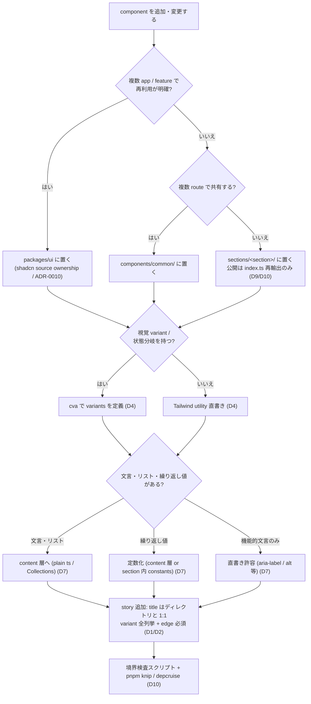
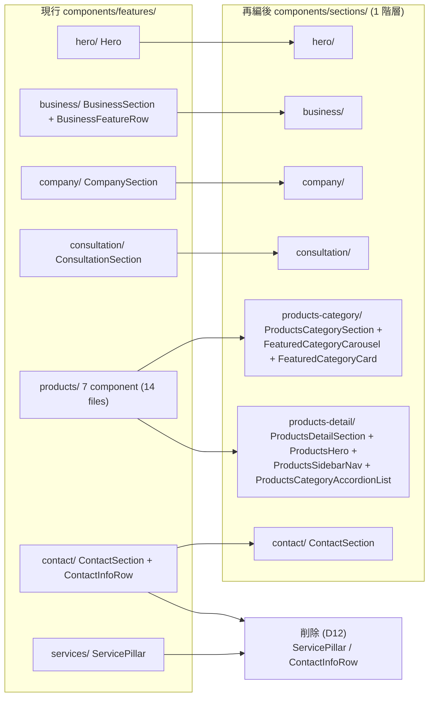
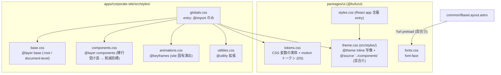

# コンポーネント設計・sections 再編 (Storybook autodocs / cva 集約 / globals.css 分割)

> 対象: corporate-site / packages/ui のコンポーネント設計とディレクトリ構成の見直し **と、その実装**。
> スコープ: Storybook カタログ規約 / cva variants 集約 (アニメーション含む) / globals.css レイヤ分割 / ハードコード基準 / features → sections 再編と index.ts 公開規約。**2026-07-26 のスコープ拡大により、方針決定だけでなく実装まで本 issue で行う**。
> 正本境界: 本 spec は issue #32 の論点・決定経緯・受け入れ基準・実装分割を記録する。durable な規約は **sync phase (2026-07-25 反映 / 2026-07-26 に D8・D10 再決定を反映) 済**であり、以後は下記が正本:
>
> - 横断規約 (ディレクトリ / 公開面 / Storybook / スタイル / ハードコード基準): [context/component-design.md](../../context/component-design.md)
> - app 内依存方向: [context/architecture.md](../../context/architecture.md)
> - corporate-site の section マップ: [component-map.md](../../design/features/corporate-site/component-map.md) と [feature doc](../../design/features/corporate-site/DesignDoc_corporate-site.md)
> - 再編のアーキ判断: [ADR-0011](../../adr/0011-corporate-site-sections-architecture.md) / トークン層の更新: [ADR-0007](../../adr/0007-design-token-architecture.md)
>
> 本 spec 内の規約記述は **決定時スナップショット** であり、以後の更新は上記正本側で行う。要求レベルの決定 7 件は [requirements.md](requirements.md) 決定事項を参照。

## メタ情報

- Issue: `#32`
- ステータス: `In Progress`
- 作成日: 2026-07-25
- 更新日: 2026-07-26
- Branch: `feature/32`
- Owner: Fukuemon

## 設計フェーズ状況

状態は `未着手 / 進行中 / 完了 / レビュー済 / 保留` のいずれか。保留の場合は理由を備考に残す。

| #   | フェーズ                    | 状態       | 最終更新   | 備考                                                                          |
| --- | --------------------------- | ---------- | ---------- | ----------------------------------------------------------------------------- |
| 1   | 起票                        | 完了       | 2026-07-25 | issue #32 (spec-requirement で起票、要求論点 7 件解決済み)                    |
| 2   | 下書き                      | 完了       | 2026-07-25 | scaffold で index.md 初版生成。実装突合: 対象 (既存実装への増分)              |
| 3   | 上位文書突合                | 完了       | 2026-07-25 | 変更提案あり。**sync で全件ハンドオフ済** (context 2 / feature doc 2 / ADR 2) |
| 4   | 論点整理                    | レビュー済 | 2026-07-26 | D1〜D15 + 実装突合ゲート 7 件 (⑤〜⑦ と D12〜D15 は 2026-07-26 追加)           |
| 5   | 論点解決                    | レビュー済 | 2026-07-26 | D8 / D10 再決定 + D12〜D15 追加。spec-review PASS (4 回目)                    |
| 6   | Interface / Routing 設計    | レビュー済 | 2026-07-26 | D8 再決定に伴い section 構成を 1 階層へ修正                                   |
| 7   | Content / Data 設計         | レビュー済 | 2026-07-25 | ハードコード基準は D7 で確定 (機能仕様 Content/Assets に反映)                 |
| 8   | Performance / Security 設計 | レビュー済 | 2026-07-25 | CSS payload / island 方針は現状維持を確認 (D4〜D6 / styles 構成図)            |
| 9   | Test / Metrics 設計         | レビュー済 | 2026-07-26 | 検査手段を独自スクリプトへ変更 (D10 / D14)。実装後の検証観点も追加            |
| 10  | 実装分割                    | レビュー済 | 2026-07-26 | P1〜P6 を定義し着手可能と確認。prompts: **差分修正モード**                    |
| 11  | レビュー済                  | 完了       | 2026-07-26 | spec-review PASS (4 回目)。prompts 生成 → 実装へ                              |

## 上位文書整合

正本 ([Design Doc `## Why / What`](../../design/DesignDoc.md#why--what) / [Design Doc landscape](../../design/DesignDoc.md) / [feature doc](../../design/features/corporate-site/DesignDoc_corporate-site.md) / [context](../../context/) / ADR) のどの節と、どう整合させたかを記録する。

- Design Doc Why / What 更新要否: 不要 (継承。ガードレール「Unnecessary Client JS Count」「Direct UI Duplication Count」の枠内)
- Design Doc 更新要否: 不要 (継承。モジュール責務は変えず、component 規約の詳細化のみ)
- ADR 起票要否: 要 → **反映済 (2026-07-25 sync)**。新規 [ADR-0011](../../adr/0011-corporate-site-sections-architecture.md) を起票し、[ADR-0007](../../adr/0007-design-token-architecture.md) に「更新」節 (`@source` の theme.css 移動 / motion トークン追加) を追記した

| 上位文書    | 節 / 該当箇所                                                      | 整合方針 (継承 / 補足 / 変更提案)                                                                |
| ----------- | ------------------------------------------------------------------ | ------------------------------------------------------------------------------------------------ |
| Design Doc  | Why / What → ガードレール / 設計上の重要ポイント                   | 継承 (性能最優先・最小 island を損なわない)                                                      |
| context     | component-design.md → ディレクトリ構成 / 責務分割 / Storybook 対象 | **変更提案** (features → sections 改名、autodocs 規約、cva 集約、index.ts 公開規約の追記)        |
| context     | component-design.md → スタイリング節                               | **変更提案** (globals.css レイヤ分割、アニメーション共通ユーティリティ / keyframes トークン化)   |
| context     | architecture.md → Package Boundary                                 | 補足 (section の内部非公開と app 内依存方向を追加。境界の考え方自体は継承)                       |
| feature doc | corporate-site → 設計方針 / component-map.md                       | **変更提案** (sections 再編の移行先マップ、products 再構成など corporate-site 固有規約)          |
| ADR-0007    | デザイントークン 2 層構造 / lean app-local Tailwind entry          | **変更提案** (トークン体系は変えないが、`@source` の theme.css 移動を「更新」として追記 — 突合④) |
| ADR-0008    | Astro static rendering / island 境界                               | 継承 (再編で island 方針は変えない)                                                              |
| ADR-0010    | shadcn primitive 基盤は Base UI                                    | 継承 (packages/ui の component source 方針は変えない)                                            |
| project.yml | forbidden (UI 独自実装 / トークン直書き) / decision_priority       | 継承 (ハードコード基準は forbidden の詳細化)                                                     |

> 変更提案は本 issue の成果物そのものであり、sync phase の正本ハンドオフで context / feature doc / ADR へ反映する。それまで design 側を書き換えない。

## 関連資料

- `design/DesignDoc.md`: ## モジュール責務 / ## 設計上の重要ポイント
- `design/features/corporate-site/DesignDoc_corporate-site.md` / `component-map.md`
- `context/component-design.md` (現行規約の正本) / `context/architecture.md` / `context/design-workflow.md` §6
- `adr/0006` (3 route IA) / `adr/0007` (トークン) / `adr/0008` (island) / `adr/0010` (Base UI)
- 関連 issue: #32 (本 issue) / #33 (testing-strategy: Storybook play テストは対象外としてそちらへ移管) / #6 (Storybook catalog 決定経緯) / #10 (corporate-site 実装)
- [requirements.md](requirements.md): 要求定義と決定済み方針 7 件

## 背景

- corporate-site 実装 (#10) と Storybook catalog (#6) を経て、component 数が増えた結果、現行規約 (context/component-design.md) と実態に次のギャップがある:
  - Storybook がカタログとして探しにくい (タイトル階層・分類の規約がない、バリエーション網羅基準がない)
  - `globals.css` が 799 行に肥大化し、entry point と実体の責務が混在している
  - `components/features/` 配下 7 feature の分割粒度が曖昧で、`products` は 14 ファイルの起点が読めない
  - ハードコード (文言・値) の許容基準が明文化されていない
- Phase 1 完成条件「責務境界が Design Docs と AI 設定に明記されている」の component 規約部分を実態に追いつかせる issue である
- 影響範囲は `apps/corporate-site` と `packages/ui` (規約文書は context / feature doc)

### 実装突合ゲート結果 (2026-07-25 clarify 冒頭 / 2026-07-26 追加)

spec × 現行実装 × ADR × context の突合で検出した食い違いと、ユーザーが確認した正。⑤⑥ は 2026-07-26 にユーザー指摘を受けて import 実態と検査基盤を調べ直した際の追加分:

| #   | 食い違い                                                                                                                                                                                                                                                                    | 正 (ユーザー決定)                                                                                                                                                                                                                                                                                   |
| --- | --------------------------------------------------------------------------------------------------------------------------------------------------------------------------------------------------------------------------------------------------------------------------- | --------------------------------------------------------------------------------------------------------------------------------------------------------------------------------------------------------------------------------------------------------------------------------------------------- |
| 1   | `globals.css:5-799` に約 105 クラスセレクタの生 CSS + @keyframes 2 件 (規約は Tailwind utility / lean entry)                                                                                                                                                                | **規約を正とする**。実装側の乖離として扱い、D4 (cva 集約) / D6 (分割) で解消設計する                                                                                                                                                                                                                |
| 2   | section assembly の story 6 件が存在 (規約は「原則 story 対象にしない」)                                                                                                                                                                                                    | **保留**。D1〜D3 のカタログ規約検討に「section story を含めるか」を含めて決める                                                                                                                                                                                                                     |
| 3   | fonts.css を `BaseLayout.astro:8` の `?url` 参照で読み込み (ADR-0007 記載は import 経路)                                                                                                                                                                                    | **記録のみ**。意図的な最適化とみなし、D6 の entry 設計で現状経路を前提に含める                                                                                                                                                                                                                      |
| 4   | `globals.css:7-8` に `@source` 2 行 (規約は「app-local `@source` は置かない」)。目的は `@kufu/ui` の workspace ソース走査で、規約が想定した app 自身の走査指定とは異なる                                                                                                    | **規約を正とし、`@source` は `@kufu/ui/theme.css` へ移動** (2026-07-25, レビュー指摘① 対応)。`@source` のパスは記述ファイル基準の相対解決のため theme.css 側で ui 自身の src を指せば全 consumer が自動で ui の class を生成できる。app entry は import のみに戻す。動作検証は本 issue の P4 で行う |
| 5   | `pages/index.astro` (`/`) が `ProductsCategorySection` を import しており、products ドメインの section が home route の構成要素になっている。また `ProductsHero` は `/products` の独立 section でなく `ProductsDetailSection` の内部 component                              | **実装を正とする** (2026-07-26)。route 単位のグルーピング (D8 初回決定) が成立しない実態のため、**D8 を再オープンして案 E (フラット) へ再決定**。D9 の products 3 分割も 2 section へ修正                                                                                                           |
| 6   | D10 が前提にした dependency-cruiser は `.astro` を解析対象にしていない (cruise 対象 82 modules に `.astro` ゼロ、`no-orphans` の除外に `\.astro$`)。oxlint も `.astro` 非対応で、corporate-site の `lint` は `astro.config.mjs` と `vitest.config.ts` の 2 ファイルのみ対象 | **実装 (基盤の制約) を正とする** (2026-07-26)。**D10 を再オープンし、検査手段を独自スクリプトへ再決定**。既存 `scripts/check-token-usage.mjs` が同方式の前例                                                                                                                                        |
| 7   | `.dependency-cruiser.cjs` の `lp-site-no-cross-app-imports` ルールが旧 app 名 `apps/lp-site/` を指しており、現行の `apps/corporate-site/` に一致せず無効化している                                                                                                          | **実装の不具合として修正対象に含める** (2026-07-26)。app 間直接依存の禁止 (architecture.md) が現状検査されていないため、実装スコープで `corporate-site` へ修正                                                                                                                                      |

## スコープ

> **スコープ更新 (2026-07-26)**: 当初は「方針決定と正本反映まで」で実装を別 issue へ送る計画だったが、ユーザー判断により **実装まで本 issue / 本ブランチで通す** ことにした。以下は更新後のスコープ。

### やること

設計 (完了済み):

- Storybook カタログの詳細設計 (autodocs 全面採用を前提としたタイトル階層・分類規約、バリエーション網羅基準)
- cva variants への集約方針の詳細化 (アニメーションの共通ユーティリティ / keyframes トークン化の設計)
- globals.css (799 行) のレイヤ別分割の設計 (@layer 単位のファイル構成、entry point 化、ADR-0007 との整合)
- ハードコード基準の明文化 (文言は content collections / data へ、繰り返し値は定数化、スタイル値はトークン参照のみ)
- features → sections 改名・再編の設計 (移行先マップ、共有部品の common への振り分け)
- section の index.ts 再輸出 + 内部非公開規約の設計 (機械検査ルール案を含む)
- 決定の context (codebase architecture) / ADR / feature doc への反映 (横断規約は context、corporate-site 固有は feature doc)

実装 (2026-07-26 にスコープ追加):

- `components/features/` → `components/sections/` のディレクトリ移動と `index.ts` 公開面の新設 (D8 / D9)
- pages / 内部 component の import 経路の追従
- 未使用 component / content の削除 (D12)
- `src/styles/` のレイヤ別分割と `globals.css` の entry 化、`@source` の `@kufu/ui/theme.css` への移動 (D6 / 突合④)
- cva 集約と motion トークン化 (D4 / D5)
- Storybook の title 階層・autodocs グローバル適用・variant 網羅への追従 (D1〜D3)
- section 境界の検査スクリプト追加、app `lint` への合流と pre-commit 配線 (D10 / D14)、`.dependency-cruiser.cjs` の旧 app 名ルール修正 (突合⑦)

### やらないこと

- Storybook play テスト / E2E の方針決定・実装 (#33 testing-strategy 側)
- デザイントークン体系自体の再設計 (ADR-0007 を覆す場合のみ派生 issue)
- component の命名変更 (BCD 基準の見直し) — 今回は移動と公開面の整備に限定する
- `packages/ui` 側 component の再編 (motion トークン追加と `@source` 移動を除く)

## 要件の解釈

### 実現したいユーザー価値

- 開発者 / AI エージェントがコンポーネントを探しやすく、起点と責務が即座に分かり、安心して変更できる
- 区切り方・構成・スタイル規約が明文化され、一貫した実装ができる

### 成功条件

- Storybook がカタログとして機能する構成規約 (階層・分類・網羅基準) が確定し文書化される
- コンポーネント区切り・スタイル分離・globals.css 分割・ハードコード基準が context / ADR に明文化される
- sections 分割基準と section 内部の標準構成が明文化され、products のような大きい section でも起点が一意に分かる
- **規約どおりに実装が移行され**、既存ページの表示を壊さずに build / typecheck / test / Storybook build が通る
- **境界違反が機械検査で検出できる**状態になる (検査スクリプトが corporate-site の `lint` に組み込まれ、`pnpm lint` と pre-commit hook で走る)

### 対象ユーザー / 操作主体

- 開発者 (本人): UI / corporate-site 実装者
- AI エージェント: 実装・レビューの実行主体

EARS 風で振る舞いを記述する (`<who>` `<trigger>` 時、システムは `<expected behavior>` する)。

文書 (設計成果):

- WHEN 本 issue が完了したとき、システム (文書群) は autodocs 全面採用を前提とした Storybook のカタログ構成規約 (階層・分類・バリエーション網羅基準) を保持している
- WHEN 本 issue が完了したとき、システムは cva variants への集約方針、globals.css のレイヤ別分割設計、ハードコード基準を保持している
- WHEN 本 issue が完了したとき、システムは features → sections 改名の移行先マップと、section の index.ts 再輸出 + 内部非公開規約を保持している
- IF 方針が既存 ADR (0007 / 0008 / 0010) と矛盾する場合、THEN 該当 ADR の supersede 案を提示するまで方針を確定しない

実装 (2026-07-26 追加):

- WHEN 本 issue が完了したとき、`apps/corporate-site/src/components/` は `sections/<section>/` + `common/` の構成であり、各 section は `index.ts` を公開面として持つ
- WHEN pages が section を参照するとき、システムは `index.ts` 経由の import のみを許可し、内部ファイルへの直接 import と section 間 import を検査スクリプトで検出する
- WHEN 実装が完了したとき、`pnpm build` / `pnpm typecheck` / `pnpm test` / `pnpm storybook:build` / 境界検査 / `pnpm format:check` がすべて成功する
- WHEN 実装が完了したとき、`/` `/products` `/contact` の表示は再編前と等価である (既存 E2E が通る)
- IF 移行中に既存の import 経路が壊れた場合、THEN typecheck / build の失敗として検出し、その段階で修正するまで次の段階に進まない

## 設計時の論点

設計 / 実装フェーズへ持ち越す残課題を 1 件ずつ管理する。確定したものは「解決済みの論点」へ移す。

| #   | 論点                                                                                                                                                       | 決定候補                                                                                    | 決定                                                                                                                                           |
| --- | ---------------------------------------------------------------------------------------------------------------------------------------------------------- | ------------------------------------------------------------------------------------------- | ---------------------------------------------------------------------------------------------------------------------------------------------- |
| D1  | Storybook タイトル階層規約: packages/ui と app-local それぞれの `title` 命名体系 (例: `UI/Button` / `Sections/Business/BusinessFeatureRow` / `Common/...`) | sections 再編後のディレクトリと 1:1 対応させる案                                            | 決定 (2026-07-25): 案 A ディレクトリ 1:1。「解決済みの論点」D1 参照                                                                            |
| D2  | バリエーション網羅基準: args / argTypes で何をどこまで網羅するか (variant 全列挙 / edge state / 長文・空データ)                                            | variant × 主要 state をマトリクスで必須化する案                                             | 決定 (2026-07-25): 案 A variant 全列挙 + edge 必須。「解決済みの論点」D2 参照                                                                  |
| D3  | autodocs 適用範囲: `tags: ['autodocs']` の全面適用の単位 (preview でグローバル指定か story 単位か)、MDX doc の扱い                                         | preview グローバル + 例外 opt-out                                                           | 決定 (2026-07-25): 案 A preview グローバル + opt-out。「解決済みの論点」D3 参照                                                                |
| D4  | cva 集約の適用形態: `.astro` component での cva 利用方法 (frontmatter で class 組み立て中の条件分岐を cva へ置換する範囲)、cva を使わない閾値              | variant を持つ component のみ cva、単純な固定 class は現状維持                              | 決定 (2026-07-25): 案 A variant を持つ component のみ。「解決済みの論点」D4 参照                                                               |
| D5  | アニメーション設計: keyframes / duration / easing のトークン化の置き場 (`@kufu/ui` tokens.css / theme.css / app-local) と共通ユーティリティの提供形態      | keyframes + motion トークンは `@kufu/ui`、利用 utility は theme.css 写像                    | 決定 (2026-07-25): 案 C トークンは ui / keyframes は app。「解決済みの論点」D5 参照                                                            |
| D6  | globals.css 分割のファイル構成: @layer (tokens / base / components / utilities) 単位の具体ファイル・置き場・import 順序、ADR-0007 の 4 entry との関係      | `src/styles/` 配下にレイヤ別ファイル + globals.css は import のみ                           | 決定 (2026-07-25): 案 A 4 ファイル + 移行受け皿。「解決済みの論点」D6 参照                                                                     |
| D7  | ハードコード基準の線引き: 既存「Content 層の選び分け」(plain ts / Content Collections) との統合、繰り返し値の定数の置き場、許容する直書きの範囲            | 現行ハイブリッド基準を包含する 3 区分 (文言 / 値 / スタイル) で明文化                       | 決定 (2026-07-25): 案 A 3 区分 + 機能的文言は許容。「解決済みの論点」D7 参照                                                                   |
| D8  | sections 移行先マップ: 現 7 features (business / company / consultation / contact / hero / products / services) のページ対応再編と common への振り分け     | route (`/` `/products` `/contact`) 対応で再グルーピング                                     | **再決定 (2026-07-26): 案 E フラット 7 section**。初回決定 (案 A route 層) は import 実態と矛盾したため撤回。「解決済みの論点」D8 参照         |
| D9  | section 標準構成: section 内部の標準ファイル構成 (エントリーポイント `index.ts` / Section component / 内部 component) と products 14 ファイルの再構成案    | `index.ts` 再輸出 + `<Feature>Section.astro` を起点とする構成                               | 決定 (2026-07-25): フラット + index.ts。products の分割は D8 再決定に伴い 2 section へ修正。「解決済みの論点」D9 参照                          |
| D10 | 公開面の機械検査: index.ts 経由 import のみ許可するルール案 (story ファイル・pages からの参照経路の扱い、検査手段)                                         | pages → sections は index 経由のみ、story は同 section 内直接参照を許可                     | **再決定 (2026-07-26)**: 境界の定義は初回どおり。検査手段は depcruise が `.astro` 非対応のため独自スクリプトへ変更。「解決済みの論点」D10 参照 |
| D11 | 規約の置き場と ADR 要否: 各決定の反映先 (context/component-design.md / feature doc / component-map.md) の割り付け、sections 再編を ADR として残すか        | 横断規約は component-design.md 改訂、corporate-site 固有は feature doc、再編判断は ADR 起票 | 決定 (2026-07-25): 案 A context + feature doc + 新規 ADR 1 本。「解決済みの論点」D11 参照                                                      |
| D12 | 未使用 component の扱い: `ServicePillar` / `ContactInfoRow` (story からのみ参照され実ページで未使用)                                                       | 削除 / 現状維持 / 活用先を作る                                                              | 決定 (2026-07-26): **削除する** (story も同時削除)。「解決済みの論点」D12 参照                                                                 |
| D13 | `common/` の配置形式: 規約は `common/<Component>/` (1 component 1 ディレクトリ) だが実装はフラット                                                         | ディレクトリ化する / フラットを正とする                                                     | 決定 (2026-07-26): **フラットを正とし context / component-map を追従**。「解決済みの論点」D13 参照                                             |
| D14 | 境界検査スクリプトの組み込み先: `pnpm check` は実在せず、既存の `token:check` もどの gate からも呼ばれていない                                             | app の lint に合流 / root に check 新設 / lefthook に直接追加                               | 決定 (2026-07-26): **app の `lint` に合流**。「解決済みの論点」D14 参照                                                                        |
| D15 | corporate-site から cva を使う経路: cva は `packages/ui` の依存で corporate-site には無く、`@kufu/ui` も再輸出していない                                   | ui から再輸出 / app に直接追加 / cva を使わない                                             | 決定 (2026-07-26): **`@kufu/ui/lib` から再輸出**。「解決済みの論点」D15 参照                                                                   |

## 解決済みの論点

要求レベルの決定 7 件 (autodocs 全面採用 / cva 集約 / レイヤ別分割 / 文言 content 化・値の定数化 / ページ対応 + common・sections 改名 / index.ts 再輸出 + 内部非公開 / 規約は context と feature doc に分置) は [requirements.md](requirements.md) の決定事項を正とする。本 spec ではその詳細化のみを扱い、要求決定を上書きしない。

各論点の反映先判定 (sync phase の棚卸し。2026-07-25 に反映し、D8 / D10 / D12 は 2026-07-26 の再決定を反映済み):

| 論点  | 反映先 (以後の正本)                                                                |
| ----- | ---------------------------------------------------------------------------------- |
| D1    | context/component-design.md (Storybook 対象節) + component-map.md (title 列)       |
| D2    | context/component-design.md (Storybook 対象節)                                     |
| D3    | context/component-design.md (Storybook 対象節)                                     |
| D4    | context/component-design.md (スタイリング節)                                       |
| D5    | context/component-design.md (スタイリング節) + ADR-0007 更新節                     |
| D6    | context/component-design.md (スタイリング節) + feature doc 設計方針 (app 固有適用) |
| D7    | context/component-design.md (ハードコード基準節)                                   |
| D8    | ADR-0011 + context/component-design.md (ディレクトリ構成節) + component-map.md     |
| D9    | ADR-0011 + context/component-design.md (ディレクトリ構成節) + component-map.md     |
| D10   | ADR-0011 + context/architecture.md (App 内依存方向節)                              |
| D11   | 本 sync の反映先割り付けそのもの (メタ決定。spec で閉じる)                         |
| 突合① | context/component-design.md (スタイリング節。cva / styles 分割で解消する設計)      |
| 突合② | context/component-design.md (Storybook 対象節: Section story を公認)               |
| 突合③ | ADR-0007 更新節 (fonts の読み込み経路の記述訂正)。実装変更なし                     |
| 突合④ | ADR-0007 更新節 + context/component-design.md (スタイリング節)                     |
| D12   | ADR-0011 (削除判断と復帰条件) + component-map.md (削除予定の記載)                  |
| D13   | context/component-design.md (ディレクトリ構成節) + component-map.md (配置列)       |
| D14   | spec で閉じる (実装の wiring 判断。結果は package.json / スクリプトが正)           |
| D15   | spec で閉じる (依存経路の作業判断。結果は packages/ui の export が正)              |
| 突合⑤ | ADR-0011 (route 層でなくフラットにした判断根拠として記録)                          |
| 突合⑥ | ADR-0011 (検査手段の選択根拠として記録) + context/architecture.md (検査方法の記述) |
| 突合⑦ | spec で閉じる (`.dependency-cruiser.cjs` の旧 app 名バグ修正。コードが正)          |

- **D8 再決定 (2026-07-26, ユーザー): sections は 1 階層のフラット構成にする (案 E)**。`components/sections/<section>/` とし、route 層は設けない。
  - **初回決定 (2026-07-25 の案 A: route 層グルーピング) は撤回**。撤回理由: import 実態と矛盾していた。`pages/index.astro` (`/`) が `ProductsCategorySection` を import しており、products ドメインの section が home route の構成要素になっている。route 層に置くと「ドメインと route が一致しない component の置き場が決まらない」「IA 変更 (#11 → #17 で実績あり) がディレクトリ移動を強制する」問題が生じる (突合⑤)
  - 移行先マップ (実 import 関係に基づく。→ は使用 route):
    - `sections/hero/` ← `Hero.astro` (→ `/`)
    - `sections/business/` ← `BusinessSection.astro`, `BusinessFeatureRow.astro` (→ `/`)
    - `sections/company/` ← `CompanySection.astro` (→ `/`)
    - `sections/consultation/` ← `ConsultationSection.astro` (→ `/`)
    - `sections/products-category/` ← `ProductsCategorySection.astro`, `FeaturedCategoryCarousel.astro`, `FeaturedCategoryCard.astro` (→ `/`)
    - `sections/products-detail/` ← `ProductsDetailSection.astro`, `ProductsHero.astro`, `ProductsSidebarNav.astro`, `ProductsCategoryAccordionList.astro` (→ `/products`)
    - `sections/contact/` ← `ContactSection.astro` (→ `/contact`)
    - `common/` ← 現行のまま (BaseLayout / SiteHeader / SiteFooter / SectionHeading / ContactCtaLink)。移動なし
    - `services/` は D12 により削除 (未使用)
  - ドメインのまとまりはディレクトリ名の接頭辞 (`products-*`) で表す。ページ対応は `component-map.md` の表が正本
- **D9 (2026-07-25, ユーザー / 2026-07-26 に D8 再決定へ追従): section 内部はフラット + index.ts**。
  - 標準構成: `sections/<section>/` 直下に `index.ts` (公開面。Section component のみ再輸出) + Section component + 内部 component + story をフラットに並べる。`internal/` サブディレクトリは作らない (現行規約「1 component 1 ディレクトリを強制しない」を継承)
  - 階層は常に 1 段。「section の起点は必ず `sections/<section>/index.ts`」という単一規約になる
  - products は `products-category` / `products-detail` の 2 section に分割する (初回の 3 分割案は `ProductsHero` が `ProductsDetailSection` の内部 component である実態と食い違ったため修正)
- **D10 再決定 (2026-07-26, ユーザー): 境界の定義は初回どおり、検査手段を独自スクリプトに変更**。
  - 依存方向を `pages → sections (index.ts) → common → @kufu/ui` の一方向に固定する
  - pages から section 内部ファイルへの直接 import を禁止 (index.ts 経由のみ許可)
  - section 間の import は index 経由でも禁止。共有が必要になった部品は common (app 内) または `packages/ui` (複数 app) へ昇格する
  - 同 section 内 (story 含む) の直接参照は自由。story の colocation を維持する
  - **検査手段**: dependency-cruiser は `.astro` を解析対象にしておらず (cruise 対象 82 modules に `.astro` はゼロ、`no-orphans` の除外にも `\.astro$` を含む)、oxlint も `.astro` 非対応のため corporate-site の lint は設定 2 ファイルしか見ていない。よって既存の `scripts/check-token-usage.mjs` (28 行 / ripgrep で `.astro` を走査するガード) と同方式の検査スクリプトを追加する (突合⑥)
- **D12 (2026-07-26, ユーザー): 未使用の component / content を削除する**。
  - 削除対象: `ServicePillar.astro` + story、`ContactInfoRow.astro` + story (いずれも story からのみ参照され、実ページから未使用)
  - 削除しないもの: `content/services.ts` (`Hero.astro` が使用)、`content/contact.ts` (`SiteFooter.astro` が使用)。ファイル名が似ているため取り違えに注意
  - **`content/source-references.ts` は削除対象外** (2026-07-26 レビューで訂正)。当初「被参照ゼロ」と記録したが誤りで、`content/` 配下の 5 ファイル (`business.ts` / `company.ts` / `contact.ts` / `hero.ts` / `services.ts`) と `content-data.test.ts` が `companyProfileSource` 等を import している。調査時に `components/` と `pages/` のみを走査し、content 層内の相互参照を見落としていた
- **D13 (2026-07-26): `common/` はフラット配置を正とする**。
  - context 規約は `common/<Component>/<Component>.astro` (1 component 1 ディレクトリ) だったが、実装は `common/` 直下のフラット配置で、`packages/ui` も同様にフラットである
  - D8 で「common は現行のまま移動なし」と決めており、section 内をフラットにした方針とも一貫するため、**実装を正として context / component-map を追従**させた (移動は発生しない)
  - `common/` は公開面を絞る対象ではないため `index.ts` は置かない (sections との違い)
- **D14 (2026-07-26, ユーザー): 境界検査は corporate-site の `lint` script に合流させる**。
  - `apps/corporate-site/package.json` の `lint` を `oxlint ... && node scripts/check-token-usage.mjs && node scripts/check-section-boundary.mjs` に拡張する
  - turbo の `lint` task 経由で root `pnpm lint` から実行される。どの gate からも呼ばれていなかった既存の `token:check` も同時に配線される (`token:check` script 自体は個別実行用に残す)
  - **あわせて `lefthook.yml` の `pre-commit` に `pnpm lint` を追加する** (2026-07-26 追記)。現状の pre-commit は protected-branch / format / repo-analysis (depcruise + knip) のみで lint を含まず、CI にも lint job が無いため、lint に入れるだけでは手動実行でしか走らないことが判明したため。corporate-site の lint は oxlint 2 ファイル + ガードスクリプト 2 本で軽量なので commit ごとの実行に耐える
  - `hooks/` 配下は sdd-template から配布される共有 hook (「汎用に保つ」方針) のため、プロジェクト固有検査は追加しない。`lefthook.yml` は消費 repo 側で管理するファイルなのでここに追加してよい
- **D15 (2026-07-26, ユーザー): cva は `@kufu/ui/lib` から再輸出して使う**。
  - `packages/ui/src/lib/` は既に `cn` を提供しており、同じ入口に cva を再輸出する (`packages/ui/src/lib/index.ts`)
  - corporate-site に `class-variance-authority` を直接追加しない。app が増えても共有ユーティリティの入口が 1 つに保たれる
  - `.dependency-cruiser.cjs` の未宣言依存禁止ルールにも抵触しない
- **D1 (2026-07-25, ユーザー): Storybook title はディレクトリと 1:1 対応 (案 A)**。
  - app-local: `Sections/<Section>/<Component>` (例: `Sections/Business/BusinessFeatureRow`) と `Common/<Component>`。packages/ui: `UI/<Component>` (D8 再決定に伴い route 層を除いた)
  - title はファイルの物理配置から機械的に決まる。分類の判断を story 作成時にしない
- **D2 (2026-07-25, ユーザー): バリエーションは variant 全列挙 + edge 必須 (案 A)**。
  - cva variants の全組み合わせを args で列挙する story を必須にする
  - edge state (長文 / 空データ / 最小構成) の story を必須にする
  - 網羅の単位は presentation component。Section story は fixture 差し替えの代表ケースのみでよい
- **D3 (2026-07-25, ユーザー): autodocs は preview グローバル + opt-out (案 A)**。
  - `.storybook/preview` の `tags: ['autodocs']` で全 story に適用し、例外は story 側で `!autodocs`
  - MDX 概要ページは必須にしない (必要になったら追加)
- **突合② 決着 (2026-07-25, ユーザー): section assembly の story を公認して規約化**。
  - Section story を「ページ文脈での確認入口」としてカタログに含める。component-design.md の「section assembly は原則 story 対象にしない」を改訂する
  - 条件: fixture は story 内に限定し、本番 content / secret / 外部 API call を story に持ち込まない (既存規約を継承)
- **D4 (2026-07-25, ユーザー): cva は variant を持つ component のみに適用 (案 A)**。
  - 視覚 variant / 状態分岐を持つ component は `.astro` frontmatter で cva により variants を定義し、条件付き class 組み立ての分岐を置換する (shadcn/ui パターンと整合)
  - variant のない固定 class の component は Tailwind utility 直書きのまま (様式的オーバーヘッドを避ける)
  - globals.css の生 CSS 約 700 行のうち component 由来のスタイルは、cva / utility として component 側へ移行する (突合① の解消経路)
- **D5 (2026-07-25, ユーザー): motion トークンは `@kufu/ui`、keyframes は app-local (案 C)**。
  - duration / easing の motion トークンは `@kufu/ui/tokens.css` に定義する (「トークンは常に ui」の既存昇格境界と整合)
  - site 固有演出の keyframes (`scroll-cue` / `section-rise` 等) は app-local (`src/styles/animations.css`) に置き、複数 app での再利用が明確になったら `@kufu/ui` へ昇格する (業務ルール 3: 過剰一般化しない)
- **D6 (2026-07-25, ユーザー): src/styles/ は 4 ファイル + 移行受け皿 (案 A)**。
  - `globals.css` = entry (@import のみ。現行の `@source` 2 行のうち `packages/ui/src/components` 分を `@kufu/ui/theme.css` へ移動 — 突合④。`packages/ui/src/lib` 分は `utils.ts` (cn のみ) で class 文字列を持たないため移送せず削除する)、`base.css` (@layer base: document-level / :root)、`components.css` (@layer components: 既存生 CSS の受け皿。D4 の cva / utility 移行で逐次削減し、最終的に削除を目標)、`animations.css` (@keyframes)、`utilities.css` (@utility 拡張)
  - tokens 層は既存どおり `@kufu/ui/tokens.css` の import で賄う (app 内に tokens ファイルを作らない)
  - fonts は現行の `BaseLayout.astro` の `?url` 参照経路を維持する (突合③)
  - ADR-0007 の「entry は import / base に絞る」への詳細化であり、4 entry 配信 (ui 側) は変更しない
- **D7 (2026-07-25, ユーザー): ハードコード基準は 3 区分 + 機能的文言は許容 (案 A)**。
  - ① 文言・リスト: content 層へ (現行「Content 層の選び分け」を継承 — plain `content/<feature>.ts` が既定、同形集合は Content Collections)。component 内への content 直書きは禁止 (現行規約の必須化)
  - ② 繰り返し値 (数値 / URL / 閾値): 定数化する。置き場は content 由来なら content 層、表示ロジック由来なら section 内 constants
  - ③ スタイル値: セマンティックトークン参照のみ (既存 forbidden を継承)
  - 許容する直書き: aria-label / alt / sr-only 等の機能的文言と、単一箇所でのみ使う一時値。ただし同じ値が 2 箇所以上に現れたら定数化する
- **D11 (2026-07-25, ユーザー): 規約は context + feature doc + 新規 ADR 1 本 (案 A)**。
  - 横断規約 (ディレクトリ / 公開面 / Storybook / スタイル / ハードコード基準): `component-design.md` / `architecture.md` の改訂
  - corporate-site 固有 (移行先マップ / products 3 分割): feature doc + `component-map.md`
  - 新規 ADR 1 本: 「corporate-site の sections 再編と section 公開面規約」(D8〜D10 の判断経緯。ADR-0007/0008/0010 は継承で supersede なし)。起票は sync phase で行う

## 未確定事項

(決定できない項目を理由とともに残す。1 件でも残っていれば下流 phase は止める)

- なし (D1〜D15 + 実装突合ゲート 7 件。2026-07-25 に D1〜D11 と突合①〜④、2026-07-26 に D8 / D10 の再決定・D12〜D15・突合⑤〜⑦ を解決)

## 実装対象

正規 target は `context/project.yml` の対象ドメイン一覧を正本とする。

| モジュール       | 実装有無 | 主な責務                                                                      |
| ---------------- | :------: | ----------------------------------------------------------------------------- |
| `corporate-site` |    ◯     | sections 再編・styles 分割・cva 集約・境界検査の対象 (規約決定と実装の両方)   |
| `cms`            |    -     | 将来 app。共通規約の過剰一般化をしない線引きの参照先                          |
| `ui`             |    ◯     | Storybook カタログ規約の対象。実装は motion トークン追加と `@source` 移動のみ |
| `config`         |    -     |                                                                               |
| `e2e`            |    -     | (play テスト / E2E は #33 側)                                                 |
| `core`           |    -     |                                                                               |

## 機能仕様

本 issue の成果物は規約文書 (context / feature doc / ADR) と、その規約に沿った既存実装の再編である。ランタイム機能の追加はなく、表示挙動は再編前と等価に保つ。

### User Flow

1. 開発者 / AI エージェントが component を追加・変更するとき、context/component-design.md (改訂版) で置き場・命名・公開面を判断する
2. Storybook カタログで既存 component とバリエーションを探し、重複実装を避ける
3. 規約違反 (section 内部への直接 import / section 間 import) は境界検査スクリプトで検出される。package 境界・循環・未宣言依存は引き続き depcruise / knip が担当する

### Reuse Policy

- 第一原則は feature / colocation とする (現行規約を継承)
- 共通化は複数 feature / app をまたぐ再利用が明確になってから行う
- app や feature 内で閉じる UI / utility / asset はローカルに置く

### Performance

- globals.css 分割・cva 集約は CSS payload / JS 出荷量を増やさないこと (decision_priority 1 / ADR-0007 の lean entry 方針を維持)

### Routing / URL State

- 変更なし (sections はページ対応で再編するが routing 自体は 3 route IA (ADR-0006) を継承)

### Content / Assets

- ハードコード基準 (D7): 文言・リストは content collections または `content/<feature>.ts` へ、繰り返し値は定数化、スタイル値はトークン参照のみ

### UI Reuse

- shared primitive は `packages/ui` (ADR-0010 Base UI)、section / 固有 component は app 内 colocation (現行規約を継承)

### Testing

- 境界規約は独自スクリプトで機械検査する (D10)。スクリプトの追加と quality gate への組み込みは本 issue の P6。Storybook play テスト / E2E の方針は #33 側

## Interface 設計

### UI / API / Event Interface

- section の公開 interface = `index.ts` 再輸出面 (D9 / D10 で設計)。API / Event の追加はない

### Props / Request / Response

- 対象外 (再編で props を変えない。変更が要る場合は移行後の別 issue)

## Content / Data 設計

### 保存・管理するデータ

- 対象外 (永続データなし。文言・定数の置き場基準のみ D7 で設計)

### コンテンツ配置 / package / route

- ハードコード基準 (D7) と content 層の選び分け (現行規約) の統合を設計する

## Performance / Security 設計

### Performance

- globals.css 分割後も出力 CSS が増えないこと (@layer / import 構成は build 結果で検証。検証手順は実装分割で定義)
- cva 導入が island / JS 出荷量を増やさないこと (表示専用 component は静的描画のまま)

### Security / Privacy

- 対象外 (構成の再編であり、secret / 認証情報・外部通信の扱いに変更はない)

## Error / Fallback 設計

### エラーケース

| #   | ケース                                                            | ユーザーへの見せ方         | リカバリ                                          |
| --- | ----------------------------------------------------------------- | -------------------------- | ------------------------------------------------- |
| 1   | sections 分割基準がどの軸でも一長一短で決めきれない               | 未決事項として比較表を残す | products のみ先行して構成規約を適用し他は現状維持 |
| 2   | スタイル分離方針が Storybook カタログ構成と相互依存で確定できない | 依存関係を未決事項に明記   | カタログ構成を先に確定しスタイル分離を追従させる  |

### Fallback

- 移行が import 経路を壊すリスクは、P1〜P6 の段階的移動と各段階での typecheck / build 実行で吸収する (受け入れ基準 IF 節)

## テスト / 評価方針

### テスト観点

- 境界規約が機械検査で検出できるか: 検査スクリプトが「pages → section 内部への直接 import」「section 間 import」を **違反として検出し、正しい経路では通る** ことを確認する (業務ルール 4)
- 再編後に `pnpm build` / `pnpm typecheck` / `pnpm test` / `pnpm storybook:build` が通るか
- `/` `/products` `/contact` の表示が再編前と等価か (既存 E2E)
- styles 分割後に出力 CSS が増えていないか (build 結果のサイズ比較)
- 削除した component / content (D12) への参照が残っていないか (build / typecheck / knip で検出)
- `.dependency-cruiser.cjs` の app 間依存ルールが実 app 名で機能するか (突合⑦)

### 計測指標

- 対象外 (ガードレール件数は Design Doc の既存定義を継承)

## フロー / シーケンス

本 issue は表示挙動を変えずに構造を移行する再編のため、ユーザー (開発者 / AI エージェント) 操作起点の判断フローと、決定した構造の対応図を描く。runtime の sequence diagram は対象なし。

### Flowchart (ユーザー操作起点)

開発者 / AI エージェントが component を追加・変更するときの置き場判断フロー (D4 / D7 / D8〜D10 の決定を反映):

### Sequence

runtime のシステム間相互作用に変更がないため対象なし (問い合わせフォーム等の既存 sequence は [#14 の feature doc 反映分](../../design/features/corporate-site/DesignDoc_corporate-site.md#問い合わせフォーム仕様) を正本とする)。

### 移行先マップ (D8 / D9 の component 単位詳細)

- `components/common/` (BaseLayout / SiteHeader / SiteFooter / SectionHeading / ContactCtaLink) は現行のまま移動なし
- 各 section dir に `index.ts` を新設し、Section component (hero は `Hero`) のみ再輸出する (D9)
- 使用 route: `hero` / `business` / `company` / `consultation` / `products-category` → `/`、`products-detail` → `/products`、`contact` → `/contact`

### styles entry 構成 (D5 / D6 / 突合④)

## 実装分割

### 実装タスク案

実装は「壊れたら即検出できる順序」で分割する。各段階の完了時に `pnpm typecheck` / `pnpm build` を通す。

| Phase | 対象                    | 概要                                                                                                                                                    | 依存               |
| ----- | ----------------------- | ------------------------------------------------------------------------------------------------------------------------------------------------------- | ------------------ |
| P1    | `corporate-site`        | 未使用 component の削除 (D12)。`ServicePillar.astro` + story、`ContactInfoRow.astro` + story の 4 ファイル。content 層は削除しない                      | なし               |
| P2    | `corporate-site`        | `features/` → `sections/` の移動、`index.ts` 公開面の新設、pages / 内部 import の追従、`apps/corporate-site/README.md` の構成記述追従 (D8 / D9)         | P1                 |
| P3    | `corporate-site`        | Storybook title の階層追従、autodocs のグローバル適用、variant 網羅の補完 (D1〜D3)                                                                      | P2                 |
| P4    | `ui` + `corporate-site` | `@source` の theme.css 移動、motion トークン追加、`src/styles/` のレイヤ分割 (D5 / D6 / 突合④)                                                          | なし (P2 と並列可) |
| P5    | `ui` + `corporate-site` | `@kufu/ui/lib` からの cva 再輸出 (D15) と cva 集約、`components.css` 受け皿の削減 (D4)                                                                  | P4                 |
| P6    | `corporate-site` + root | 境界検査スクリプト追加 + app `lint` への合流 + `lefthook.yml` pre-commit への `pnpm lint` 追加 (D14)、`.dependency-cruiser.cjs` の旧 app 名修正 (突合⑦) | P2                 |

### prompts 生成方針

- **差分修正モード**で生成する (既存実装の移動・修正であり、新規機能の実装ではない)
- 分割は上記 P1〜P6 に対応させる。P4 は P2 と並列実行できるため `depends_on` を実依存で記述する
- 各 prompt に「移動元 → 移動先」の具体パスを列挙し、探索を不要にする

## 上位資料からの変更点

本 spec で PRD / Design Doc / feature doc / context / 既存 ADR から変更・追加した内容を、反映先別に記録する。track / sync phase で更新する。

> **全行反映済** (2026-07-25 の sync phase で反映し、D8 / D10 / D12 関連は 2026-07-26 の再決定に追従して更新。commit は本 branch `feature/32`)。以後の更新は反映先の正本側で行う。

### PRD への影響

| 対象節 | 変更内容 | 理由 |
| ------ | -------- | ---- |
|        |          |      |

### Design Doc への影響

| 対象節 | 変更内容 | 理由 |
| ------ | -------- | ---- |
|        |          |      |

### feature doc への影響

| 対象 doc / 節                                          | 変更内容                                                                                                                                         | 理由                                                                           |
| ------------------------------------------------------ | ------------------------------------------------------------------------------------------------------------------------------------------------ | ------------------------------------------------------------------------------ |
| `component-map.md` / DesignDoc_corporate-site 設計方針 | sections のフラット構成と section → component / 使用ページの対応表を追記 <!-- source: clarify D8 (2026-07-26 再決定を反映) -->                   | D8 再決定。構造を IA から独立させ、ページ対応は表で持つ                        |
| `component-map.md`                                     | products の products-category / products-detail 2 分割と各 section の公開面、削除 component (D12) を追記 <!-- source: clarify D9/D12 -->         | D9 / D12 決定。起点 (index.ts) が一意になる                                    |
| DesignDoc_corporate-site 設計方針                      | `src/styles/` の分割ファイル構成 (entry + base / components 受け皿 / animations / utilities) の corporate-site 適用を追記 <!-- source: track --> | D6 の app 固有適用形。横断規約 (context) と固有構成 (feature doc) の分置 (D11) |

### context への影響

| 対象 doc / 節                                | 変更内容                                                                                                                                                                | 理由                                 |
| -------------------------------------------- | ----------------------------------------------------------------------------------------------------------------------------------------------------------------------- | ------------------------------------ |
| `component-design.md` ディレクトリ構成節     | `components/features/<feature>/` → `components/sections/<section>/` (1 階層フラット) へ改訂 <!-- source: clarify D8 (2026-07-26 再決定を反映) -->                       | D8 再決定 (フラット構成)             |
| `component-design.md` ディレクトリ構成節     | section 標準構成 (フラット + `index.ts` 公開面、internal/ なし) を追記 <!-- source: clarify D9 -->                                                                      | D9 決定                              |
| `architecture.md` Package Boundary 節        | app 内依存方向 `pages → sections (index) → common → @kufu/ui` と独自スクリプトによる検査方針を追記 <!-- source: clarify D10 (2026-07-26 再決定を反映) -->               | D10 再決定 (検査手段の変更)          |
| `component-design.md` Storybook 対象節       | title 階層規約 (ディレクトリ 1:1)、variant 全列挙 + edge 必須、autodocs グローバル適用、Section story の公認を改訂 <!-- source: clarify D1-D3/突合② -->                 | D1〜D3 / 突合② 決定                  |
| `component-design.md` スタイリング節         | cva 適用基準 (variant を持つ component のみ)、styles/ 4 ファイル + 移行受け皿の構成、motion トークン (ui) / keyframes (app) の境界を改訂 <!-- source: clarify D4-D6 --> | D4〜D6 決定                          |
| `component-design.md` Content 層の選び分け節 | ハードコード基準 3 区分 (文言 content 化 / 繰り返し値の定数化 / スタイル値トークンのみ) + 機能的文言の許容を追記 <!-- source: clarify D7 -->                            | D7 決定                              |
| `design-workflow.md` Phase C                 | 実装配置を `src/components/features/<feature>/` → `src/components/sections/<section>/` へ改訂 <!-- source: 2026-07-26 レビュー指摘 -->                                  | D8 再決定への追従 (context 間の整合) |
| `component-design.md` ディレクトリ構成節     | `common/` の配置を `common/<Component>/` からフラットへ改訂 <!-- source: clarify D13 -->                                                                                | D13 決定 (実装実態への追従)          |
| `component-design.md` スタイリング節         | `@source` の記述を「app entry に置かず `@kufu/ui/theme.css` が自身の src を指す」へ改訂 <!-- source: clarify 突合④ -->                                                  | レビュー指摘① / 突合④ 決定           |

### ADR の新規 / 更新

| ADR ID                                                             | 変更内容                                                                                                                                                                                                           | 理由                                                                                          |
| ------------------------------------------------------------------ | ------------------------------------------------------------------------------------------------------------------------------------------------------------------------------------------------------------------ | --------------------------------------------------------------------------------------------- |
| [ADR-0011](../../adr/0011-corporate-site-sections-architecture.md) | 「corporate-site の component を section 単位のフラット構成へ再編し、公開面を index.ts + 独自検査で固定する」を起票 (D8〜D10 の判断経緯と突合⑤⑥) <!-- source: clarify D11 (2026-07-26 再決定を反映) --> **反映済** | D11 決定。issue close 後も再編の判断経緯を長期参照するため                                    |
| ADR-0007                                                           | 「更新」節に `@source` の theme.css 移動 (app entry は import のみ) を追記 <!-- source: clarify 突合④ -->                                                                                                          | レビュー指摘① / 突合④ 決定。lean entry 原則の維持                                             |
| ADR-0007                                                           | 「更新」節に motion トークン (duration / easing) の tokens.css 追加を追記 <!-- source: track -->                                                                                                                   | D5 決定。「実績ベースの最小定義」(独自トークン最小) に対する新トークン層のため ADR 側にも記録 |
| ADR-0007                                                           | 「更新」節に fonts の読み込み経路 (BaseLayout の `?url`) の記述訂正を追記 <!-- source: 2026-07-26 レビュー指摘 -->                                                                                                 | 突合③ の正本側での決着。spec 削除後も誤記が残らないようにする                                 |

## レビュー

`spec-review` (fresh-context evaluator) の最新結果。完全な記録は `review.md` を参照。

| 日付       | 結果 (PASS / NEEDS_WORK) | 指摘要点                                                                                                                                                                                                                           | 対応                                                                                         |
| ---------- | ------------------------ | ---------------------------------------------------------------------------------------------------------------------------------------------------------------------------------------------------------------------------------- | -------------------------------------------------------------------------------------------- |
| 2026-07-25 | NEEDS_WORK               | ① D6 の `@source` が ADR-0007 / component-design.md と矛盾し未記録 ② ADR 起票要否が stale                                                                                                                                          | 対応済 (① 突合④として theme.css 移動を決定・影響表へ追記 ② 「要 (D11)」へ更新)。再レビューへ |
| 2026-07-25 | PASS                     | blocking なし。参考: D6「4 ファイル」の数え方が曖昧 → sync の反映時に表記確定                                                                                                                                                      | clarify gate 通過                                                                            |
| 2026-07-25 | PASS                     | (track gate) blocking なし。参考: ① 突合件数 stale ② Flowchart の common 経路 ③ 突合③ の ADR 記録要否                                                                                                                              | ① 修正済。②③ は sync で対応                                                                  |
| 2026-07-26 | NEEDS_WORK               | (再決定レビュー) blocking: D12 の `source-references.ts` は被参照ゼロでなく 6 ファイルから使用。他 6 件: design-workflow の旧構成 / depcruise 前提の stale 記述 / component-map の完了形記述 / メタ情報同期 / 拡張子 / README 追従 | 全件対応済 (D12 から除外ほか)。再レビューへ                                                  |
| 2026-07-26 | NEEDS_WORK               | (2 回目) blocking なし。A: common の配置が spec 決定と context で矛盾 / B: 実装対象テーブルが「設計のみ」のまま / C: メタ同期と stale 記述 3 種                                                                                    | 全件対応済 (A は D13 として決定を記録)。再レビューへ                                         |

## 変更履歴

| 日付       | 変更者         | 変更内容                                                                                                                                                          |
| ---------- | -------------- | ----------------------------------------------------------------------------------------------------------------------------------------------------------------- |
| 2026-07-25 | spec-lifecycle | scaffold で index.md 初版生成。設計論点 D1〜D11 を初期抽出                                                                                                        |
| 2026-07-25 | spec-lifecycle | clarify: 実装突合ゲート 3 件を決着、D1〜D11 全件をユーザー対話で解決                                                                                              |
| 2026-07-25 | spec-lifecycle | レビュー指摘対応: 突合④ (@source を theme.css へ移動) を追加決定、ADR 起票要否の stale を修正                                                                     |
| 2026-07-25 | spec-lifecycle | diagram: 置き場判断フロー / 移行先マップ (component 単位) / styles entry 構成を図化                                                                               |
| 2026-07-25 | spec-lifecycle | track: 未追記差分 2 件を反映 (feature doc への styles 構成適用 / ADR-0007 への motion トークン追記)                                                               |
| 2026-07-25 | spec-lifecycle | sync: context 2 本 / feature doc 2 本を改訂、ADR-0011 起票 + ADR-0007 更新、impact-index 追加。spec を決定時スナップショットへ降格                                |
| 2026-07-26 | spec-lifecycle | ユーザー指摘を受け import 実態と検査基盤を再調査。突合⑤〜⑦ を追加し、**D8 を案 E (フラット) へ、D10 の検査手段を独自スクリプトへ再決定**。D12 (未使用削除) を追加 |
| 2026-07-26 | spec-lifecycle | スコープを実装込みに拡大。実装分割 P1〜P6 と実装側の受け入れ基準・テスト観点を追加                                                                                |
| 2026-07-26 | spec-lifecycle | 再決定レビュー 2 回分の指摘に対応。D12 から source-references.ts を除外、D13 (common はフラット) を追加、stale 記述とメタ情報を同期                               |

## 備考

- appendix (api / database / authorization / screen-spec / testid) は本 issue のスコープ (設計方針の文書化) に該当がないため取り込まない
