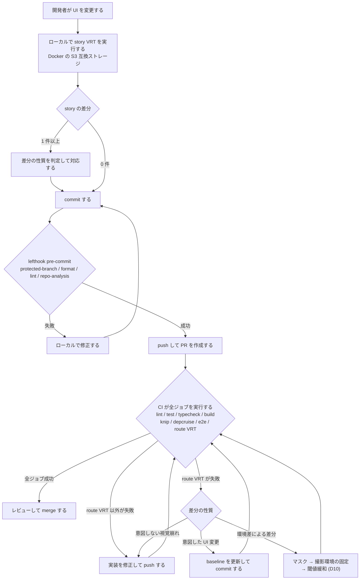
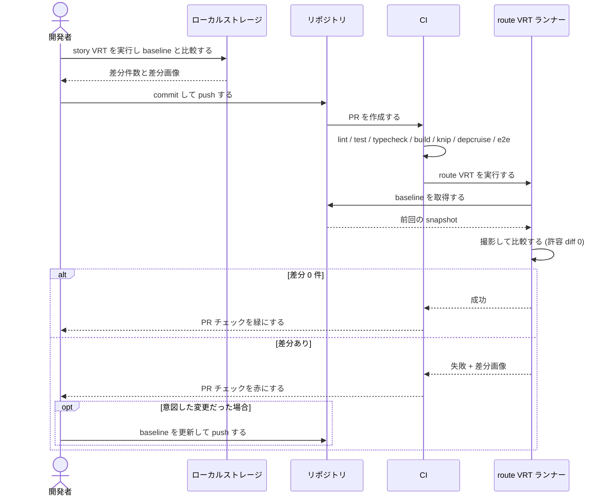
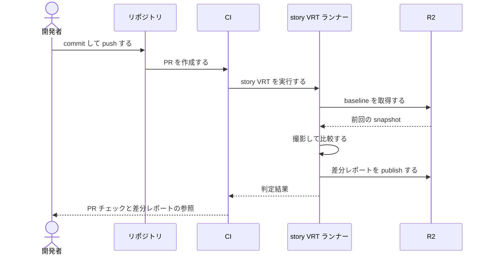

# テスト戦略と CI パイプライン整備 (play / Page Object / VRT / GitHub Actions)

## メタ情報

- Issue: `#33`
- ステータス: `In Progress`
- 作成日: 2026-08-14
- 更新日: 2026-08-16
- Branch: `feature/33`
- Owner: Fukuemon

## 設計フェーズ状況

状態は `未着手 / 進行中 / 完了 / レビュー済 / 保留` のいずれか。保留の場合は理由を備考に残す。

| #   | フェーズ                    | 状態       | 最終更新   | 備考                                                                                                         |
| --- | --------------------------- | ---------- | ---------- | ------------------------------------------------------------------------------------------------------------ |
| 1   | 起票                        | 完了       | 2026-08-14 | #28 / #12 を統合済み。実装突合: 対象                                                                         |
| 2   | 下書き                      | 完了       | 2026-08-14 | template の必須節を充足                                                                                      |
| 3   | 上位文書突合                | 完了       | 2026-08-14 | 矛盾なし。context への追記は本 spec の計画的な更新                                                           |
| 4   | 論点整理                    | 完了       | 2026-08-15 | D1〜D9 を起票。D10〜D12 はレビュー対応で追加                                                                 |
| 5   | 論点解決                    | 完了       | 2026-08-15 | D1〜D12 を確定。設計上の未決ゼロ (U1 は実装順序、U2 は運用判断)                                              |
| 6   | Interface / Routing 設計    | 完了       | 2026-08-16 | diagram / track / sync phase で確定済                                                                        |
| 7   | Content / Data 設計         | 完了       | 2026-08-16 | diagram / track / sync phase で確定済                                                                        |
| 8   | Performance / Security 設計 | 完了       | 2026-08-16 | diagram / track / sync phase で確定済                                                                        |
| 9   | Test / Metrics 設計         | 完了       | 2026-08-16 | diagram / track / sync phase で確定済                                                                        |
| 10  | 実装分割                    | 完了       | 2026-08-16 | P1a〜P5 を記入。P4 は sync で消化済み                                                                        |
| 11  | レビュー済                  | 完了       | 2026-08-16 | track gate 5 回目で 5 観点 PASS。残る指摘は記録整合のみでユーザー判断で通過                                  |
| 12  | prompts 生成                | レビュー済 | 2026-08-16 | prompts: 混在モード (P1_01 / P1_02 は新規実装、P2 / P3 は既存ファイルの差分修正、P5 は #47 完了後の差分修正) |

## 上位文書整合

- PRD 更新要否: 不要 (統合モード。`design/DesignDoc.md` の Why / What と衝突しない)
- Design Doc 更新要否: 要 → **Future Work の「CI パイプライン」行を現状事実へ更新済 (sync 反映済)**
- ADR 起票要否: 要 → **ADR-0015 / 0016 / 0017 を起票済 (sync 反映済)**

| 上位文書                     | 節 / 該当箇所                                       | 整合方針 (継承 / 補足 / 変更提案)                                                                                  |
| ---------------------------- | --------------------------------------------------- | ------------------------------------------------------------------------------------------------------------------ |
| PRD (統合)                   | Non Goals (CMS / 認証 / 過剰な抽象化)               | 継承。本 spec はいずれにも触れない                                                                                 |
| Design Doc                   | モジュール責務 → `e2e` は root 管理の公開前検証     | 継承                                                                                                               |
| Design Doc                   | 成功条件 #2 (3 route と問い合わせ導線を E2E で通す) | 補足。ジャーニー網羅と VRT を上乗せする                                                                            |
| feature doc (corporate-site) | テスト観点 / 問い合わせ導線の route intercept 方針  | 継承。E2E fixture の分岐定義をジャーニー定義の入力に使う                                                           |
| context/testing.md           | テスト責務の分担                                    | **反映済**。sync で play / VRT を追加し 4 種別へ拡張した                                                           |
| context/engineering.md       | Repository Quality Gate / Docs Closeout Gate        | **反映済**。CI とローカル hook の分担を追加し、closeout の CI 記述を実態へ更新した                                 |
| context/infrastructure.md    | Cloudflare Pages preview deployment                 | 継承。preview と CI E2E の分担判断に使う                                                                           |
| ADR-0008                     | Astro / React island ポリシー                       | 継承。play 対象を React に限る根拠                                                                                 |
| ADR-0012                     | デザイン正本 = 実装 + Storybook                     | 継承。VRT の対象セットを Storybook に置く根拠                                                                      |
| context/toolchain.md         | 標準スタック表                                      | **反映済**。VRT (story) / VRT (route) を追加した                                                                   |
| context/impact-index.yaml    | 読み取り索引 (feature エントリ)                     | **反映済**。`testing-strategy` / `ci-pipeline` を追加した                                                          |
| ADR-0001                     | Terraform の infra code は別リポジトリで管理する    | 継承。**本 spec は R2 を調達しない** (ローカル S3 互換で検証まで)。R2 の調達と ADR-0001 の supersede は #47 が行う |
| ADR-0015 / 0016 / 0017       | 本 spec で新規起票 (sync 反映済)                    | 以後この 3 本が D1〜D12 の判断の正本                                                                               |

`context/testing.md` / `context/engineering.md` / `context/toolchain.md` への追記は衝突ではなく、本 spec がスコープとして計画した更新であり **sync phase で反映済**。

**ADR-0001 とは衝突しない。** 同 ADR は「Terraform 本体・state・apply workflow を monorepo に置かない」と定めるが、本 spec のスコープは D4 の改訂によりローカル S3 互換ストレージでの検証までとなり、**Cloudflare リソースを調達しない**。
R2 の調達と ADR-0001 の supersede は #47 が行う。
ADR-0001 が spec 側に課す「infra 変更が絡む spec では infra repo 側の対応有無を明記する」義務は、U1 (実装順序の依存) の記載で満たす。

## 関連資料

- `design/DesignDoc.md`: モジュール責務 (`e2e`) / 成功条件 #2
- `design/features/corporate-site/DesignDoc_corporate-site.md`: テスト観点 / 問い合わせ導線の検証境界
- `context/testing.md` / `context/engineering.md` / `context/infrastructure.md`
- 要求定義: [requirements.md](requirements.md)
- 関連 issue: #33 (本体) / 統合済み #28 (VRT) / #12 (CI) / 参照 #26 (問い合わせフォーム) / #32 (styles 受け皿)

## 背景

UI を変える作業の安全網が、現状は「要素の存在と文言を見る E2E」しかない。
`components.css` を utility / cva へ colocation 移行する作業 (#32 の積み残し) は出力 CSS の形が変わるため、
#32 で使った「出力 CSS のバイト比較」が使えない。視覚崩れを検出する手段がないまま移行するのは危険であり、
**VRT の導入がその移行の前提 gate** になる。

同時に、テストを増やしても回す場所が決まっていなければ意味がない。CI は段階的に増えたが
どこまで載せるかの方針がなく、ローカル `lefthook` との分担も未整理である。
そのため本 spec はテストの中身 (play / Page Object / ジャーニー / VRT) と
実行場所 (CI / ローカル) を 1 つの設計として扱う。

影響範囲は `packages/ui` (play テスト対象) / `apps/corporate-site` (VRT 対象) / `e2e` (Page Object) /
リポジトリ横断の CI 設定である。

## スコープ

### やること

- play テストの導入方針 (対象基準と Astro 側の制約) の確定
- E2E の Page Object 構成規約と locator 規約の確定
- E2E がカバーするユーザージャーニーの定義と play との責務境界の確定
- VRT の手段選択・対象セット・許容 diff・snapshot 運用の確定と、**実行可能な状態までの実装**
- CI のジョブ構成、ローカル `lefthook` との責務分担、Turbo キャッシュ方針、required status checks の確定と `.github/workflows/` の実装
- 決定の `context/testing.md` / `context/engineering.md` / ADR への反映

### やらないこと

- play テスト / E2E ジャーニーの**テストコード実装** (方針確定後に別 issue。VRT と CI は例外で本 spec で実装する)
- `components.css` の colocation 移行そのもの (本 spec が gate を用意し、移行は差分ゼロを完了条件とする派生 issue が行う)
- 問い合わせフォーム (#26) の実装。island が増えた後の play 対象追加は #26 側で行う
- Cloudflare Pages のデプロイ設定変更
- 既存 workflow (`spec-residue` / `spec-closeout` / `storybook-pages`) の作り替え

## 要件の解釈

### 実現したいユーザー価値

- 開発者と AI エージェントが、UI を変えたときに壊れたことへ**気づける**状態になる
- テストの置き場と実行場所が決まっており、追加時に迷わない

### 成功条件

- VRT が実行でき、UI 無変更なら差分ゼロ、意図した変更なら baseline 更新手順で解消できる
- CI とローカル hook の責務が重複なく分担され、`context/` に文書化されている
- play / Page Object / ジャーニーの規約が、実装 issue がそのまま従える粒度で決まっている

### 対象ユーザー / 操作主体

- 開発者 (本人): テストを追加・保守する
- AI エージェント: 規約に従ってテストを実装する
- CI (GitHub Actions): 決められたジョブを実行する

EARS 風の振る舞い。観測手段が定義できるものだけを本 spec の受け入れ基準とする
(`requirements.md` の「文書群は…を保持している」型は観測手段が無いため、下記のとおり観測可能な形へ具体化した)。

- WHEN 開発者が VRT の実行コマンドを実行したとき、システムは対象セットを撮影し baseline との差分件数を終了コードと標準出力で返す。
- WHILE UI に変更がない間、システムは VRT を 2 回連続実行しても差分 0 件を返す。
- IF 意図した UI 変更で差分が出た場合、THEN システムは baseline 更新コマンドで差分を 0 件に解消できる。
- WHEN 開発者が意図的に 1 箇所のスタイルを変更したとき、システムは VRT で差分を 1 件以上検出する。
- WHEN develop 向けの PR が作成されたとき、システムは `lint` / `test` / `typecheck` / `build` / `knip` / `depcruise` / `e2e` / route の VRT を実行し、各ジョブの成否を PR のチェック欄に返す。
- WHERE story 側の VRT は #47 完了後に CI へ載せる。#33 の時点ではローカルの S3 互換ストレージに対して実行し、差分判定が成立することを確認する。
- IF いずれかのジョブが失敗した場合、THEN システムは失敗したジョブ名とログを PR から辿れる状態にする。

## 現状の実測 (2026-08-14)

要求定義の業務ルール #1 (判断は現規模の実測に基づく) に対応する棚卸し。論点の判断材料とする。

| 対象                       | 実測値                                                                            |
| -------------------------- | --------------------------------------------------------------------------------- |
| E2E ファイル数             | 1 (`e2e/corporate-site/smoke.spec.ts`)                                            |
| E2E テスト数               | 5                                                                                 |
| E2E のセレクタ内訳         | `getByTestId` 24 / `getByText` 6 / `locator()` 5 / `getByRole` 3                  |
| `data-testid` 定義箇所     | 20                                                                                |
| story ファイル数           | 29 (`packages/ui` 11 / `apps/corporate-site` 17 / fixture 1)                      |
| **story 数 (export 総数)** | **81** (`packages/ui` 47 / `apps/corporate-site` 34)。fixture は VRT 対象外       |
| `play` 関数を持つ story    | 0                                                                                 |
| React island               | **0** (`client:*` ディレクティブの使用箇所なし)                                   |
| CI に載っているもの        | `lint` / `test`                                                                   |
| CI に載っていないもの      | `typecheck` / `build` / `knip` / `depcruise` / `e2e`                              |
| lefthook pre-commit        | `protected-branch` / `format` / `repo-analysis` (= `depcruise` + `knip`) / `lint` |

この実測から、要求定義の決定事項に**前提のずれ**が 2 件ある。D1 / D2 で扱う。

## 実装対象

| モジュール       | 実装有無 | 主な責務                                                              |
| ---------------- | :------: | --------------------------------------------------------------------- |
| `e2e`            |    ◯     | Page Object 構成、locator 規約、ジャーニー定義。route 側 VRT の実装先 |
| `ui`             |    ◯     | play テストの対象。VRT の Storybook 側対象セット                      |
| `corporate-site` |    ◯     | VRT の route 対象 (3 route × 2 viewport)                              |
| `core`           |    ◯     | `.github/workflows/` と `lefthook.yml` の責務分担                     |
| `config`         |    -     | 変更しない                                                            |
| `cms`            |    -     | 対象外 (未着手モジュール)                                             |

## 機能仕様

### User Flow

開発者 / CI が本 spec の成果物を使う流れ。

1. 開発者が UI を変更する
2. ローカルで `lefthook` の pre-commit gate が走る (責務は D6 で確定)
3. 開発者が VRT を実行し、baseline との差分を確認する
4. 意図した差分なら baseline を更新し、意図しない差分なら実装を直す
5. PR を作成すると CI が決定したジョブ構成を実行し、結果を PR に返す

### Reuse Policy

- Page Object と VRT のヘルパは `e2e/` 配下に colocation する。`packages/*` へ昇格させない
- play テストのユーティリティは `packages/ui` 内に置き、app からは参照させない

### Performance

- CI 実行時間の目標値は置かない (D9)。実測値を記録し、U2 (remote cache の要否) の判断材料にする
- VRT のためにプロダクションコードへ待機用の実装を入れない (テスト都合で島を増やさない)

### Routing / URL State

該当なし。本 spec はテストと CI の仕組みを対象とし、アプリの routing / URL state を変更しない。

### Content / Assets

> **決定時スナップショット。** 対象セットと viewport の適用範囲の正本は
> [ADR-0015](../../adr/0015-visual-regression-testing-policy.md)。差異が生じた場合は ADR 側が正しい。

VRT の baseline は D4 の決定により **2 系統** を持つ。

**追記 (2026-08-16)**: Storybook は 2 インスタンスある。`pnpm storybook:build` は `@kufu/ui` と
`@kufu/corporate-site` を別々にビルドし、`scripts/build-storybook-pages.mjs` が `.storybook-pages/ui/` と
`.storybook-pages/corporate-site/` へ別の静的サイトとして配置する。統合された 1 つの Storybook にはならないため、
storycap は **2 回撮影して reg-suit の比較対象へまとめる**必要がある。

#### reg-suit を S3 互換ストレージへ接続する際の設定

> **正本は [ADR-0015](../../adr/0015-visual-regression-testing-policy.md) の「実装・運用への反映」。**
> `enableACL: false` / `region: auto` / `customDomain` と `endpoint` を併用しない、の 3 点と出典をそこに移した。
> #33 ではこの endpoint をローカルの S3 互換ストレージ (Docker) へ向け、#47 完了後は endpoint と資格情報を差し替えて R2 へ移行する。
> ローカル検証で撮った baseline は破棄前提とし、正となる baseline は #47 完了後に CI 環境で撮り直す。

| 系統                | 撮影対象                                                                    | 保管先                                                    |
| ------------------- | --------------------------------------------------------------------------- | --------------------------------------------------------- |
| reg-suit + storycap | **81 story** (`packages/ui` 47 + corporate-site 34) × 既定 viewport = 81 枚 | **#33: ローカル S3 互換 (Docker、破棄前提) → #47 後: R2** |
| Playwright          | 3 route × 2 viewport = 6 枚                                                 | リポジトリ (Playwright 既定)                              |

**viewport の適用範囲**: 要求の「desktop / mobile の 2 viewport」は **route 側に適用する**。story 側は既定 viewport 1 種で撮る
(コンポーネント単体の崩れは viewport 非依存であることが多く、81 story を 2 倍にすると実行時間と baseline 保守が見合わないため)。
レスポンシブ挙動そのものを持つ story には個別に viewport 指定を追加できる余地を残す。

- R2 の資格情報は secret として扱い、置き場は `context/infrastructure.md` に従う (#47 で確定)
- Playwright 側の baseline は Git 管理されるため、差分が PR レビューに乗る

### UI Reuse

該当なし。本 spec は共有 UI の構成を変更しない。play テストは既存の `packages/ui` コンポーネントを対象にする。

### Testing

> **決定時スナップショット。** 以下は sync phase で正本へ移した。現在の正本は
> [`context/testing.md`](../../context/testing.md) と [ADR-0017](../../adr/0017-ui-test-structure-policy.md) / [ADR-0015](../../adr/0015-visual-regression-testing-policy.md)。
> 差異が生じた場合は正本側が正しい。

- VRT を独立したテスト種別として立てる (D3)。sync 後の `context/testing.md` は play を含めて **Unit test / play / E2E / VRT の 4 種別**になっている
- locator は領域特定に `data-testid`、操作対象に `getByRole` を優先する (D5)。Page Object 内部にも同じ規約を適用する
- play テストの対象は `packages/ui` の 11 コンポーネントに限る (D1)

## Interface 設計

### UI / API / Event Interface

アプリの UI / API は変更しない。本 spec が定義するのは**開発者と CI に対する実行インターフェース**である。

- VRT の実行コマンド。story 側 (storycap + reg-suit) と route 側 (Playwright) の 2 系統を持つ
- VRT の baseline 更新コマンド
- CI の workflow トリガと job 名 (required status checks を設定する場合、job 名が契約になる)

### Props / Request / Response

該当なし。コンポーネントの props や API の request / response を変更しない。

## Content / Data 設計

### 保存・管理するデータ

| データ                  | 内容                             | 置き場                                                 |
| ----------------------- | -------------------------------- | ------------------------------------------------------ |
| story の baseline 画像  | 81 枚 (81 story × 既定 viewport) | #33: ローカル S3 互換 (Docker、破棄前提) → #47 後: R2  |
| route の baseline 画像  | 3 route × 2 viewport = 6 枚      | リポジトリ (Git 管理)                                  |
| reg-suit の差分レポート | 差分画像と判定結果               | story の baseline と同じ保管先                         |
| Playwright の差分成果物 | 差分画像                         | CI の artifact / ローカル出力 (リポジトリには残さない) |

### コンテンツ配置 / package / route

- Page Object と VRT のヘルパは `e2e/` 配下に置く
- play テストは対象コンポーネントと同じ story ファイルに colocation する
- CI 設定は `.github/workflows/` に置き、ローカル gate は `lefthook.yml` に置く

## Performance / Security 設計

### Performance

- CI 実行時間の目標値は置かない。D6 / D7 / D8 適用後に実測し、その値を見て remote cache の要否を判断する (D9)
- Turbo キャッシュの remote 化 (D9) は実測値が許容範囲を超えた場合にのみ検討する
- テスト都合でプロダクションコードに待機処理や不要な island を追加しない (`decision_priority` 1 位を損なわない)

### Security / Privacy

- VRT の baseline 画像に非公開情報を含めない。撮影対象は公開サイトの 3 route と Storybook に限る
- **Cloudflare R2 の資格情報という新しい secret が増える** (D4 の帰結)。置き場と権限の絞り方は `context/infrastructure.md` に従い、書き込み権限を VRT 用のバケットに限定する
- R2 バケットを公開設定にしない。差分レポートの閲覧経路は U1 の一部として #47 で確定する (#33 はローカル出力の確認まで)
- Turbo の remote cache を採用する場合、キャッシュに含まれる成果物の公開範囲を D9 で確認する

## Error / Fallback 設計

### エラーケース

| #   | ケース                                     | ユーザー (開発者) への見せ方            | リカバリ                                         |
| --- | ------------------------------------------ | --------------------------------------- | ------------------------------------------------ |
| 1   | VRT が意図した UI 変更で差分を出す         | 差分画像付きで失敗を報告                | baseline 更新コマンドを実行する                  |
| 2   | VRT が環境差で恒常的に差分を出す           | CI を失敗させ差分画像で原因を示す (D12) | 原因要素をマスクし撮影環境を固定する (D10 / D12) |
| 3   | 地図 iframe / 外部画像で撮影が不安定になる | flake 要因として記録                    | 該当要素をマスクして撮影する                     |
| 4   | CI の E2E が sandbox の bind 制約で落ちる  | 失敗ジョブのログに原因を出す            | D7 の判断に応じて CI から外し preview へ寄せる   |

### Fallback

- VRT が安定しない場合の対処は次の順で行う (D10 / D12 と整合させたエスカレーション)
  1. 差分の原因要素をマスクする (地図 iframe / 外部画像 / アニメーション)
  2. 撮影環境を固定する (CI の runner イメージやフォントを揃える)
  3. 1・2 でも解消しない場合に限り、実測した差分量を上回る最小値まで閾値を緩める (D10)
  4. **マスク適用後も 3 回連続で差分が出る**場合に限り、VRT ジョブを required checks から外す。この判断はユーザーが行い、外した理由と復帰条件を spec に記録する (D12 で却下した案への例外的な後退のため)
- CI 実行時間の実測値が U2 の判断で許容外とされた場合、対象セットを縮小するか opt-in 実行にする

## テスト / 評価方針

### テスト観点

本 spec の成果物自体をどう検証するか。

- VRT: UI 無変更で連続実行して差分ゼロになること (flake しないこと) を実測で確認する
- VRT: 意図的に 1 箇所スタイルを変えて差分が検出されることを確認する (検出力の確認)
- CI: develop 向けの PR を実際に作り、決定したジョブが実行され結果が PR に返ることを確認する
- 規約類 (play / Page Object / locator): 実装 issue がそのまま従える粒度になっているかを `spec-review` で確認する

### 計測指標

| 指標                     | 目的                                                                      | 実測値                       |
| ------------------------ | ------------------------------------------------------------------------- | ---------------------------- |
| CI の総実行時間          | D6 / D7 適用後の実測値を記録し U2 の判断材料にする                        | 未計測 — P2 で計測する       |
| VRT の撮影枚数           | 実行時間と保守コストの見積もり。初期値は story 81 枚 + route 6 枚 = 87 枚 | story 81 枚 (P1_01 で実測)   |
| VRT の連続実行での差分数 | flake の有無 (目標: 0)                                                    | story 側 0 件 (P1_01 で実測) |
| E2E のセレクタ内訳       | locator 規約 (D5) 適用後の変化                                            | 未計測 — P3 で計測する       |

#### story 側 VRT の実測 (2026-08-16 / P1_01)

ローカルの S3 互換ストレージ (Docker、破棄前提) に対して実行した。

| 項目                   | 実測値                                                                                                                        |
| ---------------------- | ----------------------------------------------------------------------------------------------------------------------------- |
| 撮影枚数               | **81 枚** (`packages/ui` 47 + `apps/corporate-site` 34)。設計時の見積もりと一致した                                           |
| fixture story          | 撮影対象に含まれない。Storybook の glob (`../src/**`) の外にあり、除外設定を足す必要がなかった                                |
| 1 回目 (baseline 不在) | changed 0 / new 81 / deleted 0 / passed 0。81 枚を publish した                                                               |
| 2 回目 (UI 無変更)     | changed **0** / new 0 / deleted 0 / passed 81                                                                                 |
| 3 回目 (UI 無変更)     | changed **0** / new 0 / deleted 0 / passed 81。**2 回連続で差分 0** を確認した                                                |
| 4 回目 (意図的な変更)  | `badge` の `px-3` を `px-6` に変更。changed **6** / passed 75 で終了コード 1。差分は Badge と Tag の 6 story だけで誤検出なし |
| 5 回目 (変更を戻す)    | changed 0 / passed 81。baseline へ復帰した                                                                                    |
| flake 要因と対処       | `CompanySection` の Google Maps iframe で撮影が完了しなかった。VRT 用ビルドにだけ CSP (`frame-src 'none'`) を入れて解消した   |
| 許容 diff              | `thresholdRate: 0` (完全一致)。緩める必要は生じなかった                                                                       |
| レビュー対応後の再検証 | 撮影 81 枚、UI 無変更で changed 0 / new 0 / deleted 0 / passed 81。CSP 追加後も撮影と判定が成立することを確認した             |

story 側 VRT の CI 稼働は #47 の完了後 (実装分割 P5) であり、ここで撮った baseline は破棄する。

## フロー / シーケンス

本 spec の「操作主体」は開発者・AI エージェント・CI であり、描く対象は **UI を変更してから検証されるまでの流れ**である
(`## 要件の解釈` の対象ユーザー / 操作主体)。アプリのエンドユーザー操作は本 spec の対象外。

**図は #33 完了時点の状態を描く。** D4 / D8 の改訂により story 側 VRT は #33 ではローカル実行 (Docker の S3 互換ストレージ) に留まり、
CI に載るのは route 側 VRT だけである。story 側が CI に載るのは #47 完了後 (実装分割 P5) で、その状態は最後の図に分けて描く。

CI 内のジョブ実行順序は D6〜D9 のいずれでも決めていないため、図では順序を持たせない。

### Flowchart (ユーザー操作起点)

### Sequence (#33 完了時点)

route 側の baseline はリポジトリ (Git 管理)、story 側は開発者のローカルに立てた S3 互換ストレージにある (D4)。

### Sequence (#47 完了後 / 実装分割 P5)

story 側の baseline が R2 へ移り、story VRT も CI で実行されるようになった状態。

図と機能仕様の整合:

- 差分ありで PR チェックを赤にするのは D12 (ブロッキング扱い) と、受け入れ基準「いずれかのジョブが失敗した場合、失敗したジョブ名とログを PR から辿れる状態にする」に対応する
- 「許容 diff 0」は D10 に対応する
- 環境差のエスカレーション順は `### Fallback` の 4 段と一致する
- lefthook と CI の重複実行は D6 の「意図的な二重化」に対応する
- story 側が #33 では CI に載らないことは D8 の改訂と、受け入れ基準の WHERE 句「story 側の VRT は #47 完了後に CI へ載せる」に対応する

## 実装分割

### 実装タスク案

| Phase | 対象                     | 概要                                                                               | 依存           |
| ----- | ------------------------ | ---------------------------------------------------------------------------------- | -------------- |
| P1a   | `ui` / `corporate-site`  | storycap + reg-suit の導入と、ローカル S3 互換ストレージでの差分判定の検証         | D4             |
| P1b   | `e2e` / `corporate-site` | Playwright `toHaveScreenshot` で 3 route × 2 viewport の baseline 確立             | D4             |
| P2    | `core`                   | CI のジョブ構成整理と `.github/workflows/` 実装                                    | D6〜D9         |
| P3    | `e2e`                    | Page Object と locator 規約の骨組み、D11 の 3 ジャーニーの定義を規約へ落とす       | D2 / D5 / D11  |
| P4    | `core`                   | 規約の `context/` への反映と ADR 起票 (**sync phase で消化済み。prompt 化しない**) | P1a〜P3        |
| P5    | `core` / `ui`            | #47 完了後: endpoint を R2 へ差し替え、story 側 VRT を CI へ載せる                 | P1a / P2 / #47 |

### prompts 生成方針

- VRT (P1a / P1b) と CI (P2) は対象ファイルが重ならないため並列実装できる
- **P4 は prompt 化しない。** 規約の `context/` 反映と ADR 起票は sync phase で実施済みであり (ADR-0015 / 0016 / 0017 と context 3 本)、実装後に残るのは実測値の追記だけで、各 prompt の「ステップ最終」に組み込んだ
- P5 は #47 の完了を待つため prompts では最後に置き、着手条件を明記する

生成した prompts は次の 5 本。ファイル名の phase 番号は整数とし、spec のラベル P1a / P1b は `P1_01` / `P1_02` に対応する。

| ファイル                     | phase / seq | target | 並列可                      | 依存                            |
| ---------------------------- | ----------- | ------ | --------------------------- | ------------------------------- |
| `P1_01_ui_story_vrt.md`      | 1 / 1       | `ui`   | P1_02 / P2 / P3 と並列可    | なし                            |
| `P1_02_e2e_route_vrt.md`     | 1 / 2       | `e2e`  | P1_01 と並列可。P3 とは直列 | なし                            |
| `P2_01_core_ci_pipeline.md`  | 2 / 1       | `core` | P1_01 / P3 と並列可         | P1_02                           |
| `P3_01_e2e_page_object.md`   | 3 / 1       | `e2e`  | P1_01 / P2 と並列可         | なし (P1_02 とは `e2e/` が競合) |
| `P5_01_core_story_vrt_r2.md` | 5 / 1       | `core` | なし (最終工程)             | P1_01 / P2 / **#47**            |

## 設計時の論点

設計フェーズへ持ち越す残課題はなし。D1〜D12 は clarify phase で全件確定し、解決済みの論点へ移した。
検討した選択肢と却下理由も同節の子箇条書きに記録している。

実装順序の依存と実装後の運用判断は、未確定事項の U1 / U2 で管理する。

## 解決済みの論点

- **D1: play テストの対象は `packages/ui` に限定し、React island 向けの基準は #26 で決める。**
  - 根拠: `client:*` の使用箇所が 0 件で、corporate-site に island が存在しない。対象が無いものへ基準を先に書くと机上になり、#26 の実装時に作り直しになる
  - 対象は `packages/ui` の 11 コンポーネント (button / input / select / textarea / form-field / label / tag / badge / separator / definition-row / link-button)
  - トレードオフ / 却下した代替案: island 向け基準も今決める案は、#26 で対象が具体化してからの方が精度が出るため却下した。play の導入自体を #26 まで保留する案は、既存 11 コンポーネントの interaction が無検証のまま残るため却下した

- **D2: page 単位の Page Object を、要求の決定どおり導入する。**
  - 根拠: E2E は現在 1 ファイル 5 テストだが、本 spec でジャーニー網羅へ広げる方針 (要求の決定事項 #3) が確定しており、テストが増える前に型を用意する方が移行コストが小さい
  - 規模は 3 route に対応する 3 クラス程度に収まる
  - トレードオフ / 却下した代替案: 現規模では過剰になり得る (要求の業務ルール #1) が、規約だけ先行させる案は、ジャーニー実装 issue が型のない状態で書き始めることになり、後から一括で書き換える手戻りが大きいため却下した

- **D3: VRT を `context/testing.md` の責務分担で、独立したテスト種別として立てる。**
  - **追記 (2026-08-16)**: sync 後の `context/testing.md` は play を含めて Unit test / play / E2E / VRT の 4 種別になった。決定内容 (VRT を独立種別にする) は変わらない
  - 根拠: D4 で story 系統 (reg-suit + storycap) と route 系統 (Playwright) の 2 つを持つため、E2E の一部として書くと Storybook 基盤側が収まらず、Storybook の gate として書くと Playwright 側が収まらない
  - トレードオフ: 種別が 1 つ増えるが、2 系統を 1 つの責務として説明できる利点が上回る

- **D4: story は reg-suit + storycap、3 route は Playwright `toHaveScreenshot` で撮る併用構成とする。**
  - 根拠: ADR-0012 が「デザイン正本 = 実装 + Storybook」と定めており、story (`packages/ui` 47 + corporate-site 34 = 81 story) が VRT の主対象として最も自然
  - storycap は story しか撮れず、要求の受け入れ基準にある 3 route × 2 viewport を満たせないため、route 側は既存 Playwright 基盤で補う
  - baseline の保管先は route 側 (Playwright) が Git 管理、story 側 (reg-suit) が **Cloudflare R2**
  - R2 は Cloudflare リソースであり ADR-0001 の境界規約に関わるが、**#47 で infra を monorepo へ集約する方針が確定した**ため、R2 は #47 の Terraform 管理下で用意される (2026-08-15, ユーザー)
  - トレードオフ: 実行系と baseline が 2 系統になり保守コストが増える。route を story 化して 1 系統に寄せる案は、ページを story 化する実装コストと二重管理が発生するため却下した
  - **改訂 (2026-08-15)**: #33 の実装範囲は **ローカルの S3 互換ストレージ (Docker) を相手にした仕組み検証まで**とする。R2 バケットの作成・secret 管理・CI からの結線は #47 へ送る。`sdkOptions.endpoint` の差し替えだけでローカルから R2 へ移行できるため、パイプラインの構築を #47 の完了前に進められる
  - **実装順序の制約**: P1a (story 側) の CI 稼働は #47 の完了後。P1b (route 側) は baseline が Git 管理のため #47 に依存せず単独で完結する
  - **追記 (2026-08-15)**: `reg-publish-s3-plugin` は `sdkOptions` を `S3Client` のコンストラクタへ渡す設計のため R2 で動作することを確認した。代替保管先は不要と判断した。実装時に必要な設定 3 点は `## 機能仕様` の `### Content / Assets` に記載している

- **D5: locator は用途で使い分ける。領域の特定に `data-testid`、内部の操作対象に `getByRole` を優先する。**
  - 根拠: セクションやページ領域は role では一意に決まりにくく、既に `home-section-hero` 等 20 箇所の testid 資産がある。一方でボタン・リンク・入力欄は role が最も安定する
  - D2 で Page Object を導入するため、セレクタは Page Object 内に隠蔽され、規約違反が広がりにくい
  - トレードオフ: `getByRole` 優先へ全面的に寄せる案は既存 24 箇所の書き換えが発生し、領域特定では逆に不安定になるため却下した。`data-testid` を正式規約にする案は、アクセシビリティ属性の崩れを検出できないため却下した

- **D6: `typecheck` / `build` / `knip` / `depcruise` をすべて CI に載せる。**
  - 根拠: `lint.yml` の「pre-commit は `--no-verify` で素通しできるため CI を必須 gate にする」という既存の設計思想に一貫する。ローカル hook との重複は意図的な二重化として許容する
  - `typecheck` と `build` は pre-commit にも CI にも無く、現状どこでも自動検証されていない。ここが最大の穴であり本決定で塞ぐ
  - **Storybook build も対象外**。`context/engineering.md` は「Storybook build は CI / PR quality gate の対象」と定めるが、既に `storybook-pages.yml` が担っており本 spec は同 workflow を作り替えない (スコープ外)
  - **`pnpm check:specs` は対象外**。`spec-residue.yml` が既に CI で実行しており常設化は完了済みで、同 workflow は「別 PR で spec を清算する運用では無関係な PR が落ちる」ため意図的に PR ゲートから外している。この既存判断を維持する (`context/engineering.md` の「CI への常設化は CI パイプライン方針へ委譲する」は実態より古く、sync phase で更新する)
  - トレードオフ: CI 時間が伸びる。Turbo キャッシュ (D9) で吸収できるかを実測する

- **D7: E2E を CI で回す。**
  - 根拠: 現在 5 テストと小さく、ジャーニー網羅で増やす前に土台を作れる。`context/` にある `127.0.0.1:4321` の bind 制約はローカル sandbox 固有で、Actions の runner には当てはまらない
  - トレードオフ: Playwright ブラウザの導入時間が加わる。Cloudflare Pages preview に対して回す案は、preview URL の取得と待機で構成が複雑になるため却下した

- **D8: VRT の撮影と判定を CI 環境に一本化する。ただし story 側の CI 稼働は #47 完了後とする。**
  - **改訂 (2026-08-15)**: story 側 (reg-suit) は永続ストレージを必要とし、それが #47 に依存するため、#33 の時点ではローカルの Docker S3 互換ストレージで仕組みを検証するに留める。**この段階のローカル baseline は破棄前提の検証用**であり、正となる baseline は #47 完了後に CI 環境で撮り直す
  - route 側 (Playwright) は #33 の時点から CI 一本化を適用する
  - 根拠: フォントのレンダリング差により、ローカル (macOS) と CI (Linux runner) で撮った画像は一致しない。baseline を撮る環境を 1 つに固定しなければ、例外シナリオ #3 の恒常的な差分が必ず起きる
  - reg-suit の baseline 解決は CI の git 情報に依存するため、CI 一本化が想定運用にも合う
  - トレードオフ: ローカルで事前確認できず、差分の確認が CI 実行待ちになる。Docker で環境を固定する案は、ローカルでも同じ画像を得られる利点があるが、Docker 依存と実行時間の増加を招くため今回は採らない

- **D9: Turbo の remote cache と required status checks は、D6 / D7 適用後の CI 実行時間を実測してから判断する (U2 で管理)。**
  - 根拠: 要求の業務ルール #1 (判断は現規模の実測に基づく) に従う。remote cache は Vercel のサービスかセルフホストが必要で、いずれも新しい依存になるため、必要性を実測で示してから入れる
  - required status checks は private repo のため現状設定を `gh api` で取得できない (403)。ジョブ構成確定後に現状を確認してから設定する
  - **実測の完了条件**: D6 / D7 を適用した CI が develop 向け PR で 1 回以上実行され、総実行時間が記録されていること

- **D10: 許容 diff は 0 (完全一致) を初期値とし、flake が実測されたときにその値へ基づいて緩める。**
  - 根拠: D8 で撮影環境を CI に一本化したため、理論上は同一環境で完全一致するはずである。緩い閾値を先に置くと、本物の小さな崩れを見逃す
  - 対応する設定値: reg-suit は `thresholdRate` / `thresholdPixel`、Playwright は `maxDiffPixels` / `maxDiffPixelRatio` / `threshold`。いずれも 0 相当から始める
  - 緩める判断の入力は受け入れ基準「UI 無変更で 2 回連続実行しても差分 0 件」の実測結果とする。差分が出た場合はその差分量を記録し、それを上回る最小値へ設定する
  - エラーケース #2 (環境差で恒常的に差分が出る) の一次対処は閾値の引き上げではなく、原因要素のマスクと撮影環境の固定とする。閾値の引き上げは最後の手段
  - トレードオフ / 却下した代替案: 最初から小さめの閾値 (差分ピクセル比 0.1% 等) を置く案は初期の flake 対応コストが下がるが、小さな崩れを見逃すため却下した。story と route で別閾値にする案は、まず 0 で実測してから必要性を判断する

- **D11: E2E のユーザージャーニーは、現時点で通せる 3 本 (回遊 / ナビゲーション / JS 無効時) を定義し、問い合わせフォーム送信は #26 の実装後に追加する。**
  - 根拠: `ContactSection.astro` に `<form>` 要素は存在しない。`<section data-testid="contact-form-slot" aria-label="問い合わせフォーム">` の中に入力欄と `type="button"` の「送信する」があり、「※ こちらはデザイン確認用のフォーム枠です」と明記されている。送信ジャーニーを通せる実体が無い
  - 定義する 3 本
    - **回遊**: `/` → `/products` → カテゴリ検索 (URL に検索条件が保持される) → `/contact` までの到達
    - **ナビゲーション**: ヘッダー / フッターのリンクとモバイルナビの開閉から各 route へ到達できる
    - **JS 無効時**: JavaScript を無効にしても 3 route の主要コンテンツが表示され、問い合わせ先 (電話 / メール) に到達できる
  - play との責務境界: 上記はいずれも **route をまたぐ到達性**を見る。単一コンポーネント内で閉じる操作 (入力検証の表示切り替え等) は play が担う
  - トレードオフ / 却下した代替案: 4 本すべてを定義し送信分を skip 扱いにする案は、実体が無いまま机上で書くことになり #26 の実装で定義し直す公算が高いため却下した

- **D12: VRT の差分が出たら CI を失敗させる (ブロッキング扱いとする)。**
  - 根拠: D10 で許容 diff を 0 に決めたため、差分の発生は「見るべき変化があった」ことを意味する。非ブロッキングにすると D10 の厳しい閾値が実質的に無意味になる
  - 環境差による恒常的な差分への一次対処は、閾値の引き上げでも非ブロッキング化でもなく、**原因要素のマスクと撮影環境の固定**とする (D10 と同じ方針)
  - トレードオフ / 却下した代替案: 当面 required checks から外して安定を確認してから必須化する案は、導入直後のノイズで開発が止まらない利点があるが、赤を放置する習慣がつくと VRT が形骸化するため却下した

## 未確定事項

設計上の未確定事項はゼロ。D1〜D12 の設計判断はすべて確定した。

残るのは **実装順序の依存と、実装後の運用判断** の 2 件で、いずれも設計をブロックしない。

| #   | 事項                                                        | 種別         | 決定者   | 解消時期                     | 影響                                                                  |
| --- | ----------------------------------------------------------- | ------------ | -------- | ---------------------------- | --------------------------------------------------------------------- |
| U1  | R2 バケット / secret / CI 結線 / **差分レポートの閲覧経路** | 実装順序依存 | #47      | #47 の完了時                 | story 側 VRT の **CI 稼働時期**。#33 のローカル検証はブロックされない |
| U2  | Turbo remote cache と required status checks                | 運用判断     | ユーザー | D6 / D7 適用後の実測が出た後 | なし (実装後に判断すればよい)                                         |

- U1: #47 で infra を monorepo へ集約し、Terraform 管理下に R2 を用意する (2026-08-15, ユーザー)。**#33 は R2 を待たず、ローカルの S3 互換ストレージで storycap + reg-suit のパイプラインを構築・検証するところまでを完了とする**。R2 への結線と story 側の CI 稼働は #47 の後
- U2: 解消には develop の branch protection の現状確認が必要。private repo のため `gh api` が 403 を返すので Web UI 等で確認する

## 上位資料からの変更点

### PRD への影響

変更なし。本 spec は Non Goals にも Why / What にも触れない。

### Design Doc への影響

| 対象節         | 変更内容                              | 状態                                                                     |
| -------------- | ------------------------------------- | ------------------------------------------------------------------------ |
| モジュール責務 | 変更なし (継承)                       | 対象外。`e2e` = root 管理の枠内に収まるため                              |
| Future Work    | 「CI パイプライン」行を現状事実へ更新 | **反映済** (sync)。稼働中と未対応を書き分け、ADR-0016 を参照先に追加した |

### feature doc への影響

| 対象 doc / 節                               | 変更内容                                                   | 状態              |
| ------------------------------------------- | ---------------------------------------------------------- | ----------------- |
| `DesignDoc_corporate-site.md` ## テスト観点 | 「E2E が担うジャーニー」節を追加 (送信は #26 実装後) (D11) | **反映済** (sync) |
| `DesignDoc_corporate-site.md` ## テスト観点 | 「視覚回帰 (VRT)」節を追加 (D4 / D10 / D12)                | **反映済** (sync) |
| `DesignDoc_corporate-site.md` メタ          | 関連 ADR に ADR-0015 / ADR-0017 を追加                     | **反映済** (sync) |

### requirements への影響

| 対象節          | 変更内容                                                                 | 状態                                             |
| --------------- | ------------------------------------------------------------------------ | ------------------------------------------------ |
| 例外シナリオ #3 | 「CI を赤にせず原因を報告」を「CI を失敗させ差分画像で原因を示す」へ改訂 | **反映済**。D12 でブロッキング扱いに確定したため |

### context への影響

| 対象 doc / 節                                       | 変更内容                                                                                                               | 状態                                                              |
| --------------------------------------------------- | ---------------------------------------------------------------------------------------------------------------------- | ----------------------------------------------------------------- |
| `context/testing.md` テスト責務の分担               | play / VRT を追加し 4 種別へ拡張 (D1 / D3)                                                                             | **反映済** (sync)                                                 |
| `context/testing.md`                                | play 対象・ジャーニー・Page Object と locator・VRT の各節 (D2 / D5 / D10〜D12)                                         | **反映済** (sync)                                                 |
| `context/engineering.md` Repository Quality Gate    | CI とローカル hook の分担を追加 (D6〜D9)                                                                               | **反映済** (sync)                                                 |
| `context/engineering.md` Docs Closeout Gate         | 「CI への常設化は委譲する」を実態へ更新                                                                                | **反映済** (sync)                                                 |
| `context/toolchain.md` 標準スタック                 | VRT (story) / VRT (route) を追加 (D4)                                                                                  | **反映済** (sync)                                                 |
| `context/impact-index.yaml`                         | `testing-strategy` / `ci-pipeline` の 2 エントリを追加                                                                 | **反映済** (sync)                                                 |
| `context/project.yml` の `commands`                 | story 側の VRT 実行コマンド `pnpm vrt:story` と baseline 更新コマンド `pnpm vrt:story:baseline`。`meta.updated` も同期 | **反映済** (P1_01)。route 側 (P1_02) のコマンドは確定後に追加する |
| `context/infrastructure.md` secret の置き場         | R2 の資格情報と VRT 用バケット                                                                                         | 未反映 — #47 の完了時                                             |
| `context/infrastructure.md` Infrastructure Contract | 別 repo 依頼の記述を集約後の実態へ更新                                                                                 | 未反映 — #47 の完了時                                             |

### 他 issue への引き継ぎ

上位資料への反映ではないが、本 spec の決定が他 issue に作業を残すもの。

| 引き継ぎ先 | 内容                                                              | 根拠 |
| ---------- | ----------------------------------------------------------------- | ---- |
| #26        | React island 向けの play テスト対象基準を決める                   | D1   |
| #26        | 問い合わせフォーム送信のジャーニーを E2E に追加する               | D11  |
| #47        | R2 バケット / secret / CI 結線 / 差分レポートの閲覧経路を用意する | U1   |

### ADR の新規 / 更新

| ADR ID                | 変更内容                                                    | 理由                                                                                                                                                   |
| --------------------- | ----------------------------------------------------------- | ------------------------------------------------------------------------------------------------------------------------------------------------------ |
| **ADR-0015** (反映済) | VRT の導入方針 (D3 / D4 / D10 / D12)                        | 候補を比較して決めた判断のため。以後 ADR-0015 が正本                                                                                                   |
| **ADR-0015** (反映済) | 必須設定へ `sdkOptions.forcePathStyle: true` を追加 (P1_01) | S3 既定の virtual-host style ではローカルの検証用ストレージを名前解決できず、実測で必要だった。R2 も path style を受け付けるため移行後も同じ値で使える |
| **ADR-0016** (反映済) | CI とローカル hook の責務分担 (D6 / D7 / D8 / D9)           | 二重実行を許すかを含む運用方針の判断のため。以後 ADR-0016 が正本                                                                                       |
| **ADR-0017** (反映済) | play / E2E のテスト構造規約 (D1 / D2 / D5 / D11)            | 却下案のある判断のため。以後 ADR-0017 が正本                                                                                                           |
| ADR-0001              | **#47 側で supersede される** (本 spec では起票しない)      | 本 spec は R2 を調達しないため衝突しない。story 側 VRT の CI 稼働 (P5) が #47 の結論に依存する                                                         |

### 正本ハンドオフ

sync phase で durable な設計成果を design 側へ反映した。**以後は下記が正本**であり、本 spec の該当記述は決定時のスナップショットとして残す。

| 反映先                                                         | 移した内容                                                                         | 対応する論点        |
| -------------------------------------------------------------- | ---------------------------------------------------------------------------------- | ------------------- |
| [ADR-0015](../../adr/0015-visual-regression-testing-policy.md) | VRT の手段・対象セット・許容 diff・ブロッキング扱い                                | D3 / D4 / D10 / D12 |
| [ADR-0016](../../adr/0016-ci-local-hook-responsibility.md)     | CI とローカル hook の責務分担、実行時間の目標を置かない判断                        | D6 / D7 / D8 / D9   |
| [ADR-0017](../../adr/0017-ui-test-structure-policy.md)         | play の対象、Page Object、locator 規約、ジャーニー定義                             | D1 / D2 / D5 / D11  |
| `context/testing.md`                                           | テスト責務の分担 (4 種別へ拡張)、play / ジャーニー / locator / VRT の各節          | D1〜D5 / D10〜D12   |
| `context/engineering.md`                                       | Repository Quality Gate の「CI とローカル hook の分担」、Docs Closeout Gate の実態 | D6 / D7 / D8 / D9   |
| `context/toolchain.md`                                         | 標準スタックへ VRT (story) / VRT (route) を追加                                    | D4                  |
| `design/DesignDoc.md`                                          | Future Work「CI パイプライン」行を現状事実へ更新                                   | D6 / D7             |
| `design/features/corporate-site/DesignDoc_corporate-site.md`   | テスト観点へ「E2E が担うジャーニー」「視覚回帰 (VRT)」を追加                       | D11 / D4            |

## レビュー

| 日付       | 結果 (PASS / NEEDS_WORK) | 指摘要点                                                                                                                                                                          | 対応                                                                          |
| ---------- | ------------------------ | --------------------------------------------------------------------------------------------------------------------------------------------------------------------------------- | ----------------------------------------------------------------------------- |
| 2026-08-15 | NEEDS_WORK               | 1 回目。指摘 10 件 (上位文書からの委譲取りこぼし / D4・D8・D9 の未決扱い)                                                                                                         | 8 件反映。**指摘 4 (project.yml) と 8 (変更履歴) は置換が失敗し未反映だった** |
| 2026-08-15 | NEEDS_WORK               | 2 回目。指摘 8 件 (ADR-0001 との衝突未記載 / D8 目標値の記述不整合 / 前回未反映分)                                                                                                | 全 8 件反映済 (各置換を検証済み)                                              |
| 2026-08-15 | NEEDS_WORK               | 3 回目。指摘 6 件 (確定内容が下流節へ未反映 / Phase 名の不整合 / review.md の追補漏れ)                                                                                            | 全 6 件反映済                                                                 |
| 2026-08-15 | NEEDS_WORK               | 4 回目。指摘 5 件 (後日追記の語彙違反 / 参照方向 / story 枚数の不一致 / P4 の target / フェーズ状況の未同期)                                                                      | 全 5 件反映済                                                                 |
| 2026-08-15 | NEEDS_WORK               | 5 回目。指摘 2 件 (story ファイル数と story 数の混同 / フェーズ 8・9 の未同期) + 補足 2 件                                                                                        | 全件反映済                                                                    |
| 2026-08-15 | NEEDS_WORK               | 6 回目。指摘 3 件 (設計時の論点節の markdown 破損 / 存在しない選択肢ラベルの参照 / D8・D9 の帰属誤り)                                                                             | 全 3 件反映済                                                                 |
| 2026-08-15 | NEEDS_WORK               | 7 回目。指摘 2 件 (許容 diff の決定が spec 内に存在しない / Fallback が存在しない目標値を参照)                                                                                    | 全 2 件反映済                                                                 |
| 2026-08-15 | NEEDS_WORK               | 8 回目。指摘 2 件 (ジャーニー定義の欠落 / 差分レポート閲覧経路が未管理) + 補足 2 件                                                                                               | 全件反映済                                                                    |
| 2026-08-15 | NEEDS_WORK               | 9 回目。指摘 4 件 (Fallback が D12 の却下案を残す / requirements の例外シナリオ #3 との矛盾 / D11 の根拠の事実誤り / フェーズ 4 の日付)                                           | 全 4 件反映済                                                                 |
| 2026-08-15 | NEEDS_WORK               | 10 回目。指摘 2 件 (9 回目の requirements 改訂が未反映 / 実体のない改訂を反映済と記録)                                                                                            | 全 2 件反映済 (本文を読み返して確認)                                          |
| 2026-08-15 | —                        | 10 回目の指摘は解消済み。**PASS を確認する再レビューは未実施**のまま、ユーザー判断で clarify gate を通過し diagram phase へ進んだ                                                 | ユーザー判断                                                                  |
| 2026-08-16 | NEEDS_WORK               | track gate 1 回目 (diagram〜track 累積)。指摘 7 件 (図が #47 後の状態 / ジョブ順序の暗黙導入 / toolchain 反映漏れ / メタ同期 / レビュー表の重複)                                  | 全 7 件反映済                                                                 |
| 2026-08-16 | NEEDS_WORK               | track gate 2 回目 (diagram〜sync 累積)。指摘 7 件 (sync 後の spec 降格が不完全 / R2 設定知識の取りこぼし / メタ情報同期)                                                          | 全 7 件反映済                                                                 |
| 2026-08-16 | NEEDS_WORK               | track gate 3 回目。指摘 2 件 (review.md に 2 回目の記録が無い / レビュー表の時系列) + 補足 3 件。**正本境界を含む 5 観点が PASS**                                                 | 全件反映済                                                                    |
| 2026-08-16 | NEEDS_WORK               | track gate 4 回目。指摘 1 件 (レビュー表に 9 回目の行が無い) + 補足 3 件。**5 観点が PASS。実測値 11 項目を実ファイルと照合し全一致**                                             | 全件反映済                                                                    |
| 2026-08-16 | NEEDS_WORK               | track gate 5 回目。指摘 1 件 (変更履歴に gate 記録 2 件が無い) + 補足 3 件。**5 観点が PASS**                                                                                     | 全件反映済                                                                    |
| 2026-08-16 | —                        | 5 回目の指摘は解消済み。**PASS を確認する再レビューは未実施**のまま、ユーザー判断で track gate を通過し prompts phase へ進んだ (残る指摘は記録の整合のみで、設計は 5 観点が PASS) | ユーザー判断                                                                  |
| 2026-08-16 | NEEDS_WORK               | prompts gate 1 回目。指摘 5 件 (命名規則 / seq 不一致 / EARS 抜粋の欠落 / 生成モード未記録 / 実装分割の食い違い) + 補足 3 件。**spec 本体は 6 観点すべて PASS**                   | 全件反映済                                                                    |
| 2026-08-16 | NEEDS_WORK               | prompts gate 2 回目。指摘 1 件 (読み取り索引に testing / CI のエントリが無い) + 補足 3 件。**6 観点が PASS**                                                                      | 全件反映済                                                                    |
| 2026-08-16 | **PASS**                 | prompts gate 3 回目。**7 観点すべて PASS。** 補足 4 件 (うち 3 件を反映、1 件は skill 側の記述揺れ)                                                                               | 補足 3 件を反映済                                                             |

## 変更履歴

| 日付       | 変更者         | 変更内容                                                                                                                                                                                              |
| ---------- | -------------- | ----------------------------------------------------------------------------------------------------------------------------------------------------------------------------------------------------- |
| 2026-08-14 | spec-lifecycle | scaffold: index.md を作成。実測棚卸しと論点 D1〜D9 を起票                                                                                                                                             |
| 2026-08-15 | spec-lifecycle | clarify: D1〜D9 を確定。play は `packages/ui` 限定、POM 導入、VRT は独立種別で reg-suit + Playwright の併用、CI に一本化                                                                              |
| 2026-08-15 | spec-review    | clarify gate 1 回目 NEEDS_WORK (指摘 10 件)。記録は [review.md](review.md)                                                                                                                            |
| 2026-08-15 | spec-lifecycle | レビュー対応: `check:specs` の扱いを D6 に追記、EARS を spec 本体へ具体化、`## 備考` を追加。infra 集約を #47 へ切り出し                                                                              |
| 2026-08-15 | spec-lifecycle | #47 で infra の monorepo 集約が確定。D4 の baseline を R2 で確定し、U1 を実装順序の依存として再分類                                                                                                   |
| 2026-08-15 | spec-review    | clarify gate 2 回目 NEEDS_WORK (指摘 8 件)。1 回目の指摘 4 / 8 が未反映だったことが判明                                                                                                               |
| 2026-08-15 | spec-lifecycle | 2 回目の指摘 8 件に対応。ADR-0001 との衝突を明記、D8 の目標値の記述を統一、reg-suit の R2 対応を調査し必須設定 3 点を記録                                                                             |
| 2026-08-15 | spec-lifecycle | D4 / D8 を改訂。#33 の VRT はローカル S3 互換ストレージでの仕組み検証までとし、R2 結線と story 側の CI 稼働を #47 後の P5 へ分離                                                                      |
| 2026-08-15 | spec-review    | clarify gate 3 回目 NEEDS_WORK (指摘 6 件)。上位文書整合 / 実装対象 / EARS は PASS                                                                                                                    |
| 2026-08-15 | spec-lifecycle | 3 回目の指摘 6 件に対応。確定内容を下流節へ反映し Phase 名と依存を整理、ADR-0001 との関係を現在形へ修正                                                                                               |
| 2026-08-15 | spec-review    | clarify gate 4 回目 NEEDS_WORK (指摘 5 件)。5 観点が PASS、残るは template 必須節のみ                                                                                                                 |
| 2026-08-15 | spec-lifecycle | 4 回目の指摘 5 件に対応。後日追記の語彙を `追記` へ統一、VRT 対象 story を 28 件に統一、P4 の target を `core` へ                                                                                     |
| 2026-08-15 | spec-review    | clarify gate 5 回目 NEEDS_WORK (指摘 2 件)。VRT 対象を 28 と誤認していたことが判明                                                                                                                    |
| 2026-08-15 | spec-lifecycle | 5 回目の指摘に対応。VRT 対象を実測の 81 story へ訂正し viewport の適用範囲を明記                                                                                                                      |
| 2026-08-15 | spec-review    | clarify gate 6 回目 NEEDS_WORK (指摘 3 件)。5 観点が PASS                                                                                                                                             |
| 2026-08-15 | spec-lifecycle | 6 回目の指摘に対応。設計時の論点節をコードスパンなしで書き直し、参照の帰属を修正                                                                                                                      |
| 2026-08-15 | spec-review    | clarify gate 7 回目 NEEDS_WORK (指摘 2 件)。template 必須節も PASS になり残るは未解決論点のみ                                                                                                         |
| 2026-08-15 | spec-lifecycle | 7 回目の指摘に対応。許容 diff を D10 として確定 (0 許容から開始)、Fallback の発動条件を D9 と整合させた                                                                                               |
| 2026-08-15 | spec-review    | clarify gate 8 回目 NEEDS_WORK (指摘 2 件)。5 観点が PASS                                                                                                                                             |
| 2026-08-15 | spec-lifecycle | 8 回目の指摘に対応。ジャーニーを D11、VRT のブロッキング扱いを D12 として確定し、レポート閲覧経路を U1 へ統合                                                                                         |
| 2026-08-15 | spec-review    | clarify gate 9 回目 NEEDS_WORK (指摘 4 件)。5 観点が PASS                                                                                                                                             |
| 2026-08-15 | spec-lifecycle | 9 回目の指摘に対応。Fallback をエスカレーション順へ、D11 の根拠を実態へ修正                                                                                                                           |
| 2026-08-15 | spec-review    | clarify gate 10 回目 NEEDS_WORK (指摘 2 件)。9 回目の requirements 改訂が実際には未反映だったことが判明                                                                                               |
| 2026-08-15 | spec-lifecycle | requirements の例外シナリオ #3 を実際に改訂し、本文を読み返して spec との一致を確認                                                                                                                   |
| 2026-08-15 | spec-lifecycle | diagram: Flowchart と Sequence を生成。Mermaid のパースをブラウザで検証し OK を確認                                                                                                                   |
| 2026-08-16 | spec-lifecycle | track: 未記録だった反映先を追記。feature doc のテスト観点 (D11 / VRT)、context/testing.md の play 対象基準・許容 diff・ジャーニー境界、ADR に D8 / D10 / D12 を追加。他 issue への引き継ぎ表を新設    |
| 2026-08-16 | spec-lifecycle | sync: ADR-0015 / 0016 / 0017 を起票し、context 3 本と DesignDoc / feature doc へ反映。正本ハンドオフを記録                                                                                            |
| 2026-08-16 | spec-review    | track gate 1 回目 NEEDS_WORK (指摘 7 件 + 補足 2 件)。図が #47 完了後の状態を描いていた                                                                                                               |
| 2026-08-16 | spec-lifecycle | 1 回目の指摘 7 件に対応。図を「#33 完了時点」「#47 完了後」の 2 本へ分割し、決定の無いジョブ順序を持たせない描き方へ変更。3 図とも Mermaid のパースを検証。`context/toolchain.md` へ VRT ツールを反映 |
| 2026-08-16 | spec-review    | track gate 2 回目 NEEDS_WORK (指摘 7 件)。sync 後の spec 降格が不完全だった                                                                                                                           |
| 2026-08-16 | spec-lifecycle | 指摘 7 件に対応。R2 の接続設定を ADR-0015 へ移し、spec の該当節を決定時スナップショットへ降格。反映済 / 未反映の状態列を各表へ追加し二重管理を解消。DesignDoc と feature doc のメタ情報を同期         |
| 2026-08-16 | spec-review    | track gate 3 回目 NEEDS_WORK (指摘 2 件 + 補足 3 件)。正本境界を含む 5 観点が PASS                                                                                                                    |
| 2026-08-16 | spec-lifecycle | 3 回目の指摘に対応。review.md へ 2 回目・3 回目を追記し、レビュー表を時系列へ整えた。系統表へ正本リンクを付与し、Storybook が 2 インスタンスである事実を追記                                          |
| 2026-08-16 | spec-review    | track gate 4 回目 NEEDS_WORK (指摘 1 件 + 補足 3 件)。5 観点が PASS。実測値 11 項目が実ファイルと全一致                                                                                               |
| 2026-08-16 | spec-lifecycle | 4 回目の指摘に対応。レビュー表へ clarify gate 9 回目の行を追加し、Storybook の追記を固定語彙へ統一。#47 側に順序制約が残っていることを確認                                                            |
| 2026-08-16 | spec-review    | track gate 5 回目 NEEDS_WORK (指摘 1 件 + 補足 3 件)。5 観点が PASS                                                                                                                                   |
| 2026-08-16 | spec-lifecycle | 5 回目の指摘に対応。変更履歴へ clarify gate 10 回目と track gate 1 回目の記録を追加し、diagram 行の図の枚数を実態へ訂正。レビュー表の track gate 1 回目の表記を揃えた                                 |
| 2026-08-16 | spec-lifecycle | ユーザー判断で track gate を通過し prompts phase へ進んだ                                                                                                                                             |
| 2026-08-16 | spec-lifecycle | prompts: P1a / P1b / P2 / P3 / P5 の 5 本を生成した (P4 は sync phase で消化済み)                                                                                                                     |
| 2026-08-16 | spec-review    | prompts gate 1 回目 NEEDS_WORK (指摘 5 件 + 補足 3 件)。spec 本体は 6 観点すべて PASS                                                                                                                 |
| 2026-08-16 | spec-lifecycle | prompts gate の指摘に対応。P1a / P1b を `P1_01` / `P1_02` へ改名し、EARS の受け入れ基準を各 prompt へ抜粋。生成モードと prompts 一覧を spec へ記録し、P4 を prompt 化しない判断を実装分割へ反映       |
| 2026-08-16 | spec-review    | prompts gate 2 回目 NEEDS_WORK (指摘 1 件 + 補足 3 件)。6 観点が PASS                                                                                                                                 |
| 2026-08-16 | spec-lifecycle | `context/impact-index.yaml` へ `testing-strategy` / `ci-pipeline` のエントリを追加し、各 prompt の参照 path を索引に紐づけた                                                                          |
| 2026-08-16 | spec-review    | **prompts gate 3 回目 PASS。** 全 phase gate を通過した                                                                                                                                               |
| 2026-08-16 | spec-lifecycle | 補足に対応。索引の `ci-pipeline` へ `context/infrastructure.md` を追加し、P5 の依存列へ P2 を補い、P2 の EARS に派生である旨を注記                                                                    |

## 備考

appendix (API / Database / Authorization / Screen spec / testid) はいずれも該当しないため取り込まない。

- API endpoint / 永続データ層 / ロール権限 / 画面コンポーネントツリーを本 spec では扱わない
- `data-testid` 一覧は D5 で locator 規約を決めるのみで、個別の testid 設計はジャーニー実装 issue の担当とする
