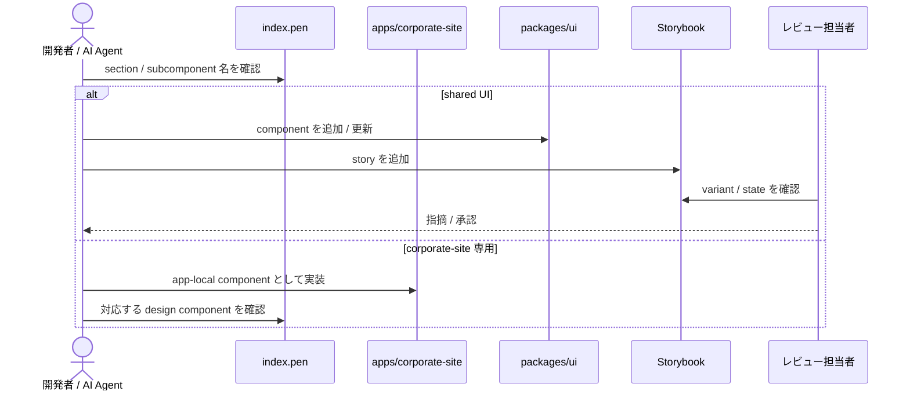

# packages/ui Storybook 導線と Pencil component 粒度整理

> `packages/ui` の Storybook 導線、shared UI review 運用、`design/features/corporate-site/index.pen` の component 粒度整理を定義する spec。

## メタ情報

- Issue: `#6`
- ステータス: `Draft`
- 作成日: 2026-06-18
- 更新日: 2026-06-18
- Branch: `feature/6`
- Owner: Fukuemon

## 設計フェーズ状況

状態は `未着手 / 進行中 / 完了 / レビュー済 / 保留` のいずれか。保留の場合は理由を備考に残す。

| #   | フェーズ                    | 状態       | 最終更新   | 備考                                                                 |
| --- | --------------------------- | ---------- | ---------- | -------------------------------------------------------------------- |
| 1   | 起票                        | 完了       | 2026-06-17 | issue #6 / requirements 作成済み                                     |
| 2   | 下書き                      | 完了       | 2026-06-18 | spec-draft で scaffold                                               |
| 3   | 上位文書突合                | 完了       | 2026-06-18 | Design Doc Why / What / landscape / feature doc / context / ADR 確認 |
| 4   | 論点整理                    | 完了       | 2026-06-18 | D1〜D6 を seed                                                       |
| 5   | 論点解決                    | 完了       | 2026-06-22 | D1〜D11 解決済み (D4 / D7 を 2026-06-22 更新、D11 追加)              |
| 6   | Interface / Routing 設計    | 完了       | 2026-06-18 | Storybook Astro framework / script contract 反映済                   |
| 7   | Content / Data 設計         | 完了       | 2026-06-18 | catalog 範囲・対応表成果物を反映済                                   |
| 8   | Performance / Security 設計 | 完了       | 2026-06-18 | Storybook は production bundle 外                                    |
| 9   | Test / Metrics 設計         | 完了       | 2026-06-18 | Storybook build / review 観点を確定                                  |
| 10  | 実装分割                    | 完了       | 2026-06-18 | D8〜D10 を prompts 生成方針へ反映済                                  |
| 11  | レビュー済                  | レビュー済 | 2026-06-18 | spec-review PASS                                                     |

## 上位文書整合

正本 ([Design Doc `## Why / What`](../../design/DesignDoc.md#why--what) / [Design Doc landscape](../../design/DesignDoc.md) / [feature doc](../../design/features/) / [context](../../context/) / ADR) のどの節と、どう整合させたかを記録する。

- Design Doc Why / What 更新要否: 不要
- Design Doc 更新要否: 不要
- ADR 起票要否: 不要

| 上位文書    | 節 / 該当箇所                                                                                                                   | 整合方針 (継承 / 補足 / 変更提案)                                                                    |
| ----------- | ------------------------------------------------------------------------------------------------------------------------------- | ---------------------------------------------------------------------------------------------------- |
| Design Doc  | Why / What → プロダクト原則「共通化は利用実績に基づく」/ Phase 1 スコープ (`packages/ui` skeleton)                              | 継承 (`packages/ui` を過剰拡張せず、共有 UI review の入口だけを整える)                               |
| Design Doc  | Why / What → Monorepo 要求 / Phase 1 完成条件                                                                                   | 補足 (AI / 開発者が shared UI と app colocation の境界を参照できる状態にする)                        |
| Design Doc  | モジュール責務 → `packages/ui` / `apps/corporate-site` / `packages/config`                                                      | 補足 (`packages/ui` は Storybook catalog、corporate-site 固有 UI は app colocation として整理)       |
| Design Doc  | Non Goals (`packages/ui` の過剰抽象化禁止) / Open Questions (`packages/ui` 本格共有 package への移行条件)                       | 継承 (複数 consumer が明確な component だけを `packages/ui` と Storybook に載せる)                   |
| feature doc | [corporate-site](../../design/features/corporate-site/DesignDoc_corporate-site.md) → 設計方針 / デザイントークン / ブランド指針 | 補足 (`index.pen` の component 粒度を実装 component 名へ写像し、トークン正本は `packages/ui` に保つ) |
| context     | [architecture.md](../../context/architecture.md) Package Boundary / Runtime Boundary                                            | 継承 (UI component は app colocation 第一、表示専用 shadcn は Astro 静的描画、island は最小)         |
| context     | [engineering.md](../../context/engineering.md) Shared Config Boundary / Root Task Boundary                                      | 補足 (Storybook の本格運用ルールを issue #6 で具体化する)                                            |
| context     | [toolchain.md](../../context/toolchain.md) 標準スタック → UI catalog: Storybook                                                 | 継承 (`packages/ui` の UI catalog として Storybook を採用する)                                       |
| context     | [testing.md](../../context/testing.md) テスト責務の分担                                                                         | 補足 (`packages/ui` の共有 UI は Storybook / unit test、公開導線は root E2E の責務に分ける)          |
| context     | [design-workflow.md](../../context/design-workflow.md) §1 / §4 / §8                                                             | 継承 (`.pen` はデザイン意図、`packages/ui` + Storybook は生きた component 正本)                      |
| context     | [component-design.md](../../context/component-design.md)                                                                        | 反映済 (component のディレクトリ構成、命名、Container / Presentation、Storybook 対象の正本)          |
| ADR-0004    | [design-production-workflow](../../adr/0004-design-production-workflow.md)                                                      | 継承 (Pencil をデザイン正本、Storybook を実装 catalog として分離する)                                |
| ADR-0007    | [design-token-architecture](../../adr/0007-design-token-architecture.md)                                                        | 継承 (`tokens.css` / `fonts.css` / `styles.css` の 3 entry と shadcn 語彙を前提にする)               |
| ADR-0008    | [astro-react-island-policy](../../adr/0008-astro-react-island-policy.md)                                                        | 継承 (corporate-site 側で `@kufu/ui` を消費する際は静的描画を既定にする)                             |

> 現時点で上位文書との矛盾は検出していない。Storybook 運用と component 設計の durable な成果は `context/engineering.md` / `context/component-design.md` / README へ反映済み。本 spec の該当節は決定時スナップショットとして扱う。

## 関連資料

- `design/DesignDoc.md` `## Why / What`: プロダクト原則 / Phase 1 スコープ / Monorepo 要求
- `design/DesignDoc.md`: モジュール責務 (`packages/ui`, `apps/corporate-site`, `packages/config`) / Non Goals
- `design/features/corporate-site/DesignDoc_corporate-site.md`: コーポレートサイト設計方針 / デザイントークン / ブランド指針
- `context/architecture.md`: colocation → `packages/ui` 昇格境界 / Astro static rendering 方針
- `context/component-design.md`: component 設計 (ディレクトリ構成 / 命名 / Container-Presentation / Storybook 対象)
- `context/design-workflow.md`: `.pen` と Storybook の正本境界
- `design/features/corporate-site/component-map.md`: `.pen` component 名と実装 component 名の対応表
- `specs/6-storybook-component-catalog/requirements.md`: 要求定義
- 関連 issue / ticket: [#6](https://github.com/Fukuemon/kufu-apps/issues/6)

## 背景

`packages/ui` には shared UI package の skeleton と `Button` があり、`design/features/corporate-site/index.pen` にはコーポレートサイトの画面デザインと component 意図が含まれる。Phase 1 の後続実装では、開発者 / AI Agent が Pencil の section / subcomponent と実装 component の対応を見て作業できる状態が必要になる。

一方で、Design Doc Why / What と landscape は `packages/ui` の過剰抽象化を明確に禁じている。したがって本 spec は「corporate-site 専用 UI をすべて `packages/ui` に上げる」ものではなく、shared UI と app colocation の境界を保ったまま、Storybook を shared UI review の入口として整備する。

## スコープ

### やること

- `packages/ui` に Storybook の起動・build・必要なら preview 導線を追加する
- root / workspace から Storybook に辿れる script contract を必要最小限で追加する
- `apps/corporate-site` に Storybook Astro framework の app-local Storybook 起動・build 導線を追加する
- app-local Storybook に `ServicePillar` / `BusinessFeatureRow` / `ContactInfoRow` の Presentation story を初期掲載し、`.pen` 対応表成果物へ反映する
- shared UI review の運用ルールを `context/` または `packages/ui` README に文書化する
- `design/features/corporate-site/index.pen` の page section 内を実装 component 粒度へ細分化する
- Pencil の `Components` フレームを `GenericComponents` と `CorporateSiteComponents` に分ける
- `GenericComponents` には shadcn/ui に写像しやすい汎用パーツを置く
- `CorporateSiteComponents` には corporate-site 内で再利用する固有 component を置く
- page 固有 section は page 内に保持する
- Storybook catalog 粒度を基礎 component、layout / section component、page-level sample に分けて扱う

### やらないこと

- corporate-site 本体の実装
- CMS など Phase 2 以降の consumer を前提にした `packages/ui` 拡張
- `.pen` を `packages/ui` の生きた component 正本にすること
- Visual regression service の導入
- Storybook を production artifact として配信すること

## 要件の解釈

### 実現したいユーザー価値

- 実装担当者 / AI Agent が Pencil component と実装 component の対応を見て、追加質問なしに実装へ入れる
- デザインシステム保守者が `packages/ui` へ昇格すべき shared UI と corporate-site 内に閉じる UI を切り分けられる
- レビュー担当者が Storybook で shared UI の見た目・状態・利用例を確認できる

### 成功条件

- `pnpm --filter @kufu/ui storybook` と `pnpm storybook:ui` で `packages/ui` Storybook 起動に到達できる
- `pnpm --filter @kufu/corporate-site storybook` と `pnpm storybook:corporate` で app-local Storybook 起動に到達できる
- 初期 shared catalog 対象 component ごとに `Default` story が 1 件以上あり、variant / error / disabled を持つ component は該当 story 名が Storybook catalog に存在する
- corporate-site 専用 section は `packages/ui` へ昇格せず、`apps/corporate-site` への colocation 方針が保たれている
- `design/features/corporate-site/index.pen` の section / subcomponent 名と実装 component 名の対応表が存在し、全行が PascalCase 相当の実装名を持つ
- `.pen` はデザイン意図、Storybook / code は実装 catalog という正本境界が `context/component-design.md` / `context/engineering.md` へリンクされている

### 対象ユーザー / 操作主体

- 開発者 / AI Agent
- デザインシステム保守者
- レビュー担当者

EARS 風で振る舞いを記述する (`<who>` `<trigger>` 時、システムは `<expected behavior>` する)。

- WHEN 開発者が `packages/ui` を確認するとき、システムは `pnpm --filter @kufu/ui storybook` と `pnpm storybook:ui` を実行可能な script として提供する
- WHEN shared UI を追加・変更するとき、システムは対象 component の `Default` story と、variant / error / disabled がある場合の該当 story を Storybook catalog に表示する
- WHEN corporate-site を実装するとき、システムは Pencil 上の section / subcomponent 名と実装 component 名の対応表を提供する
- IF UI が corporate-site 内でしか使われない場合、review checklist は `apps/corporate-site` colocation と判定した記録を残し、`packages/ui` へ昇格しない
- IF UI が複数 app / feature で再利用される場合、review checklist は `packages/ui` 昇格理由を記録し、該当 component の Storybook story を必須にする

## 設計時の論点

設計 / 実装フェーズへ持ち越す残課題を 1 件ずつ管理する。確定したものは「解決済みの論点」へ移す。

| #   | 論点                                                                                                                | 決定候補                                                                                                                            | 決定                                                                                                                                       |
| --- | ------------------------------------------------------------------------------------------------------------------- | ----------------------------------------------------------------------------------------------------------------------------------- | ------------------------------------------------------------------------------------------------------------------------------------------ |
| D1  | Storybook script contract を package のみ (`pnpm --filter @kufu/ui storybook`) に閉じるか、root script も追加するか | a) package scripts のみ / b) root `storybook:ui` を追加 / c) turbo task と root script を両方追加                                   | b) root `storybook:ui` を追加                                                                                                              |
| D2  | Storybook catalog の初期掲載範囲をどこまでにするか                                                                  | a) `Button` のみ / b) GenericComponents 相当の shared 候補まで / c) page-level sample も初期追加                                    | b) GenericComponents 相当の shared 候補まで                                                                                                |
| D3  | corporate-site 専用 component を Storybook に載せるか                                                               | a) 載せない / b) app-local Storybook を別途検討 / c) examples として非公開扱いで載せる                                              | b) `packages/ui` には載せず、`apps/corporate-site` の app-local Storybook を作る                                                           |
| D4  | `design/features/corporate-site/index.pen` の component 分割をどの粒度で確定するか                                  | a) section は page 内保持 + subcomponent 分割 / b) section も Components 化 / c) 実装時に都度判断                                   | a) section は page 文脈を保持し、実装は `components/features/<feature>/` (domain feature 単位、app 名フォルダなし) に集約 ※2026-06-22 更新 |
| D5  | shared UI review doc の置き場所をどこにするか                                                                       | a) `packages/ui/README.md` / b) `context/engineering.md` / c) 両方 (README は手順、context は運用契約)                              | c) 両方 (`context/engineering.md` が運用契約、`packages/ui/README.md` が手順)                                                              |
| D6  | Storybook の test / CI 扱いをどうするか                                                                             | a) `storybook build` を任意確認 / b) package build に含める / c) CI quality gate に含める                                           | c) CI quality gate に含める。ただし production build には混ぜない                                                                          |
| D7  | Container / Presentation と feature component 階層の責務分けをどう設計するか                                        | a) route / container / presentation / primitive の 4 層に分ける / b) 実装時に component ごと判断 / c) Storybook 対象だけ先に決める  | a'') content 層 → section assembly → presentation の 3 階層。`Presentation` suffix 廃止、命名は BCD Design 基準 ※2026-06-22 更新           |
| D8  | app-local Storybook で `.astro` Presentation component をどう表示するか                                             | a) Storybook Astro framework / b) React wrapper で確認 / c) app-local Storybook を後続 issue へ分離                                 | a) Storybook Astro framework (`@storybook-astro/framework`) を Storybook 10 系で採用                                                       |
| D9  | `GenericComponents` 相当 11 件を初期 `packages/ui` catalog に入れる例外理由をどう扱うか                             | a) shadcn primitive / token 検証の例外として明記 / b) `Button` + 実利用分へ縮小 / c) D2 を維持しつつ後続 review で昇格判定          | a) shadcn primitive / token 検証の例外として明記                                                                                           |
| D10 | app-local Storybook の初期掲載 component と `.pen` → 実装 component 対応表の成果物をどう固定するか                  | a) `ServicePillar` / `BusinessFeatureRow` / `ContactInfoRow` に固定 / b) page section も含める / c) 対応表だけ先に作り story は後続 | a') story 初期対象は 3 component に固定し、対応表は page section と subcomponent の両方を含める                                            |
| D11 | content 層 (旧 Container の fixture / static data) の実装方式をどうするか                                           | a) plain `content/<feature>.ts` のみ / b) Astro Content Collections のみ / c) ハイブリッド (性質で選び分け)                         | c) ハイブリッド: plain `content/<feature>.ts` 既定、同形エントリ集合のみ Content Collection ※2026-06-22 決定                               |

## 解決済みの論点

(`spec-resolve` で確定したものをここに移動する)

- **D1 Storybook script contract (2026-06-18 決定): b) root `storybook:ui` を追加**
  - `packages/ui` 側に `storybook` / `storybook:build` を置き、Storybook の責務は package に閉じる。
  - root には `storybook:ui` を追加し、workspace root から `packages/ui` の Storybook 起動へ委譲する。
  - turbo task への組み込みは現時点では採用しない。Storybook は `packages/ui` 単体の開発・レビュー導線であり、全 workspace の標準 build / test task とは分ける。
  - この決定は root から Storybook に辿れる導線を提供しつつ、`packages/ui` の過剰な platform 化を避けるため。
- **D2 Storybook catalog 初期掲載範囲 (2026-06-18 決定): b) GenericComponents 相当の shared 候補まで**
  - issue #6 では Storybook 導線だけでなく、shared component と Storybook catalog の初期セットも作る。
  - 初期掲載範囲は `GenericComponents` 相当の shared 候補 (`Button`, `LinkButton`, `Tag`, `Separator`, `FormField`, `Input`, `Select`, `Textarea`, `DefinitionRow`) までとする。
  - `SectionHeading` は corporate-site の section 文脈を持つため shared catalog から外し、app-local Storybook 対象に寄せる。
  - `Card` は唯一のデザイン実体が corporate-site の category card (`FeaturedCategoryCard`) であり、複数 consumer の実績が無いため shared catalog から外し、app-local Storybook 対象 (`Products/FeaturedCategoryCard`) に寄せる。
  - corporate-site 固有 component (`SectionHeading`, `ServicePillar` など) と page-level sample は初期 catalog に含めない。これらは app colocation とし、D3 / D4 で境界を確定する。
  - `packages/ui` に載せる component は default story を必須とし、主要 variant / state があるものは同じ初期 catalog に含める。
- **D3 corporate-site 専用 component の Storybook (2026-06-18 決定): b) app-local Storybook を作る**
  - corporate-site 専用 component は `packages/ui` Storybook には載せない。
  - `apps/corporate-site` 側にも app-local Storybook を用意し、corporate-site 固有 component を component 単位で確認できるようにする。
  - corporate-site の component 実装では content 層 → section assembly → presentation の責務分割を採用する (詳細は D7)。Storybook 対象は原則 presentation component とする。
  - `packages/ui` Storybook は shared component catalog、`apps/corporate-site` Storybook は feature-local component review として役割を分ける。
  - root `storybook:corporate` は `apps/corporate-site` の app-local Storybook 起動へ委譲する。
  - `.astro` Presentation component の Storybook framework は D8 で確定した Storybook Astro framework (`@storybook-astro/framework`) を Storybook 10 系で使う。
- **D4 `index.pen` component 分割粒度 (2026-06-18 決定 / 2026-06-22 更新): a) section は page 文脈を保持し、実装は domain feature 単位へ集約**
  - Pencil 上では page section (`Hero`, `BusinessSection`, `ProductsCategorySection`, `ContactSection` など) の文脈を残し、section 内の再利用部品を `GenericComponents` / `CorporateSiteComponents` へ分ける。
  - Astro の route entry は `apps/corporate-site/src/pages/` に置く。Astro では Next.js App Router のような nested route / colocated route segment を前提にしない。
  - **(2026-06-22 更新)** 実装 component は colocation + package by feature (VSA) として `apps/corporate-site/src/components/features/<feature>/` 配下に集約する。`<feature>` には **app 名ではなく content domain** (`business`, `products`, `contact`, `services` など) を使い、`features/corporate-site/` のように app 名を繰り返さない。feature 横断の site component は `components/common/` に置く。
  - `pages/*.astro` は routing / page assembly の薄い入口とし、feature component の実体は `components/features/<feature>/` に置く。
  - Container / Presentation の責務、props 境界、Storybook 対象階層は D7 で確定する。content 層の方式は D11 で確定する。
  - 横断正本は [context/component-design.md](../../context/component-design.md)。本記述は決定時スナップショット。
- **D5 shared UI review doc の置き場所 (2026-06-18 決定): c) `context/engineering.md` と `packages/ui/README.md` の両方**
  - `context/engineering.md` を Storybook / shared UI review 運用契約の正本にする。
  - `packages/ui/README.md` には `packages/ui` を触る開発者向けの起動方法、story 追加手順、review checklist へのリンクを置く。
  - 二重管理を避けるため、詳細な判断基準や運用契約は `context/engineering.md` に寄せ、README は手順とリンク中心にする。
  - app-local Storybook の導線は `apps/corporate-site` 側 README または feature doc への同期候補とし、D5 では shared UI review doc の置き場所だけを確定する。
- **D6 Storybook の test / CI 扱い (2026-06-18 決定): c) CI quality gate に含める**
  - `packages/ui` と `apps/corporate-site` の Storybook build は PR / CI の quality gate として確認する。
  - Storybook build は production artifact ではないため、通常の package `build` には混ぜない。
  - CI / quality gate 用の dedicated script を用意し、shared UI catalog と app-local Storybook の破損を PR で検出する。
  - ローカルでは `pnpm --filter @kufu/ui storybook:build` と `pnpm --filter @kufu/corporate-site storybook:build` を個別確認できるようにする。
- **D7 Container / Presentation と feature component 階層 (2026-06-18 決定 / 2026-06-22 更新): a'') content 層 → section assembly → presentation の 3 階層に分け、命名は BCD Design 基準**
  - **(2026-06-22 更新)** 旧決定では component 1 つずつに `<ComponentName>.astro` (Container) + `<ComponentName>Presentation.astro` を作っていたが、静的サイトでは Container が props を素通しするだけの空ラッパーになり、ロジック / UI 分離の目的を満たさなかったため見直した。
  - `apps/corporate-site/src/pages/` は route entry とし、URL / query / path param、layout assembly、feature root component 呼び出しに責務を限定する。
  - **content 層** (`src/content/<feature>.ts` または Content Collection) がデータ / ロジック層。旧 Container が抱えていた fixture / static data の集約先で、CMS / API への seam にする。
  - **section assembly** (`<Feature>Section.astro`) が content を presentation へ束ねる本来の Container 役。粒度は section とし、末端 component ごとには作らない。Storybook の主対象にしない。
  - **presentation** (`<Component>.astro`、`Presentation` suffix は廃止) は props だけで描画できる UI として app-local Storybook の主対象にする。
  - story は `<Component>.stories.*` とし、固定 props / fixture で状態差分を表現する。
  - 命名は BCD Design を基準にし、`Domain + Base` / `Domain + Base + Case` を優先する。Base だけで意味が通る shared primitive は `packages/ui` 側へ置く。
  - section assembly component と `content/<feature>.ts` の実体は page body 実装段階で追加し、catalog 整備段階では presentation + story のみ置く (fixture は story 内)。
  - 詳細ルールは [context/component-design.md](../../context/component-design.md) へ同期済み。同 doc が横断正本であり、本記述は決定時スナップショット。
- **D8 app-local Storybook framework (2026-06-18 決定 / 2026-06-19 更新): a) Storybook Astro framework (`@storybook-astro/framework`) を Storybook 10 系で採用**
  - app-local Storybook は `.astro` Presentation component を直接確認するため、React wrapper ではなく Astro framework を採用する。
  - `apps/corporate-site/.storybook/main.ts` の framework は `@storybook-astro/framework` を前提にする。
  - story は `<Component>.stories.*` (suffix なし) とし、固定 props / fixture で状態差分を表現する。
  - 実装時に `@storybook-astro/framework` が Astro 6 / Storybook 10 の組み合わせで成立しない場合は、React wrapper に逃がさず app-local Storybook を後続 issue へ分離し、未実施理由を PR に残す。
- **D9 GenericComponents 初期 catalog 例外理由 (2026-06-18 決定): a) shadcn primitive / token 検証の例外として明記**
  - `GenericComponents` 相当 11 件は corporate-site 固有 UI ではなく、shadcn 語彙・Kufu token・shared primitive の表示契約を検証するための初期 shared catalog とする。
  - これは Design Doc Why / What / landscape の「複数 consumer が出てから本格共有 package 化する」原則の例外ではなく、`packages/ui` skeleton の review surface を作るための最小初期化である。
  - business wording や page 文脈を持つ component は含めない。domain を持つ component は D10 の app-local Storybook 対象に寄せる。
  - `Select` などインタラクティブ primitive は Storybook で状態確認し、corporate-site 本体で使う場合は ADR-0008 に従って island 化を明示する。
- **D10 app-local 初期掲載 component / 対応表成果物 (2026-06-18 決定): a') story 初期対象は 3 component、対応表は page section と subcomponent の両方**
  - app-local Storybook の初期 story 対象は `ServicePillar`, `BusinessFeatureRow`, `ContactInfoRow` に固定する。
  - page section (`Hero`, `BusinessSection`, `ProductsCategorySection`, `ContactSection` など) は page 文脈を保持し、初期 story 対象には含めない。
  - `.pen` component 対応表は `design/features/corporate-site/index.pen` の page section と subcomponent を、実装予定の presentation component 名へ写像する成果物として残す。
  - 対応表の置き場所は `design/features/corporate-site/component-map.md` とし、`.pen` の生 JSON 差分ではなく人間が review できる表にする。
- **D11 content 層の実装方式 (2026-06-22 決定): ハイブリッド (plain `content/<feature>.ts` 既定 / Content Collection は同形エントリのみ)**
  - content の性質で選び分ける。全面 Content Collections も全面 plain も採らない。
  - singleton / bespoke / 数が固定 / レイアウト密結合の content (Hero コピー、Business feature、Contact info、Services) は plain `content/<feature>.ts`。
  - 同形エントリの集合 (N 件・増減・個別ページ化 / フィルタ / CMS 化候補) の content (`ProductCategory`, `CategoryMakers`) は Astro Content Collection 候補とする。これは Phase 2 で CMS が所有するデータと一致する。
  - Content Collection は実体が必要になった feature だけで `src/content.config.ts` に loader を定義し、全面採用しない。CMS 化時は loader を差し替える。
  - 規約は issue #6 で確定し、Content Collection / section assembly / `content/*.ts` の実体は corporate-site の page body (別 issue / Phase 2) を実装する段階で追加する。catalog 整備段階では空 collection を作らない。
  - 横断正本は [context/component-design.md](../../context/component-design.md) の「Content 層の選び分け」。本記述は決定時スナップショット。

## 未確定事項

(決定できない項目を理由とともに残す。1 件でも残っていれば下流 phase は止める)

- なし。D1〜D10 は解決済み。

## 実装対象

正規 target は `context/project.yml` の対象ドメイン一覧を正本とする。

| モジュール       | 実装有無 | 主な責務                                                            |
| ---------------- | :------: | ------------------------------------------------------------------- |
| `corporate-site` |    ◯     | `.pen` component 粒度整理の consumer。実装本体は別 issue            |
| `cms`            |    -     | Phase 2 以降の consumer。issue #6 では前提にしない                  |
| `ui`             |    ◯     | Storybook 導線、shared UI story、catalog / review 入口              |
| `config`         |    ◯     | 必要な場合のみ Storybook / Vite / TS 設定の共有境界を確認する       |
| `e2e`            |    -     | Storybook 自体は root E2E 対象外。corporate-site 公開導線は別 issue |
| `core`           |    ◯     | docs / workflow 同期のみ。実装コードは持たない                      |

## 機能仕様

> 決定時スナップショット。component 配置・命名・Storybook 対象の横断正本は [context/component-design.md](../../context/component-design.md)、Storybook review / quality gate の正本は [context/engineering.md](../../context/engineering.md) とする。

### User Flow

1. 開発者が `packages/ui` の shared component を追加・変更する
2. 開発者が Storybook story に default / variant / state を追加する
3. レビュー担当者が Storybook で見た目・状態・利用例を確認する
4. component が corporate-site 専用か shared UI かを review で確認する
5. corporate-site 実装担当者が `index.pen` の section / subcomponent 名を参照し、app-local component または `@kufu/ui` component へ写像する

### Reuse Policy

- 第一原則は feature / colocation とする
- 共通化は複数 feature / app をまたぐ再利用が明確になってから行う
- app や feature 内で閉じる UI / utility / asset はローカルに置く
- `packages/ui` に載せる component は Storybook story を持つ
- issue #6 の初期 catalog では、Pencil の `GenericComponents` 相当を shared component 候補として `packages/ui` に実装し、Storybook に掲載する
- `GenericComponents` 相当を初期 catalog に含める理由は、shadcn primitive / token / shared component 表示契約の検証である。business wording や page 文脈を持つ component は含めない
- corporate-site 固有 component と page-level sample は初期 catalog に含めず、app colocation の境界を維持する
- corporate-site 固有 component は `apps/corporate-site` の app-local Storybook に掲載し、`packages/ui` Storybook には載せない
- corporate-site の component は content 層 (`content/<feature>.ts`) → section assembly (`<Feature>Section.astro`) → presentation (`<Component>.astro`、suffix なし) の 3 階層に分け、Storybook では presentation component を主対象にする
- corporate-site 実装は colocation + package by feature (VSA) を採用し、`<feature>` には app 名でなく content domain を使う。route entry (`pages`) と feature component 実体 (`components/features/<feature>`) を分け、feature 横断 component は `components/common/` に置く
- component 命名は BCD Design を基準にし、Domain / Base / Case の意味が読み取れる名前にする
- `.pen` の component はデザイン意図であり、実装正本は `packages/ui` と Storybook、または app-local component とする

### Performance

- Storybook は開発・レビュー用途であり production bundle に含めない
- Storybook build は production build には混ぜず、CI quality gate の dedicated check として扱う
- corporate-site 実装では Astro 静的生成と最小 island 方針を維持する
- 表示専用 UI は `@kufu/ui` の shadcn component を Astro で静的描画し、`client:*` を付けない
- インタラクティブ Radix primitive を使う場合は ADR-0008 に従い island 化を明示する
- `Select` などインタラクティブ primitive は Storybook で状態確認できるようにする。corporate-site 本体で使う場合は ADR-0008 に従って island 化を明示し、静的描画だけで操作可能に見せる実装は禁止する

### Routing / URL State

- 該当なし。Storybook の内部 URL は catalog の navigation として扱い、product routing には影響しない

### Content / Assets

- `design/features/corporate-site/index.pen` は corporate-site のデザイン正本として保持する
- Pencil の `Components` フレームは `GenericComponents` と `CorporateSiteComponents` に分ける
- page 固有 section (`Hero`, `BusinessSection`, `ProductsCategorySection`, `ContactSection` など) は page 内に保持する
- Astro route entry は `apps/corporate-site/src/pages/` に置き、routing / page assembly だけを担わせる
- corporate-site の実装 component は `apps/corporate-site/src/components/features/<feature>/` (domain feature 単位) 配下に集約し、feature 横断 component は `components/common/` に置く
- `index.pen` の page section / subcomponent 名は、`components/features/<feature>/` 配下の presentation component 名へ対応できるように整理する
- `.pen` component 名と実装 component 名の対応表は `design/features/corporate-site/component-map.md` として P4 の成果物に含める
- presentation component は `<Component>.astro` と `<Component>.stories.ts` を `features/<feature>/` 直下に並べる (`Presentation` suffix なし、1 component 1 ディレクトリを強制しない)
- content / fixture は presentation に直書きせず、content 層 (`content/<feature>.ts` または Content Collection) と section assembly に寄せる
- 汎用 component の候補:
  - `Button`
  - `LinkButton`
  - `Tag`
  - `Separator`
  - `FormField`
  - `Input`
  - `Select`
  - `Textarea`
  - `DefinitionRow`
- 上記の汎用 component 候補は issue #6 の初期 shared catalog 対象とする
- corporate-site 固有 component の候補:
  - `SectionHeading`
  - `FeaturedCategoryCard`
  - `ServicePillar`
  - `BusinessFeatureRowMediaRight`
  - `BusinessFeatureRowMediaLeft`
  - `ContactInfoRow`

### UI Reuse

- `packages/ui` には複数 consumer が見込める primitive / shared UI を置く
- issue #6 では `GenericComponents` 相当を初期 shared component として `packages/ui` に置く
- `GenericComponents` 相当は shadcn primitive / token 検証の初期 catalog として扱い、domain を持つ corporate-site 固有 component は app-local Storybook に寄せる
- corporate-site 固有 section / layout component は `apps/corporate-site` に colocation する
- Storybook は `packages/ui` に公開される shared component の生きた catalog とする
- `apps/corporate-site` の app-local Storybook は corporate-site 固有 presentation component の review 入口とする
- `apps/corporate-site/src/pages/` には route entry を置き、feature component の実体は `apps/corporate-site/src/components/features/<feature>/` (domain feature 単位) に置く
- app-local Storybook は presentation component (`<Component>.astro`) を主対象にし、section assembly は story 対象にしない
- page-level sample は、shared component の組み合わせ例としてのみ扱い、corporate-site の page 正本にしない

### React Compiler

- Storybook 導線整備では React Compiler の設定変更を扱わない
- 将来 `apps/cms` や React app consumer が増えた場合は、`packages/ui` component が React Compiler 前提に反しないかを別 spec / ADR で確認する

### Testing

- `packages/ui` の shared UI は Storybook / unit test で確認する
- `apps/corporate-site` の Presentation component は app-local Storybook で確認する
- Storybook の起動・build は package script で確認する
- root からの起動導線は `pnpm storybook:ui` で確認する
- Storybook build は CI quality gate に含めるが、package の production build には混ぜない
- production app の主要導線は root Playwright E2E の責務であり、Storybook に置き換えない
- `.pen` component 粒度整理はレンダリング / スクショ / Pencil 差分のレビューで確認し、生 JSON 差分だけに依存しない

## Interface 設計

> 決定時スナップショット。script / quality gate の正本は [context/project.yml](../../context/project.yml) と [context/engineering.md](../../context/engineering.md)、component 設計の正本は [context/component-design.md](../../context/component-design.md) とする。

### UI / API / Event Interface

Storybook script contract の候補:

| script                | 置き場所                           | 目的                                                       | 備考                                 |
| --------------------- | ---------------------------------- | ---------------------------------------------------------- | ------------------------------------ |
| `storybook`           | `packages/ui/package.json`         | ローカル起動                                               | port は Storybook 既定または明示指定 |
| `storybook:build`     | `packages/ui/package.json`         | 静的 build                                                 | CI quality gate 対象                 |
| `storybook:ui`        | root `package.json`                | workspace root から `packages/ui` Storybook へ委譲         | 採用 (D1)                            |
| `storybook`           | `apps/corporate-site/package.json` | app-local Storybook 起動                                   | `@storybook-astro/framework`         |
| `storybook:build`     | `apps/corporate-site/package.json` | app-local Storybook build                                  | CI quality gate 対象                 |
| `storybook:build`     | root `package.json`                | shared / app-local Storybook build をまとめて実行          | CI quality gate 用                   |
| `storybook:corporate` | root `package.json`                | workspace root から `apps/corporate-site` Storybook へ委譲 | 採用 (D3)                            |

Storybook package version contract:

| 対象                  | package                               | version   | 用途                         |
| --------------------- | ------------------------------------- | --------- | ---------------------------- |
| `packages/ui`         | `storybook` / `@storybook/react-vite` | `^10.4.6` | React 19 + Vite catalog      |
| `apps/corporate-site` | `storybook`                           | `^10.4.6` | app-local Storybook CLI      |
| `apps/corporate-site` | `@storybook-astro/framework`          | `^1.5.0`  | Astro 5/6 component renderer |

Storybook script command contract:

| script                                 | command                                                                                        |
| -------------------------------------- | ---------------------------------------------------------------------------------------------- |
| `@kufu/ui storybook`                   | `storybook dev --host 127.0.0.1 --port 6006`                                                   |
| `@kufu/ui storybook:build`             | `storybook build`                                                                              |
| `@kufu/corporate-site storybook`       | `storybook dev --host 127.0.0.1 --port 6007`                                                   |
| `@kufu/corporate-site storybook:build` | `storybook build`                                                                              |
| root `storybook:ui`                    | `pnpm --filter @kufu/ui storybook`                                                             |
| root `storybook:corporate`             | `pnpm --filter @kufu/corporate-site storybook`                                                 |
| root `storybook:build`                 | `pnpm --filter @kufu/ui storybook:build && pnpm --filter @kufu/corporate-site storybook:build` |

Storybook story 命名の候補:

| 階層                     | 例                              | 内容                                 |
| ------------------------ | ------------------------------- | ------------------------------------ |
| `Primitives/Button`      | `Default`, `Variants`, `AsLink` | shared primitive component           |
| `Primitives/Tag`         | `Default`, `Variants`           | shared primitive component           |
| `Primitives/Separator`   | `Default`                       | shared primitive component           |
| `Foundations/Tokens`     | `Colors`, `Typography`          | token の確認。実装する場合は閲覧専用 |
| `Patterns/FormField`     | `Default`, `Error`, `Disabled`  | shared form pattern                  |
| `Patterns/DefinitionRow` | `Default`                       | shared information row pattern       |
| `Examples/PageSamples`   | -                               | 初期追加しない                       |

corporate-site app-local Storybook の初期掲載範囲:

story title は feature 単位で分類する (`Presentation` suffix は廃止)。

| 階層                            | 例                        | 内容                                     |
| ------------------------------- | ------------------------- | ---------------------------------------- |
| `Common/SectionHeading`         | `Default`, `Center`       | feature 横断 site presentation component |
| `Products/FeaturedCategoryCard` | `Default`, `WithoutCount` | products feature presentation component  |
| `Services/ServicePillar`        | `Default`                 | services feature presentation component  |
| `Business/BusinessFeatureRow`   | `MediaRight`, `MediaLeft` | business feature presentation component  |
| `Contact/ContactInfoRow`        | `Tel`, `Address`          | contact feature presentation component   |

### Props / Request / Response

API request / response は扱わない。component props は実装対象ごとに story と component source を正本とし、本 spec では方針だけを定める。

corporate-site feature component のファイル構成 (正本: [context/component-design.md](../../context/component-design.md)。本節は決定時スナップショット):

```text
apps/corporate-site/src/
├── content/                       # データ / ロジック層 (page body 実装段階で追加)
│   └── <feature>.ts
├── components/
│   ├── features/
│   │   ├── business/
│   │   │   ├── BusinessFeatureRow.astro
│   │   │   └── BusinessFeatureRow.stories.ts
│   │   ├── products/
│   │   │   ├── FeaturedCategoryCard.astro
│   │   │   └── FeaturedCategoryCard.stories.ts
│   │   ├── contact/
│   │   │   ├── ContactInfoRow.astro
│   │   │   └── ContactInfoRow.stories.ts
│   │   └── services/
│   │       ├── ServicePillar.astro
│   │       └── ServicePillar.stories.ts
│   └── common/
│       └── SectionHeading/
│           ├── SectionHeading.astro
│           └── SectionHeading.stories.ts
└── pages/
    └── index.astro
```

責務:

- `src/pages/*.astro`: URL / query / path param、layout assembly、feature root component 呼び出し
- `src/content/<feature>.ts`: content / static data のデータ層。CMS / API への seam (page body 実装段階で追加)
- `<Feature>Section.astro`: section assembly。content を presentation へ束ねる本来の Container 役 (page body 実装段階で追加)
- `<Component>.astro`: presentation component。props だけで描画できる UI。app-local Storybook の主対象
- `packages/ui`: shared primitive / shared pattern。BCD Design の Base / Case + Base 寄りの component

## Content / Data 設計

> 決定時スナップショット。component 配置・Storybook 対象の正本は [context/component-design.md](../../context/component-design.md)、root command の正本は [context/project.yml](../../context/project.yml) とする。

### 保存・管理するデータ

- Storybook story source (`*.stories.*`) は `packages/ui` 内に置く
- Storybook config (`.storybook/*`) は `packages/ui` 内に置く
- `Button`, `LinkButton`, `Tag`, `Separator`, `FormField`, `Input`, `Select`, `Textarea`, `DefinitionRow` は issue #6 の初期 shared catalog 対象として `packages/ui` 内に置く
- `SectionHeading`, `FeaturedCategoryCard` は corporate-site 固有 component として `apps/corporate-site` 内に置く
- `packages/ui` の Storybook config は Storybook 10 + `@storybook/react-vite` を前提に `packages/ui/.storybook/` に置く
- `apps/corporate-site` の Storybook config は Storybook 10 + `@storybook-astro/framework` を前提に `apps/corporate-site/.storybook/` に置く
- corporate-site 固有 presentation component の story source は `apps/corporate-site` 内に置く
- corporate-site 固有 component は presentation (`<Component>.astro`、suffix なし)、データは content 層、束ねは section assembly に分け、presentation は props で描画を完結できる形にする
- route entry は `apps/corporate-site/src/pages/`、feature component は `apps/corporate-site/src/components/features/<feature>/` (domain feature 単位)、横断 component は `components/common/` に分ける
- shared UI review の運用契約は `context/engineering.md`、`packages/ui` の実務手順は `packages/ui/README.md` に置く
- `index.pen` の component 粒度整理は `design/features/corporate-site/index.pen` に反映する
- `.pen` component 名と実装 component 名の対応表は `design/features/corporate-site/component-map.md` に成果物として残す

### コンテンツ配置 / package / route

| 対象                                    | 配置方針                                                               |
| --------------------------------------- | ---------------------------------------------------------------------- |
| Storybook config                        | `packages/ui/.storybook/`                                              |
| shared component stories                | `packages/ui/src/**/*.stories.*` または `packages/ui/src/stories/`     |
| shared component source                 | `packages/ui/src/components/`                                          |
| corporate-site Storybook config         | `apps/corporate-site/.storybook/`                                      |
| corporate-site presentation stories     | `apps/corporate-site/src/**/*.stories.*`                               |
| corporate-site content 層               | `apps/corporate-site/src/content/<feature>.ts` (page body 実装時)      |
| corporate-site route entry              | `apps/corporate-site/src/pages/`                                       |
| corporate-site feature component source | `apps/corporate-site/src/components/features/<feature>/` (+ `common/`) |
| shared UI review contract               | `context/engineering.md`                                               |
| `packages/ui` Storybook 手順            | `packages/ui/README.md`                                                |
| Pencil component 整理                   | `design/features/corporate-site/index.pen`                             |
| `.pen` component 対応表                 | `design/features/corporate-site/component-map.md`                      |

## Performance / Security 設計

### Performance

- Storybook は production artifact ではないため、corporate-site の runtime performance budget には含めない
- `packages/ui` component は Astro 静的描画で使われる可能性があるため、SSR safe であることを前提にする
- Storybook の addon は初期導入を最小にし、不要な依存追加を避ける
- app-local Storybook も production artifact には含めず、corporate-site runtime JS 増加の理由にしない
- Storybook build は dedicated quality gate とし、production build の成果物・時間予算とは分離する

### Security / Privacy

- API / 個人情報 / secret は扱わない
- Storybook に本番 secret や問い合わせフォームの実送信先を入れない
- app-local Storybook の stories は固定 props / fixture を使い、本番 secret や実送信を伴う Container を載せない
- external asset を使う場合は license と出所を PR で確認する

## Error / Fallback 設計

### エラーケース

| #   | ケース                                                             | ユーザーへの見せ方                      | リカバリ                                         |
| --- | ------------------------------------------------------------------ | --------------------------------------- | ------------------------------------------------ |
| 1   | Storybook build が monorepo / Vite 設定で失敗する                  | エラーと必要設定を PR / spec に記録する | package script / config を修正し、build を再実行 |
| 2   | corporate-site 専用 component を `packages/ui` に入れるべきか迷う  | 複数 consumer の有無で判定する          | 専用なら app colocation、再利用確定後に昇格      |
| 3   | Pencil component と実装 component が 1:1 にならない                | 対応表に分割・統合理由を残す            | 実装時に app-local component 名を確定            |
| 4   | Storybook addon / framework 設定が React 19 / workspace と衝突する | 失敗ログと代替設定を記録する            | 最小構成へ戻し、必要 addon は後続で追加          |

### Fallback

- Storybook build がすぐ成立しない場合でも、起動導線と review doc を先に入れ、未実施理由を残す
- `index.pen` の整理が Pencil tooling で困難な場合は、対応表を spec / feature doc に先に残し、`.pen` 反映を後続作業に分ける

## テスト / 評価方針

### テスト観点

- `pnpm --filter @kufu/ui storybook` で Storybook が起動できる
- `pnpm storybook:ui` で root から `packages/ui` Storybook が起動できる
- `pnpm --filter @kufu/ui storybook:build` で静的 build が成功する
- `pnpm --filter @kufu/corporate-site storybook` で app-local Storybook が起動できる
- `pnpm storybook:corporate` で root から app-local Storybook が起動できる
- `pnpm storybook:build` で shared / app-local Storybook build が成功する
- shared component に default / 主要 variant / 必要 state の story がある
- `GenericComponents` 相当の初期 shared component が Storybook catalog に掲載されている
- corporate-site 固有 presentation component が app-local Storybook catalog に掲載されている
- corporate-site 固有 story が presentation component (`<Component>.astro`) を対象にしている
- corporate-site の route entry と feature component が `pages` / `components/features/<feature>` (domain feature 単位、app 名フォルダなし) に分かれている
- `packages/ui` に載せた component が `@kufu/ui` の token / style contract に従っている
- corporate-site 専用 component が `packages/ui` に混入していない
- `design/features/corporate-site/index.pen` の section / subcomponent 名が PascalCase 相当で実装 component 名に写像できる

### 計測指標

- Storybook build success: 100%
- CI Storybook quality gate success: 100%
- shared component story coverage: issue #6 の初期 shared component 1 件につき default story 1 件以上
- corporate-site Presentation story coverage: app-local Presentation component 1 件につき default story 1 件以上
- Direct UI Duplication Count: 共通化すべき UI の app-local 重複 0 件
- Unnecessary Client JS Count: Storybook 追加に起因する corporate-site runtime JS 増加 0 件

## フロー / シーケンス

(`spec-diagrams` で生成。spec の主要操作を Mermaid 図に落とす)

### Flowchart (ユーザー操作起点)


### Sequence



## 実装分割

### 実装タスク案

| Phase | 対象                                       | 概要                                                                                                                                                  | 依存             |
| ----- | ------------------------------------------ | ----------------------------------------------------------------------------------------------------------------------------------------------------- | ---------------- |
| P1    | `packages/ui`                              | Storybook config / package scripts を追加し、GenericComponents 相当の shared component と story を作る                                                | -                |
| P2    | `apps/corporate-site`                      | `@storybook-astro/framework` の app-local Storybook を追加し、`ServicePillar` / `BusinessFeatureRow` / `ContactInfoRow` の Presentation story を作る  | -                |
| P3    | root / docs                                | root `storybook:ui` / `storybook:corporate` / `storybook:build` script、`context/engineering.md` の運用契約、`packages/ui/README.md` の手順を追加する | -                |
| P4    | `design/features/corporate-site/index.pen` | `GenericComponents` / `CorporateSiteComponents` へ分け、section 内を実装粒度に整理し、`component-map.md` に `.pen` → 実装 component 対応表を残す      | D4               |
| P5    | verification                               | shared / app-local Storybook 起動・build、lint / typecheck を確認する                                                                                 | P1〜P4           |
| P6    | sync                                       | durable な運用ルールを `context/component-design.md` / `context/engineering.md` / README へ同期する                                                   | P3 / spec-review |

### prompts 生成方針

- P1: `packages/ui` Storybook 導線と初期 story
- P2: `apps/corporate-site` app-local Storybook と Presentation story
- P3: shared UI review doc と root script contract
- P4: Pencil component 粒度整理と対応表
- P5: 検証 / docs sync

## 上位資料からの変更点

本 spec で Design Doc Why / What / landscape / feature doc / context / 既存 ADR から変更・追加した内容を、反映先別に記録する。`spec-track` / `spec-sync` で更新する。

### Design Doc Why / What への影響

| 対象節 | 変更内容 | 理由                                                           |
| ------ | -------- | -------------------------------------------------------------- |
| なし   | -        | Design Doc Why / What の Phase 1 スコープと Non Goals の範囲内 |

### Design Doc への影響

| 対象節 | 変更内容 | 理由                                                     |
| ------ | -------- | -------------------------------------------------------- |
| なし   | -        | `packages/ui` の skeleton / shared UI 責務の補足に留まる |

### feature doc への影響

| 対象 doc / 節                                                                               | 変更内容                                                               | 理由                                                                          |
| ------------------------------------------------------------------------------------------- | ---------------------------------------------------------------------- | ----------------------------------------------------------------------------- |
| `design/features/corporate-site/DesignDoc_corporate-site.md` / デザイン正本・component 粒度 | 実装後に、Pencil component 粒度整理の durable な方針が必要なら反映候補 | `.pen` の component 名と実装 component 名の対応を長期参照できるようにするため |

### context への影響

| 対象 doc / 節                                                          | 変更内容                                                                                                                                                                                                                                        | 理由                                                                                    |
| ---------------------------------------------------------------------- | ----------------------------------------------------------------------------------------------------------------------------------------------------------------------------------------------------------------------------------------------- | --------------------------------------------------------------------------------------- |
| `context/engineering.md` / Shared Config Boundary                      | 反映済: Storybook / shared UI review 運用契約を追加 <!-- source: spec-resolve D5 -->                                                                                                                                                            | 現在「後続 issue で定義」となっていたため                                               |
| `context/engineering.md` / Repository Quality Gate                     | 反映済: Storybook build を dedicated CI quality gate として扱う方針を追加 <!-- source: spec-resolve D6 -->                                                                                                                                      | Storybook を production build に混ぜず、PR で catalog 破損を検出するため                |
| `context/toolchain.md` / 標準スタック                                  | 反映済: UI catalog の備考に `packages/ui` と app-local Storybook の入口を明記 <!-- source: spec-resolve D8 -->                                                                                                                                  | app-local Storybook も Storybook Astro framework で扱うため                             |
| `packages/ui/README.md`                                                | 反映済: `packages/ui` Storybook の起動方法・story 追加手順・review checklist へのリンクを追加 <!-- source: spec-resolve D5 -->                                                                                                                  | `packages/ui` を触る開発者が手順へ到達しやすくするため                                  |
| `context/project.yml` / Quick Commands                                 | 反映済: `pnpm storybook:ui` / `pnpm storybook:corporate` / `pnpm storybook:build` を追加 <!-- source: spec-resolve D1 / D3 / D6 -->                                                                                                             | root から Storybook に辿れる導線を正本化するため                                        |
| `context/architecture.md` / デザインシステム資産の正本と昇格境界       | 反映済: issue #6 では GenericComponents 相当を初期 shared component として扱う <!-- source: spec-resolve D2 -->                                                                                                                                 | Storybook catalog と `packages/ui` の初期 shared component 範囲を明確にするため         |
| `context/architecture.md` / Package Boundary                           | 反映済: 詳細な component 設計は `context/component-design.md` に委譲する方針を追加 <!-- source: spec-resolve D3 / D4 / D7 -->                                                                                                                   | architecture.md に詳細を抱え込まず、境界規約と component 設計規約を分けるため           |
| `context/component-design.md` / 新規                                   | 反映済: BCD Design 基準の命名、content 層 → section assembly → presentation の責務分割、domain feature 配置、Storybook 対象の横断規約を追加 <!-- source: spec-resolve D7 -->                                                                    | component 設計 (ディレクトリ構成・命名規則・責務) を横断 context として長期参照するため |
| `context/component-design.md` / ディレクトリ構成・責務分割・Content 層 | 反映済: `features/<app名>` の冗長を廃し domain feature 単位へ、`Presentation` suffix 廃止、空 Container を section assembly + content 層へ置換、content 層のハイブリッド選び分けを追加 <!-- source: spec-resolve D4 / D7 / D11 (2026-06-22) --> | 静的サイトで Container が空ラッパー化していた問題と feature 名の冗長を解消するため      |
| `apps/corporate-site/README.md`                                        | 反映済: app-local component 配置と Storybook 導線を追加 <!-- source: spec-resolve D3 / D7 -->                                                                                                                                                   | corporate-site 実装者が app-local component 規約へ到達しやすくするため                  |
| `design/features/corporate-site/component-map.md`                      | 反映済: `.pen` page section / GenericComponents / CorporateSiteComponents と実装 component 名の対応表を追加 <!-- source: spec-resolve D10 -->                                                                                                   | `.pen` component 名と実装 component 名の写像を人間が review できる成果物として残すため  |
| `context/design-workflow.md` / Phase C 実装出力 path                   | 反映済: component 配置を `src/components/features/<feature>/` へ更新 <!-- source: spec-review 対応 -->                                                                                                                                          | `context/component-design.md` と spec #6 の feature component 配置に合わせるため        |

### ADR の新規 / 更新

| ADR ID   | 変更内容                                                                                                                                                                            | 理由                                                                                                          |
| -------- | ----------------------------------------------------------------------------------------------------------------------------------------------------------------------------------- | ------------------------------------------------------------------------------------------------------------- |
| ADR-0007 | 反映済: 「更新 (2026-06-22)」節を追加。corporate-site に lean app-local Tailwind v4 entry を採用し、5 component を scoped CSS → Tailwind utility へ移行 <!-- source: 2026-06-22 --> | 決定 2 / 5 の「utility 提供は #10 の実需に応じて / spacing は Tailwind 標準」を #6 component で具体化したため |
| その他   | -                                                                                                                                                                                   | 既存 ADR-0004 / 0008 は運用具体化のみ                                                                         |

## レビュー

`spec-review` (fresh-context evaluator) の最新結果。完全な記録は `review.md` を参照。

| 日付       | 結果 (PASS / NEEDS_WORK) | 指摘要点                                                                           | 対応                             |
| ---------- | ------------------------ | ---------------------------------------------------------------------------------- | -------------------------------- |
| 2026-06-18 | NEEDS_WORK               | 正本境界、D7 同期状態、app-local Storybook スコープ、phase 状態表、EARS 観測可能性 | D8〜D10 解決済み。再 review 待ち |
| 2026-06-18 | PASS                     | rubric 7 観点すべて PASS。prompts は N/A                                           | 次 phase へ進行可                |
|            |                          |                                                                                    |                                  |

## 変更履歴

| 日付       | 変更者 | 変更内容                                                                                                                                                                                                                                                                             |
| ---------- | ------ | ------------------------------------------------------------------------------------------------------------------------------------------------------------------------------------------------------------------------------------------------------------------------------------ |
| 2026-06-18 | Codex  | 初版 scaffold                                                                                                                                                                                                                                                                        |
| 2026-06-22 | Claude | D4 / D7 を更新し D11 を追加。`features/<app名>` の冗長を domain feature 単位へ、`Presentation` suffix を廃止、空 Container を section assembly + content 層へ置換。content 層のハイブリッド方針を確定し、既存 5 component を新構成へ移設、component-map / component-design.md を同期 |
| 2026-06-22 | Claude | corporate-site に lean app-local Tailwind v4 を導入し、5 component を scoped CSS → Tailwind utility へ移行 (.pen と照合)。ADR-0007 に「更新」節、component-design.md に「スタイリング」節、README / astro.config / .storybook を追従                                                 |

## 備考

- Appendix は初期挿入しない。API endpoint / DB / 認可は対象外。画面 component tree と data-testid は corporate-site 本体実装側の spec で扱う。
