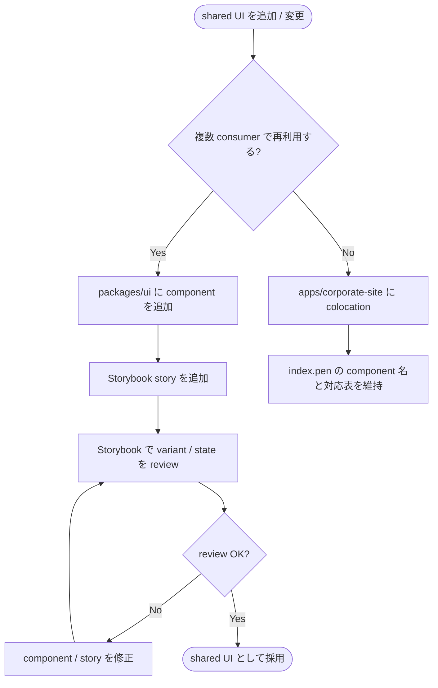
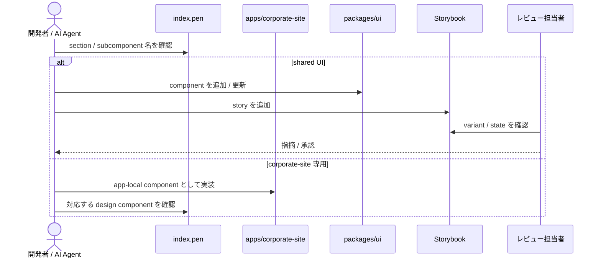

# packages/ui Storybook 導線と Pencil component 粒度整理

> `packages/ui` の Storybook 導線、shared UI review 運用、`design/features/corporate-site/index.pen` の component 粒度整理を定義する spec。

## メタ情報

- Issue: `#6`
- ステータス: `Draft`
- 作成日: 2026-06-18
- 更新日: 2026-06-18
- Branch: `feature/6`
- Owner: Fukuemon

## 設計フェーズ状況

状態は `未着手 / 進行中 / 完了 / レビュー済 / 保留` のいずれか。保留の場合は理由を備考に残す。

| #   | フェーズ                    | 状態   | 最終更新   | 備考                                                |
| --- | --------------------------- | ------ | ---------- | --------------------------------------------------- |
| 1   | 起票                        | 完了   | 2026-06-17 | issue #6 / requirements 作成済み                    |
| 2   | 下書き                      | 完了   | 2026-06-18 | spec-draft で scaffold                              |
| 3   | 上位文書突合                | 完了   | 2026-06-18 | PRD / Design Doc / feature doc / context / ADR 確認 |
| 4   | 論点整理                    | 完了   | 2026-06-18 | D1〜D6 を seed                                      |
| 5   | 論点解決                    | 未着手 |            | spec-resolve で進める                               |
| 6   | Interface / Routing 設計    | 未着手 |            | Storybook script / catalog 入口を確定する           |
| 7   | Content / Data 設計         | 未着手 |            | `.pen` component 名 / 対応表を確定する              |
| 8   | Performance / Security 設計 | 未着手 |            | Storybook は production bundle 外                   |
| 9   | Test / Metrics 設計         | 未着手 |            | Storybook build / review 観点を確定する             |
| 10  | 実装分割                    | 未着手 |            | prompts 生成前に分割する                            |
| 11  | レビュー済                  | 未着手 |            | spec-review 未実施                                  |

## 上位文書整合

正本 ([PRD](../../PRD.md) / [Design Doc](../../design/DesignDoc.md) / [feature doc](../../design/features/) / [context](../../context/) / ADR) のどの節と、どう整合させたかを記録する。

- PRD 更新要否: 不要
- Design Doc 更新要否: 不要
- ADR 起票要否: 不要

| 上位文書    | 節 / 該当箇所                                                                                                                   | 整合方針 (継承 / 補足 / 変更提案)                                                                    |
| ----------- | ------------------------------------------------------------------------------------------------------------------------------- | ---------------------------------------------------------------------------------------------------- |
| PRD         | プロダクト原則「共通化は利用実績に基づく」/ Phase 1 スコープ (`packages/ui` skeleton)                                           | 継承 (`packages/ui` を過剰拡張せず、共有 UI review の入口だけを整える)                               |
| PRD         | Monorepo 要求 / Phase 1 完成条件                                                                                                | 補足 (AI / 開発者が shared UI と app colocation の境界を参照できる状態にする)                        |
| Design Doc  | モジュール責務 → `packages/ui` / `apps/corporate-site` / `packages/config`                                                      | 補足 (`packages/ui` は Storybook catalog、corporate-site 固有 UI は app colocation として整理)       |
| Design Doc  | Non Goals (`packages/ui` の過剰抽象化禁止) / Open Questions (`packages/ui` 本格共有 package への移行条件)                       | 継承 (複数 consumer が明確な component だけを `packages/ui` と Storybook に載せる)                   |
| feature doc | [corporate-site](../../design/features/corporate-site/DesignDoc_corporate-site.md) → 設計方針 / デザイントークン / ブランド指針 | 補足 (`index.pen` の component 粒度を実装 component 名へ写像し、トークン正本は `packages/ui` に保つ) |
| context     | [architecture.md](../../context/architecture.md) Package Boundary / Runtime Boundary                                            | 継承 (UI component は app colocation 第一、表示専用 shadcn は Astro 静的描画、island は最小)         |
| context     | [engineering.md](../../context/engineering.md) Shared Config Boundary / Root Task Boundary                                      | 補足 (Storybook の本格運用ルールを issue #6 で具体化する)                                            |
| context     | [toolchain.md](../../context/toolchain.md) 標準スタック → UI catalog: Storybook                                                 | 継承 (`packages/ui` の UI catalog として Storybook を採用する)                                       |
| context     | [testing.md](../../context/testing.md) テスト責務の分担                                                                         | 補足 (`packages/ui` の共有 UI は Storybook / unit test、公開導線は root E2E の責務に分ける)          |
| context     | [design-workflow.md](../../context/design-workflow.md) §1 / §4 / §8                                                             | 継承 (`.pen` はデザイン意図、`packages/ui` + Storybook は生きた component 正本)                      |
| ADR-0004    | [design-production-workflow](../../adr/0004-design-production-workflow.md)                                                      | 継承 (Pencil をデザイン正本、Storybook を実装 catalog として分離する)                                |
| ADR-0007    | [design-token-architecture](../../adr/0007-design-token-architecture.md)                                                        | 継承 (`tokens.css` / `fonts.css` / `styles.css` の 3 entry と shadcn 語彙を前提にする)               |
| ADR-0008    | [astro-react-island-policy](../../adr/0008-astro-react-island-policy.md)                                                        | 継承 (corporate-site 側で `@kufu/ui` を消費する際は静的描画を既定にする)                             |

> 現時点で上位文書との矛盾は検出していない。Storybook 運用の durable な成果は、実装後に `context/engineering.md` または `packages/ui` README へ同期する候補として扱う。

## 関連資料

- `PRD.md`: プロダクト原則 / Phase 1 スコープ / Monorepo 要求
- `design/DesignDoc.md`: モジュール責務 (`packages/ui`, `apps/corporate-site`, `packages/config`) / Non Goals
- `design/features/corporate-site/DesignDoc_corporate-site.md`: コーポレートサイト設計方針 / デザイントークン / ブランド指針
- `context/architecture.md`: colocation → `packages/ui` 昇格境界 / Astro static rendering 方針
- `context/design-workflow.md`: `.pen` と Storybook の正本境界
- `specs/6-storybook-component-catalog/requirements.md`: 要求定義
- 関連 issue / ticket: [#6](https://github.com/Fukuemon/kufu-apps/issues/6)

## 背景

`packages/ui` には shared UI package の skeleton と `Button` があり、`design/features/corporate-site/index.pen` にはコーポレートサイトの画面デザインと component 意図が含まれる。Phase 1 の後続実装では、開発者 / AI Agent が Pencil の section / subcomponent と実装 component の対応を見て作業できる状態が必要になる。

一方で、PRD と Design Doc は `packages/ui` の過剰抽象化を明確に禁じている。したがって本 spec は「corporate-site 専用 UI をすべて `packages/ui` に上げる」ものではなく、shared UI と app colocation の境界を保ったまま、Storybook を shared UI review の入口として整備する。

## スコープ

### やること

- `packages/ui` に Storybook の起動・build・必要なら preview 導線を追加する
- root / workspace から Storybook に辿れる script contract を必要最小限で追加する
- shared UI review の運用ルールを `context/` または `packages/ui` README に文書化する
- `design/features/corporate-site/index.pen` の page section 内を実装 component 粒度へ細分化する
- Pencil の `Components` フレームを `GenericComponents` と `CorporateSiteComponents` に分ける
- `GenericComponents` には shadcn/ui に写像しやすい汎用パーツを置く
- `CorporateSiteComponents` には corporate-site 内で再利用する固有 component を置く
- page 固有 section は page 内に保持する
- Storybook catalog 粒度を基礎 component、layout / section component、page-level sample に分けて扱う

### やらないこと

- corporate-site 本体の実装
- CMS など Phase 2 以降の consumer を前提にした `packages/ui` 拡張
- `.pen` を `packages/ui` の生きた component 正本にすること
- Visual regression service の導入
- Storybook を production artifact として配信すること

## 要件の解釈

### 実現したいユーザー価値

- 実装担当者 / AI Agent が Pencil component と実装 component の対応を見て、追加質問なしに実装へ入れる
- デザインシステム保守者が `packages/ui` へ昇格すべき shared UI と corporate-site 内に閉じる UI を切り分けられる
- レビュー担当者が Storybook で shared UI の見た目・状態・利用例を確認できる

### 成功条件

- `packages/ui` の Storybook を package 起点で起動できる
- root / workspace から Storybook task に辿れる
- shared component には主要 variant / state の story がある
- corporate-site 専用 section は `packages/ui` へ昇格せず、`apps/corporate-site` への colocation 方針が保たれている
- `design/features/corporate-site/index.pen` の section / subcomponent 名が実装 component 名へ写像できる
- `.pen` の component はデザイン意図、Storybook は実装 catalog という正本境界が文書化されている

### 対象ユーザー / 操作主体

- 開発者 / AI Agent
- デザインシステム保守者
- レビュー担当者

EARS 風で振る舞いを記述する (`<who>` `<trigger>` 時、システムは `<expected behavior>` する)。

- WHEN 開発者が `packages/ui` を確認するとき、システムは Storybook の起動導線を提供する
- WHEN shared UI を追加・変更するとき、システムは Storybook story で主要 variant / state を確認できる
- WHEN corporate-site を実装するとき、Pencil 上の section / subcomponent 名は実装 component 名と対応する
- IF UI が corporate-site 内でしか使われない場合、実装者は `apps/corporate-site` に colocation し、`packages/ui` へ昇格しない
- IF UI が複数 app / feature で再利用される場合、実装者は `packages/ui` へ昇格し、Storybook story を追加する

## 設計時の論点

設計 / 実装フェーズへ持ち越す残課題を 1 件ずつ管理する。確定したものは「解決済みの論点」へ移す。

| #   | 論点                                                                                                                | 決定候補                                                                                               | 決定 |
| --- | ------------------------------------------------------------------------------------------------------------------- | ------------------------------------------------------------------------------------------------------ | ---- |
| D1  | Storybook script contract を package のみ (`pnpm --filter @kufu/ui storybook`) に閉じるか、root script も追加するか | a) package scripts のみ / b) root `storybook:ui` を追加 / c) turbo task と root script を両方追加      | 未決 |
| D2  | Storybook catalog の初期掲載範囲をどこまでにするか                                                                  | a) `Button` のみ / b) GenericComponents 相当の shared 候補まで / c) page-level sample も初期追加       | 未決 |
| D3  | corporate-site 専用 component を Storybook に載せるか                                                               | a) 載せない / b) app-local Storybook を別途検討 / c) examples として非公開扱いで載せる                 | 未決 |
| D4  | `design/features/corporate-site/index.pen` の component 分割をどの粒度で確定するか                                  | a) section は page 内保持 + subcomponent 分割 / b) section も Components 化 / c) 実装時に都度判断      | 未決 |
| D5  | shared UI review doc の置き場所をどこにするか                                                                       | a) `packages/ui/README.md` / b) `context/engineering.md` / c) 両方 (README は手順、context は運用契約) | 未決 |
| D6  | Storybook の test / CI 扱いをどうするか                                                                             | a) `storybook build` を任意確認 / b) package build に含める / c) CI quality gate に含める              | 未決 |

## 解決済みの論点

(`spec-resolve` で確定したものをここに移動する)

- なし

## 未確定事項

(決定できない項目を理由とともに残す。1 件でも残っていれば下流 phase は止める)

- D1〜D6 が未解決。次に `spec-resolve` で 1 件ずつ確定する。

## 実装対象

正規 target は `context/project.md` の対象ドメイン一覧を正本とする。

| モジュール       | 実装有無 | 主な責務                                                            |
| ---------------- | :------: | ------------------------------------------------------------------- |
| `corporate-site` |    ◯     | `.pen` component 粒度整理の consumer。実装本体は別 issue            |
| `cms`            |    -     | Phase 2 以降の consumer。issue #6 では前提にしない                  |
| `ui`             |    ◯     | Storybook 導線、shared UI story、catalog / review 入口              |
| `config`         |    ◯     | 必要な場合のみ Storybook / Vite / TS 設定の共有境界を確認する       |
| `e2e`            |    -     | Storybook 自体は root E2E 対象外。corporate-site 公開導線は別 issue |
| `core`           |    -     | docs / workflow のみ。実装コードは持たない                          |

## 機能仕様

### User Flow

1. 開発者が `packages/ui` の shared component を追加・変更する
2. 開発者が Storybook story に default / variant / state を追加する
3. レビュー担当者が Storybook で見た目・状態・利用例を確認する
4. component が corporate-site 専用か shared UI かを review で確認する
5. corporate-site 実装担当者が `index.pen` の section / subcomponent 名を参照し、app-local component または `@kufu/ui` component へ写像する

### Reuse Policy

- 第一原則は feature / colocation とする
- 共通化は複数 feature / app をまたぐ再利用が明確になってから行う
- app や feature 内で閉じる UI / utility / asset はローカルに置く
- `packages/ui` に載せる component は Storybook story を持つ
- `.pen` の component はデザイン意図であり、実装正本は `packages/ui` と Storybook、または app-local component とする

### Performance

- Storybook は開発・レビュー用途であり production bundle に含めない
- corporate-site 実装では Astro 静的生成と最小 island 方針を維持する
- 表示専用 UI は `@kufu/ui` の shadcn component を Astro で静的描画し、`client:*` を付けない
- インタラクティブ Radix primitive を使う場合は ADR-0008 に従い island 化を明示する

### Routing / URL State

- 該当なし。Storybook の内部 URL は catalog の navigation として扱い、product routing には影響しない

### Content / Assets

- `design/features/corporate-site/index.pen` は corporate-site のデザイン正本として保持する
- Pencil の `Components` フレームは `GenericComponents` と `CorporateSiteComponents` に分ける
- page 固有 section (`Hero`, `BusinessSection`, `ProductsCategorySection`, `ContactSection` など) は page 内に保持する
- 汎用 component の候補:
  - `Button`
  - `LinkButton`
  - `Tag`
  - `SectionHeading`
  - `Card`
  - `Separator`
  - `FormField`
  - `Input`
  - `Select`
  - `Textarea`
  - `DefinitionRow`
- corporate-site 固有 component の候補:
  - `ServicePillar`
  - `BusinessFeatureRowMediaRight`
  - `BusinessFeatureRowMediaLeft`
  - `ContactInfoRow`

### UI Reuse

- `packages/ui` には複数 consumer が見込める primitive / shared UI を置く
- corporate-site 固有 section / layout component は `apps/corporate-site` に colocation する
- Storybook は `packages/ui` に公開される shared component の生きた catalog とする
- page-level sample は、shared component の組み合わせ例としてのみ扱い、corporate-site の page 正本にしない

### React Compiler

- Storybook 導線整備では React Compiler の設定変更を扱わない
- 将来 `apps/cms` や React app consumer が増えた場合は、`packages/ui` component が React Compiler 前提に反しないかを別 spec / ADR で確認する

### Testing

- `packages/ui` の shared UI は Storybook / unit test で確認する
- Storybook の起動・build は package script で確認する
- production app の主要導線は root Playwright E2E の責務であり、Storybook に置き換えない
- `.pen` component 粒度整理はレンダリング / スクショ / Pencil 差分のレビューで確認し、生 JSON 差分だけに依存しない

## Interface 設計

### UI / API / Event Interface

Storybook script contract の候補:

| script            | 置き場所                   | 目的                      | 備考                                 |
| ----------------- | -------------------------- | ------------------------- | ------------------------------------ |
| `storybook`       | `packages/ui/package.json` | ローカル起動              | port は Storybook 既定または明示指定 |
| `storybook:build` | `packages/ui/package.json` | 静的 build                | CI / review 前確認の候補             |
| `storybook:ui`    | root `package.json`        | workspace root からの委譲 | D1 で採否を確定                      |

Storybook story 命名の候補:

| 階層                   | 例                              | 内容                                                 |
| ---------------------- | ------------------------------- | ---------------------------------------------------- |
| `Primitives/Button`    | `Default`, `Variants`, `AsLink` | shared primitive component                           |
| `Foundations/Tokens`   | `Colors`, `Typography`          | token の確認。実装する場合は閲覧専用                 |
| `Patterns/FormField`   | `Default`, `Error`, `Disabled`  | shared pattern component                             |
| `Examples/PageSamples` | `CorporateCTA`                  | shared component の組み合わせ例。page 正本にはしない |

### Props / Request / Response

API request / response は扱わない。component props は実装対象ごとに story と component source を正本とし、本 spec では方針だけを定める。

## Content / Data 設計

### 保存・管理するデータ

- Storybook story source (`*.stories.*`) は `packages/ui` 内に置く
- Storybook config (`.storybook/*`) は `packages/ui` 内に置く
- shared UI review doc は D5 で置き場所を決める
- `index.pen` の component 粒度整理は `design/features/corporate-site/index.pen` に反映する

### コンテンツ配置 / package / route

| 対象                     | 配置方針                                                           |
| ------------------------ | ------------------------------------------------------------------ |
| Storybook config         | `packages/ui/.storybook/`                                          |
| shared component stories | `packages/ui/src/**/*.stories.*` または `packages/ui/src/stories/` |
| UI review doc            | D5 で確定                                                          |
| Pencil component 整理    | `design/features/corporate-site/index.pen`                         |

## Performance / Security 設計

### Performance

- Storybook は production artifact ではないため、corporate-site の runtime performance budget には含めない
- `packages/ui` component は Astro 静的描画で使われる可能性があるため、SSR safe であることを前提にする
- Storybook の addon は初期導入を最小にし、不要な依存追加を避ける

### Security / Privacy

- API / 個人情報 / secret は扱わない
- Storybook に本番 secret や問い合わせフォームの実送信先を入れない
- external asset を使う場合は license と出所を PR で確認する

## Error / Fallback 設計

### エラーケース

| #   | ケース                                                             | ユーザーへの見せ方                      | リカバリ                                         |
| --- | ------------------------------------------------------------------ | --------------------------------------- | ------------------------------------------------ |
| 1   | Storybook build が monorepo / Vite 設定で失敗する                  | エラーと必要設定を PR / spec に記録する | package script / config を修正し、build を再実行 |
| 2   | corporate-site 専用 component を `packages/ui` に入れるべきか迷う  | 複数 consumer の有無で判定する          | 専用なら app colocation、再利用確定後に昇格      |
| 3   | Pencil component と実装 component が 1:1 にならない                | 対応表に分割・統合理由を残す            | 実装時に app-local component 名を確定            |
| 4   | Storybook addon / framework 設定が React 19 / workspace と衝突する | 失敗ログと代替設定を記録する            | 最小構成へ戻し、必要 addon は後続で追加          |

### Fallback

- Storybook build がすぐ成立しない場合でも、起動導線と review doc を先に入れ、未実施理由を残す
- `index.pen` の整理が Pencil tooling で困難な場合は、対応表を spec / feature doc に先に残し、`.pen` 反映を後続作業に分ける

## テスト / 評価方針

### テスト観点

- `pnpm --filter @kufu/ui storybook` で Storybook が起動できる
- `pnpm --filter @kufu/ui storybook:build` で静的 build が成功する
- shared component に default / 主要 variant / 必要 state の story がある
- `packages/ui` に載せた component が `@kufu/ui` の token / style contract に従っている
- corporate-site 専用 component が `packages/ui` に混入していない
- `design/features/corporate-site/index.pen` の section / subcomponent 名が PascalCase 相当で実装 component 名に写像できる

### 計測指標

- Storybook build success: 100%
- shared component story coverage: shared component 1 件につき default story 1 件以上
- Direct UI Duplication Count: 共通化すべき UI の app-local 重複 0 件
- Unnecessary Client JS Count: Storybook 追加に起因する corporate-site runtime JS 増加 0 件

## フロー / シーケンス

(`spec-diagrams` で生成。spec の主要操作を Mermaid 図に落とす)

### Flowchart (ユーザー操作起点)

### Sequence

## 実装分割

### 実装タスク案

| Phase | 対象                                       | 概要                                                                                   | 依存             |
| ----- | ------------------------------------------ | -------------------------------------------------------------------------------------- | ---------------- |
| P1    | `packages/ui`                              | Storybook config / package scripts を追加し、`Button` story を最小構成で作る           | D1 / D2          |
| P2    | root / docs                                | root script contract と shared UI review doc を追加する                                | D1 / D5          |
| P3    | `design/features/corporate-site/index.pen` | `GenericComponents` / `CorporateSiteComponents` へ分け、section 内を実装粒度に整理する | D4               |
| P4    | verification                               | Storybook 起動 / build、lint / typecheck を確認する                                    | P1〜P3           |
| P5    | sync                                       | durable な運用ルールを context / README へ同期する                                     | P2 / spec-review |

### prompts 生成方針

- P1: `packages/ui` Storybook 導線と初期 story
- P2: shared UI review doc と root script contract
- P3: Pencil component 粒度整理と対応表
- P4: 検証 / docs sync

## 上位資料からの変更点

本 spec で PRD / Design Doc / feature doc / context / 既存 ADR から変更・追加した内容を、反映先別に記録する。`spec-track` / `spec-sync` で更新する。

### PRD への影響

| 対象節 | 変更内容 | 理由                                         |
| ------ | -------- | -------------------------------------------- |
| なし   | -        | PRD の Phase 1 スコープと Non Goals の範囲内 |

### Design Doc への影響

| 対象節 | 変更内容 | 理由                                                     |
| ------ | -------- | -------------------------------------------------------- |
| なし   | -        | `packages/ui` の skeleton / shared UI 責務の補足に留まる |

### feature doc への影響

| 対象 doc / 節                                                                               | 変更内容                                                               | 理由                                                                          |
| ------------------------------------------------------------------------------------------- | ---------------------------------------------------------------------- | ----------------------------------------------------------------------------- |
| `design/features/corporate-site/DesignDoc_corporate-site.md` / デザイン正本・component 粒度 | 実装後に、Pencil component 粒度整理の durable な方針が必要なら反映候補 | `.pen` の component 名と実装 component 名の対応を長期参照できるようにするため |

### context への影響

| 対象 doc / 節                                        | 変更内容                                                                     | 理由                                                 |
| ---------------------------------------------------- | ---------------------------------------------------------------------------- | ---------------------------------------------------- |
| `context/engineering.md` / Shared Config Boundary    | Storybook 本格運用ルールを実装後に同期する候補                               | 現在「後続 issue で定義」となっているため            |
| `context/design-workflow.md` / §8 既知の課題と緩和策 | 原則は既存記述と整合。必要なら Storybook review doc へのリンクを追加する候補 | `.pen` と Storybook の正本境界を参照しやすくするため |

### ADR の新規 / 更新

| ADR ID | 変更内容 | 理由                                                                 |
| ------ | -------- | -------------------------------------------------------------------- |
| なし   | -        | 新しい長期技術判断ではなく、既存 ADR-0004 / 0007 / 0008 の運用具体化 |

## レビュー

`spec-review` (fresh-context evaluator) の最新結果。完全な記録は `review.md` を参照。

| 日付 | 結果 (PASS / NEEDS_WORK) | 指摘要点 | 対応 |
| ---- | ------------------------ | -------- | ---- |
|      |                          |          |      |

## 変更履歴

| 日付       | 変更者 | 変更内容      |
| ---------- | ------ | ------------- |
| 2026-06-18 | Codex  | 初版 scaffold |

## 備考

- Appendix は初期挿入しない。API endpoint / DB / 認可は対象外。画面 component tree と data-testid は corporate-site 本体実装側の spec で扱う。
