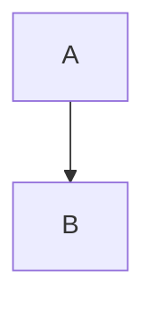

# Feature 設計: <feature 名>

> 最終更新: YYYY-MM-DD / Status: 未着手 | 進行中 | 完了 | 保留

Feature 単位の設計 doc。仕様 (What) をどう実現するか (How) を、データ構造・画面・フロー単位で記述する。全体像は [design/DesignDoc.md](../DesignDoc.md)、横断規約は [context/](../../context/) を参照する。

## メタ

| 項目           | 値                                                      |
| -------------- | ------------------------------------------------------- |
| 関連 PRD 要求  | <PRD.md の該当節 / 要求>                                |
| 関連 DesignDoc | <design/DesignDoc.md の該当節>                          |
| 関連 context   | <context/\*.md の該当ファイル>                          |
| 関連 ADR       | <adr/NNNN-\*.md>                                        |
| 関連 spec      | <specs/<issue>-<slug>/>                                 |
| 対象モジュール | <corporate-site / cms / ui / config / e2e / future-api> |

## 背景・要件解釈

- なぜこの feature が必要か (PRD の Why からの落とし込み)。
- 本設計が満たすべき What (要求・成功条件)。

## スコープ

### やること

-

### やらないこと

-

## 設計

### データ構造 / コンテンツモデル

-

### 画面・デザイン

-

### フロー / シーケンス

## 主要ユースケース

1.

## テスト観点

- 横断規約は [context/testing.md](../../context/testing.md)。本 feature 固有の観点を記す。
-

## 上位資料からの変更点

| 対象資料  | 変更種別 (継承 / 追記 / 変更提案) | 内容 |
| --------- | --------------------------------- | ---- |
| PRD       |                                   |      |
| DesignDoc |                                   |      |
| context   |                                   |      |
| ADR       |                                   |      |
